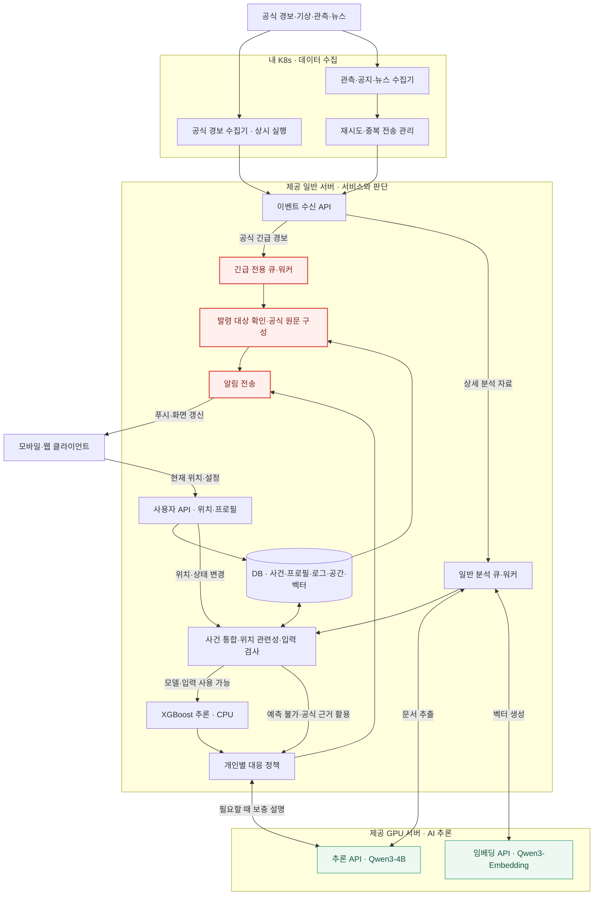
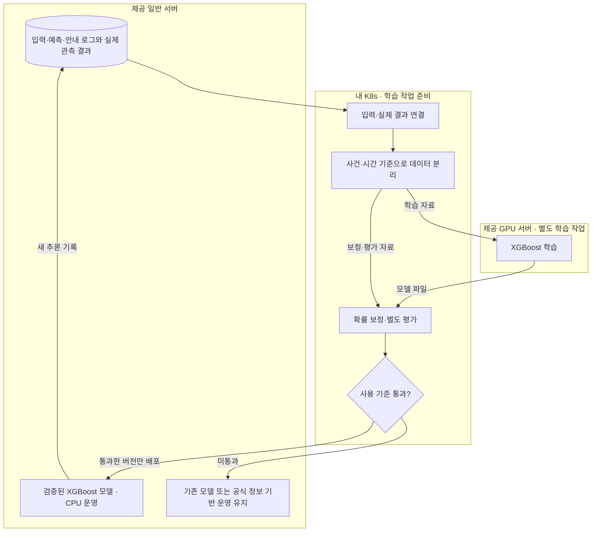

# Context

## Loom 코드 계약

아래 항목은 Loom 코드에 고정된 runtime 동작 계약입니다. 관련 흐름을 바꾸기 전 `loom contract show <id>`로 확인합니다.

- `task-execution`: Task 실행 전 prompt/context/previous-results에 들어가는 입력 경계입니다. 명령: `loom contract show task-execution`. Source: `loom/application/context_pack.py`, `loom/application/team_policy.py`
- `done-guardrail`: Task를 DONE으로 인정하기 전에 필요한 산출물과 상태 전이를 검증하는 계약입니다. 명령: `loom contract show done-guardrail`. Source: `loom/application/services.py`

## Project Memory

# 프로젝트 분석: BONGHWAJIGI

## 루트

`/Users/hongyongjae/Desktop/helloworld/BONGHWAJIGI`

## 요약

- 주요 스택: 확인 필요
- 패키지 / 런타임 파일: -
- 테스트 진입점: -
- 앱 진입점: docs/

## 최상위 구조

- ./
  - .gitignore
  - AGENTS.md
  - CLAUDE.md
  - README.md
-   docs/
    - README.md
    - ai-and-infrastructure.md
    - architecture-and-data-flow.md
    - decisions-and-meeting-review.md
    - product-and-scenarios.md
    - ui-ux-handoff.md

## 레포 규칙

- 기존 프로젝트 스타일과 로컬 helper API를 우선합니다.
- 수정 전에 관련 파일을 먼저 확인합니다.
- 변경 범위는 현재 Loom Task 계약 안에 유지합니다.
- 사용자 변경분을 버리는 destructive git reset/checkout을 사용하지 않습니다.
- 넓은 리팩터링이나 cross-domain 변경이 필요하면 먼저 boundary warning을 기록합니다.

## 실행 힌트

- 설치 / 런타임: -
- 테스트 / 검증: -
- 개발 서버: -

## 위험 영역

- 주의가 필요한 경로:
  - `No obvious sensitive path detected`

## Loom Task 가이드

- 좋은 Task는 예상 산출물, 완료 조건, 작업 범위, 검증 힌트를 가져야 합니다.
- repo 맥락이 약하면 architecture docs를 보강한 뒤 `loom analyze-repo`를 다시 실행합니다.
- agent 실행 전 `loom task validate <task-id>`로 경계를 확인합니다.
- 중단 이후에는 `loom resume`으로 현재 workflow 상태를 복구합니다.

## 보완할 맥락

- 아키텍처 ownership boundary는 수동 note가 필요할 수 있습니다.
- 배포, credential, 외부 서비스 정책은 자동으로 추론하지 않습니다.
- 프로젝트별 규칙은 Job note 또는 context reference에 추가합니다.

## Workspace Policy

- Output language: `ko`
- Agent provider: `claude`
- Agent model: `adapter-default`
- Reasoning effort: `high`
- Required branch: `develop`
- Dirty branch switch: `blocked`
- Commit policy: `manual`
- Include `.loom` metadata in Git: `yes`
- Read-only parallel execution: `allowed`
- Validation environment: `auto`
- Previous Task result limit: `2`
- Workspace required docs: -
- Loom fixed guardrails and verified Team required policies take precedence over this Workspace Policy.

## Job

- Title: V2 실행 기반과 통합 검증
- Goal: V2를 설계 기준으로 MVP 범위와 실행 환경을 고정하고, 다중 출처 수집부터 개인별 안내까지 통합 검증한다. HeoNey는 참고이며 앱 구현은 제외하고 API 명세를 제공한다.
- Branch: HeoNey
- Task count: `5`

## Task

- Title: 서버 간 통신과 클러스터 자원 및 운영 조건 검증
- Description: K8s에서 일반 및 GPU 서버로의 실제 연결 경로 포트 DNS 인증 스토리지 자원 예약 가용량을 확인한다. 마스터 DNSConfigForming과 과거 재시작을 조사하고 변경 필요 여부를 기록한다. 이번 상태 조회와 달리 종단간 통신 시험과 배치 용량을 검증한다. 설계 기준은 docs/V2이며 HeoNey는 참고다. 앱 구현은 제외하고 앱팀에 API 명세를 제공한다. 이 등록은 작업 계약 고정이며 후속 구현 Task를 지금 실행하거나 Queue에 넣지 않는다.
- Expected output: docs/V2/delivery/environment-readiness.md 및 작업 범위의 재현 가능한 구현 또는 검증 산출물
- Done condition: 노트북 접속과 K8s발 통신이 구분되어 검증되고 용량 및 미해결 운영 조건이 정리된다.
- In scope: K8s에서 일반 및 GPU 서버로의 실제 연결 경로 포트 DNS 인증 스토리지 자원 예약 가용량을 확인한다. 마스터 DNSConfigForming과 과거 재시작을 조사하고 변경 필요 여부를 기록한다. 이번 상태 조회와 달리 종단간 통신 시험과 배치 용량을 검증한다.
- Out of scope: 모바일 앱 화면 권한 및 3D 렌더러 구현; HeoNey UX의 자동 편입; 비밀정보 커밋; 작업 범위 외 운영 변경
- Validation hint: 방향별 연결 시험, DNS 확인, 요청 자원 대비 스케줄 가능량, 영향 없는 점검
- Required docs: `docs/V2/01_서비스_핵심_정리.md`, `docs/V2/02_실시간_서버_배치도.md`, `docs/V2/03_학습_검증_흐름도.md`
- Memory refs: -
- Document outputs: `docs/V2/delivery/environment-readiness.md`
- Document output exceptions: -
- Source proposal: `-`
- Status: RUNNING
- Assigned agent: foreground

## Advisor Source Prompt

No Advisor source prompt recorded for this Task.

## Inclusion Policy

- Mandatory execution files: `prompt.md`, `context.md`, and `previous-results.md`.
- Always included: project memory, current Job/Task metadata, and Job notes.
- Previous results: up to the latest 2 recorded results from earlier Tasks in this Job.
- Job context refs: explicit Job-scoped references selected by the controlling agent or user.
- Task required docs: mandatory Task-scoped documents; missing refs block validation and execution.
- Task memory refs: mandatory Task-scoped workflow memory references; missing or non-memory refs block validation and execution.
- Repository documents, validation documents, and skill rules: included only through explicit Job context refs, Task required docs, or Task memory refs.
- Verified Team Policy Snapshot: included before Active Memory; required policy cannot be overridden by lower-priority context.
- Active workflow memory with an `always` category is included automatically while its status is `ACTIVE`.
- `task_selected` and `reference_only` memory is included only through explicit Task memory refs.
- Consumed proposals, rejected proposals, resolved memory, superseded memory, and archived memory are excluded.
- Unreferenced repository files and results from other Jobs are not included.
- `AGENTS.md` and `CLAUDE.md` remain session-level controlling-agent entrypoints and are not treated as task context artifacts by default.

## Job Notes

# Notes

## 2026-10-31T00:24:09+00:00

사용자 지시 기준: V2를 설계 정본으로 삼고 HeoNey는 참고한다. 앱 구현은 앱팀 소관이며 우리 산출물은 서버와 앱 연동 API 명세이다. 이번 턴은 서버와 클러스터의 읽기 전용 점검 및 TODO의 Job Task 등록만 실행한다. 신규 구현 Task는 PENDING으로 두며 Queue Worker와 배포 학습을 시작하지 않는다. 사용자가 Job Task 분할을 직접 위임했으므로 통제 에이전트가 계약을 생성한다.

- Task: `task-20261031-002027-k8s-v2-a251b54e`
- Tags: `scope`, `user-direction`
## 2026-10-31T00:26:25+00:00

설계 기준은 docs/V2이며 HeoNey는 참고다. 앱 구현은 제외하고 앱팀에 API 명세를 제공한다. 이 등록은 작업 계약 고정이며 후속 구현 Task를 지금 실행하거나 Queue에 넣지 않는다. 기준 원문은 docs/V2/01, 02, 03 문서이고 실행 작업표는 docs/V2/04-execution-backlog.md이다. 등록 시 의존관계는 Job 경계를 넘어 적용한다.
- Tags: `v2`, `scope`, `backlog`
## 2026-10-31T00:42:26+00:00

사용자 질문 응답: 첨부 이미지의 계정 및 비밀번호를 GPU 서버와 일반 서버의 SSH 로그인에 사용하도록 두 서버 로그인 승인이라고 명시적으로 답했다. 상태 조회에만 사용하며 인증정보는 저장소나 보고서에 남기지 않는다. 기존 검토 대기 Task의 서버 조회를 재개한다.

- Task: `task-20261031-002027-k8s-v2-a251b54e`
- Tags: `user-approval`, `resume`
## 2026-10-31T00:50:01+00:00

승인 후 실제 서버 조회 완료: GPU 서버는 4 vCPU RAM 47.05 GiB 및 NVIDIA L4 1대, 드라이버 580.159.04, cuInit 성공이다. 일반 서버는 2 vCPU RAM 7.76 GiB, systemd running 및 실패 서비스 없음이다. 두 서버 사이 TCP 22는 양방향 접근 가능하다. GPU 서버는 부팅 시 Mellanox 설정 파일 누락과 NVSwitch 조회 실패 기록으로 systemd degraded이며 A2에서 실제 필요성과 조치 여부를 확인한다. K8s발 서버 API 통신과 실제 모델 성능은 별도 검증 대상이다.

- Task: `task-20261031-002627-task-5ce3742e`
- Tags: `infrastructure`, `verified`
## 2026-10-31T01:20:51+00:00

사용자가 현재 대화에서 검증 작업 전부 실행을 지시했다. 선행 완료된 A2 환경 검증을 지금 수행하고, 학습 모델과 구현 및 API가 필요한 C4 D3 E2 A4 검증은 선행 산출물 존재 여부와 실행 경계를 확인한다. 이 지시는 검증 작업 실행이며 미구현 기능 전체의 개발 지시로 확대하지 않는다.

- Task: `task-20261031-002627-task-5ce3742e`
- Tags: `user-request`, `validation`
## 2026-10-31T01:22:32+00:00

사용자가 검증을 계속하기 전에 develop과 HeoNey를 동기화하고 develop에서 실행하도록 지시했다. 원격 최신 상태 조회 결과 develop은 HeoNey의 조상이며 충돌 없는 fast-forward가 가능하다. 진행 중 A2 기록을 보존하고 실행 브랜치 정책을 develop으로 변경한 뒤 검증을 이어간다.

- Task: `task-20261031-002627-task-5ce3742e`
- Tags: `user-direction`, `branch`

## Context References

No explicit context references recorded for this job.

## Required Documents and Memory

### required-doc: docs/V2/01_서비스_핵심_정리.md

- Path: `docs/V2/01_서비스_핵심_정리.md`
- Status: present

# 재난 대응 비서 - 서비스 핵심 정리

작성일: 2026-10-31  |  버전: 1.0

이 문서는 재난 대응 비서 관련 대화의 핵심과 설계 후보를 정리한 문서다. 구현·배포·학습·성능 검증이 완료됐다는 의미는 아니다.

## 1. 서비스의 핵심과 목표

> 위험이 사용자에게 영향을 주기 전에, 그 사람이 준비하고 대응하는 데 필요한 시간을 확보해 주는 재난 대응 비서.

공식 경보·관측·뉴스를 지속적으로 수집하고 사용자 위치·상태에 연결한다. 관련 사건의 변화를 추적해 **언제 무엇을 준비해야 하는지** 개인별로 안내하는 것이 서비스의 중심이다. 해커톤에서는 AI 기반 개인별 대응 행동 추천이라는 방향으로 설명할 수 있다.

### 10m 이내의 두 사용자도 서로 다른 안내를 받을 수 있다

| 구분 | 달라질 수 있는 대응 |
| --- | --- |
| 혼자 이동할 수 있는 사용자 | 적용되는 준비 사항과 공식 행동요령 안내 |
| 이동 지원이 필요한 사용자 | 지원 요청·연락·준비 사항을 추가하고, 검토된 정책에 따라 안내 시점 조정 |
| 언어·음성·화면 설정이 다른 사용자 | 선호·접근성 설정에 맞는 전달 방식 적용 |

사용자 상태는 필요한 대응을 바꾼다. 동일한 환경 위험을 평가할 때 이동 능력만으로 화재·연기·물의 도달 확률이 달라지지는 않는다. 가까운 두 지점도 층수·지형·건물 조건에 따라 노출이 다를 수 있으므로, 10m 거리만으로 위험까지 동일하다고 단정하지 않는다.

### 시간을 번다는 의미

상류에서 이미 재난이 발생했더라도 하류 사용자에게 영향이 오기 전에 준비를 시작하게 했다면 목표에 부합한다. 목표는 모든 재난의 발생 시각을 맞히는 것이 아니라, **사용자에게 영향이 도달하기 전 필요한 준비 시간**을 확보하는 것이다.

현재 상태: 서비스 방향과 구성 후보를 정리한 단계다. 실제 예측 모델·개인별 정책·확보 가능한 선행 시간은 검증되지 않았다. 서비스명, 첫 재난 유형, 지역, 세부 대상 사용자는 미정이다.

## 2. 실시간 처리와 판단 주체

### 기본 파이프라인

자료 수집 → 정형 필드 파싱 또는 Qwen 문서 추출 → 사건 통합 → 사용자·관심 장소 관련성 확인 → 필요한 자료 보강 → 모델 입력 검사 → 위험 평가 → 대응 정책 적용 → 알림·안내 갱신. 위치·프로필·통제 정보가 바뀌어도 필요한 단계부터 재평가한다.

| 구성 | 맡기는 역할 |
| --- | --- |
| Qwen3-4B-Instruct-2507 | 약 40억 파라미터의 사전 학습된 텍스트 모델. 사실·장소·시각·상태·근거 추출과 선택된 안내의 설명. Non-thinking 전용 업데이트 모델.[1] |
| Qwen3-Embedding-0.6B | 수집한 문서의 벡터 생성과 관련 문서 검색 지원. 웹 수집 자체는 별도 기능.[2] |
| XGBoost 기반 모델 | 관측값·정리된 입력으로 정해진 영향 확률 추정. 우리 목표에 맞는 학습·검증이 필요하며 현재는 후보.[3] |
| 정책 엔진 | 공식 지침과 사전 검토한 규칙에 사용자 상태·위험 평가를 대입해 알림과 행동 선택 |

### 공식 긴급 경보는 별도 경로

공식 출처와 발령 대상의 관련성을 확인하면 **원문·출처·발령 시각을 우선 전달**한다. 추가 검색·확률 계산·Qwen 설명·음성·지도 로딩을 기다리지 않는다. 낮은 모델 예측값이 공식 긴급 지침을 보류하거나 낮추지 않게 한다.

공식 경보의 긴급성과 행동 지침을 보존한다. 경보가 있다는 이유만으로 모든 상황에 대피를 지시하지 않는다. 공식 경보 상태와 서비스의 개인별 대응 상태는 별도로 표시한다.[6]

### 개인별 정책은 사람이 설계하고 서버가 실행

사용자 정보(위치·이동·지원·설정), 주변 상황(경보·관측·통제), 공통 대응 규칙을 분리한다. 규칙은 공식 행동요령을 바탕으로 작성·검토하며, 실행 시에는 정책 엔진이 자동 적용한다. Qwen은 행동을 임의로 결정하지 않고 선택된 지침을 설명한다.

## 3. 세 가지 검사와 지도 데이터

### 사건 통합·출처·시각 확인

공식 API·기관 원문·뉴스 매체를 구분하고 원문 URL·식별자를 보관한다. 같은 문서의 중복과 같은 사건의 연결을 구분한다. 공식 사건 ID나 갱신 참조가 있으면 우선 사용하고, 없으면 종류·장소·시간으로 후보를 찾는다. 근거가 부족하면 합치지 않고 별도로 유지한다.

발생·관측 시각, 발표 시각, 수집 시각, 유효 종료 시각을 분리한다. 늦게 수집한 과거 기사를 새 사건으로 취급하지 않는다. 발령·수정·해제 관계를 따라 상태를 갱신하며, 문서 추출 성공 자체를 사실 확인 완료로 보지 않는다.[6]

### 내 위치·관심 장소와의 관련성

현재 좌표·위치 정확도·갱신 시각·관심 장소를 공식 발령 구역, 사건 위치, 통제 구간과 비교한다. 공간 포함·교차·거리 계산을 사용하며, 주변 사건은 추가 평가 후보로 본다. 장소가 모호하거나 위치가 오래됐으면 판단 보류·관련 가능성을 유지한다.[7]

### 검증 모델·필요 입력 확보

사전에 등록한 모델의 예측 목표·지역·시간 범위·검증 상태를 확인한다. 실행할 때는 필수 항목, 단위, 시간 기준, 최신성, 검증된 결측 처리 조건을 검사한다. 조건을 만족하지 않으면 예측 불가로 처리하며, 위험 0으로 바꾸지 않는다. 공식 정보 기반 안내는 계속한다.

| 지도 데이터 사용 지점 | 필요한 자료 |
| --- | --- |
| 위치 관련성 | 장소 좌표, 행정구역·발령 구역, 통제 위치 |
| 영향 예측의 입력 | 선택한 재난·모델에 필요한 고도·경사·하천·유역 등 |
| 경로 기능 | 보행·도로 연결망, 계단·경사·출입구·통제·시설 정보 |
| 화면 표시 | 배경 지도와 사건·경로. 3D이면 지형·건물 자료 추가 |

현재 GPS 좌표는 사용자 기기에서 받는다. 지도는 좌표를 구역·도로·지형과 연결한다. 경로 탐색 알고리즘이나 3D 표시 도구만으로 실제 통행 가능성·안전성이 확인되는 것은 아니다.

## 4. 학습해야 할 대상과 개선 과정

> 학습 목표: 이미 발생했거나 발생할 수 있는 재난이, 정해진 시간 안에 특정 위치·경로에 영향을 미칠 확률.

이미 확인된 재난의 발생 여부를 다시 예측하는 것이 아니다. 예를 들어 특정 관측지점의 향후 30분 이내 기준 수위 초과 여부를 목표로 정할 수 있다. 이 결과를 곧바로 사용자 집의 침수 확률로 바꾸어 해석할 수는 없다.

### 학습 자료

| 구분 | 기록할 내용 |
| --- | --- |
| 당시 입력 | 그 시점까지 실제 이용 가능했던 관측·위치·사건 정보와 시각 |
| 예측·운영 기록 | 모델 버전, 예측값, 선택한 안내, 전송 시각 |
| 이후 실제 결과 | 정의한 기간·위치·기준에 따라 영향이 관측됐는지. 발생하지 않은 사례 포함 |

이전 모델의 예측값 자체를 정답으로 사용하지 않는다. 입력과 실제 결과를 연결하는 현재 계획은 **지도학습 기반 재학습**에 가깝다. 행동 선택을 보상으로 개선하는 강화학습은 별도 설계 과제이며 현재 확정된 구현이 아니다.[12]

### 검증·보정·교체

학습·확률 보정·최종 평가 자료를 분리하고 사건·시간 관계를 고려해 정보 누출을 막는다. 놓친 위험, 오경보, 예측 확률과 실제 발생 비율을 확인한다. 단순히 0~1 값을 출력하거나 위험 점수로 이름을 바꾼 것만으로 유효성이 확보되지는 않는다.[4][5]

추론은 새 입력에 맞춰 갱신한다. 재학습은 실제 결과가 누적된 뒤 별도로 수행하고, 사용 기준을 통과한 모델 버전만 교체한다. 미통과하면 기존 모델 또는 공식 정보 기반 운영을 유지한다.

### 아직 구분해야 하는 시간 문제

“30분 안에 영향이 있을 확률”은 정확한 도달 시각을 뜻하지 않는다. 개인별 안내 시점을 결정하려면 예상 영향 시점·불확실성과 준비·이동·지원 소요시간을 어떻게 다룰지 추가 설계가 필요하다.

## 5. 배치 방향과 과거 사례 시연

| 실행 위치 | 제안된 배치 |
| --- | --- |
| 내 K8s | 기관별 수집기, 수집 재시도·상태 관리, 과거 자료 재생, 학습 자료 준비·평가 |
| 제공 일반 서버 | 사용자 API·DB, 긴급·일반 큐와 워커, 사건·공간 분석, XGBoost CPU 추론, 대응 정책·알림 |
| 제공 GPU 서버 | Qwen3-4B·Embedding 추론. 별도 시간의 XGBoost 학습 |
| 사용자 기기 | 위치·설정 전달, 알림 수신, 지도·경로 렌더링 |

GPU 학습 모델은 CPU에서도 실행할 수 있으므로 XGBoost 운영 추론은 일반 서버에 둔다.[3] MeloTTS를 붙이면 일반 서버의 낮은 우선순위 작업으로 검토한다. 경로 계산은 일반 서버, Cesium 화면 표시는 사용자 기기에서 수행하는 방향이다.[10][11]

공유된 GPU 사양은 NVIDIA L4 24GB·4 vCPU·48GB RAM이며 실측 확인 전이다. 일반 서버 사양은 미정이다. 두 Qwen 모델의 실제 메모리·처리량과 네 K8s에서 제공 서버로의 VPN·방화벽 연결을 확인해야 한다.

### 시연 시나리오

1. 한 재난 유형·한 지역의 과거 사례와 원본 발표·관측 시각을 준비한다.

2. 가까운 위치에 있지만 이동·지원·전달 설정이 다른 두 사용자를 등록한다.

3. 당시 공개된 정보만 시간순으로 재생한다.

4. 사전 준비 안내와 사용자별 차이를 보여준다.

5. 공식 긴급 지침 수신 시 AI를 기다리지 않는 전달을 보여준다.

6. 통제·해제 또는 사용자 위치 변경에 따라 안내가 갱신되는 모습을 보여준다.

나중에 알려진 피해 정보를 앞 시점에 넣지 않는다. 시연용 모의 자료·미리 정한 출력과 실제 모델 출력을 구분한다. 한 사례의 시연 성공은 예측 성능 검증을 대신하지 않는다.

### 확인할 지표

발표→서버 수신→단말 도착의 시간, 개인별 안내의 근거·적합성, 준비 가능한 시간, 중복·낡은 경보 억제, 위험 누락·오경보를 확인한다. “어디보다 빠르다”는 비교 검증 전의 목표이며 보장된 성능이 아니다.

## 6. 남은 결정과 검증 항목

| 항목 | 아직 결정하거나 확인할 내용 |
| --- | --- |
| 첫 적용 범위 | 재난 유형·지역·사용자·예측 시간·영향 기준 |
| 자료 확보 | 기관별 API·갱신 주기·과거 자료·실제 결과 라벨·사용 조건 |
| 사건·시간 처리 | 식별자, 수정·해제, 중복·상충 정보, 출처·유효시간 처리 |
| 위치 관련성 | 행정구역·위치 오차·경로·상류하류 등 재난별 관계 기준 |
| 예측 모델 | 학습 가능성, 적용 범위, 결측·노후 입력 처리, 평가·보정 합격 기준 |
| 개인 대응 정책 | 공식 지침과 사용자 상태를 연결하는 규칙, 알림 시점·해제·변경 조건 |
| 필요한 시간 | 영향 예상 시점과 준비·이동·지원 소요시간의 산정 방식 |
| 경로·시설·3D | 실제 통행·접근성·시설 이용 가능 정보 확보 여부와 기능 범위 |
| 실행 환경 | 일반 서버 용량·저장공간, GPU 처리량, 서버 간 통신, 푸시 구현 |
| 운영 개선 | 기록 방식, 실제 결과 확인, 재학습 주기, 검증 후 교체 기준 |

### 현재 MVP 방향으로 제안된 범위

한 지역·한 재난 유형에서 수집→사건 연결→사용자 관련성→개인별 안내 갱신을 우선 완성한다. 공식 경보 즉시 전달은 별도로 확보한다. 확률 예측은 학습·검증과 입력 조건이 확보된 경우에 붙이며, 상세 경로·3D는 데이터 확보에 따라 확장한다.

> 가장 중요한 검증 질문: 특정 재난 사례에서 특정 사용자에게 실제로 필요한 준비 시간을 더 확보해 줄 수 있는가?

서비스명은 미정이다. 이정·지표·파수·기점, BEARING·SENTINEL·AEGIS·MERIDIAN 등의 후보가 논의됐으며 최종 선택·명칭 사용 가능 여부는 확인하지 않았다.

## 7. 참고 자료와 문서 구성

이 문서는 재난 대응 비서 관련 대화의 핵심과 설계 후보를 정리했다. 아래 자료는 도구·개념을 확인하기 위한 참고이며, 우리 서비스의 데이터 확보나 예측 성능을 입증하는 자료는 아니다.

### 공식 참고 자료

[1] [Qwen3-4B-Instruct-2507 모델 설명](https://huggingface.co/Qwen/Qwen3-4B-Instruct-2507)

[2] [Qwen3-Embedding-0.6B 모델 설명](https://huggingface.co/Qwen/Qwen3-Embedding-0.6B)

[3] [XGBoost GPU 학습·CPU/GPU 호환](https://github.com/dmlc/xgboost/blob/master/doc/gpu/index.rst)

[4] [scikit-learn 확률 보정](https://scikit-learn.org/stable/modules/calibration.html)

[5] [scikit-learn 시간·그룹 기반 검증](https://scikit-learn.org/stable/modules/cross_validation.html)

[6] [OASIS CAP 1.2 경보 규격](https://docs.oasis-open.org/emergency/cap/v1.2/CAP-v1.2-os.html)

[7] [PostGIS 공간 교차](https://postgis.net/docs/ST_Intersects.html) / [거리 검사](https://postgis.net/docs/ST_DWithin.html)

[8] [UNDRR 조기경보 체계 정의](https://www.undrr.org/terminology/early-warning-system)

[9] [Kubernetes CronJob](https://kubernetes.io/docs/concepts/workloads/controllers/cron-jobs/)

[10] [MeloTTS 한국어 모델](https://huggingface.co/myshell-ai/MeloTTS-Korean)

[11] [CesiumJS](https://cesium.com/platform/cesiumjs/)

[12] [Google 지도학습·실제 정답 용어 설명](https://developers.google.com/machine-learning/glossary#supervised-machine-learning)

### 세 문서의 역할

| 문서 | 내용 |
| --- | --- |
| 01 핵심 정리 | 목적·모델·정책·판단 기준·데이터·시연·미정 사항 |
| 02 실시간 서버 배치도 | 사용자가 제공한 Mermaid 배치도와 각 경로의 실행 위치 |
| 03 학습·검증 흐름도 | 실제 결과 연결, 학습·보정·평가, 모델 버전 교체 |

## 함께 볼 문서

- [실시간 서버 배치도](02_실시간_서버_배치도.md)
- [학습·검증 흐름도](03_학습_검증_흐름도.md)

두 문서에는 수정 가능한 Mermaid 원문이 포함돼 있다.

### required-doc: docs/V2/02_실시간_서버_배치도.md

- Path: `docs/V2/02_실시간_서버_배치도.md`
- Status: present

# 재난 대응 비서 - 실시간 서버 배치도

작성일: 2026-10-31  |  버전: 1.0

내 K8s 수집 / 제공 일반 서버 판단·전달 / 제공 GPU 서버 추론

대화에서 정리한 설계안이다. 현재 학습·배포·검증이 완료됐다는 의미는 아니다.

## 다이어그램

## 해설

> 공식 긴급 경보: K8s 수집 → 일반 서버 긴급 큐·워커 → 발령 대상 확인 → 공식 원문 전달. GPU 추론을 기다리지 않는다.

| 영역 | 주요 책임 |
| --- | --- |
| 내 K8s | 기관별 상시 경보 수집과 관측·공지·뉴스 수집. 재시도·수집 상태 관리 |
| 일반 서버 | 이벤트·사용자 API, 긴급/일반 작업 분리, DB, 사건·공간 분석, XGBoost CPU 예측, 대응 정책·알림 |
| GPU 서버 | Qwen3-4B-Instruct-2507의 추출·설명, Qwen3-Embedding-0.6B의 벡터 생성 |
| 사용자 기기 | 위치·설정 전달, 알림 수신, 지도 표시 |

### 도표를 읽는 기준

일반 분석 워커는 문서가 필요할 때 GPU를 호출한다. 구조화된 관측자료는 Qwen을 생략할 수 있다. 벡터 생성은 GPU, 벡터 저장·검색은 일반 서버다. 사건 통합·위치 관련성·입력 검사는 일반 서버에서 수행한다.

XGBoost는 검증된 모델과 입력 조건이 확보된 경우에만 호출한다. 사용할 수 없으면 공식 정보 기반 대응을 유지한다. 사용자 위치·지원 상태가 바뀌면 필요한 단계부터 재평가한다.

빨간 노드는 긴급 경보 전달 경로다. 마지막 알림 전송 노드는 일반 안내도 공유한다. 초록 노드는 GPU 모델 API다. 양방향 연결은 요청과 결과 반환을 뜻하며 실시간 자동 재학습을 뜻하지 않는다.

### 구현 전에 확인할 사항

긴급·일반 큐와 워커의 실행 자원을 분리하고, 수집·처리·알림의 중복과 갱신·해제를 관리한다. 긴급 수집기에도 자체 재시도·중복 방지 기준이 필요하다. 도표는 핵심 연결을 표현하므로 원문·로그 저장과 모든 DB 접근선은 생략돼 있다.

일반 서버 사양과 네 K8s에서 제공 서버로의 VPN·방화벽 연결은 미확인이다. Qwen 두 모델의 메모리·처리량은 실제 자료로 측정한다. GPU 장애가 있어도 긴급 경보는 처리하도록 구성하되, 수집기·일반 서버·네트워크의 가용성은 별도로 확보해야 한다.

## 함께 볼 문서

- [서비스 핵심 정리](01_서비스_핵심_정리.md)

- [학습·검증 흐름도](03_학습_검증_흐름도.md)

### required-doc: docs/V2/03_학습_검증_흐름도.md

- Path: `docs/V2/03_학습_검증_흐름도.md`
- Status: present

# 재난 대응 비서 - 학습·검증 흐름도

작성일: 2026-10-31  |  버전: 1.0

실제 결과 연결 / 학습 / 확률 보정·평가 / 검증 모델 배포

대화에서 정리한 설계안이다. 현재 학습·배포·검증이 완료됐다는 의미는 아니다.

## 다이어그램

## 해설

> 이전 추론값 자체를 정답으로 삼지 않는다. 당시 입력과 이후 실제 관측 결과를 연결하고, 검증한 모델 버전만 운영에 반영한다.

| 단계·위치 | 처리 내용 |
| --- | --- |
| 기록 - 일반 서버 | 입력·자료 시각·모델 버전·예측값·안내·전송 시각과 실제 결과 보관 |
| 자료 준비 - K8s | 예측 대상·기간에 맞춰 입력과 정답 연결. 사건·시간 기준으로 자료 분리 |
| 학습 - GPU 서버 | XGBoost 학습. 작은 자료라면 CPU 학습 가능성도 있으나 현재 배치안은 GPU 활용 |
| 보정·평가 - K8s | 학습과 분리한 자료로 확률 보정 및 별도 성능 평가 |
| 운영 반영 - 일반 서버 | 사전에 정한 사용 기준을 통과한 버전만 CPU 추론에 배포 |

### 분리해야 하는 자료

학습용, 확률 보정용, 최종 평가용 자료를 구분한다. 같은 사건의 정보나 미래 관측이 경계를 넘어 섞이지 않도록 한다. 당시 수집·이용할 수 없던 후속 기사를 과거 입력에 넣지 않는다. 영향이 없었던 사례도 평가에 포함한다.

### 반복 추론과 재학습의 차이

실시간 반복 추론은 고정된 모델에 최신 입력을 넣는 과정이다. 재학습은 실제 결과가 누적된 뒤 새 모델을 만드는 별도 작업이다. 이 계획은 지도학습 기반 개선이며, 행동 선택을 보상으로 학습하는 강화학습은 별도 과제다.

### GPU 운영과 모델 교체

첫 시연 전에 학습을 끝내고 시연 중 GPU는 Qwen·Embedding 추론에 집중시키는 방향을 권한다. 동일 GPU의 추론과 학습을 동시에 수행할지는 메모리·처리량을 확인한 뒤 결정한다. 새로운 모델이 기준을 통과하지 못하면 기존 모델 또는 공식 정보 기반 운영을 유지한다.

아직 미정: 실제 학습 자료, 예측 목표, 합격 기준, 재학습 주기, 배포 승인·되돌리기 절차. XGBoost는 재난 예측이 완성된 모델이 아니라 목표에 맞게 학습할 도구다.

## 함께 볼 문서

- [서비스 핵심 정리](01_서비스_핵심_정리.md)

- [실시간 서버 배치도](02_실시간_서버_배치도.md)

## Verified Team Policies

No verified Team Policy Snapshot is active.

## Active Workflow Memory

No active workflow memory recorded.
