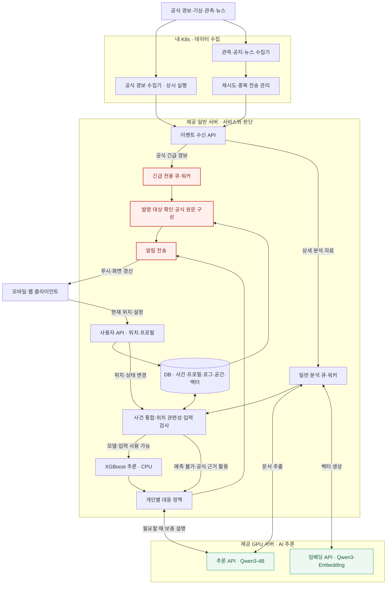
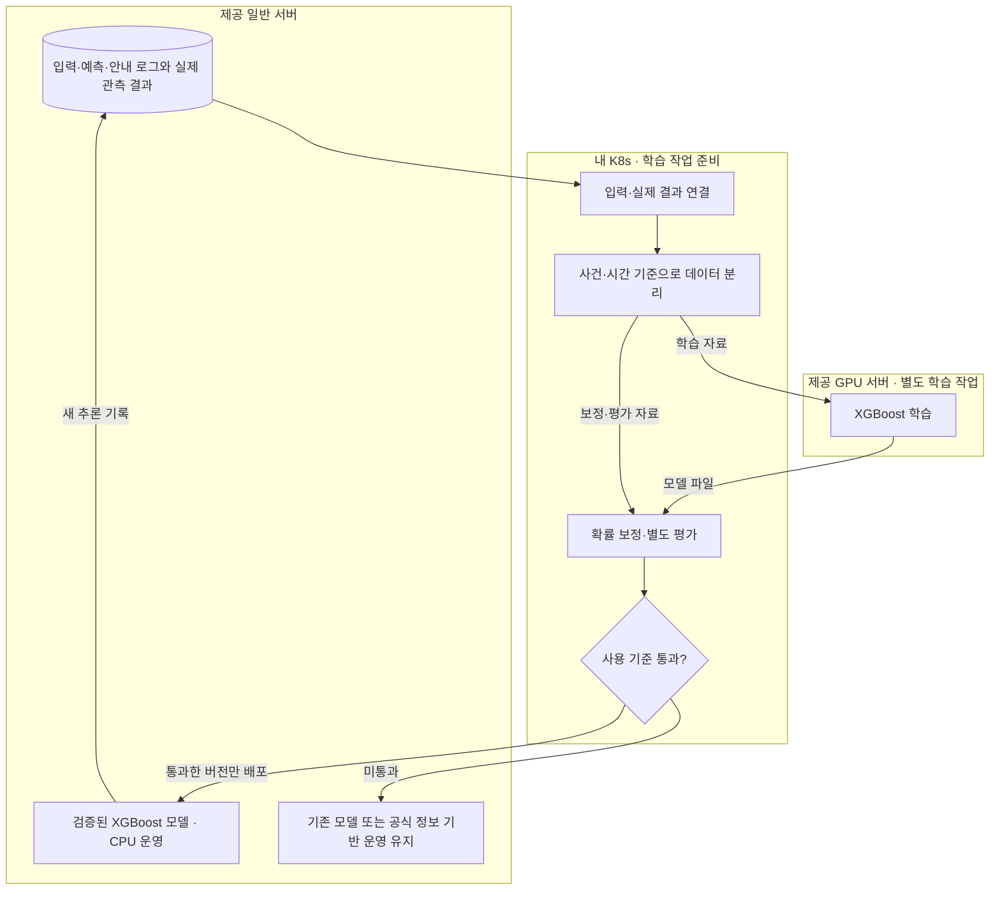

# Context

## Loom 코드 계약

아래 항목은 Loom 코드에 고정된 runtime 동작 계약입니다. 관련 흐름을 바꾸기 전 `loom contract show <id>`로 확인합니다.

- `task-execution`: Task 실행 전 prompt/context/previous-results에 들어가는 입력 경계입니다. 명령: `loom contract show task-execution`. Source: `loom/application/context_pack.py`, `loom/application/team_policy.py`
- `done-guardrail`: Task를 DONE으로 인정하기 전에 필요한 산출물과 상태 전이를 검증하는 계약입니다. 명령: `loom contract show done-guardrail`. Source: `loom/application/services.py`

## Project Memory

# 프로젝트 분석: BONGHWAJIGI

## 루트

`/Users/hongyongjae/Desktop/helloworld/BONGHWAJIGI`

## 요약

- 주요 스택: 확인 필요
- 패키지 / 런타임 파일: -
- 테스트 진입점: -
- 앱 진입점: docs/

## 최상위 구조

- ./
  - .gitignore
  - AGENTS.md
  - CLAUDE.md
  - README.md
-   docs/
    - README.md
    - ai-and-infrastructure.md
    - architecture-and-data-flow.md
    - decisions-and-meeting-review.md
    - product-and-scenarios.md
    - ui-ux-handoff.md

## 레포 규칙

- 기존 프로젝트 스타일과 로컬 helper API를 우선합니다.
- 수정 전에 관련 파일을 먼저 확인합니다.
- 변경 범위는 현재 Loom Task 계약 안에 유지합니다.
- 사용자 변경분을 버리는 destructive git reset/checkout을 사용하지 않습니다.
- 넓은 리팩터링이나 cross-domain 변경이 필요하면 먼저 boundary warning을 기록합니다.

## 실행 힌트

- 설치 / 런타임: -
- 테스트 / 검증: -
- 개발 서버: -

## 위험 영역

- 주의가 필요한 경로:
  - `No obvious sensitive path detected`

## Loom Task 가이드

- 좋은 Task는 예상 산출물, 완료 조건, 작업 범위, 검증 힌트를 가져야 합니다.
- repo 맥락이 약하면 architecture docs를 보강한 뒤 `loom analyze-repo`를 다시 실행합니다.
- agent 실행 전 `loom task validate <task-id>`로 경계를 확인합니다.
- 중단 이후에는 `loom resume`으로 현재 workflow 상태를 복구합니다.

## 보완할 맥락

- 아키텍처 ownership boundary는 수동 note가 필요할 수 있습니다.
- 배포, credential, 외부 서비스 정책은 자동으로 추론하지 않습니다.
- 프로젝트별 규칙은 Job note 또는 context reference에 추가합니다.

## Workspace Policy

- Output language: `ko`
- Agent provider: `claude`
- Agent model: `adapter-default`
- Reasoning effort: `high`
- Required branch: `develop`
- Dirty branch switch: `blocked`
- Commit policy: `manual`
- Include `.loom` metadata in Git: `yes`
- Read-only parallel execution: `allowed`
- Validation environment: `auto`
- Previous Task result limit: `2`
- Workspace required docs: -
- Loom fixed guardrails and verified Team required policies take precedence over this Workspace Policy.

## Job

- Title: 앱 연동 API 계약과 인계
- Goal: 앱팀이 독립적으로 구현할 수 있는 OpenAPI 명세 예제 응답과 계약 검증 산출물을 제공한다. 앱 화면과 모바일 기능은 구현하지 않는다. 설계 기준은 docs/V2이며 HeoNey는 참고다. 앱 구현은 제외하고 앱팀에 API 명세를 제공한다. 이 등록은 작업 계약 고정이며 후속 구현 Task를 지금 실행하거나 Queue에 넣지 않는다.
- Branch: HeoNey
- Task count: `3`

## Task

- Title: V2와 최신 5개 화면을 대조해 앱 API 초안과 화면별 인계 패키지 작성
- Description: 사용자가 앱 연동 API 계약과 인계 Job을 다시 확인하고 최신 HeoNey 화면 및 V2 설계를 바탕으로 각 API 경로 사용법 대응 화면을 포함한 앱팀 전달 문서를 지금 작성하도록 지시했다. E1과 E2의 선행 데이터 및 정책이 미완료이므로 그것을 완료로 바꾸지 않고 검증 가능한 선행 계약 초안을 별도 Task로 작성한다.
- Expected output: OpenAPI 3.1 명세, 정상 예외 모의 응답, API 사용법, 5개 화면 매핑과 호출 순서, Job 재검토 및 미결정 목록, 계약 검증 도구와 결과
- Done condition: 최신 화면 요구와 V2 원칙이 추적되고 API별 경로 인증 입력 출력 오류 사용법과 화면 매핑이 문서화되며 OpenAPI 및 예제가 검사되고 배포 미완료와 조건부 기능이 구분되어 로컬 커밋된다.
- In scope: V2 및 최신 HeoNey 화면 문서 검토; 기존 API Job 재검토; API 계약 초안과 모의 예제; 앱팀 인계 문서; 계약 검증; 관련 Loom 기록 및 로컬 커밋
- Out of scope: 모바일 앱 구현; 실제 서버 배포; 실제 재난 정책 임계값 확정; 실시간 음성 및 자동 신고 구현; 실제 긴급 연락; 원격 push; 다른 Task의 허위 완료 처리
- Validation hint: OpenAPI 3.1 유효성, 요청 응답 예제의 스키마 일치, 화면 경로 대응 누락, 수정 해제 예측 불가 위치 불명확 경로 비활성 시나리오, 문서 링크 및 Loom strict
- Required docs: `docs/V2/01_서비스_핵심_정리.md`, `docs/V2/02_실시간_서버_배치도.md`, `docs/V2/03_학습_검증_흐름도.md`, `docs/HeoNey/봉화지기_모바일_화면_기획서.md`, `docs/V2/04-execution-backlog.md`
- Memory refs: -
- Document outputs: `docs/V2/delivery/app-api-contract.md`, `docs/V2/delivery/api-handoff.md`, `docs/V2/delivery/api-job-review.md`
- Document output exceptions: -
- Source proposal: `-`
- Status: PENDING
- Assigned agent: foreground

## Advisor Source Prompt

No Advisor source prompt recorded for this Task.

## Inclusion Policy

- Mandatory execution files: `prompt.md`, `context.md`, and `previous-results.md`.
- Always included: project memory, current Job/Task metadata, and Job notes.
- Previous results: up to the latest 2 recorded results from earlier Tasks in this Job.
- Job context refs: explicit Job-scoped references selected by the controlling agent or user.
- Task required docs: mandatory Task-scoped documents; missing refs block validation and execution.
- Task memory refs: mandatory Task-scoped workflow memory references; missing or non-memory refs block validation and execution.
- Repository documents, validation documents, and skill rules: included only through explicit Job context refs, Task required docs, or Task memory refs.
- Verified Team Policy Snapshot: included before Active Memory; required policy cannot be overridden by lower-priority context.
- Active workflow memory with an `always` category is included automatically while its status is `ACTIVE`.
- `task_selected` and `reference_only` memory is included only through explicit Task memory refs.
- Consumed proposals, rejected proposals, resolved memory, superseded memory, and archived memory are excluded.
- Unreferenced repository files and results from other Jobs are not included.
- `AGENTS.md` and `CLAUDE.md` remain session-level controlling-agent entrypoints and are not treated as task context artifacts by default.

## Job Notes

# Notes

## 2026-10-31T00:26:26+00:00

설계 기준은 docs/V2이며 HeoNey는 참고다. 앱 구현은 제외하고 앱팀에 API 명세를 제공한다. 이 등록은 작업 계약 고정이며 후속 구현 Task를 지금 실행하거나 Queue에 넣지 않는다. 기준 원문은 docs/V2/01, 02, 03 문서이고 실행 작업표는 docs/V2/04-execution-backlog.md이다. 등록 시 의존관계는 Job 경계를 넘어 적용한다.
- Tags: `v2`, `scope`, `backlog`
## 2026-10-31T01:30:16+00:00

검증 전부 실행 지시를 확인했다. 계약 형식 검증은 통과했지만 실제 검증에 필요한 선행 작업 E1, D5, D6의 산출물이 아직 없어 기능 검증은 실행할 수 없다. 모델 또는 API가 완성된 것으로 간주하지 않고 PENDING 유지하며 선행 구현 완료 후 이 Task를 실행한다. 현황은 A2 환경 검증 보고서에 함께 정리한다.

- Task: `task-20261031-002631-api-0f38b4c1`
- Tags: `validation`, `prerequisites`
## 2026-10-31T03:52:04+00:00

사용자가 Job 2는 앱 연동 API 계약과 인계라고 명확히 확인했다. 이번 직접 실행은 최신 5개 화면과 V2 기준의 API 초안 및 앱팀 문서 작성이다. B2 D1 미완료 때문에 기존 E1 최종 계약과 E2 실제 서버 호환 검증을 완료로 바꾸지 않고 선행 초안 Task로 수행한다. 음성 3D 자동 신고의 구현 채택은 문서 작성과 구분한다.

- Task: `task-20261031-035154-v2-5-api-39004d37`
- Tags: `user-direction`, `api`, `scope`

## Context References

No explicit context references recorded for this job.

## Required Documents and Memory

### required-doc: docs/V2/01_서비스_핵심_정리.md

- Path: `docs/V2/01_서비스_핵심_정리.md`
- Status: present

# 재난 대응 비서 - 서비스 핵심 정리

작성일: 2026-10-31  |  버전: 1.0

이 문서는 재난 대응 비서 관련 대화의 핵심과 설계 후보를 정리한 문서다. 구현·배포·학습·성능 검증이 완료됐다는 의미는 아니다.

## 1. 서비스의 핵심과 목표

> 위험이 사용자에게 영향을 주기 전에, 그 사람이 준비하고 대응하는 데 필요한 시간을 확보해 주는 재난 대응 비서.

공식 경보·관측·뉴스를 지속적으로 수집하고 사용자 위치·상태에 연결한다. 관련 사건의 변화를 추적해 **언제 무엇을 준비해야 하는지** 개인별로 안내하는 것이 서비스의 중심이다. 해커톤에서는 AI 기반 개인별 대응 행동 추천이라는 방향으로 설명할 수 있다.

### 10m 이내의 두 사용자도 서로 다른 안내를 받을 수 있다

| 구분 | 달라질 수 있는 대응 |
| --- | --- |
| 혼자 이동할 수 있는 사용자 | 적용되는 준비 사항과 공식 행동요령 안내 |
| 이동 지원이 필요한 사용자 | 지원 요청·연락·준비 사항을 추가하고, 검토된 정책에 따라 안내 시점 조정 |
| 언어·음성·화면 설정이 다른 사용자 | 선호·접근성 설정에 맞는 전달 방식 적용 |

사용자 상태는 필요한 대응을 바꾼다. 동일한 환경 위험을 평가할 때 이동 능력만으로 화재·연기·물의 도달 확률이 달라지지는 않는다. 가까운 두 지점도 층수·지형·건물 조건에 따라 노출이 다를 수 있으므로, 10m 거리만으로 위험까지 동일하다고 단정하지 않는다.

### 시간을 번다는 의미

상류에서 이미 재난이 발생했더라도 하류 사용자에게 영향이 오기 전에 준비를 시작하게 했다면 목표에 부합한다. 목표는 모든 재난의 발생 시각을 맞히는 것이 아니라, **사용자에게 영향이 도달하기 전 필요한 준비 시간**을 확보하는 것이다.

현재 상태: 서비스 방향과 구성 후보를 정리한 단계다. 실제 예측 모델·개인별 정책·확보 가능한 선행 시간은 검증되지 않았다. 서비스명, 첫 재난 유형, 지역, 세부 대상 사용자는 미정이다.

## 2. 실시간 처리와 판단 주체

### 기본 파이프라인

자료 수집 → 정형 필드 파싱 또는 Qwen 문서 추출 → 사건 통합 → 사용자·관심 장소 관련성 확인 → 필요한 자료 보강 → 모델 입력 검사 → 위험 평가 → 대응 정책 적용 → 알림·안내 갱신. 위치·프로필·통제 정보가 바뀌어도 필요한 단계부터 재평가한다.

| 구성 | 맡기는 역할 |
| --- | --- |
| Qwen3-4B-Instruct-2507 | 약 40억 파라미터의 사전 학습된 텍스트 모델. 사실·장소·시각·상태·근거 추출과 선택된 안내의 설명. Non-thinking 전용 업데이트 모델.[1] |
| Qwen3-Embedding-0.6B | 수집한 문서의 벡터 생성과 관련 문서 검색 지원. 웹 수집 자체는 별도 기능.[2] |
| XGBoost 기반 모델 | 관측값·정리된 입력으로 정해진 영향 확률 추정. 우리 목표에 맞는 학습·검증이 필요하며 현재는 후보.[3] |
| 정책 엔진 | 공식 지침과 사전 검토한 규칙에 사용자 상태·위험 평가를 대입해 알림과 행동 선택 |

### 공식 긴급 경보는 별도 경로

공식 출처와 발령 대상의 관련성을 확인하면 **원문·출처·발령 시각을 우선 전달**한다. 추가 검색·확률 계산·Qwen 설명·음성·지도 로딩을 기다리지 않는다. 낮은 모델 예측값이 공식 긴급 지침을 보류하거나 낮추지 않게 한다.

공식 경보의 긴급성과 행동 지침을 보존한다. 경보가 있다는 이유만으로 모든 상황에 대피를 지시하지 않는다. 공식 경보 상태와 서비스의 개인별 대응 상태는 별도로 표시한다.[6]

### 개인별 정책은 사람이 설계하고 서버가 실행

사용자 정보(위치·이동·지원·설정), 주변 상황(경보·관측·통제), 공통 대응 규칙을 분리한다. 규칙은 공식 행동요령을 바탕으로 작성·검토하며, 실행 시에는 정책 엔진이 자동 적용한다. Qwen은 행동을 임의로 결정하지 않고 선택된 지침을 설명한다.

## 3. 세 가지 검사와 지도 데이터

### 사건 통합·출처·시각 확인

공식 API·기관 원문·뉴스 매체를 구분하고 원문 URL·식별자를 보관한다. 같은 문서의 중복과 같은 사건의 연결을 구분한다. 공식 사건 ID나 갱신 참조가 있으면 우선 사용하고, 없으면 종류·장소·시간으로 후보를 찾는다. 근거가 부족하면 합치지 않고 별도로 유지한다.

발생·관측 시각, 발표 시각, 수집 시각, 유효 종료 시각을 분리한다. 늦게 수집한 과거 기사를 새 사건으로 취급하지 않는다. 발령·수정·해제 관계를 따라 상태를 갱신하며, 문서 추출 성공 자체를 사실 확인 완료로 보지 않는다.[6]

### 내 위치·관심 장소와의 관련성

현재 좌표·위치 정확도·갱신 시각·관심 장소를 공식 발령 구역, 사건 위치, 통제 구간과 비교한다. 공간 포함·교차·거리 계산을 사용하며, 주변 사건은 추가 평가 후보로 본다. 장소가 모호하거나 위치가 오래됐으면 판단 보류·관련 가능성을 유지한다.[7]

### 검증 모델·필요 입력 확보

사전에 등록한 모델의 예측 목표·지역·시간 범위·검증 상태를 확인한다. 실행할 때는 필수 항목, 단위, 시간 기준, 최신성, 검증된 결측 처리 조건을 검사한다. 조건을 만족하지 않으면 예측 불가로 처리하며, 위험 0으로 바꾸지 않는다. 공식 정보 기반 안내는 계속한다.

| 지도 데이터 사용 지점 | 필요한 자료 |
| --- | --- |
| 위치 관련성 | 장소 좌표, 행정구역·발령 구역, 통제 위치 |
| 영향 예측의 입력 | 선택한 재난·모델에 필요한 고도·경사·하천·유역 등 |
| 경로 기능 | 보행·도로 연결망, 계단·경사·출입구·통제·시설 정보 |
| 화면 표시 | 배경 지도와 사건·경로. 3D이면 지형·건물 자료 추가 |

현재 GPS 좌표는 사용자 기기에서 받는다. 지도는 좌표를 구역·도로·지형과 연결한다. 경로 탐색 알고리즘이나 3D 표시 도구만으로 실제 통행 가능성·안전성이 확인되는 것은 아니다.

## 4. 학습해야 할 대상과 개선 과정

> 학습 목표: 이미 발생했거나 발생할 수 있는 재난이, 정해진 시간 안에 특정 위치·경로에 영향을 미칠 확률.

이미 확인된 재난의 발생 여부를 다시 예측하는 것이 아니다. 예를 들어 특정 관측지점의 향후 30분 이내 기준 수위 초과 여부를 목표로 정할 수 있다. 이 결과를 곧바로 사용자 집의 침수 확률로 바꾸어 해석할 수는 없다.

### 학습 자료

| 구분 | 기록할 내용 |
| --- | --- |
| 당시 입력 | 그 시점까지 실제 이용 가능했던 관측·위치·사건 정보와 시각 |
| 예측·운영 기록 | 모델 버전, 예측값, 선택한 안내, 전송 시각 |
| 이후 실제 결과 | 정의한 기간·위치·기준에 따라 영향이 관측됐는지. 발생하지 않은 사례 포함 |

이전 모델의 예측값 자체를 정답으로 사용하지 않는다. 입력과 실제 결과를 연결하는 현재 계획은 **지도학습 기반 재학습**에 가깝다. 행동 선택을 보상으로 개선하는 강화학습은 별도 설계 과제이며 현재 확정된 구현이 아니다.[12]

### 검증·보정·교체

학습·확률 보정·최종 평가 자료를 분리하고 사건·시간 관계를 고려해 정보 누출을 막는다. 놓친 위험, 오경보, 예측 확률과 실제 발생 비율을 확인한다. 단순히 0~1 값을 출력하거나 위험 점수로 이름을 바꾼 것만으로 유효성이 확보되지는 않는다.[4][5]

추론은 새 입력에 맞춰 갱신한다. 재학습은 실제 결과가 누적된 뒤 별도로 수행하고, 사용 기준을 통과한 모델 버전만 교체한다. 미통과하면 기존 모델 또는 공식 정보 기반 운영을 유지한다.

### 아직 구분해야 하는 시간 문제

“30분 안에 영향이 있을 확률”은 정확한 도달 시각을 뜻하지 않는다. 개인별 안내 시점을 결정하려면 예상 영향 시점·불확실성과 준비·이동·지원 소요시간을 어떻게 다룰지 추가 설계가 필요하다.

## 5. 배치 방향과 과거 사례 시연

| 실행 위치 | 제안된 배치 |
| --- | --- |
| 내 K8s | 기관별 수집기, 수집 재시도·상태 관리, 과거 자료 재생, 학습 자료 준비·평가 |
| 제공 일반 서버 | 사용자 API·DB, 긴급·일반 큐와 워커, 사건·공간 분석, XGBoost CPU 추론, 대응 정책·알림 |
| 제공 GPU 서버 | Qwen3-4B·Embedding 추론. 별도 시간의 XGBoost 학습 |
| 사용자 기기 | 위치·설정 전달, 알림 수신, 지도·경로 렌더링 |

GPU 학습 모델은 CPU에서도 실행할 수 있으므로 XGBoost 운영 추론은 일반 서버에 둔다.[3] MeloTTS를 붙이면 일반 서버의 낮은 우선순위 작업으로 검토한다. 경로 계산은 일반 서버, Cesium 화면 표시는 사용자 기기에서 수행하는 방향이다.[10][11]

공유된 GPU 사양은 NVIDIA L4 24GB·4 vCPU·48GB RAM이며 실측 확인 전이다. 일반 서버 사양은 미정이다. 두 Qwen 모델의 실제 메모리·처리량과 네 K8s에서 제공 서버로의 VPN·방화벽 연결을 확인해야 한다.

### 시연 시나리오

1. 한 재난 유형·한 지역의 과거 사례와 원본 발표·관측 시각을 준비한다.

2. 가까운 위치에 있지만 이동·지원·전달 설정이 다른 두 사용자를 등록한다.

3. 당시 공개된 정보만 시간순으로 재생한다.

4. 사전 준비 안내와 사용자별 차이를 보여준다.

5. 공식 긴급 지침 수신 시 AI를 기다리지 않는 전달을 보여준다.

6. 통제·해제 또는 사용자 위치 변경에 따라 안내가 갱신되는 모습을 보여준다.

나중에 알려진 피해 정보를 앞 시점에 넣지 않는다. 시연용 모의 자료·미리 정한 출력과 실제 모델 출력을 구분한다. 한 사례의 시연 성공은 예측 성능 검증을 대신하지 않는다.

### 확인할 지표

발표→서버 수신→단말 도착의 시간, 개인별 안내의 근거·적합성, 준비 가능한 시간, 중복·낡은 경보 억제, 위험 누락·오경보를 확인한다. “어디보다 빠르다”는 비교 검증 전의 목표이며 보장된 성능이 아니다.

## 6. 남은 결정과 검증 항목

| 항목 | 아직 결정하거나 확인할 내용 |
| --- | --- |
| 첫 적용 범위 | 재난 유형·지역·사용자·예측 시간·영향 기준 |
| 자료 확보 | 기관별 API·갱신 주기·과거 자료·실제 결과 라벨·사용 조건 |
| 사건·시간 처리 | 식별자, 수정·해제, 중복·상충 정보, 출처·유효시간 처리 |
| 위치 관련성 | 행정구역·위치 오차·경로·상류하류 등 재난별 관계 기준 |
| 예측 모델 | 학습 가능성, 적용 범위, 결측·노후 입력 처리, 평가·보정 합격 기준 |
| 개인 대응 정책 | 공식 지침과 사용자 상태를 연결하는 규칙, 알림 시점·해제·변경 조건 |
| 필요한 시간 | 영향 예상 시점과 준비·이동·지원 소요시간의 산정 방식 |
| 경로·시설·3D | 실제 통행·접근성·시설 이용 가능 정보 확보 여부와 기능 범위 |
| 실행 환경 | 일반 서버 용량·저장공간, GPU 처리량, 서버 간 통신, 푸시 구현 |
| 운영 개선 | 기록 방식, 실제 결과 확인, 재학습 주기, 검증 후 교체 기준 |

### 현재 MVP 방향으로 제안된 범위

한 지역·한 재난 유형에서 수집→사건 연결→사용자 관련성→개인별 안내 갱신을 우선 완성한다. 공식 경보 즉시 전달은 별도로 확보한다. 확률 예측은 학습·검증과 입력 조건이 확보된 경우에 붙이며, 상세 경로·3D는 데이터 확보에 따라 확장한다.

> 가장 중요한 검증 질문: 특정 재난 사례에서 특정 사용자에게 실제로 필요한 준비 시간을 더 확보해 줄 수 있는가?

서비스명은 미정이다. 이정·지표·파수·기점, BEARING·SENTINEL·AEGIS·MERIDIAN 등의 후보가 논의됐으며 최종 선택·명칭 사용 가능 여부는 확인하지 않았다.

## 7. 참고 자료와 문서 구성

이 문서는 재난 대응 비서 관련 대화의 핵심과 설계 후보를 정리했다. 아래 자료는 도구·개념을 확인하기 위한 참고이며, 우리 서비스의 데이터 확보나 예측 성능을 입증하는 자료는 아니다.

### 공식 참고 자료

[1] [Qwen3-4B-Instruct-2507 모델 설명](https://huggingface.co/Qwen/Qwen3-4B-Instruct-2507)

[2] [Qwen3-Embedding-0.6B 모델 설명](https://huggingface.co/Qwen/Qwen3-Embedding-0.6B)

[3] [XGBoost GPU 학습·CPU/GPU 호환](https://github.com/dmlc/xgboost/blob/master/doc/gpu/index.rst)

[4] [scikit-learn 확률 보정](https://scikit-learn.org/stable/modules/calibration.html)

[5] [scikit-learn 시간·그룹 기반 검증](https://scikit-learn.org/stable/modules/cross_validation.html)

[6] [OASIS CAP 1.2 경보 규격](https://docs.oasis-open.org/emergency/cap/v1.2/CAP-v1.2-os.html)

[7] [PostGIS 공간 교차](https://postgis.net/docs/ST_Intersects.html) / [거리 검사](https://postgis.net/docs/ST_DWithin.html)

[8] [UNDRR 조기경보 체계 정의](https://www.undrr.org/terminology/early-warning-system)

[9] [Kubernetes CronJob](https://kubernetes.io/docs/concepts/workloads/controllers/cron-jobs/)

[10] [MeloTTS 한국어 모델](https://huggingface.co/myshell-ai/MeloTTS-Korean)

[11] [CesiumJS](https://cesium.com/platform/cesiumjs/)

[12] [Google 지도학습·실제 정답 용어 설명](https://developers.google.com/machine-learning/glossary#supervised-machine-learning)

### 세 문서의 역할

| 문서 | 내용 |
| --- | --- |
| 01 핵심 정리 | 목적·모델·정책·판단 기준·데이터·시연·미정 사항 |
| 02 실시간 서버 배치도 | 사용자가 제공한 Mermaid 배치도와 각 경로의 실행 위치 |
| 03 학습·검증 흐름도 | 실제 결과 연결, 학습·보정·평가, 모델 버전 교체 |

## 함께 볼 문서

- [실시간 서버 배치도](02_실시간_서버_배치도.md)
- [학습·검증 흐름도](03_학습_검증_흐름도.md)

두 문서에는 수정 가능한 Mermaid 원문이 포함돼 있다.

### required-doc: docs/V2/02_실시간_서버_배치도.md

- Path: `docs/V2/02_실시간_서버_배치도.md`
- Status: present

# 재난 대응 비서 - 실시간 서버 배치도

작성일: 2026-10-31  |  버전: 1.0

내 K8s 수집 / 제공 일반 서버 판단·전달 / 제공 GPU 서버 추론

대화에서 정리한 설계안이다. 현재 학습·배포·검증이 완료됐다는 의미는 아니다.

## 다이어그램



## 해설

> 공식 긴급 경보: K8s 수집 → 일반 서버 긴급 큐·워커 → 발령 대상 확인 → 공식 원문 전달. GPU 추론을 기다리지 않는다.

| 영역 | 주요 책임 |
| --- | --- |
| 내 K8s | 기관별 상시 경보 수집과 관측·공지·뉴스 수집. 재시도·수집 상태 관리 |
| 일반 서버 | 이벤트·사용자 API, 긴급/일반 작업 분리, DB, 사건·공간 분석, XGBoost CPU 예측, 대응 정책·알림 |
| GPU 서버 | Qwen3-4B-Instruct-2507의 추출·설명, Qwen3-Embedding-0.6B의 벡터 생성 |
| 사용자 기기 | 위치·설정 전달, 알림 수신, 지도 표시 |

### 도표를 읽는 기준

일반 분석 워커는 문서가 필요할 때 GPU를 호출한다. 구조화된 관측자료는 Qwen을 생략할 수 있다. 벡터 생성은 GPU, 벡터 저장·검색은 일반 서버다. 사건 통합·위치 관련성·입력 검사는 일반 서버에서 수행한다.

XGBoost는 검증된 모델과 입력 조건이 확보된 경우에만 호출한다. 사용할 수 없으면 공식 정보 기반 대응을 유지한다. 사용자 위치·지원 상태가 바뀌면 필요한 단계부터 재평가한다.

빨간 노드는 긴급 경보 전달 경로다. 마지막 알림 전송 노드는 일반 안내도 공유한다. 초록 노드는 GPU 모델 API다. 양방향 연결은 요청과 결과 반환을 뜻하며 실시간 자동 재학습을 뜻하지 않는다.

### 구현 전에 확인할 사항

긴급·일반 큐와 워커의 실행 자원을 분리하고, 수집·처리·알림의 중복과 갱신·해제를 관리한다. 긴급 수집기에도 자체 재시도·중복 방지 기준이 필요하다. 도표는 핵심 연결을 표현하므로 원문·로그 저장과 모든 DB 접근선은 생략돼 있다.

일반 서버 사양과 네 K8s에서 제공 서버로의 VPN·방화벽 연결은 미확인이다. Qwen 두 모델의 메모리·처리량은 실제 자료로 측정한다. GPU 장애가 있어도 긴급 경보는 처리하도록 구성하되, 수집기·일반 서버·네트워크의 가용성은 별도로 확보해야 한다.

## 함께 볼 문서

- [서비스 핵심 정리](01_서비스_핵심_정리.md)

- [학습·검증 흐름도](03_학습_검증_흐름도.md)

### required-doc: docs/V2/03_학습_검증_흐름도.md

- Path: `docs/V2/03_학습_검증_흐름도.md`
- Status: present

# 재난 대응 비서 - 학습·검증 흐름도

작성일: 2026-10-31  |  버전: 1.0

실제 결과 연결 / 학습 / 확률 보정·평가 / 검증 모델 배포

대화에서 정리한 설계안이다. 현재 학습·배포·검증이 완료됐다는 의미는 아니다.

## 다이어그램



## 해설

> 이전 추론값 자체를 정답으로 삼지 않는다. 당시 입력과 이후 실제 관측 결과를 연결하고, 검증한 모델 버전만 운영에 반영한다.

| 단계·위치 | 처리 내용 |
| --- | --- |
| 기록 - 일반 서버 | 입력·자료 시각·모델 버전·예측값·안내·전송 시각과 실제 결과 보관 |
| 자료 준비 - K8s | 예측 대상·기간에 맞춰 입력과 정답 연결. 사건·시간 기준으로 자료 분리 |
| 학습 - GPU 서버 | XGBoost 학습. 작은 자료라면 CPU 학습 가능성도 있으나 현재 배치안은 GPU 활용 |
| 보정·평가 - K8s | 학습과 분리한 자료로 확률 보정 및 별도 성능 평가 |
| 운영 반영 - 일반 서버 | 사전에 정한 사용 기준을 통과한 버전만 CPU 추론에 배포 |

### 분리해야 하는 자료

학습용, 확률 보정용, 최종 평가용 자료를 구분한다. 같은 사건의 정보나 미래 관측이 경계를 넘어 섞이지 않도록 한다. 당시 수집·이용할 수 없던 후속 기사를 과거 입력에 넣지 않는다. 영향이 없었던 사례도 평가에 포함한다.

### 반복 추론과 재학습의 차이

실시간 반복 추론은 고정된 모델에 최신 입력을 넣는 과정이다. 재학습은 실제 결과가 누적된 뒤 새 모델을 만드는 별도 작업이다. 이 계획은 지도학습 기반 개선이며, 행동 선택을 보상으로 학습하는 강화학습은 별도 과제다.

### GPU 운영과 모델 교체

첫 시연 전에 학습을 끝내고 시연 중 GPU는 Qwen·Embedding 추론에 집중시키는 방향을 권한다. 동일 GPU의 추론과 학습을 동시에 수행할지는 메모리·처리량을 확인한 뒤 결정한다. 새로운 모델이 기준을 통과하지 못하면 기존 모델 또는 공식 정보 기반 운영을 유지한다.

아직 미정: 실제 학습 자료, 예측 목표, 합격 기준, 재학습 주기, 배포 승인·되돌리기 절차. XGBoost는 재난 예측이 완성된 모델이 아니라 목표에 맞게 학습할 도구다.

## 함께 볼 문서

- [서비스 핵심 정리](01_서비스_핵심_정리.md)

- [실시간 서버 배치도](02_실시간_서버_배치도.md)

### required-doc: docs/HeoNey/봉화지기_모바일_화면_기획서.md

- Path: `docs/HeoNey/봉화지기_모바일_화면_기획서.md`
- Status: present

# 봉화 지기 모바일 화면 기획서

작성일: 2026-10-31
범위: 5개 화면의 구성, 표시 내용, 동작 및 모바일 화면 예시

## 문서 기준과 상태 구분

이번 요청에 명시된 요구사항과 이전 대화 「모바일 화면 구성 보기」에서 확인한 최신 수정사항을 기준으로 정리했다. 서로 다른 버전이 있는 경우 최신 사용자 수정사항을 우선한다. 이전 대화에서 읽을 수 있었던 내용은 주로 2번 화면 수정과 4번 프로필 제안이며, 1번 홈은 이번 요청의 명시 사항을 기준으로 작성했다.

| 표시 | 의미 |
| --- | --- |
| **확정** | 사용자가 정한 화면 구성 또는 요구 동작. 구현 완료를 뜻하지 않는다. |
| **미확정 · 제안** | 논의 후보 또는 예시이며, 채택된 요구사항으로 취급하지 않는다. |
| **미확정 · 보류** | 후속 자료나 결정이 나올 때까지 상세 구성을 정하지 않는다. |
| **개발 담당자 협의** | 원하는 경험과 별개로 구현 방식·가능 범위·연동 등을 확인해야 한다. |

**화면 예시 읽는 법:** 1번과 2번은 제공된 이미지, 3~5번은 배치와 정보 순서를 보여주는 텍스트 예시다. 이미지와 텍스트에 담긴 지역·날짜·등급·질문·태그·행동요령 문구는 가상 예시이며, 실제 재난 정보나 검증된 안내 결과가 아니다. 이미지의 시각 요소나 문구가 확정 요구사항과 다르면 이 문서의 **확정 사항과 표시·삭제 규칙**을 우선한다. 색상·서체·정확한 크기와 여백은 이 문서에서 확정하지 않는다.

## 전체 화면 목록

| 번호 | 화면 | 결정 상태 | 핵심 역할 |
| --- | --- | --- | --- |
| 1 | 평상시 홈 | 주요 구성 확정 | 오늘의 안전 행동요령과 최근 주변 재난 정보 확인 |
| 2 | 긴급 재난 대응 | 주요 구성 확정, 일부 개발 협의 | 음성 대화, 위치·상태 확인, 맞춤 행동요령과 긴급 행동 연결 |
| 3 | 3D 대피로 | 상세 구성 보류 | 목업이 나온 뒤 화면 구성 결정 |
| 4 | 프로필 설정 | 목적만 확정, 세부 구성은 제안 | 사용자가 재난 전에 자신의 상태를 입력 |
| 5 | 재난별 기본 수칙 | 화면 역할·2번에서의 연결 확정 | 해당 재난의 기본 행동수칙 확인 |

화면 번호는 문서상의 식별 번호이며, 5개 하단 탭을 만들기로 확정했다는 의미가 아니다.

## 1. 평상시 홈

### 확정 사항

- **오늘의 안전 행동요령**을 보여준다.
- **최근 주변 재난 정보**를 보여준다.
  - 현재 **진행 중인 재난**을 포함한다.
  - **최근 3개월 이내의 과거 재난**을 포함한다.
  - 과거 재난의 제목에서는 **‘발생’이라는 표현을 제외**한다.
  - 주변 재난 정보에는 **상세 화면 진입 기능을 두지 않는다.** 목록에서 정보를 확인하는 구조다.

### 모바일 화면 예시


제공된 홈 이미지의 배치 예시다. 이미지의 **‘우리 지역 주의사항’은 확정된 ‘오늘의 안전 행동요령’ 영역**을 시각화한 것으로 읽는다. 이미지 속 과거 항목 제목에는 ‘발생’이 보이지만 최종 표시에서는 제외한다. 진행 중/과거 라벨과 날짜·지역 배치도 예시이며, 목록에 상세보기 버튼이나 이동 화살표를 넣지 않는다.

### 미확정 사항

- 오늘의 안전 행동요령의 구체 문구, 선정 방식, 갱신 시점.
- ‘주변’의 조회 반경 또는 행정구역 기준.
- 목록 정렬, 표시 건수, 정보가 없을 때의 문구.
- 진행 중/과거를 나누는 구체적인 시각 표현.

### 개발 담당자 협의

- 주변 재난 정보의 데이터 출처와 진행 중/종료 상태 판별 방법.
- 최근 3개월의 조회 기준 날짜와 기간 계산 방식.
- 위치 권한이 없거나 위치 확인에 실패한 경우의 조회 방법.

## 2. 긴급 재난 대응

### 확정된 화면 순서와 동작

| 순서 | 영역 | 확정 내용 |
| --- | --- | --- |
| 1 | 재난 등급 | 화면 맨 위에 해당 재난의 등급·레벨 표시 |
| 2 | 재난 상황 제목 | 등급 아래에 현재 재난 표시. 홍수 시연 예시는 **‘홍수 대피 명령’** |
| 3 | 음성 상태 | 실시간 음성 대화 상태에 반응하는 **중앙 파형** 표시 |
| 4 | 지도 | **재난 영향 지역과 사용자의 GPS 위치**를 함께 표시 |
| 5 | AI 발화 | AI의 질문 또는 응답을 **한 번에 하나만** 표시. 새 발화가 나오면 이전 문구 교체 |
| 6 | 현재 상태 태그 | 처음에는 프로필 입력 상태를 표시하고, 이후 대화에서 확인한 상태에 따라 갱신 |
| 7 | 맞춤 행동요령 | 현재 재난과 사용자 상태를 반영한 요령을 **번호별로** 텍스트 표시 |
| 8 | 하단 고정 버튼 | 왼쪽 기본 수칙, 가운데 조건부 3D 대피로, 오른쪽 119 신고 |

### 표시·삭제 규칙

- 구형의 AI 캐릭터 또는 말하는 구체 애니메이션은 제거한다.
- **‘실시간 음성 대화’ 글자 왼쪽의 파형 아이콘은 제거**한다. 별도 영역의 **중앙 파형은 유지**한다.
- **‘AI 대화 안내’ 제목은 표시하지 않는다.** 질문 또는 응답 문장만 보여준다.
- **사용자 발화는 화면에 표시하지 않는다.** 대화 기록을 쌓는 채팅 형태로 구성하지 않는다.
- AI 질문·응답 영역과 맞춤 행동요령 영역은 역할을 구분한다. 전자는 현재 AI 발화 하나를 표시하고, 후자는 확인된 상태에 따른 행동 목록을 표시한다.
- **‘맞춤 행동요령’ 제목 바로 아래부터 1, 2, 3번 요령을 표시**한다.
- 다음 도입 문구와 설명 박스는 삭제한다.
  - ‘현재 상황에 맞춘 안내’
  - ‘계단 이동이 어렵고 혼자 계신 것으로 파악됐습니다.’
- 본문은 스크롤할 수 있고, 하단 버튼은 스크롤해도 계속 보인다.

### 모바일 화면 예시 — 상단과 아래로 스크롤한 모습


제공된 이미지의 **왼쪽은 상단, 오른쪽은 같은 화면을 아래로 스크롤한 상태**다. 해당 지역에 3D 대피로가 제공되는 상황을 가정해 가운데 버튼이 표시돼 있다. `혼자 있음`은 현재 대화에서, `위치 확인`은 GPS로 확인됐다고 가정한 예시 태그이며 모든 사용자에게 기본으로 붙이지 않는다.

이미지에는 맞춤 행동요령 앞의 설명 박스가 남아 있지만 **최신 요구에서는 삭제한다.** 실제 화면은 ‘맞춤 행동요령’ 제목 바로 아래에 번호별 요령을 표시한다. 이미지의 행동요령 문구는 가상 홍수 시연용이며 최종 안내 문구가 아니다.

### 하단 고정 버튼

| 버튼 | 확정된 요구사항 | 구분할 사항 |
| --- | --- | --- |
| 기본 수칙 | 왼쪽에 배치. 해당 재난의 기본 수칙을 보여주는 5번 화면으로 연결 | 5번의 세부 구성은 미확정 |
| 3D 대피로 | 해당 지역에 실제 제공되는 경우에만 가운데 표시. 제공되지 않으면 버튼 자체를 숨김 | 연결 대상인 3번 화면의 상세 구성은 보류 |
| 119 신고 | 오른쪽에 배치. 사용자 요구는 **현재 상태와 위치를 함께 문자로 신고하고 전화 연결도 제공**하는 것 | 버튼 한 번으로 자동 문자 전송·전화 연결까지 가능한지는 개발 협의 |

3D 대피로가 제공되지 않는 경우:

```text
┌────────────────────────────────┐
│ [기본 수칙]         [119 신고]  │
└────────────────────────────────┘
```

비활성 3D 버튼을 남기는 방식이 아니라 버튼을 숨긴다. 남은 버튼의 정확한 너비와 간격은 미확정이다.

### 미확정 사항

- 재난 등급 체계, 등급별 명칭·색상과 정보가 없을 때의 표시.
- 음성 대화의 시작·종료 조작과 상태별 구체 문구.
- 프로필이 비어 있거나 대화에서 상태를 확인하지 못한 경우의 표시.
- 지도 확대·이동 등의 조작 범위.
- 119 신고 과정의 상세 화면과 문자·전화 연결 순서.

### 개발 담당자 협의

1. **맞춤 행동요령 음성 안내**
   - 행동요령의 **텍스트 표시는 확정**이다.
   - 같은 내용을 AI가 음성으로 읽어주는 기능은 **확정 기능에 포함하지 않는다.**
   - 음성 출력 구현 가능성, 실시간 음성 대화와의 연계, 사용자가 말할 때 안내를 중단하고 대화를 이어갈 수 있는지 협의한다.
   - 실시간 음성 대화의 화면 구성과 행동요령 전체를 읽어주는 기능을 구분한다.
2. **119 신고 연동**
   - 현재 상태·위치를 담는 문자 구성, 자동 전송 가능 여부, 사용자 조작이 필요한 단계, 전화 연결 방법을 확인한다.
   - 모바일 웹 또는 설치형 앱 여부와 지원 운영체제에 따른 구현 범위는 아직 확정되지 않았다.
   - 실제 연동 전에는 ‘한 번 누르면 문자 전송과 전화 연결이 모두 완료된다’고 확정하지 않는다.
3. **정보 연동과 상태 갱신**
   - 재난 등급·영향 지역의 데이터 출처와 GPS 지도 연동을 확인한다.
   - 음성 인식 결과에서 상태 태그를 갱신하는 방법과 오류 수정 방식을 정한다.
   - 해당 지역의 3D 대피로 제공 여부를 판별하는 방법을 정한다.

## 3. 3D 대피로 — 상세 구성 보류

### 확정 사항

- **목업이 나온 뒤 화면을 구성한다.**
- 2번 화면의 진입 버튼은 해당 지역에 3D 대피로가 실제 제공되는 경우에만 표시한다.

### 미확정 · 보류 사항

- 화면 배치, 대피 경로 표현, 지도 조작, 안내 문구 등 상세 구성 전체.
- 이 문서에서는 임의의 3D 화면이나 상세 기능을 확정안으로 만들지 않는다.

### 모바일 화면 예시 — 문서용 보류 표시

```text
┌────────────────────────────────┐
│ 3D 대피로                      │
│                                │
│        [화면 구성 보류]        │
│                                │
│   목업 확인 후 구성 예정       │
│                                │
└────────────────────────────────┘
```

이 틀은 기획 문서에서 보류 상태를 보여주기 위한 것이며, 실제 서비스에 노출할 준비 중 화면으로 확정한 것이 아니다.

## 4. 프로필 설정 구상 — 세부 항목은 제안 단계

### 확정된 목적

- 사용자가 **자신의 상태를 미리 입력해두는 곳**이다.
- 2번 화면의 상태 태그는 처음에 프로필 입력 정보를 바탕으로 표시하고, 이후 대화에서 확인한 현재 상태로 갱신한다.

**아래 입력 항목·필수 여부·배치·설정 기능은 이전 답변에서 제안한 내용이며, 사용자가 채택한 확정안이 아니다.**

### 미확정 · 제안된 입력 후보

| 분류 | 입력 후보 | 예시 |
| --- | --- | --- |
| 기본 정보 | 이름 또는 호칭 | 김○○ |
| 연령 | 연령대 | 어린이 / 성인 / 고령자 |
| 이동 능력 | 평소 이동 방식 | 독립 보행 / 보행 보조기 / 휠체어 / 타인 도움 필요 |
| 계단 이용 | 계단 이동 가능 여부 | 가능 / 어려움 / 불가능 |
| 의사소통 | 선호하는 안내·응답 방식 | 음성 / 문자 / 모두 |
| 감각 지원 | 시각·청각 관련 지원 필요 여부 | 화면 읽기 어려움 / 소리 듣기 어려움 / 해당 없음 |
| 보호 대상 | 함께 대피할 때 도움이 필요한 대상 | 영유아 / 돌봄 대상자 / 반려동물 / 없음 |
| 건강·의료 | 대피나 구조에 영향을 주는 특이사항 | 임신, 산소 공급장치 사용, 기타 지원 필요 |
| 긴급 연락처 | 보호자 또는 비상 연락 대상 | 이름 / 관계 / 전화번호 |
| 주요 생활 장소 | 자주 머무는 곳 | 집 주소 / 건물 층수 / 지하 여부 |

앞선 제안에서는 MVP의 우선 후보로 이동 능력·계단 이용·안내 방식·보호 대상을, 선택 후보로 건강·의료 특이사항·긴급 연락처·주요 생활 장소를 제시했다. **필수 입력 항목이 확정된 것은 아니다.**

### 모바일 화면 예시 — 제안안

```text
┌────────────────────────────────┐
│ 프로필 설정                    │
│ 나의 대피 정보                 │
│                                │
│ 이동 능력                      │
│ [독립 보행] [보조기구 사용]     │
│ [이동 도움 필요]               │
│                                │
│ 계단 이용                      │
│ [가능] [어려움] [불가능]        │
│                                │
│ 의사소통 및 안내 방식          │
│ [음성] [문자] [둘 다]           │
│ 시각·청각 지원 필요 여부       │
│ [선택하기]                     │
│                                │
│ 함께 대피할 보호 대상          │
│ [없음] [어린이] [돌봄 대상자]   │
│ [반려동물]                     │
│                                │
│ 건강 및 특이사항 (선택 후보)   │
│ [필요한 지원 입력]             │
│                                │
│ 긴급 연락처 [등록하기]         │
│ 주요 생활 장소 [등록하기]      │
│                                │
│             [저장]             │
└────────────────────────────────┘
```

선택지·버튼·저장 위치는 구상 예시다. ‘음성’ 선택지가 있다는 이유로 맞춤 행동요령 음성 안내를 구현 확정으로 해석하지 않는다.

### 미확정 · 추가 제안 및 결정할 사항

- 사전 프로필과 재난 당시의 상태를 구분하는 구체적인 데이터 처리 규칙.
  - 예: 사전에 보행 가능으로 등록했어도 재난 중 부상이 확인되면 현재 상태를 반영하는 방식.
  - 이전 답변의 제안: **‘혼자 있음’은 평소 생활 형태만으로 현재 상태로 단정하지 않고, 현재 대화에서 확인한 경우에 표시**한다.
- 프로필을 맞춤 행동요령용으로만 사용할지, 119 신고에 전달할 사전 정보로도 사용할지.
- 어떤 항목을 필수·선택으로 받을지, 수정·삭제를 어떻게 제공할지.
- 앱 설정 후보: 위치 권한, 재난 알림, 음성 안내, 주변 재난 정보 조회 반경. 모두 제안 단계다.

### 개발 담당자 협의

- 프로필 저장 방식과 대화로 확인한 현재 상태의 반영 범위.
- 건강·의료 및 연락처·주소 등을 수집한다면 수집 범위, 동의, 보관·삭제 방식.
- 119 신고에 프로필을 활용한다면 전달 항목과 사용자 확인 방식.

## 5. 재난별 기본 수칙

### 확정 사항

- **해당 재난에 따른 기본 행동수칙**을 확인하는 화면이다.
- 2번 긴급 재난 대응 화면의 하단 고정 **‘기본 수칙’ 버튼에서 연결**한다.
- 개인의 상태에 맞춘 2번의 맞춤 행동요령과 구분해, 해당 재난의 기본 안내를 제공한다.

### 미확정 사항

- 지원할 재난 종류와 재난별 수칙의 최종 문구·항목 수·순서.
- 목록형 또는 카드형 등의 세부 배치와 재난 종류 전환 기능.
- 화면 닫기·뒤로가기 방식, 출처·갱신일 표시 여부.

### 모바일 화면 예시 — 세부 배치 제안

```text
┌────────────────────────────────┐
│ [뒤로]  재난별 기본 수칙        │
│                                │
│ 홍수 기본 수칙                 │
│                                │
│ 1. [기본 수칙 제목]            │
│    [해당 수칙의 설명]          │
│                                │
│ 2. [기본 수칙 제목]            │
│    [해당 수칙의 설명]          │
│                                │
│ 3. [기본 수칙 제목]            │
│    [해당 수칙의 설명]          │
│                                │
└────────────────────────────────┘
```

기본 수칙의 구체적인 내용이 확인된 대화에서 확정되지 않았으므로 자리표시자로 표현했다. 번호형 배치와 뒤로가기 버튼도 예시이며 확정된 상세 설계가 아니다.

### 개발 담당자 협의

- 재난별 기본 수칙의 콘텐츠 출처, 검토·갱신 방식.
- 2번에서 보고 있던 재난에 해당하는 기본 수칙을 연결하는 방법.

## 최신 수정사항 반영 점검

- [x] 홈에 오늘의 안전 행동요령을 포함했다.
- [x] 최근 주변 재난 정보에 진행 중과 최근 3개월의 과거 재난을 포함했다.
- [x] 과거 재난 제목에서 ‘발생’을 제외하고 상세 진입을 두지 않았다.
- [x] 2번 상단에 재난 등급과 ‘홍수 대피 명령’ 예시를 배치했다.
- [x] 구형 AI 표현과 음성 대화 제목 옆 아이콘을 제거하고 중앙 파형을 유지했다.
- [x] 재난 영향 지역과 GPS 위치를 지도에 함께 표시했다.
- [x] AI 발화는 한 번에 하나만 표시하고 사용자 발화는 표시하지 않았다.
- [x] 프로필에서 시작해 대화로 갱신되는 상태 태그를 반영했다.
- [x] 맞춤 행동요령은 도입 설명 없이 제목 아래 번호별로 제시했다.
- [x] 하단 고정 기본 수칙·조건부 3D 대피로·119 신고를 반영했다.
- [x] 맞춤 행동요령 음성 안내와 119 자동 전송의 구현 여부를 개발 협의로 분리했다.
- [x] 3D 상세 화면은 목업 이후로 보류했다.
- [x] 프로필의 세부 항목은 확정안이 아닌 제안으로 표시했다.
- [x] 1·2번 화면은 제공된 예시 이미지로, 3~5번 화면은 텍스트 와이어프레임으로 표시하고 보류·제안 상태를 명시했다.

## 정리 근거

- 사용자 최신 요청: 5개 화면 범위, 홈의 정보 범위와 상세 진입 제외, 2번 최신 구성, 3번 보류, 4번 제안 단계 명시.
- [이전 대화: 모바일 화면 구성 보기](chatgpt-conversation://6ae52766-85d4-83e8-9569-2ec6466ad13f): 긴급 대응 화면의 배치·버튼 요구, AI 발화 단일 표시, 맞춤 행동요령 도입문 삭제, 음성 안내 개발 협의, 프로필 입력 후보 제안.
- 이 문서는 대화에서 정한 기획을 정리한 문서이며, 실제 구현·재난 데이터·행동요령의 검증 완료를 나타내지 않는다.

### required-doc: docs/V2/04-execution-backlog.md

- Path: `docs/V2/04-execution-backlog.md`
- Status: present

# V2 실행 계획과 작업 계약

기준일: 2026년 10월 31일. 사용자가 V2를 설계 기준으로 지정하고 TODO를 Loom Job과 Task로 고정하도록 요청한 실행 계획이다. HeoNey 문서는 참고 자료이며 그 음성 UX를 자동으로 구현 범위에 추가하지 않는다.

## 작업 범위

- 우리 범위: 데이터 수집, 사건 및 위치 관련성, 모델 학습과 검증, 개인별 대응 정책, 서버와 알림, 앱 연동 API 계약.
- 앱팀 범위: 화면, 모바일 권한과 음량 제어, 단말 알림 표시, 지도와 3D 렌더링. 우리는 OpenAPI와 정상 및 예외 응답 예제를 제공한다.
- 최초 등록은 두 서버와 클러스터의 읽기 전용 상태 조회와 계획 고정이었다. 이후 사용자 지시에 따라 A2 검증과 A5 Tailscale 연결을 실행했다. 나머지 구현 Task는 PENDING이며 자동 실행 또는 Queue 등록하지 않는다.
- 상세 경로 및 TTS는 자료와 자원 확인 후 포함 여부를 결정한다. 양방향 STT 대화와 HeoNey 화면은 현재 필수 범위가 아니다.
- 기존 초기 문서화 Job과 HeoNey RUNNING Task는 별개로 유지한다.

## 설계 기준

- [01_서비스_핵심_정리.md](01_서비스_핵심_정리.md)
- [02_실시간_서버_배치도.md](02_실시간_서버_배치도.md)
- [03_학습_검증_흐름도.md](03_학습_검증_흐름도.md)

일반 흐름은 수집 → 정형 파싱 또는 근거 있는 문서 추출 → 사건 통합 → 위치 관련성 → 입력 검사 → 검증 모델 또는 예측 불가 → 개인별 정책 → 안내 갱신이다. 공식 긴급 경보는 출처와 발령 대상을 확인해 추가 AI 분석 없이 원문과 지침부터 전달한다.

이동 능력은 대응 방식과 준비 시간에 반영하며 환경 위험 확률을 임의로 바꾸지 않는다. 기간 내 영향 확률과 정확한 도달 시각을 구분한다. 학습에는 당시 이용 가능했던 입력과 이후 실제 결과를 사용하며, 이전 모델 출력을 정답으로 삼지 않는다.

## Job 구성

| 구분 | Job | 작업 수 | 책임 |
| --- | --- | ---: | --- |
| A | V2 실행 기반과 통합 검증 | 6 | V2 기준 MVP 범위와 실행 환경 및 Tailscale 연결을 고정하고 수집부터 개인별 안내까지 통합 검증한다. |
| B | 기관 데이터와 위치 관련성 파이프라인 | 5 | 공식 경보 관측 뉴스의 수집 정규화 사건 통합과 주변 지역 영향 관련성을 구현한다. |
| C | 영향 확률 데이터셋과 모델 | 5 | 실제 관측 정답 기반 데이터셋과 검증 보정된 XGBoost 영향 확률 모델 및 운영 교체 절차를 확보한다. |
| D | 개인별 대응 정책과 알림 서버 | 7 | 검토한 대응 규칙 사용자 상태 Qwen 보조와 긴급 우선 전달을 연결한 서버를 구현한다. |
| E | 앱 연동 API 계약과 인계 | 2 | 앱팀이 독립적으로 구현할 수 있는 OpenAPI 명세 예제 응답과 계약 검증 산출물을 제공한다. 앱 화면과 모바일 기능은 구현하지 않는다. |

V2 Job 5개와 Task 25개로 구성한다. 최초 24개에 사용자 지시로 A5 Tailscale 연결 작업을 추가했다. 기존 문서화 작업을 합친 전체 Loom은 Job 6개·Task 27개다. Job 사이의 선행 조건도 실제 Task ID의 depends_on으로 연결한다. 상태 정본은 Loom이다.

10월 31일 A0에서 실제 로그인으로 두 서버 상태를 확인했다. 이후 사용자 지시로 develop에서 A2의 [환경 검증](delivery/environment-readiness.md)과 A5의 [Tailscale 연결](delivery/tailnet-connectivity.md)을 수행했다. VPN이 다른 환경 사이에 Tailnet으로 관리 접속을 확보했으며 일반 수집 파드의 API 경로는 A3에서 구성한다. GPU 기본 CUDA 동작, DNS와 저장소 및 요청 자원 여유는 확인했고 실제 모델 성능은 D3에 남아 있다. 나머지 22개는 PENDING이며, 이 중 C4·D3·E2·A4 검증은 필요한 선행 산출물이 없어 아직 실제 기능 검증을 실행하지 못했다.

## 의존관계와 착수 순서

1. A0 점검과 등록 후 A1 첫 범위 확정 및 A2 실행 환경 검증을 진행한다.
2. A1 → B1 실제 데이터 확보 → B2 공통 형식을 정한다. C1 예측 대상과 D1 대응 규칙은 B1 결과를 바탕으로 병행한다.
3. A3 실행 기반 후 B3 수집과 D4 긴급 전달을 구현한다. 긴급 전달에는 XGBoost 학습 완료 의존성을 두지 않는다.
4. C2 → C3 → C4 → C5로 데이터셋 학습 평가 운영을 분리한다. C4에서 미달이면 C5는 예측 비활성 및 공식 정보 대체 경로를 검증한다.
5. E1 API 명세는 B2와 D1 후 먼저 작성하므로 앱팀은 모델 학습 완료를 기다리지 않는다.
6. B5 위치 관련성 및 D2 정책을 D5 안내 갱신에 연결한 뒤 E2 계약 검증과 A4 통합 시연으로 확인한다.
7. D6에서 선택 기능의 포함 여부를 결정한다. D7은 채택 및 후속 실행 지시가 있을 때만 착수하며 핵심 통합 검증의 필수 선행 조건으로 두지 않는다.

## Task 계약 목록

아래 코드는 이 문서의 참조용이다. 각 실제 Task에는 설명, 범위, 산출물, 완료 조건, 검증 방법과 V2 필수 문서가 등록되어 있다. 산출물 경로는 생성 예정이며 아직 구현 완료를 뜻하지 않는다.

### A V2 실행 기반과 통합 검증

Job ID: `job-20261031-002017-v2-fe3bfad0`

#### A0 두 서버와 K8s 상태 점검 및 V2 실행 작업 등록

- Task ID: `task-20261031-002027-k8s-v2-a251b54e`
- 선행: 없음
- 기존 TODO: 이번 요청
- 산출물: `docs/V2/04-execution-backlog.md; docs/V2/05-infrastructure-status.md`
- 완료 기준: 점검 가능한 상태와 미확인 범위를 구분하고 모든 TODO를 계약으로 등록해 검증한다.

#### A1 첫 재난 지역과 사용자 및 MVP 수용 기준 확정

- Task ID: `task-20261031-002627-mvp-e821b0f7`
- 선행: A0
- 기존 TODO: 1
- 산출물: `docs/V2/delivery/mvp-scope.md`
- 수행 범위: 한 재난 한 지역 사용자 시나리오 예측 시간과 영향 단위 실제 및 모의 범위를 정하고 데이터 확보 결과에 따라 보완할 결정을 표시한다.
- 완료 기준: 첫 범위와 성공 조건, 미정 항목의 결정 주체가 기록된다.
- 검증: V2 요구와 범위 및 수용 기준 대조

#### A2 서버 간 통신과 클러스터 자원 및 운영 조건 검증

- Task ID: `task-20261031-002627-task-5ce3742e`
- 선행: A0
- 기존 TODO: 3
- 산출물: `docs/V2/delivery/environment-readiness.md`
- 수행 범위: K8s에서 일반 및 GPU 서버로의 실제 연결 경로 포트 DNS 인증 스토리지 자원 예약 가용량을 확인한다. 마스터 DNSConfigForming과 과거 재시작을 조사하고 변경 필요 여부를 기록한다. 이번 상태 조회와 달리 종단간 통신 시험과 배치 용량을 검증한다.
- 완료 기준: 노트북 접속과 K8s발 통신이 구분되어 검증되고 용량 및 미해결 운영 조건이 정리된다.
- 검증: 방향별 연결 시험, DNS 확인, 요청 자원 대비 스케줄 가능량, 영향 없는 점검

#### A3 일반 서버와 K8s의 서비스 실행 기반 구성

- Task ID: `task-20261031-002627-k8s-4bf877bd`
- 선행: A1, A2, B2
- 기존 TODO: 3,9
- 산출물: `docs/V2/delivery/runtime-platform.md`
- 수행 범위: DB 큐 모델 API 배포 단위 인증정보 주입 접근 제한 로그 백업과 복구를 구성한다. 기존 클러스터 서비스와 격리하고 긴급 및 일반 처리 자원과 관측 지표를 분리한다.
- 완료 기준: 테스트 환경에서 수집 서버 큐 저장소 모델 연결과 재시작 복구가 동작한다.
- 검증: 연결 스모크 검사, 재시작 복구, 최소 접근 권한과 비밀정보 비노출 확인

#### A4 과거 재난 재생과 개인별 안내 통합 수용 검증

- Task ID: `task-20261031-002631-task-df03e0e8`
- 선행: B5, C5, D5, E2
- 기존 TODO: 12
- 산출물: `docs/V2/delivery/integration-acceptance.md`
- 수행 범위: 당시 이용 가능 자료 순서대로 한 사례를 재생해 주변 영향 개인차 공식 긴급 우선 수정 해제 위치 변경을 검증한다. 자료 누락 GPU 장애와 시연 및 실제 출력 구분, 처리 지연 누락 오경보 준비 시간 근거를 측정한다. 선택 기능은 채택된 경우에만 추가한다.
- 완료 기준: 재현 가능한 시연과 수용 기준 결과 남은 제약이 정리된다.
- 검증: 시간 누출 없는 재생 및 세 사용자 유형 정상 장애 시나리오 통합 검증

#### A5 두 제공 서버를 기존 Tailscale 망에 연결하고 클러스터 통신 검증

- Task ID: `task-20261031-022438-tailscale-6dc57118`
- 선행: A2
- 기존 TODO: 사용자 추가 지시
- 산출물: `docs/V2/delivery/tailnet-connectivity.md`, `docs/V2/delivery/tailnet-connectivity-evidence.json`
- 수행 범위: 두 서버 공식 패키지 설치와 사용자 제공 키 등록, 승인된 최소 SSH 규칙 적용, 실제 연결 검증과 운영 기록.
- 완료 기준: 두 서버가 기존 Tailnet에 연결되고 클러스터의 기존 연결 지점에서 실제 통신이 검증되며 일반 파드와 서비스 포트의 남은 조건이 구분된다.
- 검증: 노트북 Tailnet SSH 로그인, 마스터 → 두 서버 및 서버 상호 TCP 22, 일반 노드·파드 접근 범위, 기존 서비스 상태와 비밀정보 비노출.
- 후속: 일반 수집 파드용 전용 egress와 API 포트·인증 구성 및 실제 요청 검증은 A3에 포함한다.

### B 기관 데이터와 위치 관련성 파이프라인

Job ID: `job-20261031-002626-job-a46f69a4`

#### B1 기관별 수집 경로와 실제 샘플 및 과거 자료 확보

- Task ID: `task-20261031-002627-task-35e0acc7`
- 선행: A1
- 기존 TODO: 2
- 산출물: `docs/V2/delivery/source-catalog.md`
- 수행 범위: 공식 경보 행동요령 관측 예보 주변 사건 뉴스 해외 보조자료 지도 지형 통제 자료의 엔드포인트 인증 방식 이용 조건 호출 제한 갱신 지연 공간 해상도 과거 자료를 확인하고 허용된 샘플을 확보한다. 키와 자격 증명은 저장하지 않는다.
- 완료 기준: 확인된 제공처별 접속 결과 샘플 스키마 과거 자료와 실제 결과 확보 가능성이 기록된다.
- 검증: 실제 요청 응답과 목록 대조, 출처 독립성 및 재인용 확인

#### B2 사건 관측 사용자 위치의 공통 스키마와 저장 정책 정의

- Task ID: `task-20261031-002627-task-93368ddf`
- 선행: B1
- 기존 TODO: 4
- 산출물: `docs/V2/delivery/data-contract.md`
- 수행 범위: 발생 관측 발표 수집 유효 시각 원문 식별자 출처 신뢰 상태 단위 좌표 버전 및 개인정보 최소 수집 보관 기간을 정의한다. 사건과 개별 문서를 구분한다.
- 완료 기준: 공통 필드와 예제 및 결측 단위 시간 처리와 보관 삭제 정책이 정해진다.
- 검증: 기관 샘플 변환 예제 및 좌표 시각 유효성 검사

#### B3 공식 긴급 및 일반 자료 수집기와 재시도 구현

- Task ID: `task-20261031-002628-task-4b3ae684`
- 선행: B2, A3
- 기존 TODO: 4
- 산출물: `docs/V2/delivery/ingestion-pipeline.md`
- 수행 범위: 기관별 주기와 긴급 상시 수집 경로 재시도 중복 전송 방지 누락 복구 원문 보관 재생을 구현한다. 원문 발표 시각을 보존하고 외부 지연을 측정한다.
- 완료 기준: 실제 샘플과 재생 자료가 공통 이벤트로 들어오며 재시도 후 중복되지 않는다.
- 검증: 중복 지연 실패 복구와 긴급 우선 처리 검증

#### B4 사건 연결과 수정 해제 및 상충 정보 처리 구현

- Task ID: `task-20261031-002628-task-52ce54a6`
- 선행: B3
- 기존 TODO: 4
- 산출물: `docs/V2/delivery/event-resolution.md`
- 수행 범위: 공식 식별자 우선으로 사건을 연결하고 재인용 출처 중복 오래된 기사 갱신 및 해제 상태를 관리한다. 근거가 모호하면 사건을 임의 병합하지 않는다.
- 완료 기준: 사건 이력과 유효 상태 근거가 추적되고 독립 근거 수가 기사 수와 구별된다.
- 검증: 중복 기사 다른 사건 수정 해제 시간 역전 사례 검증

#### B5 사용자 위치와 주변 지역의 영향 관련성 구현

- Task ID: `task-20261031-002628-task-79e4938c`
- 선행: B4
- 기존 TODO: 5
- 산출물: `docs/V2/delivery/spatial-relevance.md`
- 수행 범위: 위치 정확도 최신성 발령 구역 경로 교차와 선택 재난의 상류 하류 풍향 지형 관계를 적용한다. 관심 지역과 현재 GPS 평가를 분리하고 장소 불확실은 보류한다.
- 완료 기준: 행정구역 밖 사건의 관련 여부와 이유가 나오고 위치 불명확이 안전으로 처리되지 않는다.
- 검증: 구역 경계 위치 오차 상류 하류 또는 선정 재난의 전파 관계 시험

### C 영향 확률 데이터셋과 모델

Job ID: `job-20261031-002626-job-c9f9ff0d`

#### C1 영향 확률의 목표 라벨과 피처 및 평가 기준 정의

- Task ID: `task-20261031-002627-task-cc78619e`
- 선행: A1, B1
- 기존 TODO: 6-1
- 산출물: `docs/V2/delivery/prediction-target.md`
- 수행 범위: 위치 및 시간 범위별 관측 가능한 영향을 정하고 입력 당시 이용 가능 시점과 이후 실제 정답 연결을 정의한다. 수위 초과 확률을 가구 침수 확률로 바꾸지 않는다. 단순 기준선과 위험 누락 오경보 보정 합격 기준을 사전에 정한다.
- 완료 기준: 정답 출처 양성 음성 결측 기준 데이터 분할과 모델 채택 기준이 확정된다.
- 검증: 예시 사건에서 입력 및 미래 결과 시점 감사

#### C2 과거 관측과 실제 결과를 연결한 학습 데이터셋 생성

- Task ID: `task-20261031-002628-task-71b2ed3b`
- 선행: C1, B2
- 기존 TODO: 6-1
- 산출물: `docs/V2/delivery/training-dataset.md`
- 수행 범위: 양성 음성 사례를 포함하고 사건 시간 기준으로 학습 보정 최종 평가를 분리한다. 후속 기사 및 미래 관측의 입력 누출을 막고 결측 단위 수집 지연과 데이터 버전을 기록한다.
- 완료 기준: 재생성 가능한 데이터셋과 분할 명세 및 품질 보고서가 있다.
- 검증: 중복 사건 누출 정답 시점 결측 분포 양성 음성 비율 검사

#### C3 기준선과 첫 XGBoost 모델 학습

- Task ID: `task-20261031-002629-xgboost-c44c6d79`
- 선행: C2, A2
- 기존 TODO: 6-2
- 산출물: `docs/V2/delivery/training-run.md`
- 수행 범위: 단순 규칙 기준선과 XGBoost를 같은 분할로 학습한다. 설정 환경 시드 데이터 모델 버전을 남기고 실시간 추론과 학습 GPU 시간을 분리한다.
- 완료 기준: 모델 파일과 재현 명령 기준선 비교 결과가 확보된다.
- 검증: 별도 실행 재현성과 학습 평가 분할 사용 검사

#### C4 독립 평가와 확률 보정으로 모델 채택 여부 결정

- Task ID: `task-20261031-002629-task-2b63fdb8`
- 선행: C3
- 기존 TODO: 6-2
- 산출물: `docs/V2/delivery/model-evaluation.md`
- 수행 범위: 분리된 보정 최종 평가 자료로 위험 누락 오경보 신뢰도 적용 범위를 측정한다. 미달 또는 데이터 부족이면 확률 기능을 제외하고 공식 정보 기반 운영을 유지한다.
- 완료 기준: 사전 기준에 따른 채택 또는 보류 판단과 적용 한계가 근거와 함께 기록된다.
- 검증: 학습 보정 최종 평가 독립성, 기준선 대비 성능, 확률 보정 검증

#### C5 검증 모델의 CPU 추론과 버전 교체 및 복구 구현

- Task ID: `task-20261031-002629-cpu-0d28f70c`
- 선행: C4, A3
- 기존 TODO: 6-3
- 산출물: `docs/V2/delivery/model-serving.md`
- 수행 범위: 채택 모델의 CPU 추론 입력 검사를 구현하고 결측 노후 범위 밖 입력을 예측 불가로 처리한다. 모델 로그 재학습 조건 버전 교체와 복구를 정의한다. 보류 시 비활성 상태와 공식 정보 대체 동작을 검증한다.
- 완료 기준: 채택 시 서빙과 복구가 검증되고 보류 시 예측 불가 계약과 대체 경로가 검증된다.
- 검증: CPU 추론 지연 입력 누락 범위 검사 버전 교체 및 이전 모델 복구

### D 개인별 대응 정책과 알림 서버

Job ID: `job-20261031-002626-job-97436430`

#### D1 개인별 대응 단계와 공식 지침 우선 정책표 확정

- Task ID: `task-20261031-002627-task-a70543d3`
- 선행: A1, B1
- 기존 TODO: 7
- 산출물: `docs/V2/delivery/response-policy.md`
- 수행 범위: 공식 경보 상태와 개인 대응 상태를 분리하고 진입 상향 하향 해제 중복 반복 조건을 정한다. 보행 계단 지원 필요와 예상 영향 시점 준비 이동 지원 시간을 다루며 확률만으로 도달 시각을 만들지 않는다. 지침 근거와 규칙 검토 주체를 남긴다.
- 완료 기준: 입력별 행동 및 이유와 예측 불가 상충 자료 처리 규칙을 재현할 수 있다.
- 검증: 사용자 세 유형과 공식 지침 우선 및 정책 경계 사례 검토

#### D2 사용자 상태 저장과 결정적 대응 정책 엔진 구현

- Task ID: `task-20261031-002629-task-80e56e11`
- 선행: D1, B2, A3
- 기존 TODO: 7,9
- 산출물: `docs/V2/delivery/policy-engine.md`
- 수행 범위: 위치 프로필 지원 및 설정을 상태로 관리하고 확정 정책을 적용한다. 환경 위험과 개인 대응을 분리하고 동일 입력 동일 결과 및 규칙 버전 이유를 기록한다.
- 완료 기준: 사용자별 대응과 이유가 규칙 버전 및 근거로 재현된다.
- 검증: 세 사용자 유형 단계 경계 불확실 자료 및 공식 지침 우선 시험

#### D3 Qwen 추출 검색 보조와 제한된 설명 및 성능 검증

- Task ID: `task-20261031-002629-qwen-617b8d58`
- 선행: B2, D1, A2
- 기존 TODO: 8
- 산출물: `docs/V2/delivery/language-models.md`
- 수행 범위: Qwen3-4B와 Embedding의 필요 범위를 고정하고 원문 근거 대조 구조화 출력과 불확실 결과 보류를 구현한다. 정형 자료는 모델을 생략하며 선택된 행동만 설명한다. 메모리 한국어 지연 동시성 장애 대체를 측정한다.
- 완료 기준: 모델별 측정과 근거 일치 검증 및 실패 시 템플릿 안내가 있다.
- 검증: 사실 추출 오류 행동 임의 변경 입력 문서의 명령 주입 및 과부하 대체 시험

#### D4 공식 긴급 경보와 일반 안내의 전달 상태 처리 구현

- Task ID: `task-20261031-002630-task-91ec9d3f`
- 선행: B3, D1, A3
- 기존 TODO: 9
- 산출물: `docs/V2/delivery/alert-delivery.md`
- 수행 범위: 공식 출처와 발령 대상을 확인해 원문을 우선 전달한다. 일반 분석 및 GPU와 독립된 큐 우선순위 재시도 중복 방지 수정 해제와 전송 확인 상태를 구현한다.
- 완료 기준: GPU 지연 장애와 일반 작업 적체에도 공식 경보가 우선 전달되고 전달 상태가 추적된다.
- 검증: 우선순위 지연 중복 재시도 해제 및 서버 수신 전송 수신확인 시간 검증

#### D5 사건 위치 프로필 변경을 반영한 안내 갱신 연결

- Task ID: `task-20261031-002630-task-bc07e7d7`
- 선행: B5, D2, D3, D4, C5
- 기존 TODO: 9
- 산출물: `docs/V2/delivery/decision-orchestration.md`
- 수행 범위: 자료 위치 사용자 상태 변경 시 필요한 단계만 재평가해 모델 또는 예측 불가 상태와 정책 알림을 연결한다. 오래된 평가가 최신 상태를 덮어쓰지 않게 버전과 유효시간을 적용한다.
- 완료 기준: 새 입력으로 안내가 갱신되고 공식 지침이 낮은 모델 값 때문에 억제되지 않는다.
- 검증: 사건 위치 프로필 순서 역전 및 해제 동시성 통합 시험

#### D6 경로와 3D 전달 정보 및 TTS의 포함 여부 결정

- Task ID: `task-20261031-002630-3d-tts-8f1e43b5`
- 선행: A1, B1, A2
- 기존 TODO: 11
- 산출물: `docs/V2/delivery/optional-features.md`
- 수행 범위: 통행 접근성 시설 자료와 음성 지연을 확인해 상세 경로 좌표 고도 구간 및 TTS의 포함 보류 기준을 정한다. 3D 화면은 앱팀이며 양방향 음성은 범위 밖이다.
- 완료 기준: 각 기능의 이번 범위와 근거 자료 명세 제약 및 보류 사유가 있다.
- 검증: 실제 자료 확보와 앱 API 필요성 및 자원 예산 확인

#### D7 채택된 경로 또는 TTS 서버 기능과 응답 구현

- Task ID: `task-20261031-002630-tts-bb28f882`
- 선행: D6, D2, B5
- 기존 TODO: 11
- 산출물: `docs/V2/delivery/optional-server-features.md`
- 수행 범위: 조건부 작업이다. D6에서 채택되고 실행 지시가 있는 기능만 경로 계산 또는 TTS로 구현한다. 생성형 모델로 길을 만들지 않고 확인 불가 경로를 표시한다. 앱 3D 렌더러와 STT는 구현하지 않는다.
- 완료 기준: 채택된 기능별 검증이 끝나거나 모두 보류하면 변경 없이 조건부 범위를 재조정한다.
- 검증: 통제 계단 접근성 경로 미확인 및 음성 지연 대체 시험

### E 앱 연동 API 계약과 인계

Job ID: `job-20261031-002626-api-18805e8a`

#### E1 앱 연동 OpenAPI 명세와 상태 및 이벤트 계약 작성

- Task ID: `task-20261031-002631-openapi-d96e2bb5`
- 선행: B2, D1
- 기존 TODO: 10
- 산출물: `docs/V2/delivery/app-api-contract.md`
- 수행 범위: 프로필 위치 설정 사건 근거 영향 평가 대응 단계 행동 알림 확인의 요청 응답 인증 오류 좌표 시각 유효시간 버전을 명세한다. 예측 불가 위치 불명확 경로 미확인과 실시간 갱신 계약을 포함한다. 선택 기능은 D6 결정 후 반영한다.
- 완료 기준: OpenAPI와 실제 모델 없이 사용할 정상 및 예외 샘플 응답이 준비된다.
- 검증: 명세 스키마 검사 필수 필드 오류 상태 버전 및 예제 일치

#### E2 앱팀 인계용 예제와 API 계약 호환 검증

- Task ID: `task-20261031-002631-api-0f38b4c1`
- 선행: E1, D5, D6
- 기존 TODO: 10
- 산출물: `docs/V2/delivery/api-handoff.md`
- 수행 범위: 샘플 응답

[truncated]

## Verified Team Policies

No verified Team Policy Snapshot is active.

## Active Workflow Memory

No active workflow memory recorded.
