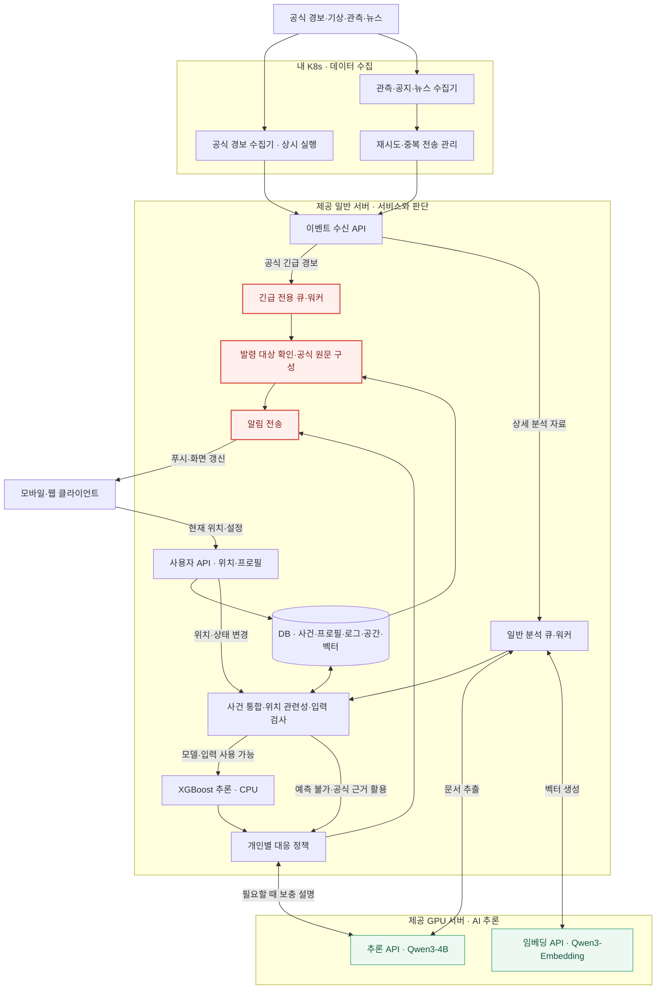
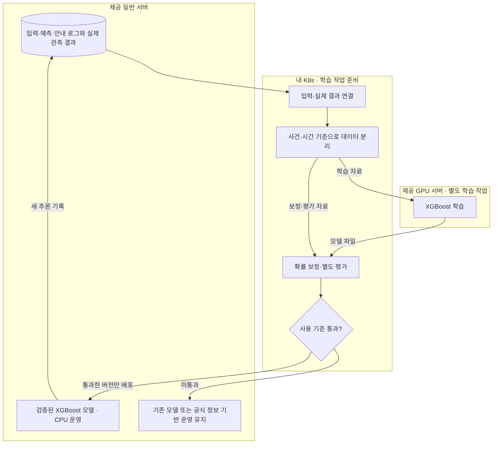

# Context

## Loom 코드 계약

아래 항목은 Loom 코드에 고정된 runtime 동작 계약입니다. 관련 흐름을 바꾸기 전 `loom contract show <id>`로 확인합니다.

- `task-execution`: Task 실행 전 prompt/context/previous-results에 들어가는 입력 경계입니다. 명령: `loom contract show task-execution`. Source: `loom/application/context_pack.py`, `loom/application/team_policy.py`
- `done-guardrail`: Task를 DONE으로 인정하기 전에 필요한 산출물과 상태 전이를 검증하는 계약입니다. 명령: `loom contract show done-guardrail`. Source: `loom/application/services.py`

## Project Memory

# 프로젝트 분석: BONGHWAJIGI

## 루트

`/Users/hongyongjae/Desktop/helloworld/BONGHWAJIGI`

## 요약

- 주요 스택: 확인 필요
- 패키지 / 런타임 파일: -
- 테스트 진입점: -
- 앱 진입점: docs/

## 최상위 구조

- ./
  - .gitignore
  - AGENTS.md
  - CLAUDE.md
  - README.md
-   docs/
    - README.md
    - ai-and-infrastructure.md
    - architecture-and-data-flow.md
    - decisions-and-meeting-review.md
    - product-and-scenarios.md
    - ui-ux-handoff.md

## 레포 규칙

- 기존 프로젝트 스타일과 로컬 helper API를 우선합니다.
- 수정 전에 관련 파일을 먼저 확인합니다.
- 변경 범위는 현재 Loom Task 계약 안에 유지합니다.
- 사용자 변경분을 버리는 destructive git reset/checkout을 사용하지 않습니다.
- 넓은 리팩터링이나 cross-domain 변경이 필요하면 먼저 boundary warning을 기록합니다.

## 실행 힌트

- 설치 / 런타임: -
- 테스트 / 검증: -
- 개발 서버: -

## 위험 영역

- 주의가 필요한 경로:
  - `No obvious sensitive path detected`

## Loom Task 가이드

- 좋은 Task는 예상 산출물, 완료 조건, 작업 범위, 검증 힌트를 가져야 합니다.
- repo 맥락이 약하면 architecture docs를 보강한 뒤 `loom analyze-repo`를 다시 실행합니다.
- agent 실행 전 `loom task validate <task-id>`로 경계를 확인합니다.
- 중단 이후에는 `loom resume`으로 현재 workflow 상태를 복구합니다.

## 보완할 맥락

- 아키텍처 ownership boundary는 수동 note가 필요할 수 있습니다.
- 배포, credential, 외부 서비스 정책은 자동으로 추론하지 않습니다.
- 프로젝트별 규칙은 Job note 또는 context reference에 추가합니다.

## Workspace Policy

- Output language: `ko`
- Agent provider: `claude`
- Agent model: `adapter-default`
- Reasoning effort: `high`
- Required branch: `develop`
- Dirty branch switch: `blocked`
- Commit policy: `manual`
- Include `.loom` metadata in Git: `yes`
- Read-only parallel execution: `allowed`
- Validation environment: `auto`
- Previous Task result limit: `2`
- Workspace required docs: -
- Loom fixed guardrails and verified Team required policies take precedence over this Workspace Policy.

## Job

- Title: V2 실행 기반과 통합 검증
- Goal: 산불 한 종류의 오늘 MVP 범위와 실행 기반을 고정하고 공식 경보 우선 전달·사용자별 텍스트 안내·변경 및 해제를 시간순 재생으로 통합 검증한다. 3D와 서버 음성을 제외하고 실제 성능과 모의 시연을 구분한다. 이 갱신은 사용자 지시에 따른 계약 재고정이며 구현 실행·Queue 등록은 포함하지 않는다. 기존 완료 이력과 Task ID를 보존한다.
- Branch: HeoNey
- Task count: `7`

## Task

- Title: 산불 MVP 구현 기술 스택과 서버별 배치 계약 고정
- Description: 사용자가 현재 에이전트에게 레포 상태를 확인하고 산불 MVP 기술 스택을 정하도록 직접 지시했다. 현재 레포와 API 초안, 일반 서버 2 vCPU·약 8GiB 및 단일 L4 GPU의 기존 점검 기록과 공식 기술 문서를 대조해 구현 스택과 배치·의존성·검증 기준을 문서로 고정한다. 대응 레벨과 레벨별 알림 방식은 사용자 회의 결과 대기이며 임의로 확정하지 않는다.
- Expected output: docs/V2/delivery/implementation-stack.md 및 기존 A3 실행 기반 계약의 기술 기준 참조, 관련 Loom 결정·검증 기록
- Done condition: API·DB·공간·벡터 검색·긴급/분석 큐·수집·모델·배포·검증 스택과 선택 근거 및 서버별 배치가 명시되고 공식 근거 링크와 미검증 항목을 구분하며 문서 및 Loom 검증 후 로컬 커밋된다.
- In scope: 레포·원격 develop 및 기존 인프라 기록 읽기; 공식 문서 조회; 기술 스택 결정 문서; A3에 기술 기준과 선행 설계 연결; 관련 Job 노트와 Task 결과; 검증 및 로컬 커밋
- Out of scope: 서버 접속·설치·재시작·배포; 라이브러리 설치 및 앱/서버 코드 구현; 모델 다운로드·학습·성능 검증; 대응 레벨·알림 정책 확정; _APP 조회·수정; 원격 push; 기존 구현 Task 실행 또는 Queue 등록
- Validation hint: 현재 레포와 자원 근거 대조, 공식 문서·내부 링크 검사, A3 선행 관계와 필수 문서 검사, 정책 미확정 및 실제/모의 경계 확인, git diff --check와 Loom strict
- Required docs: `docs/V2/01_서비스_핵심_정리.md`, `docs/V2/02_실시간_서버_배치도.md`, `docs/V2/03_학습_검증_흐름도.md`, `docs/V2/delivery/app-api-contract.md`, `docs/V2/delivery/environment-readiness.md`, `docs/V2/delivery/tailnet-connectivity.md`
- Memory refs: -
- Document outputs: `docs/V2/delivery/implementation-stack.md`
- Document output exceptions: -
- Source proposal: `-`
- Status: PENDING
- Assigned agent: foreground

## Advisor Source Prompt

No Advisor source prompt recorded for this Task.

## Inclusion Policy

- Mandatory execution files: `prompt.md`, `context.md`, and `previous-results.md`.
- Always included: project memory, current Job/Task metadata, and Job notes.
- Previous results: up to the latest 2 recorded results from earlier Tasks in this Job.
- Job context refs: explicit Job-scoped references selected by the controlling agent or user.
- Task required docs: mandatory Task-scoped documents; missing refs block validation and execution.
- Task memory refs: mandatory Task-scoped workflow memory references; missing or non-memory refs block validation and execution.
- Repository documents, validation documents, and skill rules: included only through explicit Job context refs, Task required docs, or Task memory refs.
- Verified Team Policy Snapshot: included before Active Memory; required policy cannot be overridden by lower-priority context.
- Active workflow memory with an `always` category is included automatically while its status is `ACTIVE`.
- `task_selected` and `reference_only` memory is included only through explicit Task memory refs.
- Consumed proposals, rejected proposals, resolved memory, superseded memory, and archived memory are excluded.
- Unreferenced repository files and results from other Jobs are not included.
- `AGENTS.md` and `CLAUDE.md` remain session-level controlling-agent entrypoints and are not treated as task context artifacts by default.

## Job Notes

# Notes

## 2026-10-31T00:24:09+00:00

사용자 지시 기준: V2를 설계 정본으로 삼고 HeoNey는 참고한다. 앱 구현은 앱팀 소관이며 우리 산출물은 서버와 앱 연동 API 명세이다. 이번 턴은 서버와 클러스터의 읽기 전용 점검 및 TODO의 Job Task 등록만 실행한다. 신규 구현 Task는 PENDING으로 두며 Queue Worker와 배포 학습을 시작하지 않는다. 사용자가 Job Task 분할을 직접 위임했으므로 통제 에이전트가 계약을 생성한다.

- Task: `task-20261031-002027-k8s-v2-a251b54e`
- Tags: `scope`, `user-direction`
## 2026-10-31T00:26:25+00:00

설계 기준은 docs/V2이며 HeoNey는 참고다. 앱 구현은 제외하고 앱팀에 API 명세를 제공한다. 이 등록은 작업 계약 고정이며 후속 구현 Task를 지금 실행하거나 Queue에 넣지 않는다. 기준 원문은 docs/V2/01, 02, 03 문서이고 실행 작업표는 docs/V2/04-execution-backlog.md이다. 등록 시 의존관계는 Job 경계를 넘어 적용한다.
- Tags: `v2`, `scope`, `backlog`
## 2026-10-31T00:42:26+00:00

사용자 질문 응답: 첨부 이미지의 계정 및 비밀번호를 GPU 서버와 일반 서버의 SSH 로그인에 사용하도록 두 서버 로그인 승인이라고 명시적으로 답했다. 상태 조회에만 사용하며 인증정보는 저장소나 보고서에 남기지 않는다. 기존 검토 대기 Task의 서버 조회를 재개한다.

- Task: `task-20261031-002027-k8s-v2-a251b54e`
- Tags: `user-approval`, `resume`
## 2026-10-31T00:50:01+00:00

승인 후 실제 서버 조회 완료: GPU 서버는 4 vCPU RAM 47.05 GiB 및 NVIDIA L4 1대, 드라이버 580.159.04, cuInit 성공이다. 일반 서버는 2 vCPU RAM 7.76 GiB, systemd running 및 실패 서비스 없음이다. 두 서버 사이 TCP 22는 양방향 접근 가능하다. GPU 서버는 부팅 시 Mellanox 설정 파일 누락과 NVSwitch 조회 실패 기록으로 systemd degraded이며 A2에서 실제 필요성과 조치 여부를 확인한다. K8s발 서버 API 통신과 실제 모델 성능은 별도 검증 대상이다.

- Task: `task-20261031-002627-task-5ce3742e`
- Tags: `infrastructure`, `verified`
## 2026-10-31T01:20:51+00:00

사용자가 현재 대화에서 검증 작업 전부 실행을 지시했다. 선행 완료된 A2 환경 검증을 지금 수행하고, 학습 모델과 구현 및 API가 필요한 C4 D3 E2 A4 검증은 선행 산출물 존재 여부와 실행 경계를 확인한다. 이 지시는 검증 작업 실행이며 미구현 기능 전체의 개발 지시로 확대하지 않는다.

- Task: `task-20261031-002627-task-5ce3742e`
- Tags: `user-request`, `validation`
## 2026-10-31T01:22:32+00:00

사용자가 검증을 계속하기 전에 develop과 HeoNey를 동기화하고 develop에서 실행하도록 지시했다. 원격 최신 상태 조회 결과 develop은 HeoNey의 조상이며 충돌 없는 fast-forward가 가능하다. 진행 중 A2 기록을 보존하고 실행 브랜치 정책을 develop으로 변경한 뒤 검증을 이어간다.

- Task: `task-20261031-002627-task-5ce3742e`
- Tags: `user-direction`, `branch`
## 2026-10-31T01:28:14+00:00

사용자 추가 설명: 클러스터와 제공 서버는 서로 아예 다른 VPN이므로 현재 직접 통신이 안 되는 것이 맞다. 6개 노드와 5개 워커 파드의 제공 서버 TCP 22 시험은 모두 시간 초과, 노드 경로는 일반 게이트웨이이며 제공 서버 대역 전용 경로는 확인되지 않았다. 장애로 단정하지 않고 A3 실행 기반 구성에서 명시적 연결 방식을 정해야 하는 설계 조건으로 기록한다. VPN/라우팅/방화벽 설정은 이번 검증에서 변경하지 않는다.

- Task: `task-20261031-002627-task-5ce3742e`
- Tags: `user-context`, `network-validation`
## 2026-10-31T01:30:16+00:00

검증 전부 실행 지시를 확인했다. 계약 형식 검증은 통과했지만 실제 검증에 필요한 선행 작업 B5, C5, D5, E2의 산출물이 아직 없어 기능 검증은 실행할 수 없다. 모델 또는 API가 완성된 것으로 간주하지 않고 PENDING 유지하며 선행 구현 완료 후 이 Task를 실행한다. 현황은 A2 환경 검증 보고서에 함께 정리한다.

- Task: `task-20261031-002631-task-df03e0e8`
- Tags: `validation`, `prerequisites`
## 2026-10-31T01:35:11+00:00

A2 결과: 클러스터와 제공 서버는 별도 VPN이며 6개 노드 및 5개 워커 파드에서 제공 서버 TCP 22 연결 실패가 실측됐다. A3에서는 허용된 전송 경로와 서비스 주소/포트/인증/TLS를 먼저 정하고 실제 수집 API까지 검증해야 한다. 단일 파드 요청 2 CPU는 현재 어느 워커에도 들어가지 않고 합산 요청 여유는 약 5.19 CPU다. DNS resolver의 4개 nameserver 정리와 GPU 보조 서비스 상태 관리도 검토한다. 일반 서버는 A0 로그인 성공 이후 이번 재인증을 못 했으므로 설치 전에 정확한 자격 증명 재확인이 필요하다. 보고서 docs/V2/delivery/environment-readiness.md 참조.

- Task: `task-20261031-002627-k8s-4bf877bd`
- Tags: `verification-result`, `readiness`
## 2026-10-31T02:38:53+00:00

A5에서 두 서버 Tailscale 1.104.4 설치와 기존 tailnet 등록 완료. 사용자 저장 직전 승인 후 관리자 그룹·마스터·두 서버에서 두 서버 IPv4 TCP 22만 허용하는 grant 1개를 추가했다. Tailnet SSH 실제 로그인, 마스터발 TCP 22 및 서버 상호 배너 수신이 성공했다. 일반 서버 재인증 문제는 해결됐다. 일반 워커와 파드는 경로가 없어 연결 실패하므로 A3에서 프로젝트 전용 egress와 실제 API 포트·인증·TLS를 구성하고 다시 검증한다. 비밀정보는 기록하지 않았다.

- Task: `task-20261031-022438-tailscale-6dc57118`
- Tags: `tailscale`, `verified`, `follow-up`
## 2026-10-31T08:01:46+00:00

# 2026-10-31-wildfire-mvp 작업 계약 재고정

사용자 지시: “오케 우선은 그거대로 loom에 타스크를 재고정 해”.

2026-10-31 KST 사용자 재고정: 오늘 MVP는 산불 한 종류이며 3D와 서버 STT/TTS·오디오 스트리밍을 제외하고 서버는 텍스트를 제공한다. 공식 경보는 출처·원문·발령 대상을 확인해 개인별 정책 계산과 GPU를 기다리지 않고 우선 전달한다. 일반 분석은 정형 파싱 또는 필요한 Qwen 문서 추출·저장 문서의 임베딩 검색, 사건 통합·위치 관련성·입력 검사, 영향 확률 또는 예측 불가, 검토된 개인별 정책 순서다. 공식 등급·환경 영향 확률·개인 대응 단계를 분리하고 정책은 검토·버전 관리하며 입력 변경 때 재적용한다. 실제 자료·과거 재생·합성 시나리오를 구분하고 실제 정답이 없으면 학습·추론 연결은 simulation으로 검증하며 실제 예측은 unavailable로 둔다. 이 지시는 작업 계약 재고정만 승인하며 구현 실행·Queue 등록·서버 설치·원격 push를 지금 승인한 것으로 취급하지 않는다. 오늘 범위는 이 계약과 Job 재고정 노트를 우선하고 기존 V2 문서는 배경 설계로 참조한다.

이 갱신은 재고정만 수행하며 Task 실행 또는 Queue 등록을 시작하지 않는다.

미정: 시연 지역·사례, 모델의 실제 정답 출처·격자·예측 기간, 개인 대응 단계 매핑, 2D 실제 경로 계산 채택 여부. 60분은 예시이며 실제 확정값이 아니다. 실제 정답 부족은 C4에서 실제 예측 보류로 판정한다.

착수 순서: A1 → B1 → B2 및 C1 → A3·D1·D6 → 수집/긴급 전달·개인 정책·모델 준비 → 안내 갱신 → E2·A4 통합 검증. 공식 원문 전달 D4는 개인 정책 D1/D2와 모델 준비를 선행 조건으로 삼지 않는다.

- A1 `task-20261031-002627-mvp-e821b0f7`: 산불 MVP의 지역·재생 사례·실제 및 모의 범위와 수용 기준 고정. 선행: A0. 현재 PENDING.
- A3 `task-20261031-002627-k8s-4bf877bd`: 산불 MVP의 수집·DB·긴급 및 분석 큐·모델 API 실행 기반 구성. 선행: A1, A2, A5, B2. 현재 PENDING.
- A4 `task-20261031-002631-task-df03e0e8`: 산불 사례 재생으로 공식 경보 우선·개인별 안내·갱신 및 장애 통합 시연 검증. 선행: B5, C5, D5, E2. 현재 PENDING.

구체적 완료 조건은 각 Task의 재고정 계약을 따른다. 기존 docs/V2/04-execution-backlog.md는 이전 계획이며 실제 계약 정본은 현재 Task와 이 노트다.
- Tags: `mvp`, `산불`, `2026-10-31`, `계약재고정`

## Context References

No explicit context references recorded for this job.

## Required Documents and Memory

### required-doc: docs/V2/01_서비스_핵심_정리.md

- Path: `docs/V2/01_서비스_핵심_정리.md`
- Status: present

# 재난 대응 비서 - 서비스 핵심 정리

작성일: 2026-10-31  |  버전: 1.0

이 문서는 재난 대응 비서 관련 대화의 핵심과 설계 후보를 정리한 문서다. 구현·배포·학습·성능 검증이 완료됐다는 의미는 아니다.

## 1. 서비스의 핵심과 목표

> 위험이 사용자에게 영향을 주기 전에, 그 사람이 준비하고 대응하는 데 필요한 시간을 확보해 주는 재난 대응 비서.

공식 경보·관측·뉴스를 지속적으로 수집하고 사용자 위치·상태에 연결한다. 관련 사건의 변화를 추적해 **언제 무엇을 준비해야 하는지** 개인별로 안내하는 것이 서비스의 중심이다. 해커톤에서는 AI 기반 개인별 대응 행동 추천이라는 방향으로 설명할 수 있다.

### 10m 이내의 두 사용자도 서로 다른 안내를 받을 수 있다

| 구분 | 달라질 수 있는 대응 |
| --- | --- |
| 혼자 이동할 수 있는 사용자 | 적용되는 준비 사항과 공식 행동요령 안내 |
| 이동 지원이 필요한 사용자 | 지원 요청·연락·준비 사항을 추가하고, 검토된 정책에 따라 안내 시점 조정 |
| 언어·음성·화면 설정이 다른 사용자 | 선호·접근성 설정에 맞는 전달 방식 적용 |

사용자 상태는 필요한 대응을 바꾼다. 동일한 환경 위험을 평가할 때 이동 능력만으로 화재·연기·물의 도달 확률이 달라지지는 않는다. 가까운 두 지점도 층수·지형·건물 조건에 따라 노출이 다를 수 있으므로, 10m 거리만으로 위험까지 동일하다고 단정하지 않는다.

### 시간을 번다는 의미

상류에서 이미 재난이 발생했더라도 하류 사용자에게 영향이 오기 전에 준비를 시작하게 했다면 목표에 부합한다. 목표는 모든 재난의 발생 시각을 맞히는 것이 아니라, **사용자에게 영향이 도달하기 전 필요한 준비 시간**을 확보하는 것이다.

현재 상태: 서비스 방향과 구성 후보를 정리한 단계다. 실제 예측 모델·개인별 정책·확보 가능한 선행 시간은 검증되지 않았다. 서비스명, 첫 재난 유형, 지역, 세부 대상 사용자는 미정이다.

## 2. 실시간 처리와 판단 주체

### 기본 파이프라인

자료 수집 → 정형 필드 파싱 또는 Qwen 문서 추출 → 사건 통합 → 사용자·관심 장소 관련성 확인 → 필요한 자료 보강 → 모델 입력 검사 → 위험 평가 → 대응 정책 적용 → 알림·안내 갱신. 위치·프로필·통제 정보가 바뀌어도 필요한 단계부터 재평가한다.

| 구성 | 맡기는 역할 |
| --- | --- |
| Qwen3-4B-Instruct-2507 | 약 40억 파라미터의 사전 학습된 텍스트 모델. 사실·장소·시각·상태·근거 추출과 선택된 안내의 설명. Non-thinking 전용 업데이트 모델.[1] |
| Qwen3-Embedding-0.6B | 수집한 문서의 벡터 생성과 관련 문서 검색 지원. 웹 수집 자체는 별도 기능.[2] |
| XGBoost 기반 모델 | 관측값·정리된 입력으로 정해진 영향 확률 추정. 우리 목표에 맞는 학습·검증이 필요하며 현재는 후보.[3] |
| 정책 엔진 | 공식 지침과 사전 검토한 규칙에 사용자 상태·위험 평가를 대입해 알림과 행동 선택 |

### 공식 긴급 경보는 별도 경로

공식 출처와 발령 대상의 관련성을 확인하면 **원문·출처·발령 시각을 우선 전달**한다. 추가 검색·확률 계산·Qwen 설명·음성·지도 로딩을 기다리지 않는다. 낮은 모델 예측값이 공식 긴급 지침을 보류하거나 낮추지 않게 한다.

공식 경보의 긴급성과 행동 지침을 보존한다. 경보가 있다는 이유만으로 모든 상황에 대피를 지시하지 않는다. 공식 경보 상태와 서비스의 개인별 대응 상태는 별도로 표시한다.[6]

### 개인별 정책은 사람이 설계하고 서버가 실행

사용자 정보(위치·이동·지원·설정), 주변 상황(경보·관측·통제), 공통 대응 규칙을 분리한다. 규칙은 공식 행동요령을 바탕으로 작성·검토하며, 실행 시에는 정책 엔진이 자동 적용한다. Qwen은 행동을 임의로 결정하지 않고 선택된 지침을 설명한다.

## 3. 세 가지 검사와 지도 데이터

### 사건 통합·출처·시각 확인

공식 API·기관 원문·뉴스 매체를 구분하고 원문 URL·식별자를 보관한다. 같은 문서의 중복과 같은 사건의 연결을 구분한다. 공식 사건 ID나 갱신 참조가 있으면 우선 사용하고, 없으면 종류·장소·시간으로 후보를 찾는다. 근거가 부족하면 합치지 않고 별도로 유지한다.

발생·관측 시각, 발표 시각, 수집 시각, 유효 종료 시각을 분리한다. 늦게 수집한 과거 기사를 새 사건으로 취급하지 않는다. 발령·수정·해제 관계를 따라 상태를 갱신하며, 문서 추출 성공 자체를 사실 확인 완료로 보지 않는다.[6]

### 내 위치·관심 장소와의 관련성

현재 좌표·위치 정확도·갱신 시각·관심 장소를 공식 발령 구역, 사건 위치, 통제 구간과 비교한다. 공간 포함·교차·거리 계산을 사용하며, 주변 사건은 추가 평가 후보로 본다. 장소가 모호하거나 위치가 오래됐으면 판단 보류·관련 가능성을 유지한다.[7]

### 검증 모델·필요 입력 확보

사전에 등록한 모델의 예측 목표·지역·시간 범위·검증 상태를 확인한다. 실행할 때는 필수 항목, 단위, 시간 기준, 최신성, 검증된 결측 처리 조건을 검사한다. 조건을 만족하지 않으면 예측 불가로 처리하며, 위험 0으로 바꾸지 않는다. 공식 정보 기반 안내는 계속한다.

| 지도 데이터 사용 지점 | 필요한 자료 |
| --- | --- |
| 위치 관련성 | 장소 좌표, 행정구역·발령 구역, 통제 위치 |
| 영향 예측의 입력 | 선택한 재난·모델에 필요한 고도·경사·하천·유역 등 |
| 경로 기능 | 보행·도로 연결망, 계단·경사·출입구·통제·시설 정보 |
| 화면 표시 | 배경 지도와 사건·경로. 3D이면 지형·건물 자료 추가 |

현재 GPS 좌표는 사용자 기기에서 받는다. 지도는 좌표를 구역·도로·지형과 연결한다. 경로 탐색 알고리즘이나 3D 표시 도구만으로 실제 통행 가능성·안전성이 확인되는 것은 아니다.

## 4. 학습해야 할 대상과 개선 과정

> 학습 목표: 이미 발생했거나 발생할 수 있는 재난이, 정해진 시간 안에 특정 위치·경로에 영향을 미칠 확률.

이미 확인된 재난의 발생 여부를 다시 예측하는 것이 아니다. 예를 들어 특정 관측지점의 향후 30분 이내 기준 수위 초과 여부를 목표로 정할 수 있다. 이 결과를 곧바로 사용자 집의 침수 확률로 바꾸어 해석할 수는 없다.

### 학습 자료

| 구분 | 기록할 내용 |
| --- | --- |
| 당시 입력 | 그 시점까지 실제 이용 가능했던 관측·위치·사건 정보와 시각 |
| 예측·운영 기록 | 모델 버전, 예측값, 선택한 안내, 전송 시각 |
| 이후 실제 결과 | 정의한 기간·위치·기준에 따라 영향이 관측됐는지. 발생하지 않은 사례 포함 |

이전 모델의 예측값 자체를 정답으로 사용하지 않는다. 입력과 실제 결과를 연결하는 현재 계획은 **지도학습 기반 재학습**에 가깝다. 행동 선택을 보상으로 개선하는 강화학습은 별도 설계 과제이며 현재 확정된 구현이 아니다.[12]

### 검증·보정·교체

학습·확률 보정·최종 평가 자료를 분리하고 사건·시간 관계를 고려해 정보 누출을 막는다. 놓친 위험, 오경보, 예측 확률과 실제 발생 비율을 확인한다. 단순히 0~1 값을 출력하거나 위험 점수로 이름을 바꾼 것만으로 유효성이 확보되지는 않는다.[4][5]

추론은 새 입력에 맞춰 갱신한다. 재학습은 실제 결과가 누적된 뒤 별도로 수행하고, 사용 기준을 통과한 모델 버전만 교체한다. 미통과하면 기존 모델 또는 공식 정보 기반 운영을 유지한다.

### 아직 구분해야 하는 시간 문제

“30분 안에 영향이 있을 확률”은 정확한 도달 시각을 뜻하지 않는다. 개인별 안내 시점을 결정하려면 예상 영향 시점·불확실성과 준비·이동·지원 소요시간을 어떻게 다룰지 추가 설계가 필요하다.

## 5. 배치 방향과 과거 사례 시연

| 실행 위치 | 제안된 배치 |
| --- | --- |
| 내 K8s | 기관별 수집기, 수집 재시도·상태 관리, 과거 자료 재생, 학습 자료 준비·평가 |
| 제공 일반 서버 | 사용자 API·DB, 긴급·일반 큐와 워커, 사건·공간 분석, XGBoost CPU 추론, 대응 정책·알림 |
| 제공 GPU 서버 | Qwen3-4B·Embedding 추론. 별도 시간의 XGBoost 학습 |
| 사용자 기기 | 위치·설정 전달, 알림 수신, 지도·경로 렌더링 |

GPU 학습 모델은 CPU에서도 실행할 수 있으므로 XGBoost 운영 추론은 일반 서버에 둔다.[3] MeloTTS를 붙이면 일반 서버의 낮은 우선순위 작업으로 검토한다. 경로 계산은 일반 서버, Cesium 화면 표시는 사용자 기기에서 수행하는 방향이다.[10][11]

공유된 GPU 사양은 NVIDIA L4 24GB·4 vCPU·48GB RAM이며 실측 확인 전이다. 일반 서버 사양은 미정이다. 두 Qwen 모델의 실제 메모리·처리량과 네 K8s에서 제공 서버로의 VPN·방화벽 연결을 확인해야 한다.

### 시연 시나리오

1. 한 재난 유형·한 지역의 과거 사례와 원본 발표·관측 시각을 준비한다.

2. 가까운 위치에 있지만 이동·지원·전달 설정이 다른 두 사용자를 등록한다.

3. 당시 공개된 정보만 시간순으로 재생한다.

4. 사전 준비 안내와 사용자별 차이를 보여준다.

5. 공식 긴급 지침 수신 시 AI를 기다리지 않는 전달을 보여준다.

6. 통제·해제 또는 사용자 위치 변경에 따라 안내가 갱신되는 모습을 보여준다.

나중에 알려진 피해 정보를 앞 시점에 넣지 않는다. 시연용 모의 자료·미리 정한 출력과 실제 모델 출력을 구분한다. 한 사례의 시연 성공은 예측 성능 검증을 대신하지 않는다.

### 확인할 지표

발표→서버 수신→단말 도착의 시간, 개인별 안내의 근거·적합성, 준비 가능한 시간, 중복·낡은 경보 억제, 위험 누락·오경보를 확인한다. “어디보다 빠르다”는 비교 검증 전의 목표이며 보장된 성능이 아니다.

## 6. 남은 결정과 검증 항목

| 항목 | 아직 결정하거나 확인할 내용 |
| --- | --- |
| 첫 적용 범위 | 재난 유형·지역·사용자·예측 시간·영향 기준 |
| 자료 확보 | 기관별 API·갱신 주기·과거 자료·실제 결과 라벨·사용 조건 |
| 사건·시간 처리 | 식별자, 수정·해제, 중복·상충 정보, 출처·유효시간 처리 |
| 위치 관련성 | 행정구역·위치 오차·경로·상류하류 등 재난별 관계 기준 |
| 예측 모델 | 학습 가능성, 적용 범위, 결측·노후 입력 처리, 평가·보정 합격 기준 |
| 개인 대응 정책 | 공식 지침과 사용자 상태를 연결하는 규칙, 알림 시점·해제·변경 조건 |
| 필요한 시간 | 영향 예상 시점과 준비·이동·지원 소요시간의 산정 방식 |
| 경로·시설·3D | 실제 통행·접근성·시설 이용 가능 정보 확보 여부와 기능 범위 |
| 실행 환경 | 일반 서버 용량·저장공간, GPU 처리량, 서버 간 통신, 푸시 구현 |
| 운영 개선 | 기록 방식, 실제 결과 확인, 재학습 주기, 검증 후 교체 기준 |

### 현재 MVP 방향으로 제안된 범위

한 지역·한 재난 유형에서 수집→사건 연결→사용자 관련성→개인별 안내 갱신을 우선 완성한다. 공식 경보 즉시 전달은 별도로 확보한다. 확률 예측은 학습·검증과 입력 조건이 확보된 경우에 붙이며, 상세 경로·3D는 데이터 확보에 따라 확장한다.

> 가장 중요한 검증 질문: 특정 재난 사례에서 특정 사용자에게 실제로 필요한 준비 시간을 더 확보해 줄 수 있는가?

서비스명은 미정이다. 이정·지표·파수·기점, BEARING·SENTINEL·AEGIS·MERIDIAN 등의 후보가 논의됐으며 최종 선택·명칭 사용 가능 여부는 확인하지 않았다.

## 7. 참고 자료와 문서 구성

이 문서는 재난 대응 비서 관련 대화의 핵심과 설계 후보를 정리했다. 아래 자료는 도구·개념을 확인하기 위한 참고이며, 우리 서비스의 데이터 확보나 예측 성능을 입증하는 자료는 아니다.

### 공식 참고 자료

[1] [Qwen3-4B-Instruct-2507 모델 설명](https://huggingface.co/Qwen/Qwen3-4B-Instruct-2507)

[2] [Qwen3-Embedding-0.6B 모델 설명](https://huggingface.co/Qwen/Qwen3-Embedding-0.6B)

[3] [XGBoost GPU 학습·CPU/GPU 호환](https://github.com/dmlc/xgboost/blob/master/doc/gpu/index.rst)

[4] [scikit-learn 확률 보정](https://scikit-learn.org/stable/modules/calibration.html)

[5] [scikit-learn 시간·그룹 기반 검증](https://scikit-learn.org/stable/modules/cross_validation.html)

[6] [OASIS CAP 1.2 경보 규격](https://docs.oasis-open.org/emergency/cap/v1.2/CAP-v1.2-os.html)

[7] [PostGIS 공간 교차](https://postgis.net/docs/ST_Intersects.html) / [거리 검사](https://postgis.net/docs/ST_DWithin.html)

[8] [UNDRR 조기경보 체계 정의](https://www.undrr.org/terminology/early-warning-system)

[9] [Kubernetes CronJob](https://kubernetes.io/docs/concepts/workloads/controllers/cron-jobs/)

[10] [MeloTTS 한국어 모델](https://huggingface.co/myshell-ai/MeloTTS-Korean)

[11] [CesiumJS](https://cesium.com/platform/cesiumjs/)

[12] [Google 지도학습·실제 정답 용어 설명](https://developers.google.com/machine-learning/glossary#supervised-machine-learning)

### 세 문서의 역할

| 문서 | 내용 |
| --- | --- |
| 01 핵심 정리 | 목적·모델·정책·판단 기준·데이터·시연·미정 사항 |
| 02 실시간 서버 배치도 | 사용자가 제공한 Mermaid 배치도와 각 경로의 실행 위치 |
| 03 학습·검증 흐름도 | 실제 결과 연결, 학습·보정·평가, 모델 버전 교체 |

## 함께 볼 문서

- [실시간 서버 배치도](02_실시간_서버_배치도.md)
- [학습·검증 흐름도](03_학습_검증_흐름도.md)

두 문서에는 수정 가능한 Mermaid 원문이 포함돼 있다.

### required-doc: docs/V2/02_실시간_서버_배치도.md

- Path: `docs/V2/02_실시간_서버_배치도.md`
- Status: present

# 재난 대응 비서 - 실시간 서버 배치도

작성일: 2026-10-31  |  버전: 1.0

내 K8s 수집 / 제공 일반 서버 판단·전달 / 제공 GPU 서버 추론

대화에서 정리한 설계안이다. 현재 학습·배포·검증이 완료됐다는 의미는 아니다.

## 다이어그램



## 해설

> 공식 긴급 경보: K8s 수집 → 일반 서버 긴급 큐·워커 → 발령 대상 확인 → 공식 원문 전달. GPU 추론을 기다리지 않는다.

| 영역 | 주요 책임 |
| --- | --- |
| 내 K8s | 기관별 상시 경보 수집과 관측·공지·뉴스 수집. 재시도·수집 상태 관리 |
| 일반 서버 | 이벤트·사용자 API, 긴급/일반 작업 분리, DB, 사건·공간 분석, XGBoost CPU 예측, 대응 정책·알림 |
| GPU 서버 | Qwen3-4B-Instruct-2507의 추출·설명, Qwen3-Embedding-0.6B의 벡터 생성 |
| 사용자 기기 | 위치·설정 전달, 알림 수신, 지도 표시 |

### 도표를 읽는 기준

일반 분석 워커는 문서가 필요할 때 GPU를 호출한다. 구조화된 관측자료는 Qwen을 생략할 수 있다. 벡터 생성은 GPU, 벡터 저장·검색은 일반 서버다. 사건 통합·위치 관련성·입력 검사는 일반 서버에서 수행한다.

XGBoost는 검증된 모델과 입력 조건이 확보된 경우에만 호출한다. 사용할 수 없으면 공식 정보 기반 대응을 유지한다. 사용자 위치·지원 상태가 바뀌면 필요한 단계부터 재평가한다.

빨간 노드는 긴급 경보 전달 경로다. 마지막 알림 전송 노드는 일반 안내도 공유한다. 초록 노드는 GPU 모델 API다. 양방향 연결은 요청과 결과 반환을 뜻하며 실시간 자동 재학습을 뜻하지 않는다.

### 구현 전에 확인할 사항

긴급·일반 큐와 워커의 실행 자원을 분리하고, 수집·처리·알림의 중복과 갱신·해제를 관리한다. 긴급 수집기에도 자체 재시도·중복 방지 기준이 필요하다. 도표는 핵심 연결을 표현하므로 원문·로그 저장과 모든 DB 접근선은 생략돼 있다.

일반 서버 사양과 네 K8s에서 제공 서버로의 VPN·방화벽 연결은 미확인이다. Qwen 두 모델의 메모리·처리량은 실제 자료로 측정한다. GPU 장애가 있어도 긴급 경보는 처리하도록 구성하되, 수집기·일반 서버·네트워크의 가용성은 별도로 확보해야 한다.

## 함께 볼 문서

- [서비스 핵심 정리](01_서비스_핵심_정리.md)

- [학습·검증 흐름도](03_학습_검증_흐름도.md)

### required-doc: docs/V2/03_학습_검증_흐름도.md

- Path: `docs/V2/03_학습_검증_흐름도.md`
- Status: present

# 재난 대응 비서 - 학습·검증 흐름도

작성일: 2026-10-31  |  버전: 1.0

실제 결과 연결 / 학습 / 확률 보정·평가 / 검증 모델 배포

대화에서 정리한 설계안이다. 현재 학습·배포·검증이 완료됐다는 의미는 아니다.

## 다이어그램



## 해설

> 이전 추론값 자체를 정답으로 삼지 않는다. 당시 입력과 이후 실제 관측 결과를 연결하고, 검증한 모델 버전만 운영에 반영한다.

| 단계·위치 | 처리 내용 |
| --- | --- |
| 기록 - 일반 서버 | 입력·자료 시각·모델 버전·예측값·안내·전송 시각과 실제 결과 보관 |
| 자료 준비 - K8s | 예측 대상·기간에 맞춰 입력과 정답 연결. 사건·시간 기준으로 자료 분리 |
| 학습 - GPU 서버 | XGBoost 학습. 작은 자료라면 CPU 학습 가능성도 있으나 현재 배치안은 GPU 활용 |
| 보정·평가 - K8s | 학습과 분리한 자료로 확률 보정 및 별도 성능 평가 |
| 운영 반영 - 일반 서버 | 사전에 정한 사용 기준을 통과한 버전만 CPU 추론에 배포 |

### 분리해야 하는 자료

학습용, 확률 보정용, 최종 평가용 자료를 구분한다. 같은 사건의 정보나 미래 관측이 경계를 넘어 섞이지 않도록 한다. 당시 수집·이용할 수 없던 후속 기사를 과거 입력에 넣지 않는다. 영향이 없었던 사례도 평가에 포함한다.

### 반복 추론과 재학습의 차이

실시간 반복 추론은 고정된 모델에 최신 입력을 넣는 과정이다. 재학습은 실제 결과가 누적된 뒤 새 모델을 만드는 별도 작업이다. 이 계획은 지도학습 기반 개선이며, 행동 선택을 보상으로 학습하는 강화학습은 별도 과제다.

### GPU 운영과 모델 교체

첫 시연 전에 학습을 끝내고 시연 중 GPU는 Qwen·Embedding 추론에 집중시키는 방향을 권한다. 동일 GPU의 추론과 학습을 동시에 수행할지는 메모리·처리량을 확인한 뒤 결정한다. 새로운 모델이 기준을 통과하지 못하면 기존 모델 또는 공식 정보 기반 운영을 유지한다.

아직 미정: 실제 학습 자료, 예측 목표, 합격 기준, 재학습 주기, 배포 승인·되돌리기 절차. XGBoost는 재난 예측이 완성된 모델이 아니라 목표에 맞게 학습할 도구다.

## 함께 볼 문서

- [서비스 핵심 정리](01_서비스_핵심_정리.md)

- [실시간 서버 배치도](02_실시간_서버_배치도.md)

### required-doc: docs/V2/delivery/app-api-contract.md

- Path: `docs/V2/delivery/app-api-contract.md`
- Status: present

# 봉화지기 앱 API 계약 — 0.1.0 초안

작성일: 2026-10-31 KST. 기준: V2 서비스·배치·학습 설계와 최신 [5개 화면 기획서](../../HeoNey/봉화지기_모바일_화면_기획서.md). API Job: `job-20261031-002626-api-18805e8a`.

**앱팀의 화면 및 모의 연동 개발을 위한 계약 초안이다. 서버가 구현·배포되었다는 뜻은 아니다.** 필드 이름·경로·오류 처리의 협업 기준을 구체화했으며, 공통 데이터 B2와 정책 D1 확정 후 E1에서 승인본으로 고정한다. 모든 예제는 모의 자료이고 실제 재난 대응이나 119 연락에 사용하지 않는다.

## 전달 파일

| 파일 | 용도 |
| --- | --- |
| [앱팀 인계서](api-handoff.md) | 화면별 호출 순서·필드 연결·앱과 서버의 책임·인수 검사 |
| [API별 사용법](api-reference.md) | 전체 25개 API의 경로, 대응 화면, 입력, 오류, curl, 요청·응답 예제 |
| [OpenAPI](api/openapi.yaml) | 기계가 읽는 필드 타입·필수값·열거형·성공 및 오류 스키마 정본 |
| [HTTP·푸시 예제](api/examples.json) | 고정 시각의 48개 HTTP 교환과 푸시 자료. `id`로 선택해 화면 fixture로 사용 |
| [화면 매핑](api/screen-map.json) | 모든 operationId와 화면 번호의 대응 |
| [Job 재검토](api-job-review.md) | 기존 E1/E2와 이번 초안의 관계, 변경 요구·미결정·담당 |
| [정적 검증 결과](api/validation-report.json) | 명세·예제·화면 연결 검증 범위와 한계 |

OpenAPI의 성공 응답은 채택 시의 계약을 표현한다. `x-stage: conditional`인 기능은 현재 구현 대상이 확정되지 않았고 기능 설정의 기본값도 꺼져 있다. 본문과 OpenAPI가 충돌하면 임의로 구현하지 말고 계약 수정으로 해결한다.

## 접속과 인증

- 논리 기준 주소: `https://api.example.invalid`. **자리표시자라 접속되지 않는다.** 운영·개발 API 주소, 인증서, 인증 발급자는 A3/E1 결정 항목이다. 현재 확인된 Tailnet SSH 주소를 모바일 HTTPS API 주소로 사용하지 않는다.
- 경로 접두사: `/v1`. 요청·응답: UTF-8 JSON. 오류: `application/problem+json`.
- `GET /v1/app-config`만 공개. 나머지는 `Authorization: Bearer <access_token>`을 요구한다. 사용자 ID는 토큰 주체에서 결정하고 앱이 임의 `user_id`를 보내 타인의 자료에 접근할 수 없게 한다.
- access token 발급·갱신/로그아웃 흐름과 issuer/audience는 아직 미정이다. 앱은 인증 모듈을 분리하고 fixture 단계에서는 가짜 토큰만 사용한다. 실서버 연동 전 반드시 인증 계약과 테스트 계정을 받아야 한다.
- 로그인 사용자 소유가 아닌 경보·안내·설치·발화 ID는 존재 여부를 노출하지 않는 404로 처리한다. 실제 인증 실패는 401, 계정/권한 자체의 금지는 403이다.
- 푸시 토큰·음성 텍스트·정밀 위치는 URL, 분석 로그, 오류 메시지에 넣지 않는다. 개인 응답은 `Cache-Control: private, no-store`. 앱 내 오프라인 자료는 별도 암호화 저장·삭제 정책을 합의한다.
- `X-Request-ID`는 문의용 추적 ID이고 개인정보를 포함하지 않는다. 문서의 access token·push token은 모두 가짜다.

## 시간·위치·누락값

| 항목 | 계약 |
| --- | --- |
| 시각 | RFC 3339 UTC `Z`. 화면에서 사용자 시간대로 변환. `published_at`, `observed_at`, `collected_at`을 구분 |
| 위치 입력 | `latitude`, `longitude`, `accuracy_m`, `captured_at`, `fix_id`, `installation_id` |
| 지도 좌표 | WGS84 GeoJSON `[경도, 위도]`. 경로의 세 번째 값은 WGS84 타원체고(m)이며 다른 고도 기준과 혼용 금지 |
| 위치 품질 | `available / stale / inaccurate / unavailable`. GPS 실패·권한 거부를 임의 좌표나 안전 판정으로 대체하지 않음 |
| 시간 역전 | 오래된 위치는 409 `STALE_LOCATION`; 단말 시각이 서버보다 120초 이상 미래면 422. `fix_id`의 동일 본문 재전송은 동일 결과, 다른 본문 재사용은 409 |
| 예측 불가 | `impact.status=unavailable`, `probability=null`, `reason_codes` 필수. 0%로 표시 금지 |
| 알 수 없는 값 | `null` 또는 명시된 `unknown`. 생략의 의미는 각 요청 스키마를 따른다. boolean false로 미확인을 표현하지 않음 |
| 자료 없음 | 정상 조회이지만 자료가 없으면 200과 `unavailable`/빈 배열. 통신·인증 실패는 해당 HTTP 오류 |

위치 300초·정확도 100m, 현재 상태 60분, 변경 커서/멱등 기록 24시간, 기본 주변 반경 5km는 **이번 연동을 위한 제안값**이다. 위험 판단의 검증된 임계값이 아니다. 서버 설정이 정본이며 E1에서 조정한다. 앱에서 별도의 위험 임계값을 하드코딩하지 않는다.

## 공통 응답과 기능 상태

성공 응답은 `{ "meta": {...}, "data": {...} }`다. 204에는 본문이 없다.

| meta 필드 | 의미 |
| --- | --- |
| `schema_version` | 자료 계약 `0.1.0` |
| `mode` | `live / simulation`. simulation은 화면과 시연에 식별 표시 |
| `generated_at` | 서버가 이 응답을 만든 시각. 원자료 발표 시각이 아님 |
| `data_status` | `current / partial / stale / unavailable`. 빈 목록만 보고 안전하다고 해석하지 않음 |
| `request_id` | 오류 문의 및 서버 추적 |

설정의 `features`와 홈의 `capabilities`는 해당 서버가 제공하는 기능이다. OS 마이크/위치/알림 권한과는 다르다. `voice_turns`, `guidance_tts`, `route_3d`, `impact_prediction`은 기본 비활성이다. `support_draft`는 문자 **미리보기** 가능 여부이며 실제 신고 가능 여부가 아니다. 영어는 스키마상 확장 후보이며 기본 지원 언어는 한국어다. 미지원 설정은 422; 수칙 번역이 없으면 원문 언어와 `locale_fallback=true`를 반환한다.

## 홈의 기간·지역 계약

1. `scope=current_location`은 서버가 가진 유효 GPS를 사용한다. 위치가 없으면 `feed.scope=unavailable`이고 최근 캐시를 현재 위치 자료처럼 표시하지 않는다.
2. 사용자가 지역을 골랐을 때만 `scope=selected_area&area_code=...`로 조회한다. 지도/설정에 선택 지역임을 표시하고 긴급 경보의 GPS 발령 대상과 혼동하지 않는다. 지역 코드 카탈로그·지도 SDK는 A1/B1/E1에서 확정한다.
3. 진행 중 사건은 발생일이 3개월보다 오래되어도 포함한다. 종료된 사건은 `ended_at`이 `[window_start, window_end]`에 포함되면 표시한다. 종료 시각을 확인할 수 없는 자료는 과거로 단정하지 않고 unknown으로 분류한다.
4. 제안 기간 계산은 Asia/Seoul 기준 조회 시각에서 **달력상 3개월**을 뺀 값이다. 없는 날짜는 해당 월 말일로 보정한다. 90일 고정으로 바꾸지 않는다. 응답의 UTC window 값을 사용한다.
5. 진행 중/unknown 우선, 이후 과거; 각 그룹은 `updated_at DESC, id ASC`의 안정 순서다. cursor는 조회 조건과 snapshot을 고정한다. 재조회 조건 변경·커서 만료는 처음부터 조회한다.
6. 홈은 요약 목록으로 완결한다. 과거 항목의 `display_title`에는 ‘발생’을 제외하고 `original_title`은 근거 보존용이다. 상세 화면 이동을 넣지 않는다. 3개월 자료 확보 여부는 B1에서 검증하며 미확보는 `data_status=partial`로 드러낸다.

## 긴급 화면의 판단 분리

| 데이터 | 화면에서의 사용 | 금지되는 해석 |
| --- | --- | --- |
| `official_alert.official_severity` | 기관이 보낸 코드·명칭·체계를 유지 | 임의로 1~5등급으로 변환하거나 없는 등급 생성 |
| `official_alert.instruction_kind` | 실제 공식 지시 종류 | 모든 경보를 ‘대피 명령’이라고 표시 |
| `personal_response` | 개인별 정책 적용 상태 및 이유 | 환경 위험 확률과 같은 등급으로 혼합 |
| `impact` | 검증 범위 내 특정 목표/기간의 확률 | 특정 관측소 수위 확률을 사용자의 집 침수 확률로 전환 |
| `relevance` | 상류·풍향·발령 구역·인근 관계 및 근거 | 현재 행정구역 밖이라는 이유만으로 사건 제외 |
| `sources` | 발표·관측·수집 시각과 원문 추적 | 재인용 기사 수를 독립 근거 수로 계산 |
| `actions` | 검토된 정책이 선택한 번호별 행동 | 모델 발화를 그대로 행동 명령으로 채택 |

개인 대응 enum은 `information / attention / prepare / act / request_assistance / unknown`을 제안한다. 승급·하향·해제의 수치 조건은 D1 검토 전 확정하지 않았다. 공식 지시가 먼저 도착하면 `getAlert`로 원문부터 표시하며 개인 평가·음성·경로·지도 로딩을 기다리지 않는다. 낮은 예측값으로 공식 지시를 숨기지 않는다. 경보 해제와 ‘사용자가 안전함’은 다르다.

## 프로필과 현재 상태

- 사전 프로필은 S4에서 수정하고 현재 상태는 S2의 해당 `response_id`에만 저장한다. 임시 상태가 사전 프로필을 덮어쓰지 않는다.
- 이번 제안은 이동, 계단, 전달 선호, 감각 지원, 동반 보호 대상만 받는다. 이름·나이·상세 질환·주소·보호자 연락처는 자동 추가하지 않는다. 세부 항목 자체도 화면 기획상 제안이며 E1 확정 대상이다.
- 프로필 미등록은 `revision=0, profile={}`. PUT은 전체 교체이며 빠진 필드는 제거한다. 현재 상태의 mobility/stairs가 null이면 사전 프로필을 상속한다.
- `alone_now`는 `yes/no/unknown`. 1인 가구라는 이유만으로 지금 혼자 있다고 판단하지 않는다. 태그에는 `origin`, `confirmed_at`, `expires_at`을 붙인다.
- `putCurrentContext`는 사용자 확인 후에만 호출한다. 음성 모델의 `proposed_context`는 후보이며 `requires_user_confirmation=true`다. 확인 전에는 태그·경로·정책에 확정 사실로 적용하지 않는다.
- 사용자 확인은 단말 UI 또는 확인된 발화 입력의 의미이며, 단순히 확인 필드를 true로 만드는 것만으로 구현 검증이 끝나지 않는다.

## 버전·동시성·갱신

1. profile/preferences/context의 `base_revision`이 현재 값과 다르면 409. 최신 값을 다시 읽고 사용자의 변경을 재적용한다. 오래된 값을 무조건 덮어쓰지 않는다.
2. 위치·프로필·상태 저장 성공은 새 안내 계산 완료가 아니다. `response.input_versions`가 최신 입력을 반영하기 전까지 ‘갱신 중’으로 다루고 오래된 경로를 사용하지 않는다.
3. 안내 `revision`은 같은 response_id 안에서만 비교한다. 서버는 오래된 계산 결과를 최신 버전으로 발행하지 않아야 한다. 앱은 이미 적용한 revision 이하의 중복/역순 갱신을 버린다.
4. `valid_until`이 지나면 현재 안내/경로를 유효한 것으로 재사용하지 않는다. 재조회 실패 시 캐시에는 시각과 만료 상태를 표시하고 경로 안내는 중단한다. 취소·해제 상태도 원자적인 전체 응답으로 적용한다.
5. `superseded`이면 `superseded_by`를 새로 조회한다. `resolved`는 해당 사건 안내 종료이지 전체 지역의 안전 보장이 아니다. 다른 활성 경보는 유지한다.
6. POST는 `Idempotency-Key` 필수다. 사용자+메서드+경로 범위에서 같은 키/같은 본문은 같은 결과를 반환한다. 같은 키/다른 본문은 409. 본문을 바꿔 새 작업을 요청할 때 새 키를 쓴다.

## 푸시와 전경 앱 갱신

백그라운드는 푸시, 전경은 `getUpdates` long polling을 기본 제안으로 한다. 5분 수집 주기를 단말 갱신 주기로 고정하지 않는다. 푸시/폴링 모두 같은 리소스 버전을 사용하며 중복 처리를 허용한다.

- 초기/재동기화: `getHome`의 `sync_cursor`는 홈 스냅샷과 일관된 변경 경계다. 활성 경보/안내를 읽은 뒤 이 커서부터 변경을 소비한다. 서버는 홈 스냅샷 이후 변화가 커서 뒤에서 빠지지 않도록 보장해야 한다.
- 푸시의 `PushPayload`는 논리 JSON이다. FCM/APNs 실제 payload 포장과 문자열 인코딩은 서버 어댑터의 책임이다. 잠금 화면에 위치·상태 태그·전체 맞춤 행동을 넣지 않는다.
- `alert.upserted`는 공식 경보 GET 우선, `alert.cancelled`는 취소 상태 GET 우선이다. 푸시 ID나 본문만으로 대피/해제를 확정하지 않는다. 네트워크 오류 시 최근 유효 원문만 시각과 함께 유지한다.
- 이벤트→조회 매핑: alert.*→getAlert, response.*→getResponse, profile.updated→getProfile, location.changed→getLocation, preferences.updated→getPreferences, voice_turn.ready→getVoiceTurn(이벤트의 response_id 사용), home.changed→getHome. 다른 안내에서 시작한 음성 결과는 현재 S2에 섞지 않는다.
- 페이지를 모두 처리한 뒤 `next_cursor`를 저장한다. `has_more=true`이면 대기 없이 이어서 호출한다. 410이면 커서를 버리고 홈·활성 경보부터 다시 읽는다. 호출 실패 때 커서를 전진시키지 않는다.
- OS가 앱을 깨우거나 화면을 앞으로 가져오는 것, 최대 음량, 실제 푸시 수신 시점은 이 API 계약이 보장하지 않는다. 영수증은 단말의 received/displayed/opened 보고이며 대피·신고 접수 증빙이 아니다.

## 3D·음성·119 경계

**3D:** `route_3d.enabled`이고 최신 안내의 `route_availability.status=available`이며 만료 전일 때만 버튼을 표시한다. 진입 시 현재 `response_revision`으로 getRoute를 다시 확인한다. 조건이 바뀌면 409 또는 unavailable이므로 기존 선을 제거하고 S2로 돌아간다. 생성형 모델로 도로를 만들지 않는다. geometry·접근성 자료·검증 시각·출처가 있다고 절대 안전을 보장하는 문구를 표시하지 않는다. S3 상세 UI는 보류다.

**음성:** 조건부 voice-turn API는 단말 STT 결과 텍스트를 서버에 주고 결과 한 건을 받는 비동기 제안이다. 실시간 오디오 스트리밍/WebSocket 규격이나 끼어들기 성능 약속이 아니다. 기존 D6/D7의 범위 밖인 양방향 음성은 별도 채택 결정이 필요하다. 꺼져 있으면 501을 처리하고 텍스트·현재 상태 수정으로 진행한다. TTS 채택 시에도 최신 발화만 재생하고, 사용자가 끼어들면 단말 재생을 먼저 중단한다. signed audio URL의 수명과 삭제·보관은 E1에서 정한다.

**119:** createSupportDraft는 현재 사용자가 확인한 상태와 유효한 위치의 문자 초안만 만든다. 항상 `delivery_status=not_sent`. 앱에서 미리보기와 사용자 확인 후 OS 문자 작성/전화 화면으로 넘기는 방식이다. API 실패나 오프라인이어도 전화 버튼은 서버 응답을 기다리지 않고 단말에서 접근 가능해야 한다. 실제 전송·통화·접수 완료를 하나의 성공 표시로 합치지 않는다. 시연에서는 실제 119 통화/전송을 하지 않는다.

## 오류와 앱 처리

| HTTP / code 예 | 앱 처리 |
| --- | --- |
| 400 INVALID_REQUEST | query 조합/형식 수정. selected_area인데 area_code 없는 경우 등 |
| 401 UNAUTHENTICATED | 인증 모듈 갱신 후 1회 재시도. 실패하면 로그인 흐름. 무한 재시도 금지 |
| 403 FORBIDDEN | 계정/권한 문제 안내. 위치/마이크 OS 거부와 혼동하지 않음 |
| 404 NOT_FOUND | 없는/접근 불가 리소스. 활성 목록 재조회, 다른 사용자 ID 시도 금지 |
| 409 VERSION_CONFLICT / STALE_LOCATION / RESPONSE_REVISION_CHANGED | 최신 버전을 읽고 재적용. 경로 충돌이면 기존 경로 제거 |
| 410 CURSOR_EXPIRED | cursor 폐기, 홈과 활성 경보부터 재동기화 |
| 422 VALIDATION_ERROR / UNSUPPORTED_LOCALE | 필드 오류를 표시하고 수정. 재시도만 반복하지 않음 |
| 429 RATE_LIMITED | Retry-After 존중, 이후 지수 지연+지터. 최신 안내의 유효시간 확인 |
| 501 FEATURE_UNAVAILABLE | 해당 선택 기능 중단, 텍스트/기본 수칙/단말 연락 기능으로 진행 |
| 503 SERVICE_UNAVAILABLE | Retry-After가 있으면 따름. 실패를 안전·해제·신고 완료로 표시하지 않음 |

네트워크 재시도 제안: 1·2·4·8초, 이후 최대 30초와 지터. 전경 long polling 연결 제한 시간은 wait_seconds보다 길게 설정한다. 실제 요청 제한·백오프 상한은 부하 시험 후 확정한다.

## 재현 가능한 계약 검사

저장소 루트에서 실행한다. API 서버나 긴급 연락처를 호출하지 않는다.

```sh
python3 -m venv /tmp/bonghwajigi-api-check
/tmp/bonghwajigi-api-check/bin/python -m pip install -r docs/V2/delivery/api/requirements-validation.txt
/tmp/bonghwajigi-api-check/bin/python tools/validate_app_api.py
```

OpenAPI/예제 검사는 실제 서버 동작 검사와 다르다. E2에서 인증·실제 푸시·버전 역전·해제·접근 제어·앱 예외 처리의 종단간 결과를 추가한다.

## 표준 근거

기계 명세는 [OpenAPI 3.1 계열](https://spec.openapis.org/oas/v3.1.1.html), 오류 객체는 [RFC 9457](https://www.rfc-editor.org/rfc/rfc9457.html), 지도 좌표 형식은 [RFC 7946](https://www.rfc-editor.org/rfc/rfc7946.html)을 참고했다. 이 표준은 우리 데이터 정확도·재난 정책·운영 가용성을 검증하지 않는다.

### required-doc: docs/V2/delivery/environment-readiness.md

- Path: `docs/V2/delivery/environment-readiness.md`
- Status: present

# 실행 환경 검증 결과

검증일: 2026-10-31, 한국 시간 10:20~10:32. 실행 브랜치: `develop`. Loom Task: `task-20261031-002627-task-5ce3742e` (A2).

후속 갱신: 같은 날 A5에서 일반 서버의 정확한 자격 증명으로 재접속하고 두 서버의 Tailscale 등록을 완료했다. 노트북의 실제 SSH 로그인, 클러스터 마스터 → 두 서버 및 두 서버 상호 TCP 22 연결을 확인했다. 일반 워커·수집 파드의 API 연결 구성은 A3에 남아 있다. 현재 연결 상태는 [Tailscale 연결 보고서](tailnet-connectivity.md)를 우선하고, 아래 내용은 A2 당시의 검증 이력으로 읽는다.

## 판정

환경 검증과 미해결 조건 정리는 완료했다. **현재 배치안의 전체 통신이 준비됐다는 뜻은 아니다.** 클러스터의 수집·소규모 평가용 자원과 외부 기관 접속, GPU의 기본 CUDA 동작은 확인했다. 클러스터와 제공 서버 사이의 전송 경로는 별도로 구성해야 한다.

사용자가 두 환경은 서로 다른 VPN이며 직접 접속되지 않는 것이 맞다고 확인했다. 따라서 아래 연결 실패는 고장으로 단정하지 않고, A3에서 해결해야 할 연결 설계 조건으로 분류한다.

| 검증 항목 | 결과 | 의미 및 다음 조건 |
| --- | --- | --- |
| K8s 노드·파드·API 상태 | 통과 | 6대 Ready, 실행 중 준비되지 않은 컨테이너 없음, API readyz 정상 |
| 노드 및 파드 → 제공 서버 | 연결 실패 확인 | 6개 노드와 5개 워커의 일반 파드에서 두 서버 TCP 22 모두 시간 초과. 서로 다른 VPN 간 경로 필요 |
| 파드 → 기관 도메인 | 통과 | 5개 워커에서 3개 도메인 DNS·TCP 443 성공. 1개 파드에서 TLS 검증과 HTTP 응답 확인 |
| 내부 서비스 DNS | 통과 | 5개 워커 파드에서 Kubernetes 서비스의 실제 주소 응답 확인 |
| 마스터 DNS 경고 | 원인 확인, 정리 필요 | 노드 resolver에 DNS 서버 4개, kubelet 경고에서 3개만 적용. 이번 시험에서 DNS 장애는 관찰되지 않음 |
| GPU 드라이버·메모리 | 통과 | CUDA 컨텍스트 생성, 1 MiB 할당·쓰기·읽기 대조·반납 성공 |
| GPU 실패 서비스 2개 | 원인 및 현재 영향 조사 | 기본 CUDA 및 현재 네트워크 동작은 정상. 서비스 상태 정리는 별도 변경 작업 |
| 일반 서버 재접속 | 이번 세션 인증 미완료 | 이미지 자격 증명의 판독·인증에 실패해 내부 재조회는 못 함. 09:48 A0 실측과 현재 GPU→일반 서버 TCP 연결 결과를 구분하여 사용 |
| 모델·API·통합 기능 | 검증 대상 미구현 | 학습 결과, 공통 데이터 계약, 대응 정책, API와 통합 구현이 아직 없음 |

이번에 설치, 배포, 서비스 재시작, VPN·DNS·방화벽 변경은 하지 않았다. 기존 파드에서는 제한된 네트워크 진단만 실행했으며, 애플리케이션 데이터·Secret·환경변수를 조회하지 않았다. SSH 세션은 모두 종료했다.

## 브랜치 동기화

원격 최신 상태 조회 당시 `develop`은 `HeoNey`의 조상이었고, `HeoNey`에만 6개 커밋이 있었다. 진행 중 검증 기록과 사용자 브랜치 지시를 커밋한 뒤 `develop`을 fast-forward했다. 검증 재개 시 두 로컬 브랜치는 `f59e0c3`으로 같았다. Loom의 `required_branch`도 CLI로 `develop`으로 변경했다.

이후 검증은 `develop`에서 수행했다. 기존 이력은 보존했고 강제 갱신이나 원격 push는 수행하지 않았다. Job에 남아 있는 과거 `HeoNey` 기록은 생성 당시 이력이며 현재 실행 정책은 `develop`이다.

## 통신 방향과 확인 범위

| 출발 → 목적지 | 시험 | 결과 |
| --- | --- | --- |
| 클러스터 6개 노드 → 일반·GPU 서버 | 각 서버 TCP 22, 3초 연결 제한 | 12건 모두 실패. 표본 재검사에서 시간 초과 원문 확인 |
| 워커 5대의 일반 파드 → 일반·GPU 서버 | 각 서버 TCP 22, 3초 연결 제한 | 10건 모두 실패 |
| GPU → 일반 서버 | TCP 22 | 성공, 단일 측정 약 2 ms |
| 제공 서버 상호 SSH 포트 | A0의 09시대 양방향 검사 | 양방향 성공. 이번 A2에서 일반 서버발 재검사는 못 했음 |
| 5개 워커 파드 → 기관 도메인 | DNS·TCP 443 | `apis.data.go.kr`, `kosis.kr`, `apihub.kma.go.kr` 모두 성공 |
| worker-04 파드 → 위 3개 HTTPS 루트 | 인증서 검증을 유지한 HTTP 요청 | TLS 검증값 모두 0. 응답은 순서대로 400 / 302 / 200 |
| GPU → 기관·패키지 도메인 | TLS 핸드셰이크 | 위 기관 3개 및 `huggingface.co`, `pypi.org` 성공 |

기관 루트 URL의 400·302 응답도 HTTPS 서버까지 도달했다는 근거다. 실제 데이터 API의 인증·쿼터·샘플 확보 성공을 뜻하지 않으며 그것은 B1의 범위다. 설치나 모델 다운로드는 하지 않았다.

노드의 제공 서버 목적지 경로는 일반 LAN 게이트웨이였다. 마스터에는 Tailscale 경로가 있으나 조회된 라우팅 테이블에서 제공 서버 대역의 전용 경로는 확인되지 않았다. 워커에서도 해당 대역 또는 별도 터널 경로가 확인되지 않았다. 일반 파드는 각 노드의 CNI 게이트웨이를 사용한다. 노트북의 VPN 연결이 자동으로 이 경로를 제공하지는 않는다.

A3에서는 두 환경 사이의 허용된 전송 경로, 목적지 서비스 주소·포트, 인증과 TLS를 먼저 확정해야 한다. 경로가 준비된 뒤 **실제 수집 파드 → 일반 서버 이벤트 API**, **일반 서버 → GPU API**를 다시 시험한다. 현재 API는 배포되지 않았으므로 SSH 포트 검사로 API 통신을 통과 처리하지 않는다.

일반 서버의 이번 SSH 인증 실패는 클러스터의 VPN 분리와 별개의 결과다. 이전 A0에서 로그인하여 확인한 사양·디스크 값은 [직전 점검 보고서](../05-infrastructure-status.md)에 남아 있다. 이번 인증 실패를 비밀번호 변경이나 서버 장애로 단정하지 않는다. 일반 서버 설치·변경 작업 전에는 정확한 자격 증명으로 재접속을 확인해야 한다.

## 클러스터 배치 용량

다음 값은 10:24경 `kubectl describe node`의 요청 자원 집계와 kubelet 파일시스템 통계다. 메모리 여유는 **할당 가능량에서 이미 예약된 요청량을 뺀 값**이며 실제 남은 RAM과 다르다.

| 워커 | 기존 CPU 요청 | CPU 요청 추가 여유 | 메모리 요청 추가 여유 | 노드 디스크 available |
| --- | ---: | ---: | ---: | ---: |
| worker-01 | 1,225m | 775m | 약 5.37 GiB | 약 53.67 GiB |
| worker-02 | 1,000m | 1,000m | 약 6.26 GiB | 약 58.79 GiB |
| worker-03 | 1,050m | 950m | 약 6.17 GiB | 약 64.55 GiB |
| worker-04 | 625m | 1,375m | 약 6.45 GiB | 약 68.70 GiB |
| worker-05 | 910m | 1,090m | 약 6.24 GiB | 약 66.95 GiB |

워커 합산 CPU 요청 여유는 약 5.19 CPU다. 그러나 단일 파드는 한 노드에 배치되므로, 현재 요청량 기준으로 2 CPU를 요청하는 단일 파드는 어느 워커에도 들어가지 않는다. 500m CPU·512 MiB 수준의 작은 수집 파드는 요청량만 비교하면 다섯 워커 모두 후보가 된다. 실제 배치에는 affinity·네트워크 정책·스토리지 및 이후 자원 변동을 함께 확인해야 한다.

워커의 실제 사용량은 CPU 약 2~4%, 메모리 약 38~54%였다. CPU limits 합계는 노드별 약 117~350%로 이미 초과 할당되어 있다. 따라서 요청 여유를 모든 작업의 동시 최대 처리량으로 해석하지 않는다. 큰 전처리·평가 작업은 동시성을 제한하고 A3에서 실제 requests/limits를 정한다.

마스터에는 control-plane `NoSchedule` taint가 있어 일반 프로젝트 작업의 여유 용량 계산에서 제외했다. 프로젝트 네임스페이스는 아직 없고 기존 portfolio 전용 ResourceQuota/LimitRange를 이 프로젝트의 제한으로 해석하지 않았다.

## 스토리지

PVC 12개는 NFS 기반이다. 여러 PVC에서 같은 수치가 관찰된 것은 공유된 기반 파일시스템을 보고하기 때문이며 합산하면 안 된다.

| 저장소 | 관찰된 기반 파일시스템 용량 | available | 정책 |
| --- | ---: | ---: | --- |
| nfs-storage | 약 294.73 GiB | 약 275.52 GiB | Retain, 삭제 시 보관 설정 |
| nfs-bulk | 약 491.08 GiB | 약 461.59 GiB | Delete, archiveOnDelete=false |
| local-path | 노드별 위 표 참고 | 노드별로 다름 | 기본 클래스, WaitForFirstConsumer, Delete |

클래스별 수치는 마운트된 PVC의 kubelet 통계와 PV의 NFS 기반 경로를 대조했다. PVC 선언 크기를 넘는 공간의 사용 권한이나 개별 quota를 보장하지 않는다. I/O 부하 시험과 새 PVC 생성·쓰기·복구는 수행하지 않았다. 중요한 학습 자료 및 원본 보관은 A3에서 보존 정책·백업·복구를 명시하고 사용할 클래스를 선택한다.

GPU 서버의 루트 파일시스템은 이번 재조회에서 available 약 77.52 GiB, inode 사용률 4%였다. 일반 서버의 available 약 90.50 GiB는 09:48 A0 측정값으로 이번 재측정값이 아니다.

## DNS 경고와 과거 재시작

마스터의 kubelet `resolvConf`는 `/run/systemd/resolve/resolv.conf`를 가리키고, 해당 파일에는 Tailscale IPv4·IPv6와 공용 DNS 두 개로 총 네 개의 nameserver가 있었다. `DNSConfigForming` 이벤트는 세 개만 적용하고 나머지를 생략했다고 보고했다. 두 CoreDNS 파드는 마스터에 있고 `dnsPolicy: Default`, Corefile은 `/etc/resolv.conf`로 외부 질의를 전달한다.

Kubernetes 공식 문서도 nameserver 수 제한과 노드 resolver 설정을 DNS 점검 항목으로 설명한다. 이번 원인 확인은 그 설명과 실제 파일·이벤트를 대조한 결과다. [Kubernetes DNS 진단 문서](https://kubernetes.io/docs/tasks/administer-cluster/dns-debugging-resolution/)

다섯 워커 파드에서 내부 Kubernetes 서비스 주소 응답, 기관 도메인 DNS 및 TCP 연결이 모두 성공했다. 검사 시점의 CoreDNS 최근 5분 로그 표본은 각각 655줄·1,316줄이었고 `[ERROR]` 또는 `SERVFAIL`은 0건이었다. 이는 단일 검사 구간의 결과이며 향후 DNS 전환·장애 시 정상 동작을 보장하지 않는다. resolver 정리 시 Tailscale 이름 해석을 유지해야 하므로 이번에는 변경하지 않았다.

높은 재시작 횟수는 현재 반복 장애와 구분했다. Harbor DB의 마지막 종료는 8월 5일 UTC, 주요 MetalLB 및 node exporter는 6월 3일 UTC였다. 이번 관찰 전후 재시작 수가 있는 컨테이너들의 횟수 변화는 없었고 종료 시점에도 실행 중 미준비 컨테이너가 없었다.

## GPU 실패 서비스와 실제 동작

### CUDA 검사

NVIDIA 드라이버 API로 아래를 실행했고 모두 반환값 0이었다.

1. 초기화 및 장치 1대 조회.
2. CUDA 컨텍스트 생성.
3. 장치 메모리 1 MiB 할당.
4. 지정한 바이트 패턴 쓰기 및 16바이트를 호스트로 읽어 일치 확인.
5. 할당 메모리 반납 및 컨텍스트 종료.

종료 후 GPU 메모리 사용량 0 MiB, 사용률 0%였다. 이 검사는 기본 드라이버·메모리 경로 검사이며 모델 추론, 연산 커널 성능, 장시간 안정성 또는 Qwen 동시 처리량 시험은 아니다.

### nvidia-fabricmanager

실측 PCI 장치와 토폴로지에는 L4 한 대만 확인됐고 NVLink 연결은 표시되지 않았다. Fabric Manager는 masked/failed 상태지만 위 CUDA 검사는 통과했다. NVIDIA 문서에서 Fabric Manager는 NVSwitch 기반 시스템의 fabric을 관리하며, 단일 GPU 구성에서는 필요하지 않다고 설명한다. 이를 실측 구성과 대조하면 이 상태를 단일 L4의 기본 CUDA 사용 불가로 볼 근거는 없다. [NVIDIA Fabric Manager](https://docs.nvidia.com/hgx-platforms/fabric-manager-user-guide/index.html), [NVIDIA 단일 GPU 전제 조건 설명](https://docs.nvidia.com/vss/latest/prerequisites.html)

서비스의 실패 기록을 지우거나 unmask·재시작하지 않았다. 이미지 기본 구성의 정리는 A3에서 필요성을 검토한다.

### mlnx_interface_mgr@eth0

현재 eth0은 Mellanox mlx5 드라이버를 사용하며 systemd-networkd와 netplan이 DHCP로 구성한 `routable (configured)` 상태였다. 일반 서버 TCP 연결과 외부 TLS 연결도 성공했다.

설치된 `/bin/mlnx_interface_mgr.sh`는 `/sbin/ifup`이 없을 때만 netplan 경로로 분기한다. 이 서버는 ifup과 netplan이 함께 있고 `/etc/network/interfaces`는 없어, 기존 ifupdown 설정을 찾다가 실패한 로그와 일치한다. 따라서 현재 관찰된 실패는 실제 링크 단절보다 관리 방식 불일치와 부합한다. 드라이버·패키지 제거, 네트워크 재시작 및 설정 수정은 수행하지 않았다.

## 다른 검증 Task의 실행 조건

아래 네 작업 모두 Loom 계약 형식 검사는 통과했지만 실제 검증 입력이 아직 없다. 계약 검증의 OK를 기능 검증 통과로 취급하지 않았다. 실행 지시와 미착수 사유는 각 Job의 해당 Task 메모에 기록했다.

| Task | 실제 검증에 필요한 선행 산출물 | 이번 상태 |
| --- | --- | --- |
| C4 모델 독립 평가·확률 보정 | C3 학습 결과와 분리된 평가 자료 | PENDING, 모델과 평가 입력 없음 |
| D3 Qwen 추출·설명·성능 검증 | B2 데이터 계약, D1 대응 정책, A2 환경 결과 | PENDING, 데이터 계약·정책 및 모델 실행 환경 없음 |
| E2 API 계약 호환 검증 | E1 OpenAPI, D5 안내 갱신 구현, D6 선택 기능 결정 | PENDING, 명세 및 구현 없음 |
| A4 과거 재난 통합 수용 검증 | B5 관련성, C5 모델 운영, D5 갱신, E2 계약 결과 | PENDING, 통합 대상 없음 |

검증만 요청받은 이번 작업에서 미구현 전체 서비스를 새로 개발하거나 모의 결과를 실제 검증으로 대체하지 않았다. 다음 실행은 A1 범위 확정과 B1 실제 데이터 확보를 거쳐 필요한 구현·계약을 준비하는 순서다. A3에서는 서로 다른 VPN 간 전송 방법을 먼저 확정한다.

## 근거와 재검증

- [직전 상태 보고서](../05-infrastructure-status.md): A0의 서버 로그인·사양 및 클러스터 상태.
- [전체 작업 계약](../04-execution-backlog.md): Task ID, 산출물, 완료 기준과 의존관계.
- [구조화된 검증 결과](environment-readiness-evidence.json): 자격 증명과 실제 내부 IP를 제외한 검사 집계.
- 재검증 방법: 기존 노드·파드의 읽기 전용 경로 조회 및 목적지 TCP 검사, DNS 실제 응답 대조, 인증서 검증을 유지한 HTTPS 요청, 노드 요청량과 kubelet 통계 비교, GPU 드라이버 메모리 검사.
- 전체 서비스 준비 완료 판정에는 연결 경로 구성 후 실제 API 인증·통신, 일반 서버 재로그인, 런타임 설치, 모델 성능, 저장소 쓰기·복구와 종단간 시연 결과가 추가로 필요하다.

### required-doc: docs/V2/delivery/tailnet-connectivity.md

- Path: `docs/V2/delivery/tailnet-connectivity.md`
- Status: present

# 두 서버 Tailscale 연결 및 검증

검증일: 2026-10-31 11:24~11:38 KST. 실행 브랜치: `develop`. Loom A5: `task-20261031-022438-tailscale-6dc57118`.

## 결과

두 서버에 공식 Tailscale 1.104.4를 설치하고 사용자 제공 인증키로 기존 `tail2dac17.ts.net`에 등록했다. 두 서버 모두 `Running`, `Online=true`, health 경고 없음이며 `tailscaled`는 active/enabled다. 사용자 승인 후 최소 SSH 접근 규칙을 추가했고 **노트북의 Tailnet 주소 SSH 로그인, 클러스터 마스터에서 두 서버 TCP 22, 두 서버 상호 SSH 배너 수신**을 확인했다.

| 대상 | Tailscale IPv4 | 등록 이름 | 기존 사설 주소 |
| --- | --- | --- | --- |
| GPU | `100.65.45.63` | `inno-gpu-011.tail2dac17.ts.net` | `10.1.2.16` |
| 일반 서버 | `100.116.5.9` | `inno-server-011.tail2dac17.ts.net` | `10.1.1.16` |
| 기존 클러스터 마스터 | `100.104.111.111` | `k8s-master` | `192.168.0.14` |

일반 서버는 사용자가 정확한 비밀번호를 제공한 뒤 로그인에 성공했다. [A2 보고서](environment-readiness.md)의 인증 미완료는 당시 결과이며 현재 미해결 항목이 아니다.

**일반 워커와 수집 파드의 API 통신은 아직 구성 전이다.** 현재 프로젝트 파드와 API가 없으며, 이번 작업은 두 서버 등록과 기존 클러스터 연결 지점의 관리 접속을 확보했다. SSH 성공을 데이터 수집·모델 API 연결 완료로 해석하지 않는다.

## 설치와 운영 설정

- Ubuntu 24.04용 공식 stable 패키지 저장소와 서명 키를 등록하고 `tailscale` 패키지만 설치했다. 기존 패키지 업그레이드나 무관한 서비스 재시작은 하지 않았다. [공식 설치 경로](https://pkgs.tailscale.com/stable/#ubuntu-noble)
- `--hostname`은 각 서버의 기존 이름, `--accept-dns=false`, `--accept-routes=false`로 등록했다. Exit node·서브넷 광고·Tailscale SSH는 활성화하지 않았다.
- 인증키는 숨김 입력 후 표준 입력으로 CLI에 전달했다. 인증키 파일, 저장소, 셸 이력에 남기지 않았고 명령 인자에는 키 값 대신 입력 경로를 사용했다. 정상 동작에 필요한 장치 상태는 Tailscale 서비스가 관리한다.
- 기본 경로는 GPU `10.1.2.1`, 일반 서버 `10.1.1.1`의 기존 eth0 경로다. 기관 도메인 DNS 해석과 KOSIS HTTPS 인증서 검증이 두 서버에서 통과했다.
- 재부팅 자동 시작 설정은 확인했다. 실제 재부팅 시험은 하지 않았다.
- 장치 키 만료는 조회 시 두 서버 모두 **2027-04-29 11:29 KST경**이다. 무기한 접속을 보장하지 않으며 만료 전 재인증 또는 운영 정책을 정해야 한다. 서버 삭제·재등록으로 IP가 바뀌면 아래 IP 기반 규칙도 갱신한다.

접속 명령은 다음과 같다. 실행하는 장치가 Tailnet에 연결되어 있고 허용된 출발지여야 한다. DNS 수용을 끈 서버에서는 등록 이름 대신 IPv4 주소를 사용한다. 최초 호스트키는 관리 중인 기존 서버 키와 대조한다.

```sh
ssh ncloud@100.65.45.63
ssh ncloud@100.116.5.9
```

## 접근 정책

처음에는 두 서버의 유효 `PacketFilter`가 빈 배열이었다. Tailscale 자체 ping은 DERP(tok)를 통해 약 67~69 ms로 응답했지만 실제 TCP 22는 시간 초과였다. 두 서버의 UFW는 inactive, INPUT 기본 정책은 ACCEPT, `tailscale0` 수신 허용 및 SSH 리스닝을 확인했다. Tailscale 진단 ping과 실제 서비스 통신을 구분해야 한다. [공식 TCP 진단](https://tailscale.com/docs/reference/troubleshooting/network-configuration/tcp-connection-two-devices)

사용자가 저장 직전 승인한 아래 grant **1개를 기존 정책에 추가**했다. 브라우저의 저장 완료 화면과 서버에 배포된 TCP 22 필터, 실제 통신으로 적용을 확인했다. 기존 4개 규칙은 유지했다.

```json
{
  "src": ["100.104.111.111", "100.65.45.63", "100.116.5.9", "group:admin"],
  "dst": ["100.65.45.63", "100.116.5.9"],
  "ip": ["tcp:22"]
}
```

기존 관리자 그룹과 마스터에서 두 서버를 관리하고 두 서버 사이 SSH 연결을 허용하는 범위다. 클러스터 API·전체 포트·공개 인터넷 접근을 추가하지 않았다. 이 규칙은 IPv4 목적지 기준이다. 기존 SSH 계정 인증은 계속 필요하다.

## 실제 검증

| 출발 → 목적지 | 검사 및 결과 |
| --- | --- |
| 노트북 → GPU Tailnet IPv4 | 기존 VPN 주소에서 확인한 호스트키와 대조 후 실제 SSH 로그인 성공. `inno-gpu-011`, `ncloud` 확인 |
| 노트북 → 일반 서버 Tailnet IPv4 | 동일한 호스트키 대조 후 실제 SSH 로그인 성공. `inno-server-011`, `ncloud` 확인 |
| 클러스터 마스터 → 두 서버 Tailnet IPv4 | 마스터의 hostNetwork Flannel 컨테이너에서 TCP 22 각각 성공 |
| 일반 서버 → GPU Tailnet IPv4 | TCP 22 성공, OpenSSH 배너 수신 |
| GPU → 일반 서버 Tailnet IPv4 | TCP 22 성공, OpenSSH 배너 수신 |
| 워커 5대의 노드 네트워크 → 두 서버 | TCP 22 총 10건 실패. 워커에 해당 Tailscale 호스트 경로가 구성되지 않음 |
| 워커 5대의 일반 파드 → 두 서버 | TCP 22 총 10건 실패. 별도 프로젝트 egress 경로와 허용 정책 필요 |
| 기존 cody-stat Tailscale 사이드카 → 두 서버 | 등록 직후 Tailscale 진단 ping 응답 확인. TCP는 정책 적용 전 실패했고, 이 타 서비스에는 신규 접근 권한을 부여하지 않음 |

노드·일반 파드 22건의 실제 실행 결과는 [검증 근거](tailnet-connectivity-evidence.json)에 기록했다. 호스트와 서비스 주소는 구분했다. 일반 파드 시험은 다른 애플리케이션의 데이터를 읽거나 변경하지 않는 제한된 포트 연결 검사다.

기존 클러스터는 6개 노드 Ready, 실행 중 파드 84개 및 준비되지 않은 컨테이너 없음으로 확인했다. 두 서버의 기존 SSH 세션도 유지됐다. 일반 서버의 실패 서비스는 없고 GPU의 기존 실패 서비스 2개는 A2와 동일하다. 이번 설치로 해결했다고 처리하지 않는다.

## 일반 파드의 후속 연결: A3

현재 클러스터는 마스터의 호스트 Tailscale과 일부 서비스별 userspace 사이드카를 사용한다. Tailscale Operator는 설치되어 있지 않다. 따라서 서버를 Tailnet에 추가해도 워커와 모든 파드에 자동으로 연결 경로가 생기지는 않는다.

A3의 서비스 실행 기반 구성에서 다음을 함께 수행한다.

1. BONGHWAJIGI 수집 파드용 전용 Tailscale egress 또는 사이드카를 구성한다. 다른 서비스의 Tailscale 사이드카를 공용 출구로 사용하지 않는다. Operator 방식을 채택한다면 별도의 설치·인증 구성이 필요하다. [공식 Kubernetes egress 설명](https://tailscale.com/docs/kubernetes-operator/egress)
2. 수집 파드 → 일반 서버 이벤트 API, 일반 서버 → GPU 모델 API의 주소·포트·TLS·서비스 인증을 정한다. 프로젝트 전용 신원과 실제 서비스 포트에 한정해 접근 규칙을 추가한다.
3. 실제 배치한 파드에서 API 요청·응답, 거부되는 출발지, 재시작 후 재연결을 검증한다. 마스터에서 성공한 SSH 시험으로 대체하지 않는다.
4. 키 만료, 장치 교체, egress 장애 시 재시도 및 복구 절차를 운영 문서에 연결한다.

이번 설정을 되돌려야 한다면 추가한 grant를 제거하고, 기존 VPN 접속을 확보한 상태에서 대상 서버의 `tailscale down`을 수행한다. 다른 장치·접근 규칙은 변경하지 않는다. 패키지 삭제와 장치 등록 제거는 별도 정리 단계다.

## Verified Team Policies

No verified Team Policy Snapshot is active.

## Active Workflow Memory

No active workflow memory recorded.
