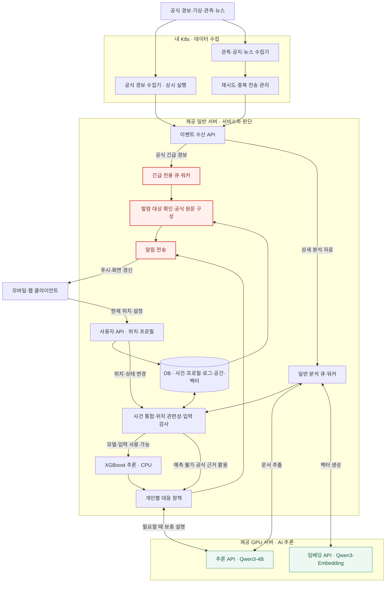
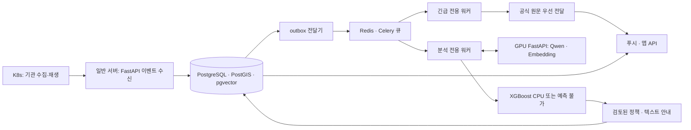

# Context

## Loom 코드 계약

아래 항목은 Loom 코드에 고정된 runtime 동작 계약입니다. 관련 흐름을 바꾸기 전 `loom contract show <id>`로 확인합니다.

- `task-execution`: Task 실행 전 prompt/context/previous-results에 들어가는 입력 경계입니다. 명령: `loom contract show task-execution`. Source: `loom/application/context_pack.py`, `loom/application/team_policy.py`
- `done-guardrail`: Task를 DONE으로 인정하기 전에 필요한 산출물과 상태 전이를 검증하는 계약입니다. 명령: `loom contract show done-guardrail`. Source: `loom/application/services.py`

## Project Memory

# 프로젝트 분석: BONGHWAJIGI

## 루트

`/Users/hongyongjae/Desktop/helloworld/BONGHWAJIGI`

## 요약

- 주요 스택: 확인 필요
- 패키지 / 런타임 파일: -
- 테스트 진입점: -
- 앱 진입점: docs/

## 최상위 구조

- ./
  - .gitignore
  - AGENTS.md
  - CLAUDE.md
  - README.md
-   docs/
    - README.md
    - ai-and-infrastructure.md
    - architecture-and-data-flow.md
    - decisions-and-meeting-review.md
    - product-and-scenarios.md
    - ui-ux-handoff.md

## 레포 규칙

- 기존 프로젝트 스타일과 로컬 helper API를 우선합니다.
- 수정 전에 관련 파일을 먼저 확인합니다.
- 변경 범위는 현재 Loom Task 계약 안에 유지합니다.
- 사용자 변경분을 버리는 destructive git reset/checkout을 사용하지 않습니다.
- 넓은 리팩터링이나 cross-domain 변경이 필요하면 먼저 boundary warning을 기록합니다.

## 실행 힌트

- 설치 / 런타임: -
- 테스트 / 검증: -
- 개발 서버: -

## 위험 영역

- 주의가 필요한 경로:
  - `No obvious sensitive path detected`

## Loom Task 가이드

- 좋은 Task는 예상 산출물, 완료 조건, 작업 범위, 검증 힌트를 가져야 합니다.
- repo 맥락이 약하면 architecture docs를 보강한 뒤 `loom analyze-repo`를 다시 실행합니다.
- agent 실행 전 `loom task validate <task-id>`로 경계를 확인합니다.
- 중단 이후에는 `loom resume`으로 현재 workflow 상태를 복구합니다.

## 보완할 맥락

- 아키텍처 ownership boundary는 수동 note가 필요할 수 있습니다.
- 배포, credential, 외부 서비스 정책은 자동으로 추론하지 않습니다.
- 프로젝트별 규칙은 Job note 또는 context reference에 추가합니다.

## Workspace Policy

- Output language: `ko`
- Agent provider: `claude`
- Agent model: `adapter-default`
- Reasoning effort: `high`
- Required branch: `develop`
- Dirty branch switch: `blocked`
- Commit policy: `manual`
- Include `.loom` metadata in Git: `yes`
- Read-only parallel execution: `allowed`
- Validation environment: `auto`
- Previous Task result limit: `2`
- Workspace required docs: -
- Loom fixed guardrails and verified Team required policies take precedence over this Workspace Policy.

## Job

- Title: V2 실행 기반과 통합 검증
- Goal: 산불 한 종류의 오늘 MVP 범위와 실행 기반을 고정하고 공식 경보 우선 전달·사용자별 텍스트 안내·변경 및 해제를 시간순 재생으로 통합 검증한다. 3D와 서버 음성을 제외하고 실제 성능과 모의 시연을 구분한다. 이 갱신은 사용자 지시에 따른 계약 재고정이며 구현 실행·Queue 등록은 포함하지 않는다. 기존 완료 이력과 Task ID를 보존한다.
- Branch: HeoNey
- Task count: `8`

## Task

- Title: 두 서버 SSH 별칭 설정과 실제 관리 접속 확인
- Description: 사용자의 직접 요청에 따라 기존 로컬 SSH 설정을 보존하고 inno-gpu-011 및 inno-server-011 별칭을 추가한다. 서버 구조 및 Tailscale 문서를 확인한 뒤 기존 호스트 키와 대조하여 ncloud 계정의 실제 SSH 로그인을 검증한다. 제공된 인증 정보는 인증에만 사용하고 설정·문서·로그에 저장하지 않는다.
- Expected output: 로컬 SSH 설정과 백업, 두 서버의 실제 로그인 및 역할 확인 결과, 비밀정보를 제외한 접속 운영 문서
- Done condition: 기존 접속 항목을 유지한 설정이 유효하고 두 별칭으로 엄격한 호스트 키 검사를 거친 실제 로그인이 성공한다. 문서와 Loom 산출물 검증 및 커밋을 완료한다.
- In scope: 로컬 SSH 별칭과 권한 설정, 기존 호스트 키 확인, 읽기 전용 서버 접근·자원 확인, 접속 절차 문서화
- Out of scope: 앱 저장소, 모델 또는 서비스 설치, 학습과 배포, 원격 인증 및 네트워크 정책 변경, 비밀번호 보관
- Validation hint: ssh -G로 별칭 해석과 기존 항목 보존을 검증하고 실제 SSH 세션에서 호스트명·계정·OS·주요 자원을 확인한다. git diff --check 및 Loom strict 검증을 수행한다.
- Required docs: `docs/V2/02_실시간_서버_배치도.md`, `docs/V2/delivery/tailnet-connectivity.md`, `docs/V2/delivery/implementation-stack.md`
- Memory refs: -
- Document outputs: `docs/V2/delivery/ssh-access.md`
- Document output exceptions: -
- Source proposal: `-`
- Status: PENDING
- Assigned agent: foreground

## Advisor Source Prompt

No Advisor source prompt recorded for this Task.

## Inclusion Policy

- Mandatory execution files: `prompt.md`, `context.md`, and `previous-results.md`.
- Always included: project memory, current Job/Task metadata, and Job notes.
- Previous results: up to the latest 2 recorded results from earlier Tasks in this Job.
- Job context refs: explicit Job-scoped references selected by the controlling agent or user.
- Task required docs: mandatory Task-scoped documents; missing refs block validation and execution.
- Task memory refs: mandatory Task-scoped workflow memory references; missing or non-memory refs block validation and execution.
- Repository documents, validation documents, and skill rules: included only through explicit Job context refs, Task required docs, or Task memory refs.
- Verified Team Policy Snapshot: included before Active Memory; required policy cannot be overridden by lower-priority context.
- Active workflow memory with an `always` category is included automatically while its status is `ACTIVE`.
- `task_selected` and `reference_only` memory is included only through explicit Task memory refs.
- Consumed proposals, rejected proposals, resolved memory, superseded memory, and archived memory are excluded.
- Unreferenced repository files and results from other Jobs are not included.
- `AGENTS.md` and `CLAUDE.md` remain session-level controlling-agent entrypoints and are not treated as task context artifacts by default.

## Job Notes

# Notes

## 2026-10-31T00:24:09+00:00

사용자 지시 기준: V2를 설계 정본으로 삼고 HeoNey는 참고한다. 앱 구현은 앱팀 소관이며 우리 산출물은 서버와 앱 연동 API 명세이다. 이번 턴은 서버와 클러스터의 읽기 전용 점검 및 TODO의 Job Task 등록만 실행한다. 신규 구현 Task는 PENDING으로 두며 Queue Worker와 배포 학습을 시작하지 않는다. 사용자가 Job Task 분할을 직접 위임했으므로 통제 에이전트가 계약을 생성한다.

- Task: `task-20261031-002027-k8s-v2-a251b54e`
- Tags: `scope`, `user-direction`
## 2026-10-31T00:26:25+00:00

설계 기준은 docs/V2이며 HeoNey는 참고다. 앱 구현은 제외하고 앱팀에 API 명세를 제공한다. 이 등록은 작업 계약 고정이며 후속 구현 Task를 지금 실행하거나 Queue에 넣지 않는다. 기준 원문은 docs/V2/01, 02, 03 문서이고 실행 작업표는 docs/V2/04-execution-backlog.md이다. 등록 시 의존관계는 Job 경계를 넘어 적용한다.
- Tags: `v2`, `scope`, `backlog`
## 2026-10-31T00:42:26+00:00

사용자 질문 응답: 첨부 이미지의 계정 및 비밀번호를 GPU 서버와 일반 서버의 SSH 로그인에 사용하도록 두 서버 로그인 승인이라고 명시적으로 답했다. 상태 조회에만 사용하며 인증정보는 저장소나 보고서에 남기지 않는다. 기존 검토 대기 Task의 서버 조회를 재개한다.

- Task: `task-20261031-002027-k8s-v2-a251b54e`
- Tags: `user-approval`, `resume`
## 2026-10-31T00:50:01+00:00

승인 후 실제 서버 조회 완료: GPU 서버는 4 vCPU RAM 47.05 GiB 및 NVIDIA L4 1대, 드라이버 580.159.04, cuInit 성공이다. 일반 서버는 2 vCPU RAM 7.76 GiB, systemd running 및 실패 서비스 없음이다. 두 서버 사이 TCP 22는 양방향 접근 가능하다. GPU 서버는 부팅 시 Mellanox 설정 파일 누락과 NVSwitch 조회 실패 기록으로 systemd degraded이며 A2에서 실제 필요성과 조치 여부를 확인한다. K8s발 서버 API 통신과 실제 모델 성능은 별도 검증 대상이다.

- Task: `task-20261031-002627-task-5ce3742e`
- Tags: `infrastructure`, `verified`
## 2026-10-31T01:20:51+00:00

사용자가 현재 대화에서 검증 작업 전부 실행을 지시했다. 선행 완료된 A2 환경 검증을 지금 수행하고, 학습 모델과 구현 및 API가 필요한 C4 D3 E2 A4 검증은 선행 산출물 존재 여부와 실행 경계를 확인한다. 이 지시는 검증 작업 실행이며 미구현 기능 전체의 개발 지시로 확대하지 않는다.

- Task: `task-20261031-002627-task-5ce3742e`
- Tags: `user-request`, `validation`
## 2026-10-31T01:22:32+00:00

사용자가 검증을 계속하기 전에 develop과 HeoNey를 동기화하고 develop에서 실행하도록 지시했다. 원격 최신 상태 조회 결과 develop은 HeoNey의 조상이며 충돌 없는 fast-forward가 가능하다. 진행 중 A2 기록을 보존하고 실행 브랜치 정책을 develop으로 변경한 뒤 검증을 이어간다.

- Task: `task-20261031-002627-task-5ce3742e`
- Tags: `user-direction`, `branch`
## 2026-10-31T01:28:14+00:00

사용자 추가 설명: 클러스터와 제공 서버는 서로 아예 다른 VPN이므로 현재 직접 통신이 안 되는 것이 맞다. 6개 노드와 5개 워커 파드의 제공 서버 TCP 22 시험은 모두 시간 초과, 노드 경로는 일반 게이트웨이이며 제공 서버 대역 전용 경로는 확인되지 않았다. 장애로 단정하지 않고 A3 실행 기반 구성에서 명시적 연결 방식을 정해야 하는 설계 조건으로 기록한다. VPN/라우팅/방화벽 설정은 이번 검증에서 변경하지 않는다.

- Task: `task-20261031-002627-task-5ce3742e`
- Tags: `user-context`, `network-validation`
## 2026-10-31T01:30:16+00:00

검증 전부 실행 지시를 확인했다. 계약 형식 검증은 통과했지만 실제 검증에 필요한 선행 작업 B5, C5, D5, E2의 산출물이 아직 없어 기능 검증은 실행할 수 없다. 모델 또는 API가 완성된 것으로 간주하지 않고 PENDING 유지하며 선행 구현 완료 후 이 Task를 실행한다. 현황은 A2 환경 검증 보고서에 함께 정리한다.

- Task: `task-20261031-002631-task-df03e0e8`
- Tags: `validation`, `prerequisites`
## 2026-10-31T01:35:11+00:00

A2 결과: 클러스터와 제공 서버는 별도 VPN이며 6개 노드 및 5개 워커 파드에서 제공 서버 TCP 22 연결 실패가 실측됐다. A3에서는 허용된 전송 경로와 서비스 주소/포트/인증/TLS를 먼저 정하고 실제 수집 API까지 검증해야 한다. 단일 파드 요청 2 CPU는 현재 어느 워커에도 들어가지 않고 합산 요청 여유는 약 5.19 CPU다. DNS resolver의 4개 nameserver 정리와 GPU 보조 서비스 상태 관리도 검토한다. 일반 서버는 A0 로그인 성공 이후 이번 재인증을 못 했으므로 설치 전에 정확한 자격 증명 재확인이 필요하다. 보고서 docs/V2/delivery/environment-readiness.md 참조.

- Task: `task-20261031-002627-k8s-4bf877bd`
- Tags: `verification-result`, `readiness`
## 2026-10-31T02:38:53+00:00

A5에서 두 서버 Tailscale 1.104.4 설치와 기존 tailnet 등록 완료. 사용자 저장 직전 승인 후 관리자 그룹·마스터·두 서버에서 두 서버 IPv4 TCP 22만 허용하는 grant 1개를 추가했다. Tailnet SSH 실제 로그인, 마스터발 TCP 22 및 서버 상호 배너 수신이 성공했다. 일반 서버 재인증 문제는 해결됐다. 일반 워커와 파드는 경로가 없어 연결 실패하므로 A3에서 프로젝트 전용 egress와 실제 API 포트·인증·TLS를 구성하고 다시 검증한다. 비밀정보는 기록하지 않았다.

- Task: `task-20261031-022438-tailscale-6dc57118`
- Tags: `tailscale`, `verified`, `follow-up`
## 2026-10-31T08:01:46+00:00

# 2026-10-31-wildfire-mvp 작업 계약 재고정

사용자 지시: “오케 우선은 그거대로 loom에 타스크를 재고정 해”.

2026-10-31 KST 사용자 재고정: 오늘 MVP는 산불 한 종류이며 3D와 서버 STT/TTS·오디오 스트리밍을 제외하고 서버는 텍스트를 제공한다. 공식 경보는 출처·원문·발령 대상을 확인해 개인별 정책 계산과 GPU를 기다리지 않고 우선 전달한다. 일반 분석은 정형 파싱 또는 필요한 Qwen 문서 추출·저장 문서의 임베딩 검색, 사건 통합·위치 관련성·입력 검사, 영향 확률 또는 예측 불가, 검토된 개인별 정책 순서다. 공식 등급·환경 영향 확률·개인 대응 단계를 분리하고 정책은 검토·버전 관리하며 입력 변경 때 재적용한다. 실제 자료·과거 재생·합성 시나리오를 구분하고 실제 정답이 없으면 학습·추론 연결은 simulation으로 검증하며 실제 예측은 unavailable로 둔다. 이 지시는 작업 계약 재고정만 승인하며 구현 실행·Queue 등록·서버 설치·원격 push를 지금 승인한 것으로 취급하지 않는다. 오늘 범위는 이 계약과 Job 재고정 노트를 우선하고 기존 V2 문서는 배경 설계로 참조한다.

이 갱신은 재고정만 수행하며 Task 실행 또는 Queue 등록을 시작하지 않는다.

미정: 시연 지역·사례, 모델의 실제 정답 출처·격자·예측 기간, 개인 대응 단계 매핑, 2D 실제 경로 계산 채택 여부. 60분은 예시이며 실제 확정값이 아니다. 실제 정답 부족은 C4에서 실제 예측 보류로 판정한다.

착수 순서: A1 → B1 → B2 및 C1 → A3·D1·D6 → 수집/긴급 전달·개인 정책·모델 준비 → 안내 갱신 → E2·A4 통합 검증. 공식 원문 전달 D4는 개인 정책 D1/D2와 모델 준비를 선행 조건으로 삼지 않는다.

- A1 `task-20261031-002627-mvp-e821b0f7`: 산불 MVP의 지역·재생 사례·실제 및 모의 범위와 수용 기준 고정. 선행: A0. 현재 PENDING.
- A3 `task-20261031-002627-k8s-4bf877bd`: 산불 MVP의 수집·DB·긴급 및 분석 큐·모델 API 실행 기반 구성. 선행: A1, A2, A5, B2. 현재 PENDING.
- A4 `task-20261031-002631-task-df03e0e8`: 산불 사례 재생으로 공식 경보 우선·개인별 안내·갱신 및 장애 통합 시연 검증. 선행: B5, C5, D5, E2. 현재 PENDING.

구체적 완료 조건은 각 Task의 재고정 계약을 따른다. 기존 docs/V2/04-execution-backlog.md는 이전 계획이며 실제 계약 정본은 현재 Task와 이 노트다.
- Tags: `mvp`, `산불`, `2026-10-31`, `계약재고정`
## 2026-10-31T08:33:37+00:00

2026-10-31 구현 기술 스택 결정: docs/V2/delivery/implementation-stack.md; Task task-20261031-082929-mvp-3188b68a. Python 3.12 + FastAPI/Pydantic 2 + SQLAlchemy 2.x/psycopg 3/Alembic + PostgreSQL 16/PostGIS/pgvector + Celery/Redis + Transformers/Sentence Transformers + XGBoost. 일반 서버 API/정책/CPU 추론, GPU 서버 모델/별도 학습, K8s 수집으로 배치한다. A3는 기술 스택 결정 Task를 선행으로 받고 구현 문서를 필수 입력으로 참조한다. 실제 파드→일반 서버→GPU API와 DB·큐 복구를 검증한다. 이번 실행은 스택 문서와 계약 연결만 수행하며 다른 구현 Task·Queue·서버 설치는 시작하지 않는다.
- Tags: `기술스택`, `산불`, `MVP`

## Context References

No explicit context references recorded for this job.

## Required Documents and Memory

### required-doc: docs/V2/02_실시간_서버_배치도.md

- Path: `docs/V2/02_실시간_서버_배치도.md`
- Status: present

# 재난 대응 비서 - 실시간 서버 배치도

작성일: 2026-10-31  |  버전: 1.0

내 K8s 수집 / 제공 일반 서버 판단·전달 / 제공 GPU 서버 추론

대화에서 정리한 설계안이다. 현재 학습·배포·검증이 완료됐다는 의미는 아니다.

## 다이어그램



## 해설

> 공식 긴급 경보: K8s 수집 → 일반 서버 긴급 큐·워커 → 발령 대상 확인 → 공식 원문 전달. GPU 추론을 기다리지 않는다.

| 영역 | 주요 책임 |
| --- | --- |
| 내 K8s | 기관별 상시 경보 수집과 관측·공지·뉴스 수집. 재시도·수집 상태 관리 |
| 일반 서버 | 이벤트·사용자 API, 긴급/일반 작업 분리, DB, 사건·공간 분석, XGBoost CPU 예측, 대응 정책·알림 |
| GPU 서버 | Qwen3-4B-Instruct-2507의 추출·설명, Qwen3-Embedding-0.6B의 벡터 생성 |
| 사용자 기기 | 위치·설정 전달, 알림 수신, 지도 표시 |

### 도표를 읽는 기준

일반 분석 워커는 문서가 필요할 때 GPU를 호출한다. 구조화된 관측자료는 Qwen을 생략할 수 있다. 벡터 생성은 GPU, 벡터 저장·검색은 일반 서버다. 사건 통합·위치 관련성·입력 검사는 일반 서버에서 수행한다.

XGBoost는 검증된 모델과 입력 조건이 확보된 경우에만 호출한다. 사용할 수 없으면 공식 정보 기반 대응을 유지한다. 사용자 위치·지원 상태가 바뀌면 필요한 단계부터 재평가한다.

빨간 노드는 긴급 경보 전달 경로다. 마지막 알림 전송 노드는 일반 안내도 공유한다. 초록 노드는 GPU 모델 API다. 양방향 연결은 요청과 결과 반환을 뜻하며 실시간 자동 재학습을 뜻하지 않는다.

### 구현 전에 확인할 사항

긴급·일반 큐와 워커의 실행 자원을 분리하고, 수집·처리·알림의 중복과 갱신·해제를 관리한다. 긴급 수집기에도 자체 재시도·중복 방지 기준이 필요하다. 도표는 핵심 연결을 표현하므로 원문·로그 저장과 모든 DB 접근선은 생략돼 있다.

일반 서버 사양과 네 K8s에서 제공 서버로의 VPN·방화벽 연결은 미확인이다. Qwen 두 모델의 메모리·처리량은 실제 자료로 측정한다. GPU 장애가 있어도 긴급 경보는 처리하도록 구성하되, 수집기·일반 서버·네트워크의 가용성은 별도로 확보해야 한다.

## 함께 볼 문서

- [서비스 핵심 정리](01_서비스_핵심_정리.md)

- [학습·검증 흐름도](03_학습_검증_흐름도.md)

### required-doc: docs/V2/delivery/tailnet-connectivity.md

- Path: `docs/V2/delivery/tailnet-connectivity.md`
- Status: present

# 두 서버 Tailscale 연결 및 검증

검증일: 2026-10-31 11:24~11:38 KST. 실행 브랜치: `develop`. Loom A5: `task-20261031-022438-tailscale-6dc57118`.

## 결과

두 서버에 공식 Tailscale 1.104.4를 설치하고 사용자 제공 인증키로 기존 `tail2dac17.ts.net`에 등록했다. 두 서버 모두 `Running`, `Online=true`, health 경고 없음이며 `tailscaled`는 active/enabled다. 사용자 승인 후 최소 SSH 접근 규칙을 추가했고 **노트북의 Tailnet 주소 SSH 로그인, 클러스터 마스터에서 두 서버 TCP 22, 두 서버 상호 SSH 배너 수신**을 확인했다.

| 대상 | Tailscale IPv4 | 등록 이름 | 기존 사설 주소 |
| --- | --- | --- | --- |
| GPU | `100.65.45.63` | `inno-gpu-011.tail2dac17.ts.net` | `10.1.2.16` |
| 일반 서버 | `100.116.5.9` | `inno-server-011.tail2dac17.ts.net` | `10.1.1.16` |
| 기존 클러스터 마스터 | `100.104.111.111` | `k8s-master` | `192.168.0.14` |

일반 서버는 사용자가 정확한 비밀번호를 제공한 뒤 로그인에 성공했다. [A2 보고서](environment-readiness.md)의 인증 미완료는 당시 결과이며 현재 미해결 항목이 아니다.

**일반 워커와 수집 파드의 API 통신은 아직 구성 전이다.** 현재 프로젝트 파드와 API가 없으며, 이번 작업은 두 서버 등록과 기존 클러스터 연결 지점의 관리 접속을 확보했다. SSH 성공을 데이터 수집·모델 API 연결 완료로 해석하지 않는다.

## 설치와 운영 설정

- Ubuntu 24.04용 공식 stable 패키지 저장소와 서명 키를 등록하고 `tailscale` 패키지만 설치했다. 기존 패키지 업그레이드나 무관한 서비스 재시작은 하지 않았다. [공식 설치 경로](https://pkgs.tailscale.com/stable/#ubuntu-noble)
- `--hostname`은 각 서버의 기존 이름, `--accept-dns=false`, `--accept-routes=false`로 등록했다. Exit node·서브넷 광고·Tailscale SSH는 활성화하지 않았다.
- 인증키는 숨김 입력 후 표준 입력으로 CLI에 전달했다. 인증키 파일, 저장소, 셸 이력에 남기지 않았고 명령 인자에는 키 값 대신 입력 경로를 사용했다. 정상 동작에 필요한 장치 상태는 Tailscale 서비스가 관리한다.
- 기본 경로는 GPU `10.1.2.1`, 일반 서버 `10.1.1.1`의 기존 eth0 경로다. 기관 도메인 DNS 해석과 KOSIS HTTPS 인증서 검증이 두 서버에서 통과했다.
- 재부팅 자동 시작 설정은 확인했다. 실제 재부팅 시험은 하지 않았다.
- 장치 키 만료는 조회 시 두 서버 모두 **2027-04-29 11:29 KST경**이다. 무기한 접속을 보장하지 않으며 만료 전 재인증 또는 운영 정책을 정해야 한다. 서버 삭제·재등록으로 IP가 바뀌면 아래 IP 기반 규칙도 갱신한다.

접속 명령은 다음과 같다. 실행하는 장치가 Tailnet에 연결되어 있고 허용된 출발지여야 한다. DNS 수용을 끈 서버에서는 등록 이름 대신 IPv4 주소를 사용한다. 최초 호스트키는 관리 중인 기존 서버 키와 대조한다.

```sh
ssh ncloud@100.65.45.63
ssh ncloud@100.116.5.9
```

## 접근 정책

처음에는 두 서버의 유효 `PacketFilter`가 빈 배열이었다. Tailscale 자체 ping은 DERP(tok)를 통해 약 67~69 ms로 응답했지만 실제 TCP 22는 시간 초과였다. 두 서버의 UFW는 inactive, INPUT 기본 정책은 ACCEPT, `tailscale0` 수신 허용 및 SSH 리스닝을 확인했다. Tailscale 진단 ping과 실제 서비스 통신을 구분해야 한다. [공식 TCP 진단](https://tailscale.com/docs/reference/troubleshooting/network-configuration/tcp-connection-two-devices)

사용자가 저장 직전 승인한 아래 grant **1개를 기존 정책에 추가**했다. 브라우저의 저장 완료 화면과 서버에 배포된 TCP 22 필터, 실제 통신으로 적용을 확인했다. 기존 4개 규칙은 유지했다.

```json
{
  "src": ["100.104.111.111", "100.65.45.63", "100.116.5.9", "group:admin"],
  "dst": ["100.65.45.63", "100.116.5.9"],
  "ip": ["tcp:22"]
}
```

기존 관리자 그룹과 마스터에서 두 서버를 관리하고 두 서버 사이 SSH 연결을 허용하는 범위다. 클러스터 API·전체 포트·공개 인터넷 접근을 추가하지 않았다. 이 규칙은 IPv4 목적지 기준이다. 기존 SSH 계정 인증은 계속 필요하다.

## 실제 검증

| 출발 → 목적지 | 검사 및 결과 |
| --- | --- |
| 노트북 → GPU Tailnet IPv4 | 기존 VPN 주소에서 확인한 호스트키와 대조 후 실제 SSH 로그인 성공. `inno-gpu-011`, `ncloud` 확인 |
| 노트북 → 일반 서버 Tailnet IPv4 | 동일한 호스트키 대조 후 실제 SSH 로그인 성공. `inno-server-011`, `ncloud` 확인 |
| 클러스터 마스터 → 두 서버 Tailnet IPv4 | 마스터의 hostNetwork Flannel 컨테이너에서 TCP 22 각각 성공 |
| 일반 서버 → GPU Tailnet IPv4 | TCP 22 성공, OpenSSH 배너 수신 |
| GPU → 일반 서버 Tailnet IPv4 | TCP 22 성공, OpenSSH 배너 수신 |
| 워커 5대의 노드 네트워크 → 두 서버 | TCP 22 총 10건 실패. 워커에 해당 Tailscale 호스트 경로가 구성되지 않음 |
| 워커 5대의 일반 파드 → 두 서버 | TCP 22 총 10건 실패. 별도 프로젝트 egress 경로와 허용 정책 필요 |
| 기존 cody-stat Tailscale 사이드카 → 두 서버 | 등록 직후 Tailscale 진단 ping 응답 확인. TCP는 정책 적용 전 실패했고, 이 타 서비스에는 신규 접근 권한을 부여하지 않음 |

노드·일반 파드 22건의 실제 실행 결과는 [검증 근거](tailnet-connectivity-evidence.json)에 기록했다. 호스트와 서비스 주소는 구분했다. 일반 파드 시험은 다른 애플리케이션의 데이터를 읽거나 변경하지 않는 제한된 포트 연결 검사다.

기존 클러스터는 6개 노드 Ready, 실행 중 파드 84개 및 준비되지 않은 컨테이너 없음으로 확인했다. 두 서버의 기존 SSH 세션도 유지됐다. 일반 서버의 실패 서비스는 없고 GPU의 기존 실패 서비스 2개는 A2와 동일하다. 이번 설치로 해결했다고 처리하지 않는다.

## 일반 파드의 후속 연결: A3

현재 클러스터는 마스터의 호스트 Tailscale과 일부 서비스별 userspace 사이드카를 사용한다. Tailscale Operator는 설치되어 있지 않다. 따라서 서버를 Tailnet에 추가해도 워커와 모든 파드에 자동으로 연결 경로가 생기지는 않는다.

A3의 서비스 실행 기반 구성에서 다음을 함께 수행한다.

1. BONGHWAJIGI 수집 파드용 전용 Tailscale egress 또는 사이드카를 구성한다. 다른 서비스의 Tailscale 사이드카를 공용 출구로 사용하지 않는다. Operator 방식을 채택한다면 별도의 설치·인증 구성이 필요하다. [공식 Kubernetes egress 설명](https://tailscale.com/docs/kubernetes-operator/egress)
2. 수집 파드 → 일반 서버 이벤트 API, 일반 서버 → GPU 모델 API의 주소·포트·TLS·서비스 인증을 정한다. 프로젝트 전용 신원과 실제 서비스 포트에 한정해 접근 규칙을 추가한다.
3. 실제 배치한 파드에서 API 요청·응답, 거부되는 출발지, 재시작 후 재연결을 검증한다. 마스터에서 성공한 SSH 시험으로 대체하지 않는다.
4. 키 만료, 장치 교체, egress 장애 시 재시도 및 복구 절차를 운영 문서에 연결한다.

이번 설정을 되돌려야 한다면 추가한 grant를 제거하고, 기존 VPN 접속을 확보한 상태에서 대상 서버의 `tailscale down`을 수행한다. 다른 장치·접근 규칙은 변경하지 않는다. 패키지 삭제와 장치 등록 제거는 별도 정리 단계다.

### required-doc: docs/V2/delivery/implementation-stack.md

- Path: `docs/V2/delivery/implementation-stack.md`
- Status: present

# 산불 MVP 구현 기술 스택 결정

기준일: 2026-10-31 KST. 결정 Task: `task-20261031-082929-mvp-3188b68a`.

이 문서는 사용자의 기술 스택 선정 요청에 따른 구현 기준이다. 라이브러리 설치, 서버 배포, 모델 학습·처리량 검증을 완료했다는 의미는 아니다. 산불 한 종류, 3D 제외, 서버 텍스트 제공이라는 재고정 범위를 따른다. 대응 레벨·레벨별 알림 방식·확률 임계값은 사용자 회의 결과 대기다.

## 1. 결정에 사용한 현재 상태

- 작업 시작 시 `develop`의 `bbf6233`은 원격 `develop`과 같았고 미커밋 변경은 없었다. 원격 `main`에는 그 이전 develop 병합 이력이 있으며 이번 Loom 재고정 커밋은 develop에 있었다.
- 저장소에는 설계, OpenAPI 0.1.0 초안·예제, API 계약 검증 도구가 있다. 서비스 패키지, DB 스키마, 실행 서버, 배포 구성과 모델 서빙은 아직 없다.
- 아래 자원은 같은 날 작성된 기존 점검 기록이다. 이번 Task에서 서버에 재접속하거나 자원을 재측정하지 않았다.

| 실행 위치 | 기존 확인 자원 | 이번 스택의 책임 |
| --- | --- | --- |
| 일반 서버 | 2 vCPU, 약 7.76 GiB RAM | API, DB, 공간·벡터 검색, 긴급/분석 워커, 정책, XGBoost CPU 추론 |
| GPU 서버 | 4 vCPU, 약 47.05 GiB RAM, NVIDIA L4 1대 | Qwen·Embedding 추론, 별도 시간의 XGBoost 학습 |
| 기존 K8s | 6노드, 기존 플랫폼 운영 중 | 프로젝트 전용 수집기·재생기, 데이터 준비·평가 작업 |

자원과 CUDA 기본 검사 근거는 [인프라 상태](../05-infrastructure-status.md)와 [환경 검증](environment-readiness.md)을 따른다. [Tailscale 검증](tailnet-connectivity.md)은 관리 접속을 확인했지만 일반 수집 파드의 서비스 API 경로는 A3에서 구성해야 한다.

## 2. 확정한 스택

| 영역 | 선정 | 적용 이유와 경계 |
| --- | --- | --- |
| 공통 언어 | Python 3.12 | 기존 서버 Python 계열과 맞추고 수집·API·정책·모델의 자료 구조와 검증 코드를 공유한다. |
| 환경·의존성 | uv, pyproject.toml, 잠금 파일 | API/수집 환경과 GPU·학습 환경을 분리하고 설치 조합을 재현한다. |
| API | FastAPI, Pydantic 2, Uvicorn | 기존 OpenAPI와 입력·출력 검증을 연결한다. ASGI의 전경 변경 조회도 같은 API에서 제공한다. |
| DB 접근 | SQLAlchemy 2.x, psycopg 3, Alembic, GeoAlchemy2 | API의 비동기 접근과 워커의 동기 접근에 같은 DB 모델·마이그레이션을 사용한다. |
| 저장소 | PostgreSQL 16 | 사건·지침·프로필·현재 상태·정책 버전·안내·전송 이력의 정본을 저장한다. |
| 공간 처리 | PostGIS 3.x | 발령 구역 포함·경계, 좌표·거리·위치 관련성 계산을 담당한다. |
| 벡터 검색 | pgvector 0.8 계열 | 같은 PostgreSQL에 문서 청크·출처·벡터를 저장하고 관련 문서를 검색한다. |
| 비동기 작업 | Celery 5.x, Redis 7.4 | 긴급·일반 분석·전달 작업을 별도 큐와 워커로 실행한다. Redis는 작업 전달용이며 결과의 정본은 PostgreSQL이다. |
| 수집·외부 호출 | HTTPX, 표준 JSON/CSV/XML 파서, Pydantic | 기관별 응답을 공통 이벤트로 변환하고 시간 제한·재시도·쿼터를 제어한다. |
| 정책 엔진 | Python 규칙 모듈, PostgreSQL의 검토된 정책표 | 사용자 상태와 공식 지침을 결정적으로 결합한다. 단계·알림 규칙은 회의 결과를 받아 등록한다. |
| Qwen 생성 | PyTorch, Transformers, Qwen3-4B-Instruct-2507 | 사실 추출과 선택된 행동의 텍스트 설명을 담당한다. |
| Embedding | Sentence Transformers, Qwen3-Embedding-0.6B | 문서·검색 질의를 벡터로 만들고 일반 서버의 pgvector 검색에 연결한다. |
| GPU API | 별도 FastAPI 서비스, 단일 프로세스 | 모델을 한 번씩 로딩하고 요청 수·입력 길이를 제한한다. 첫 MVP의 동시 GPU 실행은 1개로 시작한다. |
| 산불 모델 | XGBoost 3.x, scikit-learn, NumPy, pandas, PyArrow/Parquet | GPU 학습, 평가·보정, 일반 서버 CPU 추론을 분리한다. 모델 정답·기간은 C1에서 자료에 맞춰 결정한다. |
| 위성·좌표 전처리 | xarray/NetCDF, rasterio/GeoTIFF, pyproj | 선택한 자료 형식에 필요한 도구를 데이터 환경에만 추가한다. 실제 격자·투영법을 확인한다. |
| 전경 갱신 | 기존 getUpdates long polling | 현재 API의 커서·revision·만료·재동기화 계약을 유지한다. |
| 백그라운드 푸시 | PushGateway 인터페이스, FCM HTTP v1 우선 어댑터, 모의 Sender | 현재 명세의 fcm 토큰과 연결한다. 실제 앱 토큰·프로젝트 자격 설정을 받기 전에는 모의 전송으로 검증한다. |
| 사용자·서비스 인증 | Bearer JWT 검증(PyJWT), 서비스별 토큰 | 토큰 소유권·issuer·audience·만료를 검사한다. 로그인 제공자와 테스트 계정은 E1에서 고정한다. |
| 서버 실행 | Docker Compose | 일반 서버와 GPU 서버 각각의 서비스를 구성하고 GPU 컨테이너는 NVIDIA Container Toolkit을 사용한다. |
| 외부 HTTPS 진입 | Caddy | 앱 API의 도메인·인증서가 결정된 후 HTTPS를 제공한다. 내부 모델·DB·브로커는 프로젝트 사설 경로를 사용한다. |
| K8s | 전용 namespace, 수집기 Deployment, 배치 Job | 공식 경보 수집기는 계속 실행한다. 기존 서비스와 신원·자원·연결 경로를 분리한다. |
| 점검·관측 | JSON 로그, prometheus-client, 기존 Prometheus/Grafana | 지연·재시도·큐 적체·모델 오류·최신 자료 시각을 관찰한다. |
| 검증·정적 검사 | pytest, HTTPX, Ruff, 기존 OpenAPI/JSON Schema 검사 | 정책 재현성, 실제 API·DB·브로커 연결과 장애·역순 갱신을 검증한다. |

위 버전은 기준 계열이다. 실제 설치 시 Python 3.12와 모델·CUDA에 맞는 패치 버전을 풀어 API/worker/collector 환경과 GPU·학습 환경의 잠금 파일, 컨테이너 digest, 모델 revision을 고정한다. 이 문서만으로 해당 조합의 설치 호환성을 통과 처리하지 않는다. Redis 7.4와 PostgreSQL 16도 보안 패치가 적용된 정확한 이미지를 고정한다.

## 3. 서버별 배치와 코드 구조

한 레포의 공통 계약·도메인 모듈을 공유하고 실행 프로세스를 나눈다. 논리 모듈의 경계는 다음과 같다. 아래는 구현할 구조이며 현재 생성된 코드 경로가 아니다.

| 모듈 | 책임 | 실행 위치 |
| --- | --- | --- |
| contracts / domain | 공통 자료 구조·시각·버전·모드·정책 입력/출력 | API·워커·수집기에서 공유 |
| api | 사용자·설치·경보·안내·변경 조회, 인증 | 일반 서버 |
| ingestion | 기관 수집·과거 재생·원본 참조·중복 키 | K8s |
| events / spatial | 사건 통합·수정/해제·발령 대상·주변 관련성 | 일반 서버 |
| policy | 검토된 지침과 사용자 상태의 결정적 정책 적용 | 일반 서버 |
| workers | 공식 경보 우선 처리, 일반 분석, 푸시 전달 | 일반 서버의 분리된 프로세스 |
| retrieval | 문서 청크·출처·벡터 저장 및 검색 | 일반 서버, 벡터 생성은 GPU 호출 |
| gpu_api | Qwen 생성·Embedding 생성과 제한·health | GPU 서버 |
| ml | 피처·데이터 분할·XGBoost 학습/평가·CPU Predictor | 학습은 GPU, 운영 Predictor는 일반 서버 |



기본 행동지침은 출처·적용 조건·버전·검토 상태와 함께 DB에 보관한다. 정책표가 행동지침 ID를 참조해 개인별 행동을 선택하고 Qwen이 선택된 행동을 설명한다. DB에 추가된 문서가 자동으로 승인 정책이 되지 않는다.

## 4. 긴급 경보와 큐 처리 기준

1. 이벤트·버전·원문 참조와 전송할 작업을 PostgreSQL 트랜잭션에 함께 기록하는 outbox를 둔다. 전달기가 Redis로 보내고 실패하면 재시도한다.
2. 긴급 작업과 일반 분석은 별도 Celery 큐 및 전용 워커로 분리한다. 긴급 워커는 모델·개인 정책 계산을 호출하지 않고 발령 대상과 공식 원문부터 처리한다.
3. 일반 서버는 2 vCPU이므로 처음에는 워커별 동시 실행 1개, 작은 DB 연결 풀, 작업 선취 제한으로 시작한다. 실제 지연과 메모리를 측정해 조정한다. 큐 분리는 즉시성 보장이 아니며 DB·네트워크·프로세스 가용성도 검증한다.
4. 처리 보장은 재전달을 허용하는 방식으로 설계한다. 수신 ID·작업 종류·대상·리소스 revision에 대한 중복 키와 처리 상태를 DB에 남긴다. 푸시 제공자의 불확실한 응답 후 재시도도 앱에서 revision으로 중복 억제한다.
5. 작업 수락·DB 반영·브로커 확인·재시도 순서를 명시하고 Redis 장애 및 워커 강제 종료 후 회수 시험을 한다. Redis의 기본 visibility timeout에 의존해 긴급 복구 시간을 가정하지 않는다. 작업 시간 제한과 재전달 시간을 함께 검증한다.
6. Redis는 영속 볼륨·AOF와 브로커에 맞는 메모리 정책으로 구성하고 작업 결과를 장기 보관하지 않는다. DB의 처리 상태와 outbox를 통해 재개하며 승인되지 않은 외부 전송은 실행하지 않는다.

공식 경보·사용자 안내·전송 이력은 서로 다른 리소스다. 공식 경보가 먼저 표시된 뒤 개인별 안내가 갱신되며 동일 대응 단계에서도 행동·근거가 바뀌면 새 revision을 발행한다.

## 5. 공간·벡터·원본 저장

- 좌표는 기존 계약의 WGS84 GeoJSON `[경도, 위도]`를 유지한다. 발령 구역 경계의 포함 여부를 명시하고 미터 단위 거리는 geography 또는 적절한 투영 좌표계로 계산한다. 좌표 품질을 알 수 없으면 미확인 상태를 보존한다.
- 문서 원문 ID·출처·발표/수집 시각·검토 상태와 청크를 저장한다. Qwen3-Embedding-0.6B는 1024차원 벡터를 기준으로 사용하며 모델 revision·차원·정규화·질의 지시를 함께 고정한다.
- 초기 검색은 출처·재난·유효기간 필터와 pgvector의 정확 검색으로 시작한다. 자료량과 지연을 측정한 뒤 HNSW를 도입할지 판단한다. 벡터 유사도만으로 출처 검증이나 행동 지침 채택을 대신하지 않는다.
- 위성 파일·원본 응답·Parquet·모델 파일은 전용 영속 볼륨에 두고 DB에는 URI·해시·시각·버전을 저장한다. K8s 자료와 모델 서버 간 파일 전달 및 보존/복구 경로는 A3에서 검증한다. 대용량 원본과 모델을 Git에 넣지 않는다.

## 6. GPU와 XGBoost 실행 기준

첫 GPU 서빙은 FastAPI 단일 프로세스가 두 모델을 로딩하는 형태로 고정한다. Transformers의 생성 API와 Sentence Transformers의 encode API를 내부 인터페이스로 감싼다. 반정밀도와 모델 revision을 고정하고, 초기에는 한 번에 한 GPU 요청만 처리한다. 토큰 길이·배치 상한은 명시하며 시작 구성은 생성의 입력+출력 합계 4096토큰 이내, 출력 상한 512토큰이다. 이 값은 운영 성능 약속이 아니라 D3 측정의 시작 설정이다.

모델 API는 별도 프로세스에서 대기·실행을 제한하고 일반 서버 호출에는 시간 제한·오류 대체를 둔다. 공식 경보는 이 대기열을 통과하지 않는다. Qwen 오류 시 검토된 지침의 템플릿 텍스트로 대체한다. 동시성을 확장할 필요가 생기면 측정 결과를 바탕으로 vLLM 등 전용 엔진 전환을 후속 검토한다.

XGBoost 학습은 GPU 추론과 별도 시간에 실행한다. CUDA 지원 wheel/runtime와 기존 NVIDIA 드라이버의 호환을 실제 작은 학습으로 확인한다. 조회한 최신 XGBoost 공식 GPU 문서는 CUDA 12.9 이상을 요구하므로 기존 CUDA 메모리 검사의 성공을 라이브러리 설치 성공으로 해석하지 않는다. GPU용 환경과 API/CPU용 환경을 분리하고, 학습한 모델의 저장·재로딩·CPU 출력 일치와 피처 스키마를 검증한다.

예측 목표·격자·기간·관측 정답·실제 채택 기준은 C1~C4의 결정이다. 실제 정답이 부족하면 합성 자료로 연결만 검증하고 live의 `impact`는 unavailable/null로 유지한다. 이 스택 선정으로 산불 예측 성능을 확정하지 않는다.

## 7. API·인증·알림 계약

- [현재 API 계약](app-api-contract.md)과 [OpenAPI](api/openapi.yaml)가 구현의 출발점이다. FastAPI 자동 문서를 생성하되 DTO·오류·revision·커서·예제를 기존 명세에 대조하고 E1에서 승인본을 고정한다. 이번 문서는 기존 API 필드나 버전을 변경하지 않는다.
- 전경 갱신은 getUpdates long polling을 사용한다. 리소스 revision과 유효시간을 적용하고 오래된 응답·중복·만료된 cursor를 처리한다.
- PushGateway의 첫 실제 전송 구현 대상은 FCM HTTP v1이다. 현재 OpenAPI는 fcm/apns만 열거하므로 실제 앱에서 발급하는 토큰 종류와 FCM 프로젝트 설정을 E1에서 대조한다. APNs 직결 또는 다른 토큰 형식은 별도 어댑터·계약 검토가 필요하다. 모의 Sender의 성공을 단말 전달 성공으로 기록하지 않는다.
- JWT 검증 도구는 PyJWT로 정하되 로그인·발급자·audience·키 배포·갱신 방식은 E1에서 확정한다. 개발용 테스트 토큰·계정과 운영 인증을 구분한다. Tailnet 접속과 서비스/사용자 인증을 함께 적용한다.
- 앱 API의 외부 HTTPS 도메인·인증서는 A3/E1 결정 후 Caddy에 반영한다. Tailscale SSH 주소를 모바일 HTTPS API 주소로 취급하지 않는다.
- 대응 레벨, 단계별 알림 채널·반복·해제 방식과 임계값은 D1의 사용자 회의 결과를 기다린다. 현재 단계에서는 정책표 구조·공식 원문 전달·기본 지침 저장·모델 준비를 구분한다. D3의 모델 준비와 최종 정책 설명 검증도 단계별로 구분해 계획한다.

## 8. 첫 구현에서 검증할 사항

| 검증 작업 | 통과 기준 |
| --- | --- |
| A3 실행 기반 | 실제 수집 파드 → 일반 서버 → GPU API의 요청·인증·시간 제한과 재시작 복구. DB·Redis 사설 접근 및 영속 데이터 복구. |
| B2/B3 자료 계약·수집 | 실제/재생/합성 provenance, 시각·좌표·단위·중복 키, 기관 업무 오류·페이지·재시도. |
| D4 공식 경보 | 모델·정책 미준비와 일반 큐 적체 중에도 공식 원문 우선 처리. 실제 푸시 구간과 모의 전송 구분. |
| D1/D2 정책 | 회의 결과를 받은 후 버전이 같은 입력의 결과 재현, 사용자 상태 차이·해제·재적용. |
| D3 모델 | 두 실제 모델의 생성/임베딩, 근거 대조·검색 적합성·한국어 지연·GPU 메모리·장애 대체. |
| C3~C5 학습·추론 | 실제 CUDA 학습, 데이터/모델 버전, 평가/보류, 저장 후 CPU 재로딩·범위 밖 입력과 simulation 격리. |
| E2/A4 API·통합 | 실서버 응답과 명세, 접근 제어·역순 갱신·커서 만료·정정/해제·세 사용자 시연. |

CI는 Ruff·pytest와 기존 OpenAPI/예제 검사를 기본으로 하고 PostgreSQL 확장과 Redis가 필요한 통합 시험을 분리한다. GPU smoke·학습 시험은 GPU 환경에서 실행하고 CPU CI의 성공과 구분한다. 원본·키·정밀 위치·음성/민감 텍스트를 로그에 넣지 않는다.

## 9. 적용할 Loom 경계

이 기술 결정 Task는 기존 A Job의 후속 설계 작업이다. A3는 이 문서를 필수 입력과 선행 설계 결과로 받아 실행 기반을 구성한다. B/C/D/E의 세부 구현자는 해당 Job 노트의 기술 기준을 참조한다. 이번에는 다른 구현 Task를 실행하거나 Queue에 넣지 않는다.

D1의 회의 대기, A1의 시연 지역·사례, B1/C1의 실제 자료·정답·예측 기간, E1의 사용자 인증·앱 푸시 토큰, A3의 실제 API 접근 경로는 미정 또는 미검증으로 남는다. 기존 초기 문서화 RUNNING 기록도 이번 범위에서 변경하지 않는다.

## 공식 근거

공식 문서는 2026-10-31에 확인했다. 아래 기능 설명은 구현 조합·자원 성능을 실측했다는 근거가 아니다.

- [FastAPI 기능과 OpenAPI/JSON Schema](https://fastapi.tiangolo.com/features/): 현재 명세 중심 API와 입력·출력 검증에 적용.
- [SQLAlchemy 공식 문서](https://docs.sqlalchemy.org/): 2.x DB 접근 계층. Alembic 마이그레이션과 psycopg 드라이버 조합은 설치 시 검증.
- [PostgreSQL 버전 정책](https://www.postgresql.org/support/versioning/): PostgreSQL 16 지원 계열 확인.
- [PostGIS ST_DWithin](https://postgis.net/docs/ST_DWithin.html): geography의 미터 단위 거리 및 좌표계 구분.
- [pgvector](https://github.com/pgvector/pgvector): PostgreSQL의 벡터 검색·정확 검색과 조건 필터.
- [Celery 작업 라우팅](https://docs.celeryq.dev/en/stable/userguide/routing.html): 큐별 전용 워커 구성.
- [Celery Redis 브로커](https://docs.celeryq.dev/en/stable/getting-started/backends-and-brokers/redis.html): 재전달·visibility timeout 및 복구 제약.
- [uv 의존성 관리](https://docs.astral.sh/uv/concepts/projects/dependencies/): 프로젝트와 환경별 의존성 관리.
- [Qwen3-4B-Instruct-2507](https://huggingface.co/Qwen/Qwen3-4B-Instruct-2507): Transformers 생성 경로.
- [Qwen3-Embedding-0.6B](https://huggingface.co/Qwen/Qwen3-Embedding-0.6B): Sentence Transformers 경로와 1024차원 출력.
- [XGBoost GPU 지원](https://xgboost.readthedocs.io/en/stable/gpu/index.html): CUDA 요구 조건과 GPU 학습 구성.
- [Docker Compose GPU 지원](https://docs.docker.com/compose/how-tos/gpu-support/): GPU 컨테이너 실행 전제.
- [FCM HTTP v1](https://firebase.google.com/docs/cloud-messaging/send/v1-api): 서버 발신 어댑터의 구현 기준.

## Verified Team Policies

No verified Team Policy Snapshot is active.

## Active Workflow Memory

No active workflow memory recorded.
