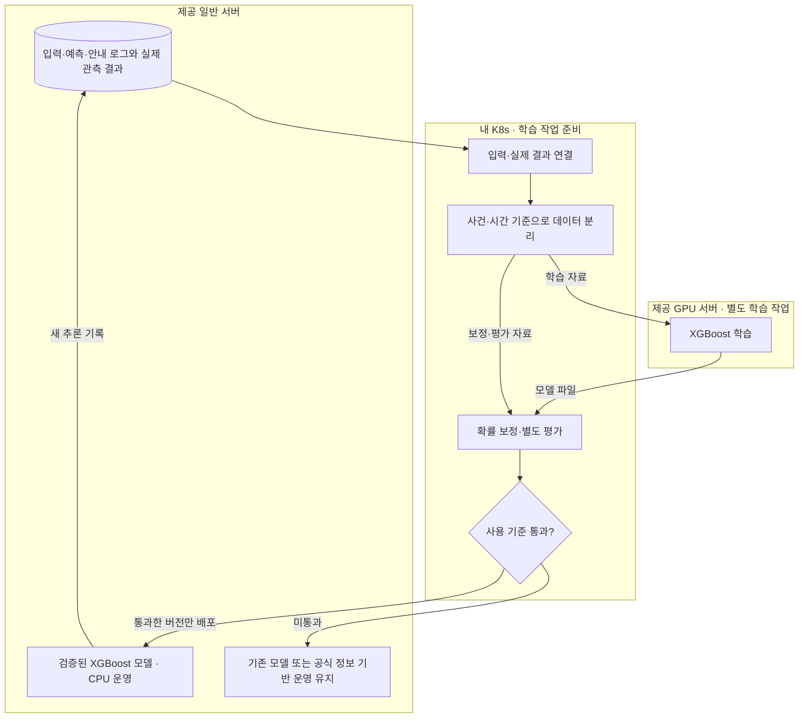
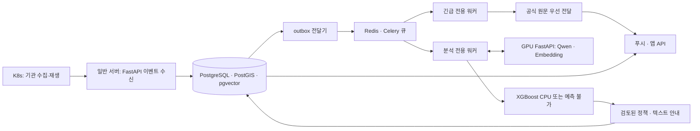

# Context

## Loom 코드 계약

아래 항목은 Loom 코드에 고정된 runtime 동작 계약입니다. 관련 흐름을 바꾸기 전 `loom contract show <id>`로 확인합니다.

- `task-execution`: Task 실행 전 prompt/context/previous-results에 들어가는 입력 경계입니다. 명령: `loom contract show task-execution`. Source: `loom/application/context_pack.py`, `loom/application/team_policy.py`
- `done-guardrail`: Task를 DONE으로 인정하기 전에 필요한 산출물과 상태 전이를 검증하는 계약입니다. 명령: `loom contract show done-guardrail`. Source: `loom/application/services.py`

## Project Memory

# 프로젝트 분석: BONGHWAJIGI

## 루트

`/Users/hongyongjae/Desktop/helloworld/BONGHWAJIGI`

## 요약

- 주요 스택: 확인 필요
- 패키지 / 런타임 파일: -
- 테스트 진입점: -
- 앱 진입점: docs/

## 최상위 구조

- ./
  - .gitignore
  - AGENTS.md
  - CLAUDE.md
  - README.md
-   docs/
    - README.md
    - ai-and-infrastructure.md
    - architecture-and-data-flow.md
    - decisions-and-meeting-review.md
    - product-and-scenarios.md
    - ui-ux-handoff.md

## 레포 규칙

- 기존 프로젝트 스타일과 로컬 helper API를 우선합니다.
- 수정 전에 관련 파일을 먼저 확인합니다.
- 변경 범위는 현재 Loom Task 계약 안에 유지합니다.
- 사용자 변경분을 버리는 destructive git reset/checkout을 사용하지 않습니다.
- 넓은 리팩터링이나 cross-domain 변경이 필요하면 먼저 boundary warning을 기록합니다.

## 실행 힌트

- 설치 / 런타임: -
- 테스트 / 검증: -
- 개발 서버: -

## 위험 영역

- 주의가 필요한 경로:
  - `No obvious sensitive path detected`

## Loom Task 가이드

- 좋은 Task는 예상 산출물, 완료 조건, 작업 범위, 검증 힌트를 가져야 합니다.
- repo 맥락이 약하면 architecture docs를 보강한 뒤 `loom analyze-repo`를 다시 실행합니다.
- agent 실행 전 `loom task validate <task-id>`로 경계를 확인합니다.
- 중단 이후에는 `loom resume`으로 현재 workflow 상태를 복구합니다.

## 보완할 맥락

- 아키텍처 ownership boundary는 수동 note가 필요할 수 있습니다.
- 배포, credential, 외부 서비스 정책은 자동으로 추론하지 않습니다.
- 프로젝트별 규칙은 Job note 또는 context reference에 추가합니다.

## Workspace Policy

- Output language: `ko`
- Agent provider: `claude`
- Agent model: `adapter-default`
- Reasoning effort: `high`
- Required branch: `develop`
- Dirty branch switch: `blocked`
- Commit policy: `manual`
- Include `.loom` metadata in Git: `yes`
- Read-only parallel execution: `allowed`
- Validation environment: `auto`
- Previous Task result limit: `2`
- Workspace required docs: -
- Loom fixed guardrails and verified Team required policies take precedence over this Workspace Policy.

## Job

- Title: 영향 확률 데이터셋과 모델
- Goal: 산불 영향의 입력·목표 격자·기간·관측 정답을 먼저 고정하고 GPU XGBoost 설치·학습·결과 확인과 일반 서버 CPU 연결을 준비한다. 실제 정답이 없으면 합성 연결검증과 실제 예측 보류를 명시하고 실제 성능을 주장하지 않는다. 이 갱신은 사용자 지시에 따른 계약 재고정이며 구현 실행·Queue 등록은 포함하지 않는다. 기존 완료 이력과 Task ID를 보존한다.
- Branch: HeoNey
- Task count: `6`

## Task

- Title: 산불 XGBoost 학습용 공개 원본 확보와 재현 가능한 데이터셋 구축
- Description: 사용자가 분석 파이프라인은 다른 작업자가 이어가고 이 작업자는 XGBoost 학습 데이터를 담당하도록 직접 지시했다. 기존 수집 담당 브랜치의 국내 자료 경로와 학습 적합성을 확인하고 사용자가 허용한 국외 공개 확산 자료도 활용한다. 프로필·매뉴얼·경보·뉴스와 환경 예측용 입력·관측 정답의 역할을 구분하고 확보 가능한 목표에 맞는 원본·정답·분할·provenance를 갖춘 학습 데이터셋을 구축한다.
- Expected output: 수집 경로·피처·정답 정의 및 한계 문서, 실제 공개 원본과 해시 manifest, 재현 가능한 수집·변환 코드, XGBoost 학습용 테이블과 학습/검증/평가 분할 및 품질 보고서
- Done condition: 실제 다운로드한 공개 자료에서 입력과 이후 관측 정답이 연결된 데이터셋을 생성하고 누락·unknown·분할·누출·출처를 검증한다. 국내 사용자 영향 예측으로 검증되지 않은 범위를 명시하고 별도 학습 작업에 전달 가능한 결과와 Loom 기록을 커밋한다.
- In scope: 국내 수집 경로 읽기·공식 출처 확인, 승인된 국외 공개 학습 자료 확보, 데이터 목표와 입력 구분, training 전용 경로의 수집·정규화·검증·분할 코드와 산출물, 데이터 품질 보고서
- Out of scope: 다른 작업자의 분석 큐·검색 구현과 파일 수정, GPU 서빙 중단·변경, 산불 실모델 운영 배포·성능 확정, 개인 대응 레벨·정책·매뉴얼 결정, 앱 저장소, 원격 push
- Validation hint: 원본 출처·버전·크기·해시 확인, 실제/합성 구분, 관측 정답 0/1/unknown과 미래 입력 누출 검사, 원본 분할 보존·동일 표본 중복 검사, 재생성·스키마·결측 통계와 학습 로더 검사, Loom strict
- Required docs: `docs/V2/03_학습_검증_흐름도.md`, `docs/V2/delivery/implementation-stack.md`, `docs/V2/delivery/gpu-model-readiness.md`
- Memory refs: -
- Document outputs: `docs/V2/delivery/xgboost-training-data.md`
- Document output exceptions: -
- Source proposal: `-`
- Status: PENDING
- Assigned agent: foreground

## Advisor Source Prompt

No Advisor source prompt recorded for this Task.

## Inclusion Policy

- Mandatory execution files: `prompt.md`, `context.md`, and `previous-results.md`.
- Always included: project memory, current Job/Task metadata, and Job notes.
- Previous results: up to the latest 2 recorded results from earlier Tasks in this Job.
- Job context refs: explicit Job-scoped references selected by the controlling agent or user.
- Task required docs: mandatory Task-scoped documents; missing refs block validation and execution.
- Task memory refs: mandatory Task-scoped workflow memory references; missing or non-memory refs block validation and execution.
- Repository documents, validation documents, and skill rules: included only through explicit Job context refs, Task required docs, or Task memory refs.
- Verified Team Policy Snapshot: included before Active Memory; required policy cannot be overridden by lower-priority context.
- Active workflow memory with an `always` category is included automatically while its status is `ACTIVE`.
- `task_selected` and `reference_only` memory is included only through explicit Task memory refs.
- Consumed proposals, rejected proposals, resolved memory, superseded memory, and archived memory are excluded.
- Unreferenced repository files and results from other Jobs are not included.
- `AGENTS.md` and `CLAUDE.md` remain session-level controlling-agent entrypoints and are not treated as task context artifacts by default.

## Job Notes

# Notes

## 2026-10-31T00:26:26+00:00

설계 기준은 docs/V2이며 HeoNey는 참고다. 앱 구현은 제외하고 앱팀에 API 명세를 제공한다. 이 등록은 작업 계약 고정이며 후속 구현 Task를 지금 실행하거나 Queue에 넣지 않는다. 기준 원문은 docs/V2/01, 02, 03 문서이고 실행 작업표는 docs/V2/04-execution-backlog.md이다. 등록 시 의존관계는 Job 경계를 넘어 적용한다.
- Tags: `v2`, `scope`, `backlog`
## 2026-10-31T01:30:15+00:00

검증 전부 실행 지시를 확인했다. 계약 형식 검증은 통과했지만 실제 검증에 필요한 선행 작업 C3의 산출물이 아직 없어 기능 검증은 실행할 수 없다. 모델 또는 API가 완성된 것으로 간주하지 않고 PENDING 유지하며 선행 구현 완료 후 이 Task를 실행한다. 현황은 A2 환경 검증 보고서에 함께 정리한다.

- Task: `task-20261031-002629-task-2b63fdb8`
- Tags: `validation`, `prerequisites`
## 2026-10-31T08:01:46+00:00

# 2026-10-31-wildfire-mvp 작업 계약 재고정

사용자 지시: “오케 우선은 그거대로 loom에 타스크를 재고정 해”.

2026-10-31 KST 사용자 재고정: 오늘 MVP는 산불 한 종류이며 3D와 서버 STT/TTS·오디오 스트리밍을 제외하고 서버는 텍스트를 제공한다. 공식 경보는 출처·원문·발령 대상을 확인해 개인별 정책 계산과 GPU를 기다리지 않고 우선 전달한다. 일반 분석은 정형 파싱 또는 필요한 Qwen 문서 추출·저장 문서의 임베딩 검색, 사건 통합·위치 관련성·입력 검사, 영향 확률 또는 예측 불가, 검토된 개인별 정책 순서다. 공식 등급·환경 영향 확률·개인 대응 단계를 분리하고 정책은 검토·버전 관리하며 입력 변경 때 재적용한다. 실제 자료·과거 재생·합성 시나리오를 구분하고 실제 정답이 없으면 학습·추론 연결은 simulation으로 검증하며 실제 예측은 unavailable로 둔다. 이 지시는 작업 계약 재고정만 승인하며 구현 실행·Queue 등록·서버 설치·원격 push를 지금 승인한 것으로 취급하지 않는다. 오늘 범위는 이 계약과 Job 재고정 노트를 우선하고 기존 V2 문서는 배경 설계로 참조한다.

이 갱신은 재고정만 수행하며 Task 실행 또는 Queue 등록을 시작하지 않는다.

미정: 시연 지역·사례, 모델의 실제 정답 출처·격자·예측 기간, 개인 대응 단계 매핑, 2D 실제 경로 계산 채택 여부. 60분은 예시이며 실제 확정값이 아니다. 실제 정답 부족은 C4에서 실제 예측 보류로 판정한다.

착수 순서: A1 → B1 → B2 및 C1 → A3·D1·D6 → 수집/긴급 전달·개인 정책·모델 준비 → 안내 갱신 → E2·A4 통합 검증. 공식 원문 전달 D4는 개인 정책 D1/D2와 모델 준비를 선행 조건으로 삼지 않는다.

- C1 `task-20261031-002627-task-cc78619e`: 산불 영향 확률의 입력·목표 격자·예측 기간·관측 정답 및 시연 경계 고정. 선행: A1, B1. 현재 PENDING.
- C2 `task-20261031-002628-task-71b2ed3b`: 산불 학습·평가 데이터와 명시적인 합성 연결검증 데이터 준비. 선행: B2, C1. 현재 PENDING.
- C3 `task-20261031-002629-xgboost-c44c6d79`: GPU 서버에 XGBoost 설치 후 기준선·학습·추론 연결 검증. 선행: A2, A3, C2. 현재 PENDING.
- C4 `task-20261031-002629-task-2b63fdb8`: 산불 모델의 독립 평가·확률 보정 또는 실제 예측 보류 판정. 선행: C3. 현재 PENDING.
- C5 `task-20261031-002629-cpu-0d28f70c`: 일반 서버의 XGBoost CPU 추론과 예측 불가·모의 모드 및 모델 복구 구현. 선행: A3, C4. 현재 PENDING.

구체적 완료 조건은 각 Task의 재고정 계약을 따른다. 기존 docs/V2/04-execution-backlog.md는 이전 계획이며 실제 계약 정본은 현재 Task와 이 노트다.
- Tags: `mvp`, `산불`, `2026-10-31`, `계약재고정`
## 2026-10-31T08:33:37+00:00

2026-10-31 구현 기술 스택 결정: docs/V2/delivery/implementation-stack.md; Task task-20261031-082929-mvp-3188b68a. Python 3.12 + FastAPI/Pydantic 2 + SQLAlchemy 2.x/psycopg 3/Alembic + PostgreSQL 16/PostGIS/pgvector + Celery/Redis + Transformers/Sentence Transformers + XGBoost. 일반 서버 API/정책/CPU 추론, GPU 서버 모델/별도 학습, K8s 수집으로 배치한다. XGBoost GPU 학습과 일반 서버 CPU Predictor를 분리하고 실제 정답·기간·평가/보류를 C1~C4에서 고정한다. 스택 선정은 실제 예측 성능 검증이 아니다. 이번 실행은 스택 문서와 계약 연결만 수행하며 다른 구현 Task·Queue·서버 설치는 시작하지 않는다.
- Tags: `기술스택`, `산불`, `MVP`

## Context References

No explicit context references recorded for this job.

## Required Documents and Memory

### required-doc: docs/V2/03_학습_검증_흐름도.md

- Path: `docs/V2/03_학습_검증_흐름도.md`
- Status: present

# 재난 대응 비서 - 학습·검증 흐름도

작성일: 2026-10-31  |  버전: 1.0

실제 결과 연결 / 학습 / 확률 보정·평가 / 검증 모델 배포

대화에서 정리한 설계안이다. 현재 학습·배포·검증이 완료됐다는 의미는 아니다.

## 다이어그램



## 해설

> 이전 추론값 자체를 정답으로 삼지 않는다. 당시 입력과 이후 실제 관측 결과를 연결하고, 검증한 모델 버전만 운영에 반영한다.

| 단계·위치 | 처리 내용 |
| --- | --- |
| 기록 - 일반 서버 | 입력·자료 시각·모델 버전·예측값·안내·전송 시각과 실제 결과 보관 |
| 자료 준비 - K8s | 예측 대상·기간에 맞춰 입력과 정답 연결. 사건·시간 기준으로 자료 분리 |
| 학습 - GPU 서버 | XGBoost 학습. 작은 자료라면 CPU 학습 가능성도 있으나 현재 배치안은 GPU 활용 |
| 보정·평가 - K8s | 학습과 분리한 자료로 확률 보정 및 별도 성능 평가 |
| 운영 반영 - 일반 서버 | 사전에 정한 사용 기준을 통과한 버전만 CPU 추론에 배포 |

### 분리해야 하는 자료

학습용, 확률 보정용, 최종 평가용 자료를 구분한다. 같은 사건의 정보나 미래 관측이 경계를 넘어 섞이지 않도록 한다. 당시 수집·이용할 수 없던 후속 기사를 과거 입력에 넣지 않는다. 영향이 없었던 사례도 평가에 포함한다.

### 반복 추론과 재학습의 차이

실시간 반복 추론은 고정된 모델에 최신 입력을 넣는 과정이다. 재학습은 실제 결과가 누적된 뒤 새 모델을 만드는 별도 작업이다. 이 계획은 지도학습 기반 개선이며, 행동 선택을 보상으로 학습하는 강화학습은 별도 과제다.

### GPU 운영과 모델 교체

첫 시연 전에 학습을 끝내고 시연 중 GPU는 Qwen·Embedding 추론에 집중시키는 방향을 권한다. 동일 GPU의 추론과 학습을 동시에 수행할지는 메모리·처리량을 확인한 뒤 결정한다. 새로운 모델이 기준을 통과하지 못하면 기존 모델 또는 공식 정보 기반 운영을 유지한다.

아직 미정: 실제 학습 자료, 예측 목표, 합격 기준, 재학습 주기, 배포 승인·되돌리기 절차. XGBoost는 재난 예측이 완성된 모델이 아니라 목표에 맞게 학습할 도구다.

## 함께 볼 문서

- [서비스 핵심 정리](01_서비스_핵심_정리.md)

- [실시간 서버 배치도](02_실시간_서버_배치도.md)

### required-doc: docs/V2/delivery/implementation-stack.md

- Path: `docs/V2/delivery/implementation-stack.md`
- Status: present

# 산불 MVP 구현 기술 스택 결정

기준일: 2026-10-31 KST. 결정 Task: `task-20261031-082929-mvp-3188b68a`.

이 문서는 사용자의 기술 스택 선정 요청에 따른 구현 기준이다. 라이브러리 설치, 서버 배포, 모델 학습·처리량 검증을 완료했다는 의미는 아니다. 산불 한 종류, 3D 제외, 서버 텍스트 제공이라는 재고정 범위를 따른다. 대응 레벨·레벨별 알림 방식·확률 임계값은 사용자 회의 결과 대기다.

**MVP 입력 경로 추가 결정:** 사용자 지시에 따라 K8s 구성은 보존하되 MVP에서는 실제 K8s 수집을 실행하지 않는다. 수동 확보한 자료·뉴스를 시나리오로 재생하여 이벤트 수신 API → DB/outbox → 긴급·분석 큐로 연결한다. 아래 K8s 수집 배치는 후속 상시 수집 구조이며 MVP 시연의 선행 조건이 아니다. 코드 기반과 현재 미구현 범위는 [스캐폴딩 안내](project-scaffold.md)를 따른다.

**GPU 준비 후속 결과:** 같은 날 별도 Task에서 GPU 서버의 두 Qwen 모델을 실제 로딩하고 localhost 인증 API로 생성·임베딩을 검증했다. 별도 ML 환경에서 XGBoost 합성 CUDA 학습·저장·CPU 재로딩도 통과했다. 설치 버전·리비전·서비스 사용법과 측정 한계는 [GPU 준비 결과](gpu-model-readiness.md)를 따른다. 이 결과로 산불 실모델이나 정책 품질을 완료 처리하지 않는다.

## 1. 결정에 사용한 현재 상태

- 작업 시작 시 `develop`의 `bbf6233`은 원격 `develop`과 같았고 미커밋 변경은 없었다. 원격 `main`에는 그 이전 develop 병합 이력이 있으며 이번 Loom 재고정 커밋은 develop에 있었다.
- 저장소에는 설계, OpenAPI 0.1.0 초안·예제, API 계약 검증 도구가 있다. 서비스 패키지, DB 스키마, 실행 서버, 배포 구성과 모델 서빙은 아직 없다.
- 아래 자원은 같은 날 작성된 기존 점검 기록이다. 이번 Task에서 서버에 재접속하거나 자원을 재측정하지 않았다.

| 실행 위치 | 기존 확인 자원 | 이번 스택의 책임 |
| --- | --- | --- |
| 일반 서버 | 2 vCPU, 약 7.76 GiB RAM | API, DB, 공간·벡터 검색, 긴급/분석 워커, 정책, XGBoost CPU 추론 |
| GPU 서버 | 4 vCPU, 약 47.05 GiB RAM, NVIDIA L4 1대 | Qwen·Embedding 추론, 별도 시간의 XGBoost 학습 |
| 기존 K8s | 6노드, 기존 플랫폼 운영 중 | 프로젝트 전용 수집기·재생기, 데이터 준비·평가 작업 |

자원과 CUDA 기본 검사 근거는 [인프라 상태](../05-infrastructure-status.md)와 [환경 검증](environment-readiness.md)을 따른다. [Tailscale 검증](tailnet-connectivity.md)은 관리 접속을 확인했지만 일반 수집 파드의 서비스 API 경로는 A3에서 구성해야 한다.

## 2. 확정한 스택

| 영역 | 선정 | 적용 이유와 경계 |
| --- | --- | --- |
| 공통 언어 | Python 3.12 | 기존 서버 Python 계열과 맞추고 수집·API·정책·모델의 자료 구조와 검증 코드를 공유한다. |
| 환경·의존성 | uv, pyproject.toml, 잠금 파일 | API/수집 환경과 GPU·학습 환경을 분리하고 설치 조합을 재현한다. |
| API | FastAPI, Pydantic 2, Uvicorn | 기존 OpenAPI와 입력·출력 검증을 연결한다. ASGI의 전경 변경 조회도 같은 API에서 제공한다. |
| DB 접근 | SQLAlchemy 2.x, psycopg 3, Alembic, GeoAlchemy2 | API의 비동기 접근과 워커의 동기 접근에 같은 DB 모델·마이그레이션을 사용한다. |
| 저장소 | PostgreSQL 16 | 사건·지침·프로필·현재 상태·정책 버전·안내·전송 이력의 정본을 저장한다. |
| 공간 처리 | PostGIS 3.x | 발령 구역 포함·경계, 좌표·거리·위치 관련성 계산을 담당한다. |
| 벡터 검색 | pgvector 0.8 계열 | 같은 PostgreSQL에 문서 청크·출처·벡터를 저장하고 관련 문서를 검색한다. |
| 비동기 작업 | Celery 5.x, Redis 7.4 | 긴급·일반 분석·전달 작업을 별도 큐와 워커로 실행한다. Redis는 작업 전달용이며 결과의 정본은 PostgreSQL이다. |
| 수집·외부 호출 | HTTPX, 표준 JSON/CSV/XML 파서, Pydantic | 기관별 응답을 공통 이벤트로 변환하고 시간 제한·재시도·쿼터를 제어한다. |
| 정책 엔진 | Python 규칙 모듈, PostgreSQL의 검토된 정책표 | 사용자 상태와 공식 지침을 결정적으로 결합한다. 단계·알림 규칙은 회의 결과를 받아 등록한다. |
| Qwen 생성 | PyTorch, Transformers, Qwen3-4B-Instruct-2507 | 사실 추출과 선택된 행동의 텍스트 설명을 담당한다. |
| Embedding | Sentence Transformers, Qwen3-Embedding-0.6B | 문서·검색 질의를 벡터로 만들고 일반 서버의 pgvector 검색에 연결한다. |
| GPU API | 별도 FastAPI 서비스, 단일 프로세스 | 모델을 한 번씩 로딩하고 요청 수·입력 길이를 제한한다. 첫 MVP의 동시 GPU 실행은 1개로 시작한다. |
| 산불 모델 | XGBoost 3.x, scikit-learn, NumPy, pandas, PyArrow/Parquet | GPU 학습, 평가·보정, 일반 서버 CPU 추론을 분리한다. 모델 정답·기간은 C1에서 자료에 맞춰 결정한다. |
| 위성·좌표 전처리 | xarray/NetCDF, rasterio/GeoTIFF, pyproj | 선택한 자료 형식에 필요한 도구를 데이터 환경에만 추가한다. 실제 격자·투영법을 확인한다. |
| 전경 갱신 | 기존 getUpdates long polling | 현재 API의 커서·revision·만료·재동기화 계약을 유지한다. |
| 백그라운드 푸시 | PushGateway 인터페이스, FCM HTTP v1 우선 어댑터, 모의 Sender | 현재 명세의 fcm 토큰과 연결한다. 실제 앱 토큰·프로젝트 자격 설정을 받기 전에는 모의 전송으로 검증한다. |
| 사용자·서비스 인증 | Bearer JWT 검증(PyJWT), 서비스별 토큰 | 토큰 소유권·issuer·audience·만료를 검사한다. 로그인 제공자와 테스트 계정은 E1에서 고정한다. |
| 서버 실행 | Docker Compose | 일반 서버와 GPU 서버 각각의 서비스를 구성하고 GPU 컨테이너는 NVIDIA Container Toolkit을 사용한다. |
| 외부 HTTPS 진입 | Caddy | 앱 API의 도메인·인증서가 결정된 후 HTTPS를 제공한다. 내부 모델·DB·브로커는 프로젝트 사설 경로를 사용한다. |
| K8s | 전용 namespace, 수집기 Deployment, 배치 Job | 공식 경보 수집기는 계속 실행한다. 기존 서비스와 신원·자원·연결 경로를 분리한다. |
| 점검·관측 | JSON 로그, prometheus-client, 기존 Prometheus/Grafana | 지연·재시도·큐 적체·모델 오류·최신 자료 시각을 관찰한다. |
| 검증·정적 검사 | pytest, HTTPX, Ruff, 기존 OpenAPI/JSON Schema 검사 | 정책 재현성, 실제 API·DB·브로커 연결과 장애·역순 갱신을 검증한다. |

위 버전은 기준 계열이다. 실제 설치 시 Python 3.12와 모델·CUDA에 맞는 패치 버전을 풀어 API/worker/collector 환경과 GPU·학습 환경의 잠금 파일, 컨테이너 digest, 모델 revision을 고정한다. 이 문서만으로 해당 조합의 설치 호환성을 통과 처리하지 않는다. Redis 7.4와 PostgreSQL 16도 보안 패치가 적용된 정확한 이미지를 고정한다.

## 3. 서버별 배치와 코드 구조

한 레포의 공통 계약·도메인 모듈을 공유하고 실행 프로세스를 나눈다. 논리 모듈의 경계는 다음과 같다. 아래는 구현할 구조이며 현재 생성된 코드 경로가 아니다.

| 모듈 | 책임 | 실행 위치 |
| --- | --- | --- |
| contracts / domain | 공통 자료 구조·시각·버전·모드·정책 입력/출력 | API·워커·수집기에서 공유 |
| api | 사용자·설치·경보·안내·변경 조회, 인증 | 일반 서버 |
| ingestion | 기관 수집·과거 재생·원본 참조·중복 키 | K8s |
| events / spatial | 사건 통합·수정/해제·발령 대상·주변 관련성 | 일반 서버 |
| policy | 검토된 지침과 사용자 상태의 결정적 정책 적용 | 일반 서버 |
| workers | 공식 경보 우선 처리, 일반 분석, 푸시 전달 | 일반 서버의 분리된 프로세스 |
| retrieval | 문서 청크·출처·벡터 저장 및 검색 | 일반 서버, 벡터 생성은 GPU 호출 |
| gpu_api | Qwen 생성·Embedding 생성과 제한·health | GPU 서버 |
| ml | 피처·데이터 분할·XGBoost 학습/평가·CPU Predictor | 학습은 GPU, 운영 Predictor는 일반 서버 |



기본 행동지침은 출처·적용 조건·버전·검토 상태와 함께 DB에 보관한다. 정책표가 행동지침 ID를 참조해 개인별 행동을 선택하고 Qwen이 선택된 행동을 설명한다. DB에 추가된 문서가 자동으로 승인 정책이 되지 않는다.

## 4. 긴급 경보와 큐 처리 기준

1. 이벤트·버전·원문 참조와 전송할 작업을 PostgreSQL 트랜잭션에 함께 기록하는 outbox를 둔다. 전달기가 Redis로 보내고 실패하면 재시도한다.
2. 긴급 작업과 일반 분석은 별도 Celery 큐 및 전용 워커로 분리한다. 긴급 워커는 모델·개인 정책 계산을 호출하지 않고 발령 대상과 공식 원문부터 처리한다.
3. 일반 서버는 2 vCPU이므로 처음에는 워커별 동시 실행 1개, 작은 DB 연결 풀, 작업 선취 제한으로 시작한다. 실제 지연과 메모리를 측정해 조정한다. 큐 분리는 즉시성 보장이 아니며 DB·네트워크·프로세스 가용성도 검증한다.
4. 처리 보장은 재전달을 허용하는 방식으로 설계한다. 수신 ID·작업 종류·대상·리소스 revision에 대한 중복 키와 처리 상태를 DB에 남긴다. 푸시 제공자의 불확실한 응답 후 재시도도 앱에서 revision으로 중복 억제한다.
5. 작업 수락·DB 반영·브로커 확인·재시도 순서를 명시하고 Redis 장애 및 워커 강제 종료 후 회수 시험을 한다. Redis의 기본 visibility timeout에 의존해 긴급 복구 시간을 가정하지 않는다. 작업 시간 제한과 재전달 시간을 함께 검증한다.
6. Redis는 영속 볼륨·AOF와 브로커에 맞는 메모리 정책으로 구성하고 작업 결과를 장기 보관하지 않는다. DB의 처리 상태와 outbox를 통해 재개하며 승인되지 않은 외부 전송은 실행하지 않는다.

공식 경보·사용자 안내·전송 이력은 서로 다른 리소스다. 공식 경보가 먼저 표시된 뒤 개인별 안내가 갱신되며 동일 대응 단계에서도 행동·근거가 바뀌면 새 revision을 발행한다.

## 5. 공간·벡터·원본 저장

- 좌표는 기존 계약의 WGS84 GeoJSON `[경도, 위도]`를 유지한다. 발령 구역 경계의 포함 여부를 명시하고 미터 단위 거리는 geography 또는 적절한 투영 좌표계로 계산한다. 좌표 품질을 알 수 없으면 미확인 상태를 보존한다.
- 문서 원문 ID·출처·발표/수집 시각·검토 상태와 청크를 저장한다. Qwen3-Embedding-0.6B는 1024차원 벡터를 기준으로 사용하며 모델 revision·차원·정규화·질의 지시를 함께 고정한다.
- 초기 검색은 출처·재난·유효기간 필터와 pgvector의 정확 검색으로 시작한다. 자료량과 지연을 측정한 뒤 HNSW를 도입할지 판단한다. 벡터 유사도만으로 출처 검증이나 행동 지침 채택을 대신하지 않는다.
- 위성 파일·원본 응답·Parquet·모델 파일은 전용 영속 볼륨에 두고 DB에는 URI·해시·시각·버전을 저장한다. K8s 자료와 모델 서버 간 파일 전달 및 보존/복구 경로는 A3에서 검증한다. 대용량 원본과 모델을 Git에 넣지 않는다.

## 6. GPU와 XGBoost 실행 기준

첫 GPU 서빙은 FastAPI 단일 프로세스가 두 모델을 로딩하는 형태로 고정한다. Transformers의 생성 API와 Sentence Transformers의 encode API를 내부 인터페이스로 감싼다. 반정밀도와 모델 revision을 고정하고, 초기에는 한 번에 한 GPU 요청만 처리한다. 토큰 길이·배치 상한은 명시하며 시작 구성은 생성의 입력+출력 합계 4096토큰 이내, 출력 상한 512토큰이다. 이 값은 운영 성능 약속이 아니라 D3 측정의 시작 설정이다.

모델 API는 별도 프로세스에서 대기·실행을 제한하고 일반 서버 호출에는 시간 제한·오류 대체를 둔다. 공식 경보는 이 대기열을 통과하지 않는다. Qwen 오류 시 검토된 지침의 템플릿 텍스트로 대체한다. 동시성을 확장할 필요가 생기면 측정 결과를 바탕으로 vLLM 등 전용 엔진 전환을 후속 검토한다.

XGBoost 학습은 GPU 추론과 별도 시간에 실행한다. CUDA 지원 wheel/runtime와 기존 NVIDIA 드라이버의 호환을 실제 작은 학습으로 확인한다. 조회한 최신 XGBoost 공식 GPU 문서는 CUDA 12.9 이상을 요구하므로 기존 CUDA 메모리 검사의 성공을 라이브러리 설치 성공으로 해석하지 않는다. GPU용 환경과 API/CPU용 환경을 분리하고, 학습한 모델의 저장·재로딩·CPU 출력 일치와 피처 스키마를 검증한다.

예측 목표·격자·기간·관측 정답·실제 채택 기준은 C1~C4의 결정이다. 실제 정답이 부족하면 합성 자료로 연결만 검증하고 live의 `impact`는 unavailable/null로 유지한다. 이 스택 선정으로 산불 예측 성능을 확정하지 않는다.

## 7. API·인증·알림 계약

- [현재 API 계약](app-api-contract.md)과 [OpenAPI](api/openapi.yaml)가 구현의 출발점이다. FastAPI 자동 문서를 생성하되 DTO·오류·revision·커서·예제를 기존 명세에 대조하고 E1에서 승인본을 고정한다. 이번 문서는 기존 API 필드나 버전을 변경하지 않는다.
- 전경 갱신은 getUpdates long polling을 사용한다. 리소스 revision과 유효시간을 적용하고 오래된 응답·중복·만료된 cursor를 처리한다.
- PushGateway의 첫 실제 전송 구현 대상은 FCM HTTP v1이다. 현재 OpenAPI는 fcm/apns만 열거하므로 실제 앱에서 발급하는 토큰 종류와 FCM 프로젝트 설정을 E1에서 대조한다. APNs 직결 또는 다른 토큰 형식은 별도 어댑터·계약 검토가 필요하다. 모의 Sender의 성공을 단말 전달 성공으로 기록하지 않는다.
- JWT 검증 도구는 PyJWT로 정하되 로그인·발급자·audience·키 배포·갱신 방식은 E1에서 확정한다. 개발용 테스트 토큰·계정과 운영 인증을 구분한다. Tailnet 접속과 서비스/사용자 인증을 함께 적용한다.
- 앱 API의 외부 HTTPS 도메인·인증서는 A3/E1 결정 후 Caddy에 반영한다. Tailscale SSH 주소를 모바일 HTTPS API 주소로 취급하지 않는다.
- 대응 레벨, 단계별 알림 채널·반복·해제 방식과 임계값은 D1의 사용자 회의 결과를 기다린다. 현재 단계에서는 정책표 구조·공식 원문 전달·기본 지침 저장·모델 준비를 구분한다. D3의 모델 준비와 최종 정책 설명 검증도 단계별로 구분해 계획한다.

## 8. 첫 구현에서 검증할 사항

| 검증 작업 | 통과 기준 |
| --- | --- |
| A3 실행 기반 | 실제 수집 파드 → 일반 서버 → GPU API의 요청·인증·시간 제한과 재시작 복구. DB·Redis 사설 접근 및 영속 데이터 복구. |
| B2/B3 자료 계약·수집 | 실제/재생/합성 provenance, 시각·좌표·단위·중복 키, 기관 업무 오류·페이지·재시도. |
| D4 공식 경보 | 모델·정책 미준비와 일반 큐 적체 중에도 공식 원문 우선 처리. 실제 푸시 구간과 모의 전송 구분. |
| D1/D2 정책 | 회의 결과를 받은 후 버전이 같은 입력의 결과 재현, 사용자 상태 차이·해제·재적용. |
| D3 모델 | 두 실제 모델의 생성/임베딩, 근거 대조·검색 적합성·한국어 지연·GPU 메모리·장애 대체. |
| C3~C5 학습·추론 | 실제 CUDA 학습, 데이터/모델 버전, 평가/보류, 저장 후 CPU 재로딩·범위 밖 입력과 simulation 격리. |
| E2/A4 API·통합 | 실서버 응답과 명세, 접근 제어·역순 갱신·커서 만료·정정/해제·세 사용자 시연. |

CI는 Ruff·pytest와 기존 OpenAPI/예제 검사를 기본으로 하고 PostgreSQL 확장과 Redis가 필요한 통합 시험을 분리한다. GPU smoke·학습 시험은 GPU 환경에서 실행하고 CPU CI의 성공과 구분한다. 원본·키·정밀 위치·음성/민감 텍스트를 로그에 넣지 않는다.

## 9. 적용할 Loom 경계

이 기술 결정 Task는 기존 A Job의 후속 설계 작업이다. A3는 이 문서를 필수 입력과 선행 설계 결과로 받아 실행 기반을 구성한다. B/C/D/E의 세부 구현자는 해당 Job 노트의 기술 기준을 참조한다. 이번에는 다른 구현 Task를 실행하거나 Queue에 넣지 않는다.

D1의 회의 대기, A1의 시연 지역·사례, B1/C1의 실제 자료·정답·예측 기간, E1의 사용자 인증·앱 푸시 토큰, A3의 실제 API 접근 경로는 미정 또는 미검증으로 남는다. 기존 초기 문서화 RUNNING 기록도 이번 범위에서 변경하지 않는다.

## 공식 근거

공식 문서는 2026-10-31에 확인했다. 아래 기능 설명은 구현 조합·자원 성능을 실측했다는 근거가 아니다.

- [FastAPI 기능과 OpenAPI/JSON Schema](https://fastapi.tiangolo.com/features/): 현재 명세 중심 API와 입력·출력 검증에 적용.
- [SQLAlchemy 공식 문서](https://docs.sqlalchemy.org/): 2.x DB 접근 계층. Alembic 마이그레이션과 psycopg 드라이버 조합은 설치 시 검증.
- [PostgreSQL 버전 정책](https://www.postgresql.org/support/versioning/): PostgreSQL 16 지원 계열 확인.
- [PostGIS ST_DWithin](https://postgis.net/docs/ST_DWithin.html): geography의 미터 단위 거리 및 좌표계 구분.
- [pgvector](https://github.com/pgvector/pgvector): PostgreSQL의 벡터 검색·정확 검색과 조건 필터.
- [Celery 작업 라우팅](https://docs.celeryq.dev/en/stable/userguide/routing.html): 큐별 전용 워커 구성.
- [Celery Redis 브로커](https://docs.celeryq.dev/en/stable/getting-started/backends-and-brokers/redis.html): 재전달·visibility timeout 및 복구 제약.
- [uv 의존성 관리](https://docs.astral.sh/uv/concepts/projects/dependencies/): 프로젝트와 환경별 의존성 관리.
- [Qwen3-4B-Instruct-2507](https://huggingface.co/Qwen/Qwen3-4B-Instruct-2507): Transformers 생성 경로.
- [Qwen3-Embedding-0.6B](https://huggingface.co/Qwen/Qwen3-Embedding-0.6B): Sentence Transformers 경로와 1024차원 출력.
- [XGBoost GPU 지원](https://xgboost.readthedocs.io/en/stable/gpu/index.html): CUDA 요구 조건과 GPU 학습 구성.
- [Docker Compose GPU 지원](https://docs.docker.com/compose/how-tos/gpu-support/): GPU 컨테이너 실행 전제.
- [FCM HTTP v1](https://firebase.google.com/docs/cloud-messaging/send/v1-api): 서버 발신 어댑터의 구현 기준.

### required-doc: docs/V2/delivery/gpu-model-readiness.md

- Path: `docs/V2/delivery/gpu-model-readiness.md`
- Status: present

# GPU 서버의 세 모델 실행 준비 결과

확인일: 2026-10-31 18:08~18:13 KST. Loom Task: `task-20261031-085956-gpu-qwen-xgboost-9eea12a5`.

두 Qwen 모델의 다운로드·동시 상주·실제 생성/임베딩과 XGBoost의 합성 CUDA 학습·저장·CPU 재로딩을 확인했다. 사용자 GPU 서비스는 localhost에서 실행 중이며 로그아웃 후 유지와 자동 시작을 설정했다. 실제 산불 모델의 정답·목표·성능이나 개인 대응 정책을 준비한 결과는 아니다.

## 설치 위치와 버전

대상은 `inno-gpu-011`, 계정은 `ncloud`, 프로젝트는 `/home1/ncloud/bonghwajigi`다. 기존 전역 Python과 다른 서비스는 변경하지 않고 새 사용자 환경에 설치했다.

| 환경 | 경로·주요 버전 |
| --- | --- |
| 공통 Python | 서버 기존 Python 3.12.3 |
| GPU 서빙 | `.venv-gpu`: torch 2.11.0+cu128, Transformers 4.57.6, Sentence Transformers 5.7.0 |
| XGBoost | `.venv-ml`: XGBoost 3.4.1, 별도 NumPy/pandas/PyArrow/scikit-learn |
| 의존성 정본 | 저장소의 `pyproject.toml`, `uv.lock` |
| 모델 캐시 | `/home1/ncloud/bonghwajigi/models/hub` |
| 설치 정보 | 서버 `model-manifest.json` |
| 서비스 설정 | `~/.config/bonghwajigi/gpu.env`, 권한 600 |

서비스 토큰은 서버에서 새로 생성했고 출력하거나 저장소에 복사하지 않았다. SSH 비밀번호도 보관하지 않았다. 공식 uv 설치 주소가 403으로 차단돼 공식 PyPI의 uv 0.11.10 wheel SHA256을 대조한 후 사용자 `~/.local/bin/uv`에 설치했다.

| 모델 | 고정 revision |
| --- | --- |
| `Qwen/Qwen3-4B-Instruct-2507` | `cdbee75f17c01a7cc42f958dc650907174af0554` |
| `Qwen/Qwen3-Embedding-0.6B` | `97b0c614be4d77ee51c0cef4e5f07c00f9eb65b3` |

두 모델은 캐시의 고정 revision을 BF16으로 로딩한다. 실행 중 자동 다운로드는 하지 않는다. Qwen은 사실 정리·설명 도구이며 검토되지 않은 출력을 개인 대응 정책으로 승인하지 않는다.

## 바로 사용하기

```sh
ssh inno-gpu-011
cd /home1/ncloud/bonghwajigi
.venv-gpu/bin/python tools/gpu_client.py ready
.venv-gpu/bin/python tools/gpu_client.py generate --text "한국어로 모델 준비 상태를 한 문장으로 써줘."
.venv-gpu/bin/python tools/gpu_client.py embed --text "임베딩할 문서"
.venv-gpu/bin/python tools/gpu_client.py embed --input-type query --text "찾을 자료에 대한 질문"
```

클라이언트는 서버 설정 파일에서 토큰을 읽어 localhost API를 호출하며 토큰을 출력하지 않는다. `/internal/v1/generate`와 `/internal/v1/embeddings`는 Bearer 서비스 토큰이 필요하다. 일반 서버에서 이 API를 호출하는 서비스 경로·인증 주입은 A3에서 연결한다. 이번에는 공개 포트나 Tailnet 규칙을 변경하지 않았다.

- 입력+출력 합계 4096토큰, 생성 출력 최대 512토큰이다. 초과 입력은 잘라 쓰지 않고 422로 거부한다.
- 임베딩은 요청당 최대 8문서, 문서당 4096토큰 이내다. 1024차원 float32 벡터를 반환하고 단위 길이로 정규화한다. 질의에는 검색 지시 접두사를 적용한다.
- 한 프로세스에 두 모델을 한 번씩 올리고 GPU 요청을 직렬 실행한다. 다른 요청이 점유 중이면 최대 2초 대기 후 503/Retry-After를 반환한다.
- `/health/live`는 프로세스 상태, `/health/ready`는 두 모델의 로딩 상태다. 현재 GPU 서버의 ready는 200이며 기본 로컬 스캐폴딩은 `BONGHWA_GPU_ENABLED=false`라 503을 유지한다.
- 모델 오류를 확률 0이나 안전 판정으로 바꾸지 않는다. 입력과 인증 토큰은 접근 로그에 남기지 않는다.

## 서비스 관리와 XGBoost

```sh
systemctl --user status bonghwajigi-gpu.service
systemctl --user restart bonghwajigi-gpu.service
journalctl --user -u bonghwajigi-gpu.service -n 30 --no-pager
```

사용자 서비스는 `active/enabled`, `Linger=yes`이고 `127.0.0.1:8001`에만 바인딩한다. 기존 관리 SSH 연결을 종료하고 새 로그인에서 준비 상태 200을 재확인했다. 새 서비스의 코드 재시작도 검증했다. 실제 서버 재부팅 시험은 수행하지 않았다.

XGBoost는 설치·CUDA 실행 준비가 끝났다. 실데이터 학습 전에 C1의 예측 목표·정답·피처 계약과 C4의 평가 기준이 필요하다. 생성 모델의 학습 또는 파인튜닝은 수행하지 않았다.

새 합성 CUDA 검사를 실행하려면 모델 서비스를 내린 뒤 새 산출물 디렉터리를 지정한다. 검사가 끝나면 서비스를 다시 시작한다.

```sh
cd /home1/ncloud/bonghwajigi
systemctl --user stop bonghwajigi-gpu.service
.venv-ml/bin/python -m bonghwajigi.ml.cuda_check --output data/artifacts/cuda-check-new
systemctl --user start bonghwajigi-gpu.service
```

서빙과 학습은 같은 사용자 GPU 잠금 파일을 사용한다. 서빙 중 위 검사를 실행하면 학습 전에 거부되며 산출물도 생성하지 않는다. 잠금은 이 프로젝트의 실행기끼리 조율하는 장치이며 외부 CUDA 프로그램을 통제하는 GPU 격리 기능은 아니다.

검증용 `simulation-booster.ubj`는 `data/artifacts/cuda-check-20261031T090759Z/`에 있다. 합성 실행 검사 전용이며 산불 영향 확률 API에 사용하지 않는다.

## 실제 측정

[검증 근거 JSON](gpu-model-evidence.json)에 인증정보 없이 결과를 보관했다.

| 항목 | 결과 |
| --- | --- |
| Qwen 한국어 생성 | 입력 29 / 출력 9토큰, 약 845ms, `모델 준비 완료되었습니다.` |
| 문서 임베딩 | 2문서 × 1024차원, 약 124ms |
| 문서 벡터 길이 | 1.0000000383 / 1.0000000101 |
| 질의 임베딩 | 1024차원, 약 32ms |
| 무인증 요청 | 401 |
| 전체 토큰 상한 초과 | 422 |
| 두 모델 호출 후 GPU 메모리 | 9,134 / 23,034 MiB |
| 서빙 중 XGBoost 학습 시도 | 잠금으로 거부, 산출물 생성 없음 |
| XGBoost 합성 CUDA 학습 | `cuda:0`, 5000행 × 16피처, 20회, 약 0.319초 |
| 저장 후 CPU 재추론 최대 절대 차이 | 약 1.19 × 10⁻⁷ |
| 설치 후 잔여 디스크 | 약 61.23 GiB |

PyTorch CUDA runtime은 12.8이며 실제 L4 사용을 확인했다. 설치된 XGBoost wheel은 CUDA 13.3 빌드이고 같은 드라이버 580.159.04에서 실제 작은 학습이 통과했다. 다른 CUDA 기능·대규모 학습 조합까지 검증한 것은 아니다.

위 지연은 짧은 설치 검사 요청의 한 번 측정이다. 4096토큰·최대 배치·동시 사용자·한국어 문서 품질·장시간 운영 성능을 보장하지 않는다. 실제 자료의 검색 적합성·추출 품질·정책 설명 검증은 D3에서 이어간다. 공식 긴급 원문 경로는 이 모델 API를 기다리지 않아야 한다.

## Verified Team Policies

No verified Team Policy Snapshot is active.

## Active Workflow Memory

No active workflow memory recorded.
