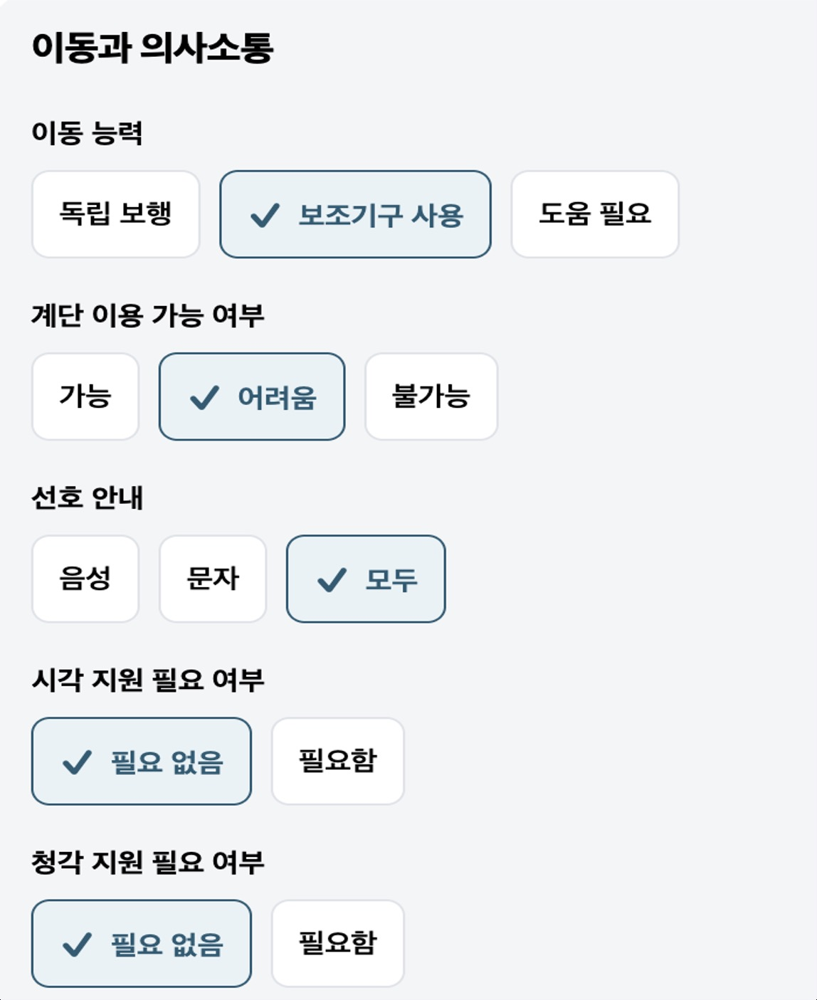
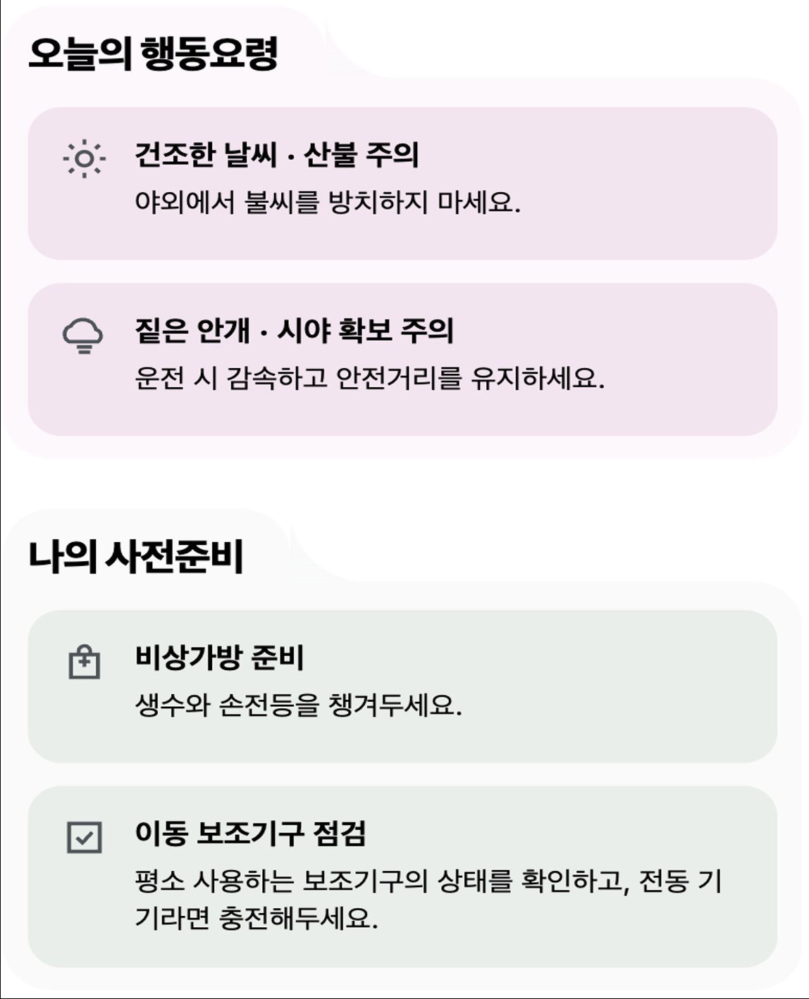
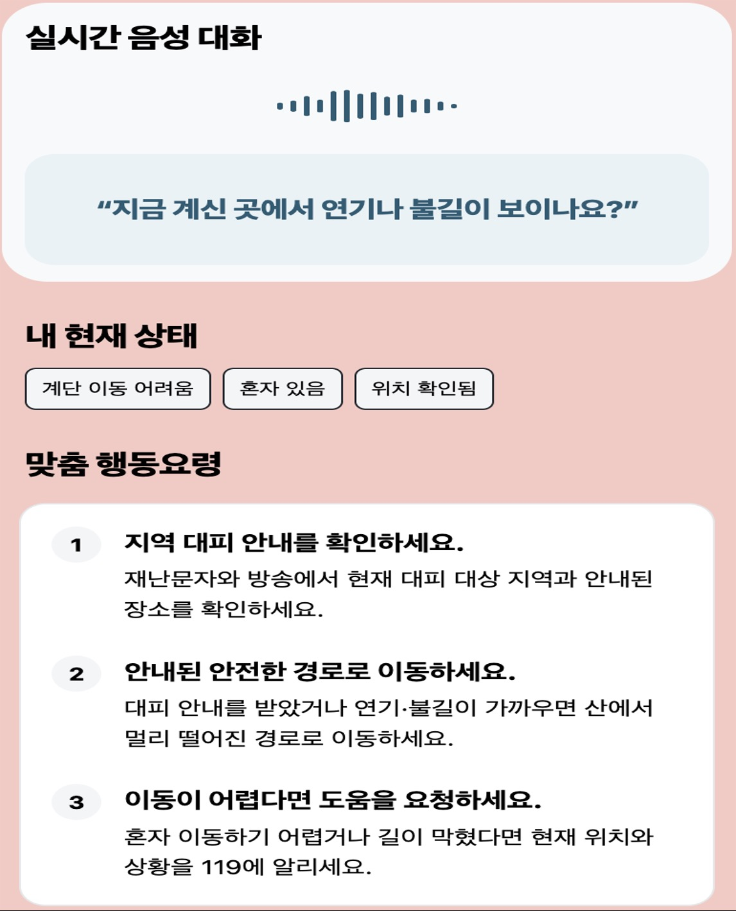
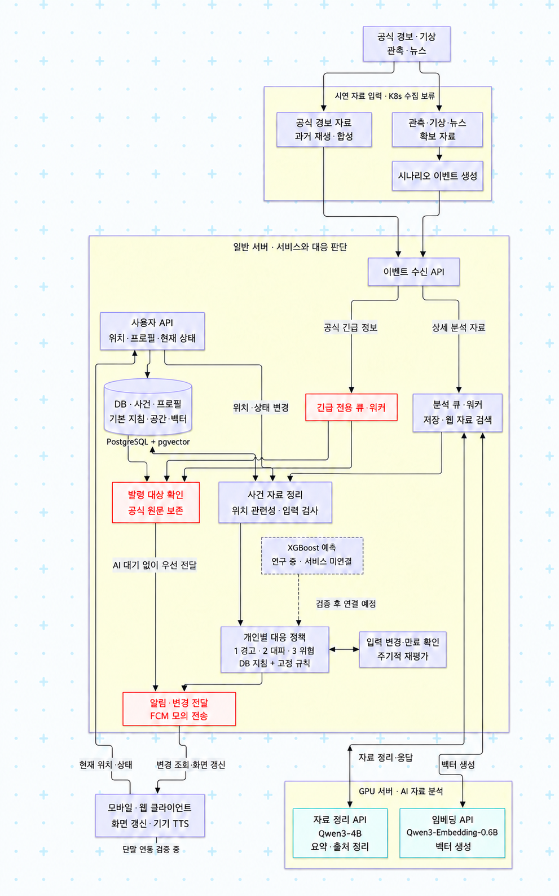

# 봉화지기 BONGHWAJIGI

**봉화지기는 공식 산불 경보와 사용자 위치·프로필·현재 상태를 연결해 개인별 행동 안내를 제공하는 재난 대응 서비스입니다.**

같은 산불이라도 위치, 이동 능력, 현재 동행자에 따라 필요한 행동은 다릅니다. 공식 원문은 우선 전달하고, 개인별 안내는 새로운 자료와 사용자 상태에 맞춰 갱신합니다.

이 저장소는 **서버 API, 자료 수신·분석, 근거 검색, 개인별 정책, 알림 전달, AI 모델 인터페이스와 학습 연구**를 관리합니다. 모바일 앱은 `apps/mobile` 서브모듈로 검증된 커밋을 고정합니다.

### 서비스 화면

| 내정보 설정 | 일상 홈 | 재난 대응 |
| --- | --- | --- |
|  |  |  |

발표자료에 수록한 모바일 화면 예시입니다. 화면 속 날씨·상태·경로 문구는 예시이며, 실제 연결·검증 범위는 아래 구현 표를 기준으로 합니다.

> **실행 환경: Tailscale Tailnet 내부의 사설망 MVP입니다.** 승인된 기기·접근 정책이 있어야 현재 서버에 접속할 수 있습니다. 일반 공개 웹 서비스가 아니며, Tailscale Funnel로 인터넷에 공개하지 않습니다. 재난 입력은 확보한 공식 자료의 과거 기록과 합성 시나리오를 재생합니다. **현재 K8s 자동 수집, 실제 예측 모델의 개인 정책 연결, FCM 원격 푸시는 실행하지 않습니다.**

문서 기준: **2026-11-01 KST**. 현재 코드와 최근 서버·단말 검증 기록을 기준으로 작성했습니다. 이전 설계 문서의 예정 기능과 실제 구현을 구분합니다.

## 목차

- [서비스 화면](#서비스-화면)
- [주요 기능과 현재 구현 범위](#주요-기능과-현재-구현-범위)
- [아키텍처](#아키텍처)
- [처리 흐름과 AI 역할](#처리-흐름과-ai-역할)
- [현재 데이터를 가져오는 곳](#현재-데이터를-가져오는-곳)
- [중복·재시도·누락 방지](#중복재시도누락-방지)
- [개인별 정책과 화면 갱신](#개인별-정책과-화면-갱신)
- [Tailnet에서 서버 접속](#tailnet에서-서버-접속)
- [설치와 실행](#설치와-실행)
- [시나리오 재생과 모델 사용](#시나리오-재생과-모델-사용)
- [검증과 장애 확인](#검증과-장애-확인)
- [사용한 모델·데이터·외부 자원과 라이선스](#사용한-모델데이터외부-자원과-라이선스)
- [팀원과 역할](#팀원과-역할)
- [코드 구조와 관련 문서](#코드-구조와-관련-문서)

## 주요 기능과 현재 구현 범위

| 기능 | 현재 동작 |
| --- | --- |
| 공식 경보 우선 처리 | 이벤트 API → DB/outbox → `urgent` 큐 → 발령 대상·위치 확인 → 원문·정정·해제 기록 및 알림 전달 기록. Qwen 완료를 기다리지 않음 |
| 근거 검색·사건 정리 | 저장 문서와 Google News RSS 검색 → 실제 GPU 임베딩 → pgvector 검색 → 실제 Qwen 사건 통합 |
| 개인별 대응 정책 | DB 기본 행동지침·고정 규칙에 위치·프로필·현재 상태를 적용. 입력 변경과 유효기간 만료에 따라 재평가 |
| 앱 연동 서버 | 설치 계정·회전 세션, 프로필·동의·기기·위치, 홈·경보·개인 안내·변경 조회·수신 확인 |
| 상황 대화 | 앱이 전송한 텍스트에서 Qwen이 상태를 제안. **사용자 확인 후** 현재 상태·정책에 반영. STT/TTS는 단말 영역 |
| 알림 | 서버 전달 어댑터·모의 발신·변경 조회 구현. 최근 단말 검증의 배너·알림음은 전경 앱의 로컬 알림이며 FCM 원격 수신과 다름 |
| 경로 | 표시용 합성 경로 계약. 통제·이탈·정보 부족 시 숨김. 실제 통행·대피소 안전·도로 경로 탐색을 검증한 서비스가 아님 |
| 예측 연구 | XGBoost와 화재 접근·확산 연구는 별도 `training/`에서 진행. 앱 예측은 `unavailable`/`null`, 연구 점수를 실제 개인 위험 확률로 제공하지 않음 |
| 후속 범위 | K8s 상시 수집, 검증된 예측 연결, 실제 FCM, 3D 대피지도, 운영 HA. 자동 119 신고는 제공하지 않음 |

정부의 산불경보 등급과 봉화지기의 **1 경고 · 2 대피 · 3 위급**은 다른 값입니다. 전국 산불경보 ‘심각’ 발령 기록만으로 모든 사용자를 3단계로 올리거나 개인 대피명령을 생성하지 않습니다.

## 아키텍처

사용자가 제공한 아키텍처 이미지입니다. 원본을 수정하지 않고 저장소에 포함했습니다.

<p align="center">
  
</p>

그림의 **‘3 위험’은 현재 확정 명칭인 ‘3 위급’**에 해당합니다. XGBoost 점선은 연구 후 연결 예정 경로이며 현재 서비스 호출 경로가 아닙니다. 그림의 ‘알림’도 현재는 FCM 모의 전달과 앱의 변경 조회·로컬 알림을 포함합니다.

| 구성 | 맡는 일 | 현재 배치 |
| --- | --- | --- |
| 일반 서버 | FastAPI, 사용자 인증, 자료 수신, 사건·위치 관련성, 고정 정책, 알림·변경 기록 | `inno-server-011`, Docker Compose |
| PostgreSQL 16 + pgvector | 사건·프로필·현재 상태·정책 이력·DB outbox·문서·1024차원 벡터 | 일반 서버의 DB 컨테이너·영속 볼륨 |
| Redis 7.4 + Celery | `urgent`, `analysis`, `delivery` 큐와 전용 워커 | 일반 서버. Redis AOF 사용 |
| 주기 작업 | outbox 재전달, 정책 만료·입력 변경 재평가, Qwen 통합 작업 | 큐 워커와 별도 프로세스 |
| GPU 서버 | Qwen3-4B-Instruct-2507 생성·자료 정리, Qwen3-Embedding-0.6B 임베딩 | `inno-gpu-011`, NVIDIA L4, localhost 인증 API |
| 학습 환경 | 데이터 확보·품질 검사·특성·라벨·학습·보정·평가 | GPU 서버의 별도 환경과 `training/`. 서비스 정책과 분리 |
| 모바일 클라이언트 | 위치·현재 상태 입력, 안내 표시, 변경 조회, 단말 음성 입출력 | 검증 버전은 서브모듈로 고정 |
| 기존 K8s | 후속 기관 수집·전송을 위한 배치 구조 | 구성 보존. **MVP 수집기로 실행하지 않음** |

일반 서버 API는 `127.0.0.1:8000`, DB는 `127.0.0.1:15432`, Redis는 `127.0.0.1:16379`에 바인딩합니다. Tailnet HTTPS는 일반 서버 API로 프록시하고, 일반 서버 → GPU는 제한된 SSH 터널의 `127.0.0.1:18001` → GPU `127.0.0.1:8001`을 사용합니다. DB·Redis·GPU 내부 API를 앱에 직접 공개하지 않습니다.

## 처리 흐름과 AI 역할

### 1. 공식 경보 경로

```text
과거 공식 발령 기록 / 합성 경보
  → POST /internal/v1/scenario-events (queue=urgent)
  → DB 작업 + outbox를 같은 트랜잭션으로 저장
  → urgent 전용 큐·워커
  → 발령·정정·해제 / 출처 확인 / 현재 위치와 대상 구역 대조
  → 경보 원문·변경 기록 + 전달 작업
  → 앱이 인증 API로 최신 내용 조회
```

이 경로는 임베딩, 뉴스 검색, Qwen 요약, 개인별 정책 계산을 기다리지 않습니다. 자료의 유효성·위치 관련성을 확인하고 원문을 유지합니다. 위치가 없거나 오래됐으면 임의로 발령 대상 안에 있다고 처리하지 않습니다.

### 2. 분석·개인 안내 경로

```text
확보한 문서·관측·뉴스 / 시나리오 이벤트
  → 수신 API → DB/outbox → analysis 큐
  → Google News RSS 검색 + 저장 문서
  → Qwen Embedding으로 질의·문서를 벡터화
  → pgvector에서 시나리오·판본·시각 조건에 맞는 근거 검색
  → Qwen으로 사건 자료 요약·출처 정리
  → 위치·프로필·현재 상태 + DB 기본 지침·고정 규칙
  → 개인별 정책 revision과 변경 기록
  → 앱 변경 조회·화면 갱신
```

임베딩 모델은 벡터를 생성하고 **검색은 DB가 수행**합니다. Qwen의 요약·상태 제안은 참고 자료이며, 대응 단계와 행동지침을 자율적으로 승인하는 주체가 아닙니다. 외부 뉴스와 검색 결과도 승인 정책으로 자동 승격하지 않습니다.

| 모델 | 입력 → 출력 | 서비스에서의 역할 |
| --- | --- | --- |
| Qwen3-Embedding-0.6B | 질의·문서 → 정규화된 1024차원 벡터 | 표현이 다른 근거의 유사도 검색 지원 |
| Qwen3-4B-Instruct-2507 | 검색 근거·원문 → 구조화된 사건 요약·인용 / 대화 텍스트 → 상태 제안 | 자료 정리와 확인할 상태 추출. 단계 결정은 고정 규칙 |
| XGBoost | 정형 화재 관측·기상·지형·위치 특성 → 연구용 관측·접근 점수 | 별도 학습·검증 중. 실제 개인 정책과 미연결 |

모델 파일은 고정 revision으로 내려받아 GPU 서버에서 실행합니다. 서비스의 Qwen 호출은 외부 유료 LLM API 호출이 아닙니다. 검색 서버나 GPU가 실패하더라도 이미 저장된 공식 경보와 고정 규칙을 이용하는 경로는 독립적으로 계속 처리합니다.

## 현재 데이터를 가져오는 곳

### 앱에 보여 주는 시연 자료와 검색

현재는 정부 API를 K8s에서 상시 수집하는 서비스가 아닙니다. **수동으로 확보·검토한 공식 자료와 합성 조건을 수신 API로 재생**하고, 분석 작업 중 인터넷 뉴스 검색을 추가합니다.

| 자료 | 가져오는 곳 | 현재 사용 방식 |
| --- | --- | --- |
| 산불 공식 발령 사실 | [대한민국 정책브리핑](https://www.korea.kr/news/policyNewsView.do?newsId=148940993) | 2025년 3월 전국 산불경보 심각 확대·영덕 확산의 과거 기록. 개별 주민대피명령 CBS 전문은 미확보 |
| 기상 근거 | [대구지방기상청 사후 분석](https://www.kma.go.kr/kma/servlet/NeoboardProcess?bid=press2&callback=&fno=1&k=ATC202504021111341_e5c09311-18e7-4641-8efb-ea86b64d12e4.pdf&mode=download&num=12893&ses=USER_SESSION) | 과거 산불 기간의 고온·건조·강풍 맥락. 사용자의 현재 위치 기상 실측값이 아님 |
| 기본 행동요령 | [국민안전24](https://www.safekorea.go.kr/safekorea-kor/acts/nacts/action-guide.do?category=forestFires&menuSn=4), 강동구 생존배낭·인천시 지체장애인 대비 자료 | 출처를 보존한 기본·개인 준비 지침. 검토·등록한 DB 지침을 조건에 맞춰 적용 |
| 지역 지리 | 영덕군 공식 산성계곡생태공원 소개 | 지역 지리 맥락. 사용자와 산림의 실측 거리·안전 대피소 검증을 뜻하지 않음 |
| 추가 뉴스 | `GET https://news.google.com/rss/search` | 산불·지역·기간 질의. 제목·최대 500자 설명·URL·매체·게시/수집 시각을 확보하며 기사 전문은 크롤링하지 않음 |
| 사용자 입력 | 앱 API의 동의·프로필·기기·위치·현재 상태 / 확인된 대화 답변 | 위치·현재 상태를 최신 자료로 갱신. 사전 프로필과 현재 동행·이동 여부를 구분 |
| A/B 촬영 조건 | `data/filming/yeongdeok-20250325.json` | 위치·국소 위험·경로 상태는 명시적인 합성 입력. 실제 GPS·기관 관측·모델 예측으로 표시하지 않음 |

[촬영 자료 출처와 사용 범위](docs/V2/delivery/filming-sources.md)에 원문 URL·시각 정밀도·미확보 자료·이용조건을 정리했습니다. 공식 자료 6개와 합성 조건을 분리하며, 사후 분석도 포함하므로 당시 정보만으로 수행한 예측 백테스트라고 주장하지 않습니다.

RSS 검색은 기본 최대 5건, 기준 시각 이전 7일 범위를 사용합니다. 미래 게시물·기간 밖 자료·같은 URL은 걸러냅니다. 결과가 없으면 `no_results`, 실패하면 `unavailable`로 남기고 저장 자료로 계속 진행합니다. 과거 촬영 질의에서는 **웹 결과 0건·저장 근거 5건**을 사용한 검증도 있습니다. 인터넷을 호출한 것과 새 근거를 확보한 것을 구분합니다.

자료마다 `origin`을 유지합니다.

- `historical_replay`: 출처가 있는 과거 자료의 재생
- `collected_sample`: 실제 확보한 샘플·검색 자료
- `synthetic`: 시연을 위해 만든 위치·상황·경로 등

원문 `published_at`·`collected_at`과 재생 `observed_at`·`expires_at`을 구분합니다. 공개 날짜만 있는 자료를 정밀한 관측 시각으로 꾸미거나 과거 경보를 현재 실제 발령으로 표시하지 않습니다.

### 학습·확산 연구용 데이터

아래는 **별도 연구 환경의 확보 경로**입니다. 현재 서비스가 이 자료를 실시간 개인 예측으로 제공한다는 뜻은 아닙니다. 최신 확보·비교 상태와 재현 방법은 [학습 README](training/README.md)와 [모델 개선 기록](docs/V2/delivery/korea-wildfire-improvement.md)을 따릅니다.

| 분류 | 출처·경로 | 사용 범위 |
| --- | --- | --- |
| 국내 위성 화재 | 기상청 API Hub `GK2A/LE2/FF/KO/data` | 승인 인증키로 국내 화재탐지 관측 확보. 접근 제한과 제품별 재이용 조건 확인 필요 |
| 초기 일별 확산 | [Kaggle Next Day Wildfire Spread v2](https://www.kaggle.com/datasets/fantineh/next-day-wildfire-spread) | 미국 과거 위성 기반 초기 학습·전처리·품질 검사 |
| 미국 시간별 화재 | NOAA GOES-17/18 `ABI-L2-FDCC` 공개 S3 | 화재 관측 시계열과 미래 관측 정답 연구 |
| 시간별 산불 경계 | [GOFER v0.2 / Zenodo](https://zenodo.org/records/14642378) | 산불 경계·접근 시간·이력 기반 별도 연구 |
| 기상 관측·예보 | NOAA ISD Lite, GFS·HRRR 공개 자료 | 과거 기상·예보 정합성 및 추가 특성 비교. 미국 HRRR를 국내 관측처럼 사용하지 않음 |
| 국내 확산 시나리오 기상 | [Open-Meteo GFS API](https://api.open-meteo.com/v1/gfs) | 지형 확산 시나리오 연구용 예보. 실제 사건의 당시 관측·국내 검증된 위험 확률과 구분 |
| 지형·토지피복·보조 관측 | Microsoft Planetary Computer의 MODIS·ESA CCI·Copernicus DEM, NASA FIRMS, geoBoundaries/Natural Earth | 화재·토지피복·고도·경사·국가 경계의 확보·검증·입력 구성 |

원본·대용량 가공 자료·서비스용 가중치는 GPU 서버의 `data/raw/`, `data/processed/`, `data/artifacts/`, 모델 캐시에 보관합니다. 저장소에는 코드, 출처 manifest, 품질·실험 보고서와 일부 연구용 소형 산출물이 있습니다. **다운로드 가능 여부, 코드 라이선스, 데이터 재배포 권한은 별도**이며 원기관의 제품·판본별 조건을 확인해야 합니다.

## 중복·재시도·누락 방지

네트워크 응답이 유실되면 같은 자료가 다시 들어올 수 있고, DB 저장 후 큐 전송 사이에 장애가 날 수 있습니다. 이를 고려해 **재전달을 허용하고 단계별로 중복 반영을 막는 구조**를 사용합니다. 모든 외부 전송이 정확히 한 번만 실행된다고 보장하는 구조는 아닙니다.

| 처리 지점 | 중복 판정·복구 로직 | 확인할 코드 |
| --- | --- | --- |
| 이벤트 수신 | `(scenario_id, kind, external_id)` DB 고유 제약 + 정규화 JSON의 SHA-256. 같은 ID·같은 본문이면 기존 `job_id`, `duplicate=true` 반환. 같은 ID·다른 본문이면 **409 `IDEMPOTENCY_CONFLICT`** | [ingestion/service.py](src/bonghwajigi/ingestion/service.py), [api/analysis.py](src/bonghwajigi/api/analysis.py) |
| DB → 큐 | 작업과 outbox를 같은 DB 트랜잭션에 저장. 큐 전송 실패 시 DB 기록으로 재전달. 여러 dispatcher는 `FOR UPDATE SKIP LOCKED`로 같은 행의 동시 처리를 피함 | [workers/outbox.py](src/bonghwajigi/workers/outbox.py) |
| 분석 작업 | 작업 행 잠금과 완료 상태 검사로 재실행을 제한. 임베딩·검색 저장은 SAVEPOINT로 묶어 실패 시 부분 결과를 롤백. 분류된 임베딩 일시 오류는 최대 3회, 지수 지연 재시도 | [retrieval/pipeline.py](src/bonghwajigi/retrieval/pipeline.py) |
| 문서 인덱싱 | `(scenario_id, document_id, revision, chunk_index, embedding_revision)` 고유 제약. 이미 있는 문서·판본·임베딩 revision은 재색인 생략. 문서는 512자, 64자 겹침으로 분할 | [analysis_models.py](src/bonghwajigi/db/analysis_models.py), [retrieval/pipeline.py](src/bonghwajigi/retrieval/pipeline.py) |
| 뉴스·검색 근거 | RSS 응답 안의 같은 URL 제외. URL·제목·게시시각 해시로 문서 ID 생성. 검색 반환에서도 같은 출처 URL을 한 번만 선택 | [retrieval/web_search.py](src/bonghwajigi/retrieval/web_search.py) |
| 공식 경보·입력 변경 | 입력 revision·본문 해시를 함께 확인. 같은 revision·같은 내용은 중복, 오래되거나 충돌하는 revision은 거부. 정정·해제를 별도 이력으로 보존 | [policy/service.py](src/bonghwajigi/policy/service.py), [events/urgent.py](src/bonghwajigi/events/urgent.py) |
| 개인 정책 | 입력 변경/만료 시 재평가하되 **정책 내용 해시가 바뀔 때만** revision·snapshot·변경 기록 생성. 같은 결과의 반복 알림을 줄임 | [policy/service.py](src/bonghwajigi/policy/service.py) |
| 알림 전달 | 기기·자료·revision 기준 고유 제약, 처리 lease와 재시도. 발신 전에 만료·기기 해제·이전 버전·보관된 사건을 검사하고 `expired`/`superseded` 등으로 중단 | [notifications/service.py](src/bonghwajigi/notifications/service.py), [notifications/delivery.py](src/bonghwajigi/notifications/delivery.py) |
| 앱 쓰기·변경 조회 | 지원 경로의 `Idempotency-Key`와 본문 해시로 재요청 결과 재사용. `base_revision`으로 역순 갱신 충돌 방지. 변경은 cursor·revision으로 재조회 | [api/mobile.py](src/bonghwajigi/api/mobile.py) |

다른 ID로 들어온 서로 다른 기사가 같은 사건을 다룬다는 이유만으로 삭제하지 않습니다. 멱등성은 동일 요청의 중복 반영 방지이며, 사건 간 의미 통합·사실 검증과는 구분합니다. 위 처리와 긴급 큐 분리로 중복·누락 위험을 줄이지만 단일 호스트 장애를 자동 해결하는 다중 리전 HA는 현재 구현하지 않았습니다.

MVP Compose의 outbox 정상 재전달 간격은 60초이며 브로커 전송 실패는 5초 뒤 재시도합니다. 분류된 임베딩 일시 오류는 `min(5 × 2^attempts, 60)`초로 재예약하고, 알림 제공자의 재시도 가능 오류는 최대 5회 처리합니다. `failed` 작업은 원인을 확인한 뒤 지원되는 재시도 API로 다시 예약합니다.

## 개인별 정책과 화면 갱신

정책의 입력은 **사건·공식 경보 + 최신 위치 + 프로필 + 현재 상태 + 환경·경로 정보 + 검토된 기본 지침과 규칙**입니다. 모델 확률 하나로 개인별 대응 매뉴얼을 만들지 않습니다. 현재 실제 예측은 연결하지 않았으므로 공식 근거와 고정 규칙을 사용합니다.

| 단계 | 이름 | 안내 성격 |
| --- | --- | --- |
| 1 | 경고 | 상황 확인·기본 준비·개인 준비·현재 상태 확인 |
| 2 | 대피 | 대피 필요성과 이동 가능 조건을 확인하고 개인별 이동·조력 준비 안내 |
| 3 | 위급 | 즉시 위험·탈출 곤란 등 확인된 조건에 맞춰 안전 확보·긴급 도움 요청 안내 |

상세 조건과 하향·해제 처리의 정본은 [3단계 대응 정책](docs/V2/delivery/response-policy.md)과 [실행 규칙](src/bonghwajigi/policy/three_stage.py)입니다. 점수가 낮다는 이유로 자동으로 ‘안전’이나 하향을 선언하지 않습니다. 3단계라고 해서 서버가 자동으로 119에 전화하는 것도 아닙니다.

프로필의 ‘보호할 어린이 있음’은 지금 아이와 함께 있다는 뜻이 아닙니다. 보조기구 사용도 현재 이동 불가와 다릅니다. 대화에서 추출한 상태는 사용자가 확인해야 저장하며, **확인 전에는 정책 입력을 바꾸지 않습니다.**

입력 변경은 재평가 요청을 만들고, 만료는 주기 작업으로 확인합니다. 현재 MVP Compose는 정책 poll 1초·주기 확인 10초를 설정합니다. 이는 처리 설정값이며 단말 종단 지연의 보장값은 아닙니다. 위치·현재 상태는 기본 5분 유효기간이 있으므로 앱에서 계속 최신화해야 합니다. 오래된 자료나 불확실한 위치에서는 `checking`/`unavailable`과 사유를 반환하고 오래된 행동·경로를 숨깁니다.

앱은 `GET /v1/me/updates`의 cursor와 자원 revision으로 변경을 가져오고, 인증된 경보·대응 API에서 최신 내용을 조회합니다. 정책이 매번 같은 결과이면 매 poll마다 새 revision이나 알림을 만들지 않습니다.

## Tailnet에서 서버 접속

### Tailnet 전용 HTTPS

개발 컴퓨터와 휴대폰 모두 **같은 승인된 Tailnet에 로그인**해야 합니다. Tailnet 로그인만으로 모든 기기에 접근권이 생기는 것은 아니며, 서버 TCP 443 접근 grant와 DNS 확인이 필요합니다.

```text
기본 API  https://inno-server-011.tail2dac17.ts.net
상태      /health/live
준비      /health/ready
API 문서  /docs
실행 명세 /openapi.json
```

```sh
curl -i https://inno-server-011.tail2dac17.ts.net/health/ready
```

문서 작성 중 정상 TLS 인증서 검증을 유지한 readiness 응답이 `200`이고 DB·브로커가 연결된 것을 확인했습니다. 일반 사용자 API는 별도의 사용자 access token을 요구합니다. 예를 들어 무인증 `/v1/app-config` 접근은 `401`로 거부됩니다. **Tailnet은 네트워크 경계이고 사용자 JWT 인증을 대체하지 않습니다.**

### SSH 터널을 사용하는 대안

이미 관리자에게 SSH 권한을 받은 개발 컴퓨터에서 실행합니다. 별칭은 [SSH 접속 문서](docs/V2/delivery/ssh-access.md)의 기존 설정을 사용합니다.

```sh
ssh -N -o ExitOnForwardFailure=yes \
  -L 127.0.0.1:18080:127.0.0.1:8000 inno-server-011
```

연결을 유지한 다른 터미널에서 `curl -i http://127.0.0.1:18080/health/ready`로 확인합니다. 컴퓨터의 loopback 주소를 휴대폰에서 직접 쓰면 휴대폰 자신을 가리킵니다. USB 디버깅을 사용하는 경우에만 `adb reverse tcp:18080 tcp:18080`을 추가하고, 휴대폰 API 주소를 `http://127.0.0.1:18080`으로 설정합니다. Tailnet HTTPS를 쓰는 단말에는 이 우회 경로가 필요 없습니다.

## 설치와 실행

### 1. 소스와 개발 의존성

Python **3.12**, `uv`, Git이 필요합니다. 전체 서비스에는 Docker Engine과 Compose v2, 실제 모델 호출에는 준비된 GPU API 접근권이 추가로 필요합니다.

```sh
git clone https://github.com/develsvai/BONGHWAJIGI.git
cd BONGHWAJIGI
uv sync --frozen --extra server --extra collector --group api-contract
test -e .env || cp .env.example .env
```

루트의 CPU 개발 설치는 GPU 모델 가중치를 내려받지 않습니다. 앱 소스가 필요한 경우에만 `git submodule update --init --recursive apps/mobile`을 실행합니다. 앱 빌드·키 설정은 [서브모듈·빌드 안내](docs/V2/delivery/mobile-submodule-deployment.md)를 따릅니다.

### 2. 환경설정 (.env)

로컬 Python 실행은 루트 `.env`를 읽습니다. 예시 파일의 값을 환경에 맞게 바꾸고, 다른 파일을 쓰려면 `BONGHWA_ENV_FILE=/절대/경로/설정파일`로 지정합니다. OS 환경변수가 파일보다 우선합니다. 설정 정의는 [`Settings`](src/bonghwajigi/common/config.py), 배포 시 적용값은 [`mvp.yaml`](deploy/compose/mvp.yaml)을 확인합니다.

| 설정 | 로컬 예시·기본값 | 전체 MVP에서의 설정·용도 |
| --- | --- | --- |
| `BONGHWA_ENVIRONMENT`, `BONGHWA_MODE` | `local`, `simulation` | Compose는 `staging`, `simulation`. 과거·합성 입력을 실제 발령과 구분 |
| `BONGHWA_DATABASE_URL`, `BONGHWA_BROKER_URL` | 로컬 PostgreSQL `5432`, Redis `6379` | Compose 내부 서비스는 호스트 loopback의 `15432`, `16379` 사용 |
| `BONGHWA_SERVICE_TOKEN` | 비어 있음 | 내부 수신·모델 API 인증. 사용자 JWT와 별개이며 무작위 비밀값 필요 |
| `BONGHWA_ANALYSIS_ENABLED`, `BONGHWA_POLICY_ENABLED`, `BONGHWA_APP_ENABLED` | 모두 `false` | DB migration·브로커·인증 준비 후 활성화. MVP Compose는 `true` |
| `BONGHWA_GPU_BASE_URL`, `BONGHWA_EMBEDDING_SERVICE_TOKEN` | `http://127.0.0.1:8001`, 빈 토큰 | 일반 서버에서는 GPU SSH 터널 `http://127.0.0.1:18001`과 관리자 제공 토큰 사용 |
| `BONGHWA_GPU_ENABLED`, `BONGHWA_QWEN_REVISION`, `BONGHWA_EMBEDDING_REVISION` | `false`, 빈 revision | GPU 프로세스만 모델·캐시·고정 revision 준비 후 활성화. 일반 서버가 모델을 로딩하는 설정은 아님 |
| `BONGHWA_POLICY_QWEN_ENABLED`, `BONGHWA_WEB_SEARCH_ENABLED` | `false`, `true` | Qwen 자료 정리와 인터넷 뉴스 검색 사용 여부. 전체 Compose는 둘 다 `true` |
| `BONGHWA_JWT_SECRET` | 비어 있음 | 사용자 세션 서명용 32바이트 이상 무작위 키. 내부 서비스 토큰과 다른 값 사용 |
| `BONGHWA_APP_REGISTRATION_ENABLED` | `false` | 사설망 simulation 설치 계정의 신규 등록 허용 여부. 기존 관리자 발급 경로와 구분 |
| `BONGHWA_NOTIFICATIONS_ENABLED`, `BONGHWA_PUSH_PROVIDER` | `false`, `disabled` | MVP Compose는 `true`, `simulation`. Firebase 자격 파일·기기 토큰을 준비해 별도 검증한 뒤 실제 FCM 연결 |
| `POSTGRES_PASSWORD`, `BONGHWA_PRIVATE_DIR`, `BONGHWA_RELEASE` | Compose용 별도 설정 | 새 DB 비밀번호, 비공개 계정 자료 볼륨의 절대경로, 이미지 태그. 아래 `secrets/mvp.env`에서 관리 |

**로컬 `.env`와 Compose의 `--env-file`은 별도 경로입니다.** 전체 MVP는 아래에서 생성하는 `secrets/mvp.env`의 변수를 Compose가 읽어 컨테이너에 전달합니다. `.env`의 기능 스위치를 바꾸는 것만으로 배포 컨테이너 설정이 바뀌지는 않습니다. 실제 키·토큰·자격 파일은 Git에서 제외하고 권한을 제한합니다.

### 3. 로컬 API 틀 확인

`.env.example`은 분석·정책·앱·GPU 실행을 기본 비활성화합니다. 이 상태는 코드·API 경계 확인용이며 전체 시연 서버가 아닙니다.

```sh
uv run --no-sync uvicorn bonghwajigi.api.app:create_app \
  --factory --host 127.0.0.1 --port 8000 --reload --no-access-log
```

다른 터미널에서 확인합니다.

```sh
curl -i http://127.0.0.1:8000/health/live
curl -i http://127.0.0.1:8000/health/ready
```

기본 예시 설정은 `/health/live`가 `200`, `/health/ready`가 `503`입니다. 프로세스 생존과 DB·큐·기능 준비를 구분한 의도된 결과입니다. GPU 틀도 아래처럼 시작할 수 있으나 `BONGHWA_GPU_ENABLED=false`일 때 실제 모델을 로딩하지 않고 readiness는 `503`입니다.

```sh
uv run --no-sync uvicorn bonghwajigi.gpu_api.app:create_app \
  --factory --host 127.0.0.1 --port 8001 --no-access-log
```

### 4. Linux에서 전체 MVP 실행

실제 배포 구성은 [`deploy/compose/mvp.yaml`](deploy/compose/mvp.yaml)입니다. **Linux host network 전용**이며 macOS의 로컬 API 틀과 구분합니다. PostgreSQL·Redis, migration, API, 긴급·분석·전달 워커, outbox, 정책, 통합 프로세스를 실행합니다.

새 개발 환경에서는 비공개 파일을 준비합니다. 아래 명령은 Git에서 제외되는 `secrets/` 아래에 서로 다른 무작위 키를 생성하고, 기존 설정이 있으면 덮어쓰지 않습니다.

```sh
umask 077
python3 - <<'PY'
from pathlib import Path
import secrets

private = Path("secrets/mvp").resolve()
(private / "accounts").mkdir(parents=True, exist_ok=True, mode=0o700)
values = {
    "POSTGRES_PASSWORD": secrets.token_hex(24),
    "BONGHWA_SERVICE_TOKEN": secrets.token_urlsafe(36),
    "BONGHWA_JWT_SECRET": secrets.token_urlsafe(48),
    "BONGHWA_PRIVATE_DIR": str(private),
    "BONGHWA_RELEASE": "local-mvp",
    "BONGHWA_EMBEDDING_SERVICE_TOKEN": "",
}
with Path("secrets/mvp.env").open("x") as stream:
    stream.write("\n".join(f"{k}={v}" for k, v in values.items()) + "\n")
Path("secrets/mvp.env").chmod(0o600)
PY
```

전체 AI 흐름에는 관리자가 허용한 **GPU API 토큰**을 `secrets/mvp.env`의 `BONGHWA_EMBEDDING_SERVICE_TOKEN`에 별도로 주입하고, 실행 호스트에서 GPU 터널을 유지해야 합니다. 토큰을 앱이나 Git에 넣지 않습니다.

```sh
# 이 터미널은 연결을 유지한다. GPU 서버 SSH 접근권이 필요하다.
ssh -N -o ExitOnForwardFailure=yes \
  -L 127.0.0.1:18001:127.0.0.1:8001 inno-gpu-011
```

다른 터미널에서 실행합니다. Docker 권한이 없는 환경에서는 관리자 절차에 따라 `sudo`를 사용합니다.

```sh
docker compose --env-file secrets/mvp.env -f deploy/compose/mvp.yaml config --quiet
docker compose --env-file secrets/mvp.env -f deploy/compose/mvp.yaml up -d --build --wait
docker compose --env-file secrets/mvp.env -f deploy/compose/mvp.yaml ps
curl -i http://127.0.0.1:8000/health/ready
```

GPU 토큰·모델이 준비되지 않으면 API·규칙 기반 경로와 AI 분석의 상태가 다를 수 있습니다. **일반 서버 readiness 200은 GPU 성공을 보장하지 않습니다.** 실제 분석 완료는 작업 조회 결과, Qwen 상태, GPU readiness를 각각 확인합니다. 기본 설치 계정 등록은 꺼져 있으며 관리자 계정 발급 도구 또는 사설망 simulation 등록 설정이 필요합니다.

이미 배포된 일반 서버에서는 새 설정을 생성하지 않고 `/home1/ncloud/.config/bonghwajigi/general.env`와 기존 볼륨을 사용합니다. 새 로컬 설정으로 운영 DB 비밀번호를 교체하거나 `down -v`로 자료를 지우지 않습니다. 상시 실행·복구 설정은 [일반 서버 운영 기록](docs/V2/delivery/mvp-server-runbook.md), 현재 Tailnet HTTPS·앱 등록은 [후속 배포 기록](docs/V2/delivery/mobile-server-deployment.md)을 함께 확인합니다.

## 시나리오 재생과 모델 사용

### 입력 형식 검사

```sh
uv run --no-sync python -m bonghwajigi.ingestion.replay \
  data/scenarios/analysis-event.jsonl --check
```

이 명령은 JSONL 계약만 검사하며 큐에 전송하지 않습니다. `--submit --base-url ...`은 내부 서비스 토큰과 분석·정책 설정을 갖춘 실행 환경에서 실제 수신 API로 전송합니다. 합성 예제의 `example.invalid`는 실제 정보 출처가 아닙니다.

### 현재 배포 서버에서 전체 동작 재생

다음은 **기존 일반 서버에서** 실행하는 명령입니다. 합성 사용자·사건과 검증 기록을 생성하며 실제 재난을 발령하거나 전화·문자를 전송하지 않습니다.

```sh
ssh inno-server-011
cd /home1/ncloud/bonghwajigi

sudo docker compose --env-file /home1/ncloud/.config/bonghwajigi/general.env \
  -f deploy/compose/mvp.yaml exec -T api python tools/mvp_demo.py

sudo docker compose --env-file /home1/ncloud/.config/bonghwajigi/general.env \
  -f deploy/compose/mvp.yaml exec -T api python tools/mvp_analysis_demo.py
```

첫 명령은 공식 경보·세 사용자·정책 변경·모의 전달 등을 검사하고, 둘째는 실제 임베딩·검색·Qwen 통합 흐름을 검사합니다. 테스트 계정 토큰을 포함한 결과는 권한이 제한된 `/accounts`에 보관합니다. 공개 보고서·스크린샷에 토큰을 복사하지 않습니다.

현재 A/B 촬영 흐름을 새 격리 시나리오로 확인하려면 같은 컨테이너에서 다음을 실행합니다. `/accounts/filming/yeongdeok-20250325.json`은 운영자가 저장소의 공식·합성 번들을 비공개 볼륨에 준비한 경로입니다. 새 환경이면 `data/filming/yeongdeok-20250325.json`을 해당 위치에 먼저 복사합니다.

```sh
python tools/filming_scenario.py all \
  --state /accounts/filming-readme-run.json \
  --bundle /accounts/filming/yeongdeok-20250325.json
```

이 명령은 `prepare → trigger → verify`를 실행합니다. **동일 `--state` 파일은 후속 단계의 계정 정보를 보관하므로 유지하고, 독립 실행은 새 파일명을 사용합니다.** A/B 프로필과 위치·경로 조건은 합성이며, 기존 휴대폰 계정에 적용하는 `--phone-user` 옵션은 대상 사용자를 확인한 운영자만 사용합니다. [촬영 파이프라인](docs/V2/delivery/filming-scenario-pipeline.md)에 단계별 명령과 실제 모델·단말 검증 범위를 남겼습니다.

### GPU 모델 직접 호출

GPU 서버에 SSH로 접속한 뒤 실행합니다. 기존 비공개 환경 파일에서 서비스 토큰을 읽으며 실제 값을 명령행에 넣지 않습니다.

```sh
ssh inno-gpu-011
cd /home1/ncloud/bonghwajigi
.venv-gpu/bin/python tools/gpu_client.py ready
.venv-gpu/bin/python tools/gpu_client.py embed --text "산불 발생 시 대피 준비"
.venv-gpu/bin/python tools/gpu_client.py generate --text "제공된 근거를 짧게 정리하세요."
```

모델·고정 revision·토큰 예산·GPU 잠금·학습과의 자원 분리는 [GPU 준비 문서](docs/V2/delivery/gpu-model-readiness.md)를 따릅니다. README 확인을 위해 학습이나 모델 서비스를 중단할 필요는 없습니다.

## 검증과 장애 확인

### 개발 검사

```sh
uv run --no-sync ruff check src tests migrations
uv run --no-sync ruff format --check src tests migrations
uv run --no-sync python -m pytest
uv run --no-sync python tools/validate_app_api.py

# 별도 학습 프로젝트. GPU 설치·학습 실행과 구분한다.
uv sync --project training --frozen
uv run --project training --no-sync pytest training/tests
```

DB 통합시험은 별도 테스트 DB를 준비하고 `BONGHWA_TEST_DATABASE_URL`을 설정해야 합니다. 설정이 없으면 해당 시험은 skip되며, 일반 pytest 통과를 실제 PostgreSQL 통합 검증 완료로 해석하지 않습니다. 운영 DB를 테스트 대상으로 사용하지 않습니다. `validate_app_api.py`는 이전 `0.1.0-draft` 계약 검사이며, 현재 실행 계약은 [`mvp-openapi.json`](docs/V2/delivery/api/mvp-openapi.json)입니다.

최근 촬영 흐름은 실제 PostgreSQL 회귀 **141개**, 실제 임베딩·검색·Qwen 사건 통합·대화 확인·정책 갱신을 검증했습니다. 긴급 큐 입력 후 경보 API 노출은 A 1.553초/B 1.564초였고 Qwen 통합 전에 확인했습니다. **합성 시나리오의 서버 API 측정값이며 휴대폰 알림의 종단 지연·운영 SLA가 아닙니다.** [실행 근거](docs/V2/delivery/filming-pipeline-verification.json)와 [모델 메타데이터](docs/V2/delivery/filming-model-metadata.json)를 확인할 수 있습니다.

### 증상별 확인

| 증상 | 먼저 확인할 것 |
| --- | --- |
| Tailnet HTTPS 접속 불가 | 기기의 Tailscale 연결·같은 Tailnet·서버 TCP 443 grant·DNS. 공개 인터넷 접속을 기대하지 않음 |
| 사용자 API 401 | 설치/로그인 세션·access token 만료·refresh 회전·로그아웃. 내부 서비스 토큰으로 사용자 API를 호출하지 않음 |
| 로컬 readiness 503 | 기본 비활성 예시인지, DB migration·Redis·분석/앱 설정이 준비됐는지 확인 |
| 분석이 `queued`/`retry`에 머묾 | outbox·analysis 워커·Redis, GPU 터널·토큰·모델 revision, 작업의 `error_code` 확인 |
| 인터넷 검색 0건 | 시나리오 기준 시각·검색 기간·지역 질의 확인. 과거 질의는 결과가 없을 수 있으며 저장 근거를 사용 |
| 화면의 안내·경로가 사라짐 | 최신 위치/상태의 만료, 자료 유효기간, 경로 차단, 보관된 사건 여부. 만료를 사건 종료로 간주하지 않음 |
| FCM이 오지 않음 | 현재 제공자는 `simulation`. 전경 앱의 로컬 알림과 별개이며 Firebase 프로젝트·기기 토큰·실발신 검증이 필요 |

기존 일반 서버 운영자는 아래처럼 상태·제한된 로그를 확인할 수 있습니다. 원문 발화·프로필·정밀 위치·인증값을 로그에 추가하지 않습니다.

```sh
sudo systemctl status bonghwajigi-general.service bonghwajigi-general-gpu-tunnel.service
sudo docker compose --env-file /home1/ncloud/.config/bonghwajigi/general.env \
  -f deploy/compose/mvp.yaml logs --tail 50 outbox urgent analysis policy integration delivery
```

## 사용한 모델·데이터·외부 자원과 라이선스

서비스에 연결된 자원과 별도 학습·확산 연구 자원을 함께 표기합니다. 모델의 입출력은 [AI 역할](#처리-흐름과-ai-역할), 데이터 확보 경로와 실제·합성 구분은 [데이터 출처](#현재-데이터를-가져오는-곳)를 참고하세요. Python 패키지의 정확한 판본과 설치·라이선스 증거는 [패키지 조사 기록](docs/V2/delivery/external-resources/python-inventory.json), [배포 메타데이터 보완](docs/V2/delivery/external-resources/supplemental-verification-20261101.json)에 있습니다. 이 기록은 조사 시점의 자료이며 현재 모든 전이 의존성의 완전한 SBOM을 뜻하지 않습니다.

| 구분 | 명칭 | 용도 | 라이선스·이용 조건 |
| --- | --- | --- | --- |
| 모델 | [Qwen3-4B-Instruct-2507](https://huggingface.co/Qwen/Qwen3-4B-Instruct-2507) | 사건 자료 정리·출처 인용·상태 제안 | Apache-2.0 |
| 모델 | [Qwen3-Embedding-0.6B](https://huggingface.co/Qwen/Qwen3-Embedding-0.6B) | 검색용 1024차원 벡터 생성 | Apache-2.0 |
| 오픈소스 | XGBoost | 산불 관측·접근 예측 연구. 실제 개인 정책 미연결 | Apache-2.0 |
| 오픈소스 | PyTorch · Transformers · Sentence Transformers | GPU 추론·모델 로딩·임베딩 | PyTorch: BSD-3-Clause / 나머지 두 라이브러리: Apache-2.0. 동봉된 제3자 고지는 별도 유지 |
| 오픈소스 | FastAPI · Pydantic · SQLAlchemy · Alembic | 서버 API·설정 검증·DB·migration | MIT |
| 오픈소스 | Celery · Uvicorn · HTTPX | 처리 큐·워커·ASGI 서버·HTTP 통신 | BSD-3-Clause |
| 오픈소스 | PostgreSQL 16 · pgvector | 사건·프로필·정책·벡터 보관과 검색 | [PostgreSQL License](https://www.postgresql.org/about/licence/), [pgvector LICENSE](https://github.com/pgvector/pgvector/blob/master/LICENSE) |
| 소스 공개 소프트웨어 | Redis 7.4 | Celery broker·큐·AOF 영속화 | [RSALv2 또는 SSPLv1](https://redis.io/legal/licenses/). Redis 8의 라이선스 선택지를 7.4에 적용하지 않음 |
| 오픈소스 | Docker Engine/Moby · Docker Compose | 일반 서버 컨테이너 배포 | Apache-2.0. Docker Desktop 제품 이용조건은 별도 |
| 네트워크·인프라 | Tailscale · NAVER Cloud · NVIDIA L4/CUDA | Tailnet 사설망·일반/GPU 서버·GPU 실행 | Tailscale·Ncloud 서비스 약관, NVIDIA CUDA EULA 및 구성 요소별 고지 |
| 외부 검색 | Google News RSS | 산불 기사 제목·짧은 설명·URL·매체·시각 검색 | Google 이용약관 및 언론사별 저작권. 기사 전문·이미지 재배포 권한을 뜻하지 않음 |
| 외부 API·데이터 | 기상청 API Hub · GK2A FF | 국내 위성 화재 관측·학습 자료 확보 | 인증·활용 승인 필요. 제품·판본별 재이용 조건 확인 |
| 데이터 | NOAA GOES · ISD Lite · GFS · HRRR | 위성 화재·과거 기상·예보 연구 | NOAA/NCEI·NODD의 제품별 이용조건·출처 고지. 관측과 예보·가공 여부 구분 |
| 데이터 | Next Day Wildfire Spread v2 | 초기 일별 확산 학습·전처리 | CC BY 4.0. [Fantine Huot 외 원저자·원본·가공 내역](training/README.md#출처와-변경) 표시 |
| 데이터 | [GOFER v0.2](https://zenodo.org/records/14642378) | 시간별 화재 경계·접근 시간 연구 | 데이터: CC BY 4.0. Liu 외 저자·DOI·판본·가공 사실 표시. 코드 라이선스와 구분 |
| 외부 API | [Open-Meteo GFS Forecast API](https://open-meteo.com/en/terms) | 국내 지형 확산 시나리오의 기상예보 | 데이터: CC BY 4.0 / 무료 API: 비상업 이용 조건·호출 제한 |
| 데이터·호스팅 | Microsoft Planetary Computer의 MODIS · ESA CCI · Copernicus DEM | 보조 화재 관측·토지피복·고도·경사 | 호스팅 서비스 약관과 원제품 조건 별도. STAC의 `other`를 단일 오픈 라이선스로 해석하지 않음 |
| 데이터 | NASA FIRMS · geoBoundaries/Natural Earth · LANDFIRE | 보조 화재·국가 경계·연료/수관 연구 입력 | FIRMS 인용·사용조건, 경계의 제품별 조건 적용. 확보한 Natural Earth 경계·LANDFIRE 공개 래스터는 Public Domain 근거 보존 |
| 연구 소프트웨어 | ELMFIRE 1.1 | 바람·지형 기반 확산 시뮬레이션 연구. 서비스 미연결 | 확보 판본은 [AGPL-3.0 + Commons Clause](training/reports/gofer-hindcast-20261101/endpoint-diagnostic/source/LICENSE.md), [상업 이용 별도 계약](training/reports/gofer-hindcast-20261101/endpoint-diagnostic/source/COMMERCIAL_LICENSE.md) |
| 공식 자료 | 정책브리핑 · 기상청 PDF · 국민안전24 · 지자체 행동요령 | 과거 경보·기상 맥락·기본/개인 준비 지침 | 정책브리핑 해당 텍스트: 공공누리 1유형. 나머지는 [자료별 출처·조건](docs/V2/delivery/filming-sources.md) 적용. 재이용 유형 미확인 자료는 짧은 자체 요약 |
| 공식 자료 | 안전한TV 산불 행동요령 | 이전 검색·정책 근거 자료 | 해당 자료의 공공누리 4유형(출처표시·상업적 이용금지·변경금지). 별도 저작물 조건 확인 |
| 앱 외부 자원 | NAVER Maps Android SDK · React Native 연결 라이브러리 | 앱 배경 지도 표시 | NAVER Maps 약관·SDK 고지 / `@mj-studio/react-native-naver-map`: MIT |
| 앱 외부 자원 | expo-speech-recognition · expo-font · Android SpeechRecognizer | 단말 음성 인식·서체 로딩. 서버에는 텍스트 전달 | 연결 라이브러리: MIT / 단말 음성 서비스 제공자 조건 별도. [확인 기록](docs/V2/delivery/external-resources/android-voice-resources-20261101.json) |
| 서체 | 대한민국정부상징체 R | 앱 로고 서체 | [문화체육관광부](https://www.mcst.go.kr/site/s_about/intro/symbol.jsp) 공공누리 4유형. 영리 목적 이용은 별도 협의 |
| 사전 보유 코드 | 해당 없음 | 행사 개회식 전 보유 코드 반입 없음 | 사용자 확인. 외부 모델·데이터·라이브러리 이용과 별도 항목 |

각 자원의 저작권·라이선스·출처 고지를 보존합니다. 데이터 다운로드나 API 호출이 가능하다는 사실만으로 재배포·상업 이용이 허용되는 것은 아닙니다. 출처 URL과 제공자 메타데이터는 [데이터·콘텐츠 조사 기록](docs/V2/delivery/external-resources/data-and-content-sources.json), 연구의 추가 자료·가공 범위는 [학습 README](training/README.md)와 개별 보고서에 남깁니다. 앱 관련 항목은 발표자료와 저장된 확인 기록을 기준으로 기재했습니다.

## 팀원과 역할

팀 **Hello, World!**의 구성과 담당 역할입니다.

| 팀원 | 담당 역할 | 주요 기여 |
| --- | --- | --- |
| 허연진 | UI/UX · 프론트엔드 | 앱 디자인과 React 기반 프론트엔드 화면 구현 |
| 김현래 | 기획 · PM | 아이디어 제시·종합, 서비스 기획 구체화와 방향 정리 |
| 강소연 | PM · 데이터 엔지니어링 | 모델 학습 데이터 수집·라벨링, 팀 활동 기록과 발표자료 구체화 |
| 홍용재 | 백엔드 · 인프라 · 시스템 통합 | 시스템·로직 설계, 서버·인프라 구현, 동작 검증과 전체 통합 |

업무를 공유하고 코드·화면을 통합한 뒤 모의 시나리오로 함께 검증합니다.

## 코드 구조와 관련 문서

```text
src/bonghwajigi/
  api/                    사용자·내부 API, 세션·접근 제어
  ingestion/              이벤트 수신·멱등성·시나리오 재생
  events/                 공식 긴급 경보 처리
  retrieval/              RSS·임베딩·문서 분할·벡터 검색
  policy/                 기본 지침·고정 규칙·정책 재평가·Qwen 통합·대화
  notifications/          변경 기록·기기·전달 예약·제공자 어댑터
  workers/                urgent·analysis·delivery·outbox·주기 작업
  gpu_api/                자체 호스팅 Qwen 생성·임베딩 API
  db/                     정본·outbox·문서·정책·알림 테이블
  common/ contracts/      설정·보안·공통 입력/출력 계약
migrations/               Alembic DB migration
deploy/                   Docker·Compose·systemd·SSH·K8s 구성
data/filming/             출처를 보존한 과거 자료·합성 촬영 조건
data/scenarios/           재생 입력 형식·이전 예제
tools/                    시연·계정 발급·계약·모델 호출 도구
training/                 별도 데이터·학습·평가 연구 프로젝트
tests/                    단위·DB 통합·실패 경계 시험
apps/mobile               별도 앱 저장소의 고정 서브모듈
```

| 문서 | 확인할 내용 |
| --- | --- |
| [현재 앱 API](docs/V2/delivery/mvp-app-api.md) · [실행 OpenAPI](docs/V2/delivery/api/mvp-openapi.json) | 인증·경보·개인 안내·변경·오류와 현재 실행 계약 |
| [앱 대화·상태 확인·경로](docs/V2/delivery/mobile-dialogue-and-route.md) | 사용자 확인 전후 상태, 합성 경로의 조건과 한계 |
| [현재 Tailnet·앱 서버 배포](docs/V2/delivery/mobile-server-deployment.md) | HTTPS·단말 접속·설치 계정·후속 배포 기록 |
| [일반 서버 초기 운영 기록](docs/V2/delivery/mvp-server-runbook.md) | Compose·지속 실행·영속성·복구. 초기 SSH 전용 범위와 현재 후속 배포를 구분 |
| [촬영 파이프라인](docs/V2/delivery/filming-scenario-pipeline.md) · [자료 출처](docs/V2/delivery/filming-sources.md) | 실제 공식 자료와 합성 조건, 큐·모델·단말 검증 |
| [대응 정책](docs/V2/delivery/response-policy.md) · [개인 정책 루프](docs/V2/delivery/personal-policy-loop.md) | 확정 단계·기본 지침·입력 변경·만료·이력 |
| [GPU 모델 준비](docs/V2/delivery/gpu-model-readiness.md) | 모델 설치·고정 revision·호출·자원 사용 |
| [학습 README](training/README.md) · [모델 개선 기록](docs/V2/delivery/korea-wildfire-improvement.md) | 데이터 확보·평가·확산 연구·현재 미연결 경계 |
| [모바일 소스·검증](docs/V2/delivery/mobile-submodule-deployment.md) | 서브모듈 초기화·검증 버전·빌드 재현 |
| [문서 안내](docs/README.md) · [구현 스택](docs/V2/delivery/implementation-stack.md) | 상세 설계와 이전 결정의 배경 |

### 비공개 설정과 작업 기록

`.env`, API 키, SSH 개인키, 사용자 JWT, 원시 위치·발화는 비공개 설정과 권한이 제한된 파일로 관리합니다. 사용자의 자료는 인증·소유권 검사와 별도 동의 범위 안에서 처리합니다.


