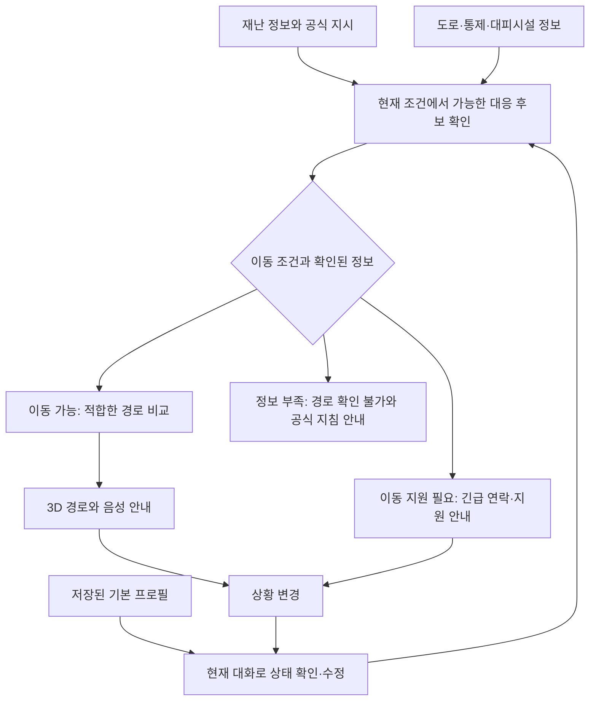

# 02. 서비스와 개인 맞춤형 대피 추천

[문서 안내](README.md) · 근거: [M039–M040](archive/conversation-05.md#m039), [M045–M050](archive/conversation-06.md#m045), [최신 대화](archive/conversation-07.md#m049)

## 서비스 정의와 대상

사용자의 중심 구상은 1인 가구나 어르신에게 재난을 음성으로 알리고, 대화로 현재 상황을 들은 뒤 적합한 대피 방법과 피난로를 안내하는 서비스다. 초반에는 가정용 음성 기기를 생각했지만 M045에서 **모바일 앱으로 제작**한다고 밝혔다.

대상은 1인 가구·고령자에서 출발했다. 답변의 예시에는 계단 이용이 어려운 사람, 자력 이동이 어려운 사람, 어린 자녀와 함께 있는 보호자도 포함된다. 이 예시를 모든 대상에 대한 MVP 지원 확정으로 해석하지 않는다.

평상시에는 지역 소식을 읽고 기본 프로필을 관리한다. 재난이 발생하면 현재 위치에 적용되는 재난 정보와 공식 지시를 보고, 대화로 현재 이동 조건을 확인한다. 이후 가능한 경로를 안내하거나 이동 지원·긴급 연락을 제안한다.

## 추천 주제와의 연결

사용자는 “재난 비서가 추천 서비스 주제에 맞는가”, “데이터와 3D 기능에 치우치면 개인 상황별 추천이 사라지지 않는가”를 반복해서 확인했다. 답변의 정리는 다음과 같다.

| 기능 | 서비스에서의 의미 |
| --- | --- |
| 재난 알림·음성 읽기 | 정보 전달 |
| 가까운 대피소 검색 | 위치 기반 조회 |
| 현재 상황을 대화로 수집 | 추천에 필요한 입력 확보 |
| 실행 가능한 대피 방법 비교 | 개인 맞춤형 추천의 핵심 |
| 개인 조건에 맞는 경로·지원 방법 선정 | 서로 다른 추천 결과 |
| 3D 지도·음성 안내 | 선택한 결과를 행동으로 연결 |

기획 메시지는 **같은 재난, 같은 지역이어도 사람마다 필요한 대피 방법이 다르다**이다. 추천 대상은 경로에 한정되지 않는다. 독립 이동, 접근 가능한 경로, 이동 지원 요청, 공식 지침 확인 등 대응 방식 자체를 포함한다.

## 추천 흐름

이는 원문 설계 제안을 재구성한 흐름도다. 공식 지시·이동 제약은 선호 점수와 맞바꾸는 요소가 아니라 후보를 먼저 제한하는 조건으로 제안됐다. 3D 경로를 먼저 만들어 놓고 사용자를 끼워 맞추지 않는다.

## 기본 프로필과 현재 상태

| 정보 | 평상시 프로필 | 재난 중 확인 |
| --- | --- | --- |
| 거주·동반 조건 | 1인 거주, 동거 여부 | 지금 혼자인지, 동반자가 있는지 |
| 이동 능력 | 독립 보행, 계단 이용 여부 | 지금 이동 가능한지, 통증·피로로 조건이 달라졌는지 |
| 위치 | 등록 거주지 등 선택 정보 | GPS 위치, 필요한 경우 층·실내 위치 확인 |
| 연락 | 비상 연락처, 보호자 | 현재 연락 가능 여부와 사용자의 요청 |
| 지원 필요 | 평소 지원 필요 여부 | 현재 긴급한 어려움과 도움 필요 여부 |

프로필은 평소 상태를 나타내는 입력이며 현재 상황의 증거를 대체하지 않는다. 대화에서 확인된 최신 상태를 추천에 반영하고 하단 상태 박스를 갱신한다. 일시적인 재난 상태를 기본 프로필에 영구적으로 덮어쓰지 않는 것은 마지막 답변의 보완 제안이다.

## 같은 홍수 상황의 비교 예시

아래는 원문의 모의 시나리오다. 실제 안전 경로나 대응을 검증한 결과가 아니다.

| 사용자 상태 | 추천에서 달라지는 점 | 표시할 결과 |
| --- | --- | --- |
| 혼자 보행 가능한 1인 가구 | 확인된 통행 가능 경로·시설 후보 비교 | 3D 도보 경로 |
| 보행은 가능하지만 계단 이용이 어려움 | 계단이 필요한 후보 제외, 접근성 확인 | 접근 가능한 경로 또는 지원 안내 |
| 혼자 이동할 수 없음 | 도보 경로보다 이동 지원을 우선 검토 | 긴급 연락·도움 요청 |
| 어린 자녀와 동행 | 동반 이동 조건 반영 | 해당 조건에 적합한 이동 방법의 예시 |
| 대화 도중 걷기 어려워짐 | 이전 추천의 이동 조건 재검토 | 상태 갱신과 추천 변경 |
| 경로의 통행 여부를 확인하지 못함 | 확인되지 않은 길을 안전한 후보로 취급하지 않음 | 확인 불가 사유와 공식 안내 |

추천 이유는 “계단 이용이 어려워 해당 구간을 제외했다”, “혼자 이동하기 어려워 지원 안내를 먼저 제공한다”처럼 입력과 결과의 연결이 보이도록 제안됐다. 별도의 분석 결과 페이지를 만드는 것과 이유를 설명하는 것은 다르다. 최신 UX는 음성 설명과 상태 박스 안에서 이를 전달한다.

## 사용자가 대화의 진행을 통제

사용자는 대화가 끝났다고 AI가 판단할 때까지 기다리지 않고 중간에 “대피로 알려줘”라고 요청해 다음 화면으로 갈 수 있어야 한다고 했다. 상태가 충분히 확인된 경우 안내 여부를 묻고, 직접 요청한 경우 현재 정보로 가능한 행동을 처리한다.

필수 조건이 부족하면 짧게 확인하거나 경로 확인이 불가능함을 알리는 방식이 답변에서 제안됐다. 이 과정을 119 연락의 선행 조건으로 만들지 않는다. 실제 자동 신고·연락 연동 범위는 아직 정하지 않았다.
