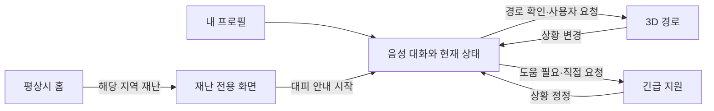

# 04. 모바일 화면 구성과 전환

[문서 안내](README.md) · 근거: [M049–M056](archive/conversation-07.md#m049)

## 화면 구성이 바뀐 과정

| 시점 | 구성 | 상태 |
| --- | --- | --- |
| M049–M050 | 홈, 프로필, 재난 알림, 음성 대화, 맞춤 추천, 3D 경로, 도움 요청의 7개 화면 | 첫 답변의 초안 |
| M051–M052 | 평소 지역 소식 홈, 재난 시 전용 화면; 추천 결과를 대화에 통합하면 6개로 축소 가능 | 사용자 수정과 답변 보완 |
| M053–M054 | 별도 분석·추천 결과 페이지 없이 대화에서 상태를 갱신하고 결과 화면으로 이동 | 최신 사용자 요구 |
| M055–M056 | 음성 화면을 원형 모션·중앙 발화·사용자 박스 중심으로 변경하고 자동 인식 | 마지막 사용자 요구 |

이 문서의 기준은 마지막 두 번의 수정이다. 초기의 “7개 필수 화면”을 그대로 최신 필수 화면 수로 사용하지 않는다.

## 최신 기준의 여섯 화면 역할

| 화면 | 주요 내용 | 진입과 다음 행동 |
| --- | --- | --- |
| 평상시 홈 | 설정 지역·반경의 재난 및 안전 소식, 화재 등 지역 이력 | 일반 상태에서 표시; 소식 조회와 프로필로 이동 |
| 내 프로필 | 평소 보행·계단 조건, 거주·동반 조건, 연락처 등 | 선택적으로 등록·수정; 음성 대화 초기 상태의 입력 |
| 재난 전용 화면 | 재난 종류, 영향 지역 안의 내 위치, 공식 지시와 기본 대피 방법 | 해당 재난 상황에서 앱을 열면 우선 표시; 대피 안내 시작 |
| 음성 대화 | 원형 모션, 최신 안내·사용자 발화, 갱신되는 내 상태 | 현재 상황을 파악·변경; 경로 또는 지원으로 분기 |
| 3D 대피경로 | 확인된 이동 경로, 대피 장소, 위험·통제 구역, 음성 안내 | 이동 가능한 경로가 확인된 경우에만 진입 |
| 긴급 지원 | 119 전화, 필요시 보호자 연락, 실제 요청 상태 | 사용자 요청이나 지원 필요에 따라 진입 |

위의 여섯 가지는 화면 역할을 정리한 것이며 실제 앱의 라우트·모달 개수를 확정한 구현 명세는 아니다.

## 평상시 홈: 요즘 우리 지역은

사용자는 현재 대피 준비 상태보다 **설정한 지역 주변에 어떤 재난·화재·지역 소식이 있었는지**를 홈에서 보고 싶다고 했다. 조회 반경을 바꿀 수 있지만 구체적인 기본 반경과 선택 값은 확정하지 않았다. 답변의 반경 숫자는 시안용 예시다.

중요한 구분은 다음과 같다.

| 범위 | 기준 | 목적 |
| --- | --- | --- |
| 주변 소식 조회 범위 | 사용자가 설정한 지역·반경 | 관심 지역의 이력·소식 탐색 |
| 긴급 재난 알림 범위 | 현재 GPS 위치와 재난 영향 지역 | 지금 사용자에게 적용되는 위험·대피 알림 |

홈 조회 범위를 작게 했다는 이유로 실제 위치에 대한 긴급 알림을 제외하면 안 된다는 방향이다. 위치 권한을 받지 못하거나 GPS가 오래된 경우의 상세 정책은 미결정이다.

## 재난 전용 화면

사용자가 요청한 정보 순서는 재난을 크게 표시 → 전체 영향 지역 중 현재 위치 표시 → 공식 지시와 대피 방법 → 현재 상황에 맞는 안내로 진입이다. 홍수 대피 명령 화면이 예시다.

사용자는 진입 버튼에서 “AI에게 말하기”처럼 AI를 전면에 드러내는 문구를 빼고 “피난로 찾기” 같은 행동 중심 문구를 원했다. 답변의 후보는 “대피 안내 받기”, “현재 상황에 맞는 대피 방법 찾기” 등이다. 최종 버튼 문구 자체는 확정되지 않았다.

재난 상황에서 앱을 열었을 때 홈 대신 전용 화면이 보이는 요구와, 운영체제의 백그라운드 앱 실행·강제 화면 전환 보장은 서로 다르다. 후자의 지원 범위는 아직 구현으로 확인하지 않았다.

## 알림 단계별 동작 제안

사용자는 재난 단계에 따라 알림과 소리로 알려주길 요청했다. 다음 세부 분류는 M052 답변의 제안이며 최종 운영 기준은 아니다.

| 상황 | 앱 동작 제안 | 첫 화면 제안 |
| --- | --- | --- |
| 일반 지역 소식 | 홈 게시 | 평상시 홈 |
| 주의가 필요한 기상특보 | 일반 알림과 상세 안내 | 홈 또는 특보 상세 |
| 사용자 지역에 공식 대피 권고·명령 | 눈에 띄는 알림과 음성 안내 시도 | 재난 전용 화면 우선 |
| 긴급구조가 필요한 상황 | 긴급 연락과 공식 행동지침 우선 | 긴급 대응 화면 |

정확한 임계값, 알림 권한, 무음·방해금지 상태, 전경·백그라운드 동작은 따로 정해야 한다.

## 음성 대화에서 결과로 이동

모든 사용자에게 3D 지도를 강제하지 않는다. 자력 이동이 어렵다면 긴급 지원이 추천 결과가 될 수 있다. 확인된 경로가 없는 경우는 대화 또는 지원 화면에서 그 사실과 공식 안내를 제공하는 안이다.

별도의 AI 분석 중 페이지, 프로필 분석 결과 페이지, 대화 완료 버튼은 최신 요구에 포함하지 않는다. 상태는 대화 화면의 하단 박스에서 계속 갱신한다. 자세한 배치는 [음성 UX](05-voice-ux.md)에 정리했다.

## 상황 변경과 연락 기능

사용자는 음성 대화 한켠의 상황 변경 버튼 또는 대화로 즉각 상태를 바꾸는 흐름을 제안했다. 답변은 독립된 상황 변경 화면 대신 상태 수정·발화 정정 기능으로 처리하고, 기존 경로의 조건을 재평가하는 방식을 제안했다.

“대신 신고”는 사용자가 희망한 기능이다. 실제 신고 API·접수 확인은 정해지지 않았다. 원문 답변은 119 전화 연결, 보호자 연락, 자동 신고, 시연용 모의 접수를 구분하고 연동되지 않은 상태에서 신고 완료라고 표시하지 말 것을 제안했다.
