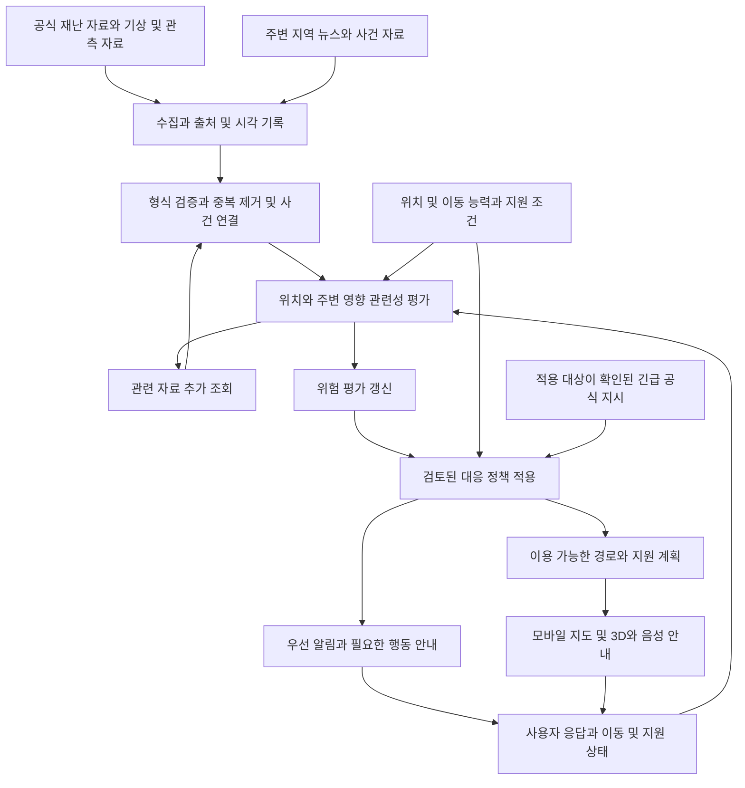

# 데이터 수집과 대응 흐름

이 문서는 요구사항을 실행 단계로 구체화한 설계 제안입니다. 수집 파이프라인은 사용자의 기존 K8s 클러스터를 활용하고, GPU 서버는 필요한 모델 추론을 제공하는 구성을 검토합니다.

핵심 흐름은 **자료 수집 → 사건 정리 → 주변 영향과 위치 관련성 평가 → 위험 평가 갱신 → 대응 정책 적용 → 사용자 안내 → 응답과 새 정보 반영**입니다. 사용자 프로필은 평소 관련성·대응 준비 계산에 활용하고, 행동 안내 시 최신 상태를 재확인합니다.

## 전체 흐름

추가 자료 조회는 새 사건, 중요한 변화, 정해진 재조회 시점에만 수행합니다. 같은 자료를 무한히 재조회하지 않도록 사건 버전과 조회 이력을 관리합니다.

## 평상시 수집과 정규화

1. **정보원 등록:** 기관·제공처, 대상 지역, 데이터 유형, 접근 조건, 갱신 주기, 허용 이용 범위를 기록합니다. 국내·해외 기관은 같은 사건·공간·시각 범위를 실제로 제공하는지 확인한 뒤 연결합니다.
2. **수집:** 사용자가 제시한 기본 구상은 5분 단위 갱신입니다. 빠른 전달을 위해 정보원별 갱신 주기와 제공 방식을 확인하고, 가능한 긴급 이벤트는 수신 즉시 처리하는 방안을 제안합니다.
3. **시각 구분:** 사건 발생 시각, 관측 시각, 기관 발표 시각, 서비스 수집 시각을 구분합니다. 뒤늦게 수집한 과거 기사를 새 사건으로 취급하지 않습니다.
4. **형식·품질 확인:** 필수 항목, 좌표, 단위, 관측 범위, 결측·정정·취소 상태를 확인합니다. 근거 원문과 원문을 식별할 수 있는 정보를 연결합니다.
5. **중복과 사건 연결:** 기사 재전송과 보도자료 재인용을 묶습니다. 제목 유사도만으로 같은 사건이라고 확정하지 않고 시각·위치·재난 종류를 함께 확인합니다.

정보원 장애나 수집 지연은 데이터 상태로 표시합니다. 새 자료가 없다는 사실을 위험 해제의 근거로 사용하지 않습니다.

## 주변 사건과 현재 위치의 연결

6. **공간 범위 구성:** 현재 위치, 이동 경로, 목적지와 주변 지역을 관련성 평가 대상으로 삼습니다. 정해진 반경은 검색 시작 범위가 될 수 있지만 행정구역이나 거리만으로 대상을 끊지 않습니다.
7. **재난별 관계 계산:** 산불·연기는 풍향과 지형, 침수는 상류·하류와 지형·수위처럼 해당 재난에 필요한 자료를 사용합니다. 필요한 관측이나 연결 정보가 없으면 계산 가능 범위를 제한합니다.
8. **관련 자료 보강:** 사건의 위치와 시각을 기준으로 추가 공식 자료, 기상·센서 관측, 뉴스와 정정 정보를 조회합니다. 해외 기관 자료도 해당 지역에 의미 있는 해상도와 최신성을 갖출 때 사용합니다.
9. **프로필 반영:** 이동 제약과 지원 필요를 상시 보관해 대응 준비 시간을 계산합니다. 사용자 이동, 임시 부상, 지원자 변경이 들어오면 해당 사용자 평가를 갱신합니다.

기사의 의미상 관련성은 물리적인 영향의 증거와 다릅니다. 어떤 사건이 사실일 신뢰도, 현재 위치가 영향을 받을 가능성, 정보 부족 정도를 구분합니다.

## 위험 평가와 정책 적용

10. **위험 평가 갱신:** 최신 입력으로 학습된 모델 또는 검증한 규칙을 다시 실행합니다. 새 자료가 올 때마다 모델 자체를 재학습하는 구조는 아닙니다.
11. **정책 비교:** 평가값과 심각도, 예상 영향 시간, 데이터 신선도, 공식 지시, 사용자 준비·지원 시간을 함께 비교합니다. 각 대응에는 적용한 정책 버전과 근거를 남깁니다.
12. **안내 선택:** 주의, 준비, 행동 개시, 지원 요청 등 필요한 상태를 선택합니다. 행동의 종류와 수치 임계값은 재난별 매뉴얼 및 평가 결과를 확인한 뒤 결정합니다.

적용 지역·대상이 확인된 긴급 공식 지시는 서비스 모델의 낮은 점수 때문에 지연되거나 숨겨지지 않도록 별도 우선 경로를 둡니다. 앱 자체의 위험 점수나 대응 단계는 공식 기관이 발령한 경보와 구분합니다.

위험 평가는 다음과 같이 구분해 보관하는 제안입니다.

| 정보 | 의미 |
| --- | --- |
| 사건 확인 상태 | 공식 확인, 추가 확인 필요, 정정·취소 등 |
| 평가 대상 | 어떤 현상이 어느 지역에 어느 시간 범위 안에 발생할지 |
| 값의 종류 | 검증된 확률, 위험 점수, 정보 부족으로 평가 불가 |
| 평가값과 불확실성 | 모델 출력과 적용 가능한 범위, 누락된 자료 |
| 근거 | 원천 자료, 독립 출처 관계, 발표·관측 시각 |
| 버전과 유효 시점 | 모델·규칙 버전, 평가 시각, 재평가 조건 |

## 경로와 알림

13. **경로·지원 계획:** 통제·위험 구간, 계단·경사 제한, 이동 시간, 목적지의 재난 적합성과 운영 상태를 확인합니다. 자력 이동이 불가능하거나 이용 가능한 경로를 찾지 못하면 해당 상황의 지원·보호 행동으로 분기합니다.
14. **우선 알림:** 사용자에게 관련 사건, 현재 필요한 행동, 근거와 기준 시각을 먼저 전달합니다. 긴 설명, 3D 자산 로딩, 음성 합성 완료가 최초 알림을 막지 않도록 합니다.
15. **지도·음성:** 계산된 경로를 모바일에 표시하고, 검토된 정책에서 선택한 문구를 음성으로 전달합니다. 3D는 확보한 공간 데이터의 표현 단계로 둡니다.
16. **사용자 응답과 재평가:** 확인, 이동 불가, 도움 필요, 도착 등의 응답을 받습니다. 새 사건·관측·위치·경로 통제·응답이 들어오면 관련 평가와 안내를 다시 계산합니다.

보호자·지원자 연락은 사전 동의와 실제 연결 가능한 수신자가 있을 때 진행합니다. 앱의 요청 생성, 전달, 상대의 확인, 실제 지원 진행은 각각 다른 상태입니다. 공공 구조기관 자동 출동 연계는 확보된 기능으로 가정하지 않습니다.

## 데이터 단위 제안

API 경로나 저장소 기술은 UI/UX와 함께 결정합니다. 아래는 화면과 백엔드가 공유해야 할 정보 단위의 초안입니다.

| 단위 | 필요한 정보 |
| --- | --- |
| 원천 자료 | 제공처, 자료 식별자, 원문 주소, 발생·관측·발표·수집 시각, 지역, 상태 |
| 사건 | 사건 식별자·버전, 유형, 관련 범위, 연결된 자료, 중복·정정 관계 |
| 사용자 상태 | 위치와 정확도·측정 시각, 이동 제약, 지원 조건, 최근 응답, 동의 상태 |
| 위험 평가 | 대상 사건·지역·시간 범위, 값의 종류, 평가값, 근거, 신선도, 버전 |
| 대응 계획 | 선택 행동, 정책 버전, 적용 이유, 필요한 지원, 경로 유무와 한계 |
| 알림 | 사건·대응 버전, 우선순위, 사용자 표시 내용, 발송·수신·열람 상태 |
| 경로 | 구간, 제외 조건, 목적지 정보, 기준 시각, 유효성·재탐색 상태 |

정밀 위치와 연락처는 역할별로 필요한 범위에만 제공하고, 보관 기간과 접근 정책을 정해야 합니다. 사용자별 민감정보를 모델 입력에 무조건 포함하지 않습니다.

## 운영과 속도

- 수집, 정규화, 사건 평가, 사용자 매칭, 알림 발송을 분리하고 큐를 두는 구성을 제안합니다.
- 같은 문서를 사용자마다 반복 분석하지 않고 사건 단위 결과를 재사용합니다.
- 새 정보가 영향을 주는 지역·사용자만 갱신하며 긴급 작업의 우선순위를 높입니다.
- 사건·자료·수신자·버전으로 중복 처리를 방지하고 재시도·지연 도착을 처리합니다.
- 중요한 악화와 정정은 전달하되, 동일 내용 반복 알림과 잦은 단계 왕복을 줄입니다.
- 수집 지연, 처리 대기, 모델 응답 시간, 사용자 전달 시간을 따로 측정합니다.
- 연결이 끊기면 마지막 안내의 기준 시각과 현재 확인 불가 상태를 표시합니다. 저장된 오래된 경로를 새로 확인된 안전 경로처럼 표시하지 않습니다.

실제 정보원, 안전 관련 정책, 모델 검증 결과, 경로 데이터가 확보되기 전에는 이 흐름의 모든 단계가 운영 가능하다고 간주하지 않습니다.
