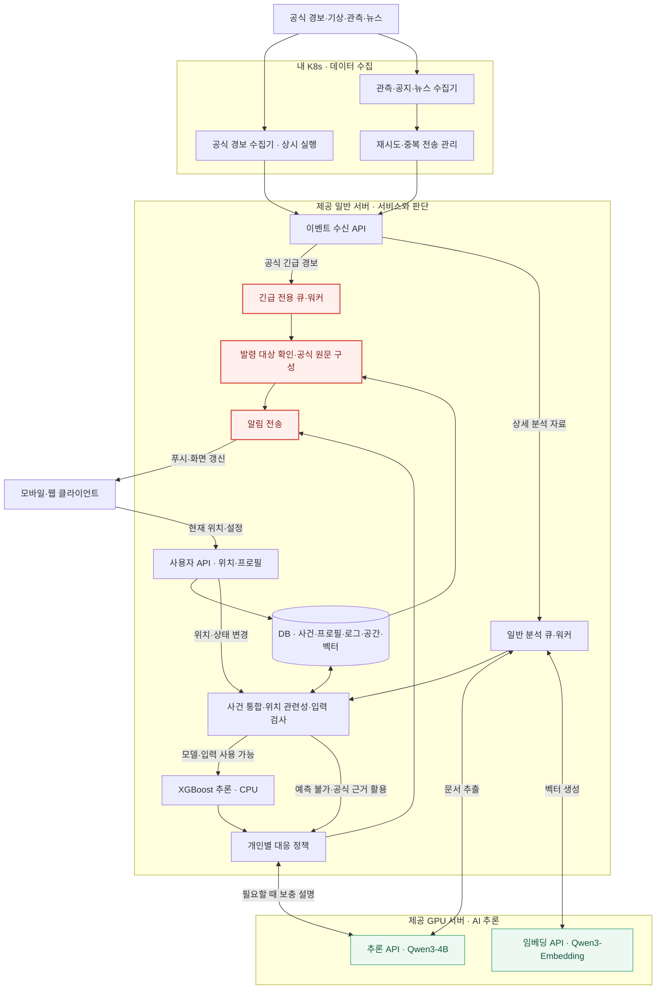

# 재난 대응 비서 - 실시간 서버 배치도

작성일: 2026-10-31  |  버전: 1.0

내 K8s 수집 / 제공 일반 서버 판단·전달 / 제공 GPU 서버 추론

대화에서 정리한 설계안이다. 현재 학습·배포·검증이 완료됐다는 의미는 아니다.

## 다이어그램

## 해설

> 공식 긴급 경보: K8s 수집 → 일반 서버 긴급 큐·워커 → 발령 대상 확인 → 공식 원문 전달. GPU 추론을 기다리지 않는다.

| 영역 | 주요 책임 |
| --- | --- |
| 내 K8s | 기관별 상시 경보 수집과 관측·공지·뉴스 수집. 재시도·수집 상태 관리 |
| 일반 서버 | 이벤트·사용자 API, 긴급/일반 작업 분리, DB, 사건·공간 분석, XGBoost CPU 예측, 대응 정책·알림 |
| GPU 서버 | Qwen3-4B-Instruct-2507의 추출·설명, Qwen3-Embedding-0.6B의 벡터 생성 |
| 사용자 기기 | 위치·설정 전달, 알림 수신, 지도 표시 |

### 도표를 읽는 기준

일반 분석 워커는 문서가 필요할 때 GPU를 호출한다. 구조화된 관측자료는 Qwen을 생략할 수 있다. 벡터 생성은 GPU, 벡터 저장·검색은 일반 서버다. 사건 통합·위치 관련성·입력 검사는 일반 서버에서 수행한다.

XGBoost는 검증된 모델과 입력 조건이 확보된 경우에만 호출한다. 사용할 수 없으면 공식 정보 기반 대응을 유지한다. 사용자 위치·지원 상태가 바뀌면 필요한 단계부터 재평가한다.

빨간 노드는 긴급 경보 전달 경로다. 마지막 알림 전송 노드는 일반 안내도 공유한다. 초록 노드는 GPU 모델 API다. 양방향 연결은 요청과 결과 반환을 뜻하며 실시간 자동 재학습을 뜻하지 않는다.

### 구현 전에 확인할 사항

긴급·일반 큐와 워커의 실행 자원을 분리하고, 수집·처리·알림의 중복과 갱신·해제를 관리한다. 긴급 수집기에도 자체 재시도·중복 방지 기준이 필요하다. 도표는 핵심 연결을 표현하므로 원문·로그 저장과 모든 DB 접근선은 생략돼 있다.

일반 서버 사양과 네 K8s에서 제공 서버로의 VPN·방화벽 연결은 미확인이다. Qwen 두 모델의 메모리·처리량은 실제 자료로 측정한다. GPU 장애가 있어도 긴급 경보는 처리하도록 구성하되, 수집기·일반 서버·네트워크의 가용성은 별도로 확보해야 한다.

## 함께 볼 문서

- [서비스 핵심 정리](01_서비스_핵심_정리.md)

- [학습·검증 흐름도](03_학습_검증_흐름도.md)
