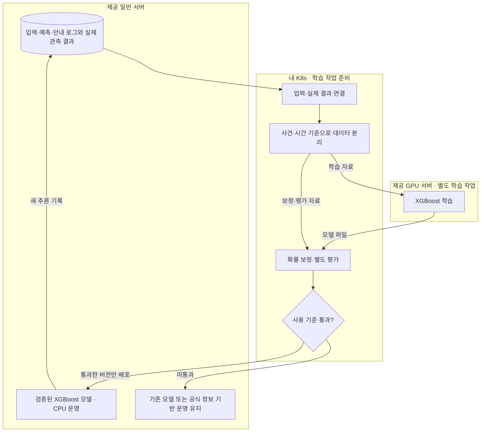

# 재난 대응 비서 - 학습·검증 흐름도

작성일: 2026-10-31  |  버전: 1.0

실제 결과 연결 / 학습 / 확률 보정·평가 / 검증 모델 배포

대화에서 정리한 설계안이다. 현재 학습·배포·검증이 완료됐다는 의미는 아니다.

## 다이어그램

## 해설

> 이전 추론값 자체를 정답으로 삼지 않는다. 당시 입력과 이후 실제 관측 결과를 연결하고, 검증한 모델 버전만 운영에 반영한다.

| 단계·위치 | 처리 내용 |
| --- | --- |
| 기록 - 일반 서버 | 입력·자료 시각·모델 버전·예측값·안내·전송 시각과 실제 결과 보관 |
| 자료 준비 - K8s | 예측 대상·기간에 맞춰 입력과 정답 연결. 사건·시간 기준으로 자료 분리 |
| 학습 - GPU 서버 | XGBoost 학습. 작은 자료라면 CPU 학습 가능성도 있으나 현재 배치안은 GPU 활용 |
| 보정·평가 - K8s | 학습과 분리한 자료로 확률 보정 및 별도 성능 평가 |
| 운영 반영 - 일반 서버 | 사전에 정한 사용 기준을 통과한 버전만 CPU 추론에 배포 |

### 분리해야 하는 자료

학습용, 확률 보정용, 최종 평가용 자료를 구분한다. 같은 사건의 정보나 미래 관측이 경계를 넘어 섞이지 않도록 한다. 당시 수집·이용할 수 없던 후속 기사를 과거 입력에 넣지 않는다. 영향이 없었던 사례도 평가에 포함한다.

### 반복 추론과 재학습의 차이

실시간 반복 추론은 고정된 모델에 최신 입력을 넣는 과정이다. 재학습은 실제 결과가 누적된 뒤 새 모델을 만드는 별도 작업이다. 이 계획은 지도학습 기반 개선이며, 행동 선택을 보상으로 학습하는 강화학습은 별도 과제다.

### GPU 운영과 모델 교체

첫 시연 전에 학습을 끝내고 시연 중 GPU는 Qwen·Embedding 추론에 집중시키는 방향을 권한다. 동일 GPU의 추론과 학습을 동시에 수행할지는 메모리·처리량을 확인한 뒤 결정한다. 새로운 모델이 기준을 통과하지 못하면 기존 모델 또는 공식 정보 기반 운영을 유지한다.

아직 미정: 실제 학습 자료, 예측 목표, 합격 기준, 재학습 주기, 배포 승인·되돌리기 절차. XGBoost는 재난 예측이 완성된 모델이 아니라 목표에 맞게 학습할 도구다.

## 함께 볼 문서

- [서비스 핵심 정리](01_서비스_핵심_정리.md)

- [실시간 서버 배치도](02_실시간_서버_배치도.md)
