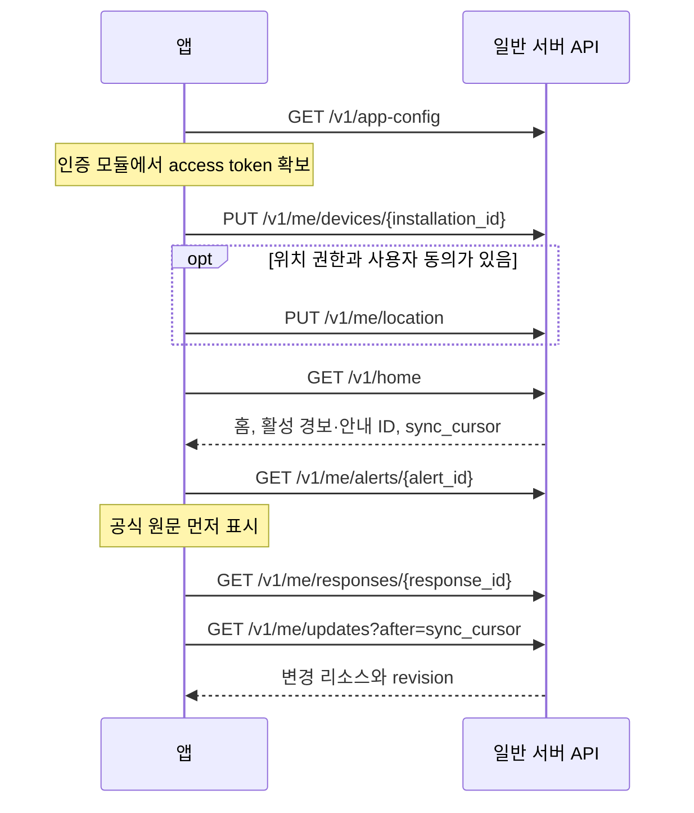

# 앱팀 전달서 — 화면별 API 연동

2026-10-31 · 계약 `0.1.0-draft` · **미배포, 모의 연동 가능**

앱팀은 먼저 이 문서로 화면의 호출 순서를 잡고, [API별 사용법](api-reference.md)에서 각 요청 예제를 확인한다. 타입·필수 필드는 [OpenAPI](api/openapi.yaml)를 사용한다. 화면 기준은 최신 [5개 화면 기획서](../../HeoNey/봉화지기_모바일_화면_기획서.md), 판단과 데이터 기준은 V2다. UI 예시의 가상 등급·홍수 대피 명령·행동 문구를 실서버 기본값으로 옮기지 않는다.

## 먼저 합의할 연결 정보

| 항목 | 현재 상태 | 담당/완료 시점 |
| --- | --- | --- |
| API 개발/운영 URL·TLS | 미배포. example.invalid는 자리표시자 | 서버 A3, 실연동 전 |
| 로그인·토큰 발급/갱신·테스트 계정 | Bearer 사용 계약만 정의 | 서버+앱 E1, 인증 구현 전 |
| 앱 형태·OS·푸시 프로젝트 | 미정 | 앱+서버, 푸시 등록 전 |
| 첫 재난·지역·기관 등급·정책 | 미확정 | A1/B1/D1, 실제 안내 전 |
| 지도 SDK·지역코드·이용권한 | 미정 | 앱+데이터 B1/E1, 지도 연동 전 |
| 음성 대화·3D·TTS | 조건부 API 초안, 기본 꺼짐 | 팀 채택 결정 및 D6 범위 재검토 후 |

현재 전달은 문서 패키지 작성이다. 실제 팀 채널 전송이나 운영 서버/API 배포는 수행하지 않았다.

## 모의 연동 시작 방법

[examples.json](api/examples.json)의 `exchanges`에서 원하는 `id`를 골라 `response.status`와 `response.body`를 API client의 fixture 응답으로 연결한다. `request.parameters`와 `request.body`는 그 화면에서 보내는 요청을 대조할 자료다. `reference_clock`은 고정된 시연 시각이므로 만료 동작 시험에서는 앱의 테스트 시계도 그 시각을 기준으로 한다.

각 예제는 독립된 상태를 표현하며 48개를 순서대로 실행하는 서버 시나리오가 아니다. 기본 config는 음성·3D·확률 기능이 꺼져 있다. 해당 기능의 성공 화면을 시험할 때에만 **모의 설정**의 feature를 켜고 같은 response_revision을 가진 성공 fixture를 조합한다. 실제 서버 기능이 없는 상태에서 운영 capability를 강제로 켜지 않는다. OpenAPI는 스키마/클라이언트 생성에 사용할 수 있으나 이 패키지에 API 실행 서버는 포함하지 않았다.

## 화면별 API 지도

| 화면 | 사용하는 operationId | 진입/동작 |
| --- | --- | --- |
| 공통 | getAppConfig, putDevice, deleteDevice, getLocation, putLocation, deleteLocation, getUpdates, listAlerts, postAlertReceipt | 설정·인증 후 초기화, 위치·토큰 갱신, 푸시/전경 갱신, 로그아웃 |
| S1 평상시 홈 | getHome, listDisasters, getLocation, putLocation | 오늘 수칙, 주변 진행 중/최근 3개월 과거 목록. 목록 상세 진입 없음 |
| S2 긴급 재난 대응 | getAlert, getResponse, putCurrentContext, postAlertReceipt, createSupportDraft, getRoute, getVoiceTurn, createVoiceTurn, cancelVoiceTurn | 공식 정보 우선 표시, 맞춤 안내, 상태 수정, 하단 버튼 |
| S3 3D 대피로 | getRoute | 기능·지역·안내 버전이 유효한 경우에만 진입. 상세 레이아웃은 보류 |
| S4 프로필 설정 | getProfile, replaceProfile, deleteProfile, getPreferences, replacePreferences | 사전 정보와 앱 설정. 필수 개인정보 항목은 아직 확정 안 됨 |
| S5 재난별 기본 수칙 | getSafetyRules | S2의 disaster_type을 전달하여 기본 수칙 표시 |

각 API의 **전체 경로**는 [경로 표](api-reference.md)에 있으며 모든 항목에 화면 ID가 붙어 있다. 부가 설정/권한 제어는 별도 여섯 번째 화면 확정이 아니라 공통 앱 기능이다.

## 공통 초기화와 재접속

위치 권한이 없어도 홈은 열 수 있다. 현재 위치 기반 자료가 없음을 표시하고 사용자가 선택한 지역으로만 탐색한다. 관심 지역의 재난을 현재 GPS에 대한 긴급 발령으로 표시하지 않는다. 토큰 권한/위치 권한/알림 권한/마이크 권한은 각각 별도 상태다.

푸시 도착 시 `type`, `alert_id`, `response_id`로 연결한다. 실제 URI scheme/universal link는 앱 플랫폼 결정 후 정하며, 임의 외부 URL을 푸시에서 받아 자동 실행하지 않는다. 중복 푸시는 event_id와 리소스 revision으로 억제한다. received·displayed·opened를 실제 해당 시점에 보고한다.

## S1 — 평상시 홈

1. 현재 GPS 전송이 가능하면 putLocation 후 getHome. 없으면 getHome의 unavailable을 표시하거나 선택한 지역으로 재요청한다.
2. `data.today_rules.items`의 title/text → 오늘의 안전 행동요령. 여러 재난 유형을 함께 담을 수 있다. source와 항목별 content_version을 보관한다. scope=general이면 현재 지역에 특화한 자료처럼 표시하지 않는다. 자료가 없으면 임의 수칙을 생성하지 않는다.
3. `data.feed.items` → 주변 목록. `status`, `display_title`, `region_label`, `occurred_at/ended_at`을 사용한다. 과거는 display_title만 보여주고 original_title을 대신 표시하지 않는다.
4. `feed.next_cursor`가 있을 때 listDisasters로 다음 페이지. 조회 범위를 바꾸면 cursor도 폐기한다.
5. 활성 긴급 경보는 `active_alert_ids`에서 S2로 진입한다. **주변 목록 항목의 상세 진입은 추가하지 않는다.** 긴급 알림 진입과 홈 목록 클릭은 별개다.

| 예외 | 표시/처리 |
| --- | --- |
| 위치 없음·오래됨 | ‘현재 위치 확인 필요’ 상태. 관심 지역임을 구분하여 탐색 |
| feed 빈 배열, data_status=current | ‘조회 조건에 맞는 정보 없음’. 안전하다는 문구로 바꾸지 않음 |
| data_status=partial/stale | 일부 자료 또는 마지막 갱신 시각을 표시. 정상 최신 자료와 구별 |
| 3개월 과거 자료 없음 | API의 partial/coverage 상태로 처리. 과거 사건을 만들어 채우지 않음 |

fixture: `getHome`, `home_location_unavailable`, `listDisasters`, `rate_limited`.

## S2 — 긴급 재난 대응

공식 경보 GET을 먼저 실행하고 지도·개인 안내 GET은 독립적으로 로딩한다. response_id가 아직 null이면 공식 경보와 기본 수칙/단말 연락 기능으로 화면을 구성하고 후속 업데이트를 기다린다. AI 대기 전용 페이지는 추가하지 않는다.

| 기획서 영역/순서 | API 필드 | 앱 연결 규칙 |
| --- | --- | --- |
| 1 재난 등급 | getAlert `official_severity.label/code/scheme` | 기관 원문 등급. null이면 ‘등급 정보 없음’. 개인 대응 단계와 별도 표시 |
| 2 제목 | getAlert `title`, `instruction_kind` | 공식 대피 지시일 때만 대피 명령 표현. 예시 홍수 문구 하드코딩 금지 |
| 3 중앙 파형 | 앱 녹음/재생 상태 + voice turn 상태 | 구형 캐릭터·제목 왼쪽 파형은 제외. 기능 off 상태에서 듣는 척 애니메이션 금지 |
| 4 영향 지역과 GPS | getResponse `affected_area`, `area_source_ids`, `location` | 경도·위도 순서, 위치 정확도 반영. 미확인 영역을 임의 원으로 실제 영향 구역처럼 채우지 않음 |
| 5 현재 AI 발화 1개 | `assistant_utterance` 또는 최신 ready voice turn `utterance` | 새 발화로 교체. 제목 ‘AI 대화 안내’와 사용자 발화 박스·채팅 이력 제외 |
| 6 상태 태그 | `context.tags` | 최초 profile 근거, 확인 후 user_confirmed 근거. GPS 태그는 실제 유효 위치가 있을 때만 |
| 7 맞춤 행동요령 | `actions`, 각 `order/text/source_id` | ‘맞춤 행동요령’ 제목 바로 다음 번호 목록. 기획에서 삭제한 설명 박스·도입문 제외 |
| 8 기본 수칙 | `disaster_type` → getSafetyRules | S5로 연결 |
| 8 조건부 3D | feature와 `route_availability` → getRoute | 미제공이면 **버튼 숨김**. 비활성 버튼을 남기지 않음 |
| 8 119 | createSupportDraft + 단말 연락 UI | 초안 미리보기와 실제 문자 전송/전화 사용자 조작을 분리 |

주변 영향 설명이 필요한 경우 `relevance.summary`, 상류/풍향 등의 relationship, 관련 근거 sources를 제공한다. 이 정보는 별도 전체 화면을 확정하는 요구가 아니며 S2의 지도/근거 보기 보조 데이터다. 출처 원문 링크가 필요할 때만 사용자 조작으로 연다.

현재 상태 수정은 `getResponse.context.revision`을 base_revision으로 사용한다. 성공 후 기존 경로를 보류하고 새 response의 `input_versions.context`가 갱신 버전을 반영할 때 다시 표시한다. `putCurrentContext` 성공만으로 새 행동요령을 클라이언트가 계산하지 않는다.

선택 음성은 텍스트 요청→202 pending→getVoiceTurn 또는 ready 이벤트→한 문구 교체의 계약 초안이다. 앱은 최신 client_turn_id만 유지하며 취소·새 발화·새 안내 revision 이후 도착한 과거 음성을 버린다. `proposed_context`는 확인 UI를 거쳐 putCurrentContext로 확정한다. 어떤 확인 UI를 쓸지는 앱팀 협의 항목이다.

fixture: `getAlert`, `getResponse`, `response_location_unknown`, `prediction_simulation`, `alert_cancelled`, `response_resolved`, `voice_disabled`, `profile_conflict`.

세 사용자 비교 fixture는 `persona_independent`, `persona_stairs_difficult`, `persona_assistance_required`다. 같은 환경 영향 객체를 유지하고 태그·개인 대응·행동 표시만 달라지는 **가상 정책 예시**이며 실제 정책 확정이나 위험 판단 검증 결과가 아니다.

## S3 — 3D 대피로

현재는 데이터 인터페이스의 조건부 제안만 제공한다. 목업 전 화면 배치나 조작법은 확정하지 않는다.

- 표시 조건: config/home의 route_3d enabled + 현재 안내 active + route_availability available + 유효시간 미경과. 진입할 때 getRoute를 호출해 같은 response_revision인지 다시 확인한다.
- 사용할 자료: `route.geometry`, `altitude_reference`, `instructions`, `accessibility`, `checked_at`, `valid_until`, `sources`, `rendering_assets`의 저작자 표시.
- 현재 위치·프로필·계단 제약·통제가 바뀌면 기존 선을 제거/보류하고 재조회한다. unknown 접근성 자료를 무장애로 표시하지 않는다.
- 만료·409·unavailable·네트워크 실패이면 계속 이동을 지시하지 않고 S2의 최신 공식 정보로 돌아간다. 서버 경로를 앱이 임의 보정하지 않는다.
- 지도 SDK·지형/건물 타일·실제 통행 정보 확보와 지역별 제공 가능성은 D6 결정 사항이다.

fixture: `getRoute`(미제공), `route_available_simulation`, `route_changed`, `response_route_available_simulation`. available 예제는 실제 길이 아닌 렌더링용 모의 좌표다.

## S4 — 프로필 설정

1. getProfile/getPreferences를 읽고 revision을 보관한다.
2. 사용자가 선택한 항목만 표시·입력한다. 프로필이 비어 있으면 미상으로 시작한다.
3. 저장은 전체 PUT이다. 표시하지 않는 값을 무심코 누락해 삭제하지 않도록 원본과 변경값을 합쳐 전송한다. 미확정 의료·연락처·상세 주소 입력은 추가하지 않는다.
4. 409이면 최신 정보를 다시 보여주고 사용자가 고친 값을 확인한 뒤 저장한다.
5. 초기화는 deleteProfile. OS 위치 권한 철회는 위치 전송 중단 + deleteLocation. 알림 해제/로그아웃은 해당 설치 토큰을 비활성화/삭제한다.

이동/계단 등 프로필 후보는 서버의 검토 전 상태다. 화면 항목의 필수 여부와 동의·보관·계정 탈퇴 정책을 E1에서 정한다. ‘현재 혼자 있음’은 이 화면의 상시 기본값으로 저장하지 않는다.

fixture: `getProfile`, `replaceProfile`, `deleteProfile`, `getPreferences`, `replacePreferences`, `profile_conflict`.

## S5 — 재난별 기본 수칙

S2의 `disaster_type`과 언어를 getSafetyRules에 전달한다. items 순서·문구와 sources/content_version을 사용한다. 개인 상태별 맞춤 행동 목록과 기본 수칙을 섞지 않는다. unavailable은 안내 자료 미확보를 표시하고 모델로 내용을 채우지 않는다. 원문 언어 fallback은 표시한다. 상세 배치와 뒤로가기 UI는 앱팀이 기획 담당자와 확정한다.

fixture: `getSafetyRules`, `rules_unavailable`.

## 119 연결 구현 경계

서버는 초안만 반환한다. 사용자가 내용을 확인한 뒤 문자 작성 화면 또는 전화 화면을 여는 동작은 앱이 담당한다. 위치가 오래됐으면 현재 좌표처럼 넣지 않고 상태만 알린다. 버튼 하나에서 전화와 문자 모두 완료되었다고 표시하지 않는다. 서버가 꺼져 있어도 단말 전화 기능 접근을 막지 않는다.

Android에서는 전화 앱에 번호를 채우는 ACTION_DIAL과 문자 앱에 넘기는 ACTION_SENDTO/smsto가 구분된다. ACTION_DIAL은 사용자의 통화 버튼 조작을 남긴다. 실제 OS별 조작과 권한은 앱팀이 지원 단말에서 확인해야 한다. [Android 공식 연락 Intent 문서](https://developer.android.com/guide/components/intents-common)

이 문서는 자동 신고 API나 접수 확인 API를 제공하지 않는다. 모의 fixture의 119 초안을 실제 문자 앱에 보내는 테스트는 하지 않는다. 전화/문자 성공 콜백이 있더라도 구조기관의 접수·출동 확인과 동일하게 표시하지 않는다.

## 책임 분담

| 서버팀 | 앱팀 | 공동 확정 |
| --- | --- | --- |
| 자료 수집·출처·최신성·사건 통합 | 화면/상태/접근성 표시 | 인증·로그인·앱 형태·지원 OS |
| 위치 관련성·영향 평가·정책·행동 선택 | GPS 권한과 측정·상태 전달 | 프로필·동의·보관·삭제 |
| 공식 경보 우선 발송·버전·해제 | 푸시 수신·영수증·중복/역순 억제 | 재시도·오프라인·배터리 기준 |
| 확인 가능한 경로/상태의 조건부 응답 | 지도/3D 렌더링·단말 음성 상태 | 경로·음성·119 제공 범위 |
| OpenAPI·fixtures·서버 계약 시험 | API client·화면 바인딩·단말 시험 | E2 통합 인수 및 운영 승인 |

## 앱 인수 검사표

아래는 앱팀 구현 후 실행할 목록이다. 이번에 실제 앱에서 통과했다고 표시하지 않는다.

- [ ] S1에 오늘 수칙·진행 중·최근 3개월 과거를 표시하고 과거 제목의 ‘발생’ 및 상세 진입을 제외한다.
- [ ] S2는 공식 원문을 개인 평가/지도/음성보다 먼저 표시하고 두 등급을 구분한다.
- [ ] 위치 불명확·모델 없음·자료 지연을 안전 또는 0%로 표시하지 않는다.
- [ ] 상류/풍향 등 주변 지역의 영향 근거와 출처를 보존한다.
- [ ] 상태 수정 후 옛 안내/경로를 최신으로 취급하지 않고 revision/input_versions를 확인한다.
- [ ] AI 발화 한 개, 사용자 발화 미표시, 번호별 행동, 고정 하단 버튼을 지킨다.
- [ ] 3D 미제공 버튼 숨김·만료 경로 제거·계단 접근성 unknown 처리를 확인한다.
- [ ] 음성 기능 비활성/권한 거부에서도 텍스트와 직접 상태 수정이 가능하다.
- [ ] 119 초안/전화 화면/문자 전송/실제 접수를 구분하고 실연락 없는 시연을 한다.
- [ ] 취소·해제·중복·역순·cursor 만료·401·409·429·503과 오프라인 복구를 확인한다.
- [ ] 푸시 토큰 회전/로그아웃 해제와 사용자별 리소스 접근 제어를 확인한다.
- [ ] simulation 표시를 유지하고 실제 데이터/운영 성능으로 소개하지 않는다.

정적 스키마/예제 검사는 [검증 결과](api/validation-report.json)를 참조한다. 실서버와 단말 검증은 기존 E2 작업에 남겨 두었다.
