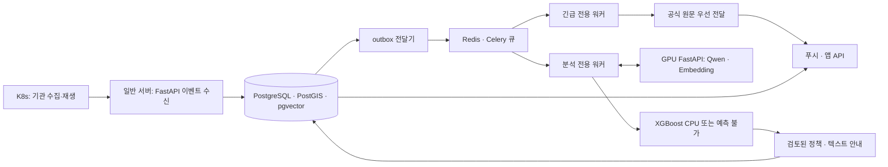

# 산불 MVP 구현 기술 스택 결정

기준일: 2026-10-31 KST. 결정 Task: `task-20261031-082929-mvp-3188b68a`.

이 문서는 사용자의 기술 스택 선정 요청에 따른 구현 기준이다. 라이브러리 설치, 서버 배포, 모델 학습·처리량 검증을 완료했다는 의미는 아니다. 산불 한 종류, 3D 제외, 서버 텍스트 제공이라는 재고정 범위를 따른다. 대응 레벨·레벨별 알림 방식·확률 임계값은 사용자 회의 결과 대기다.

**MVP 입력 경로 추가 결정:** 사용자 지시에 따라 K8s 구성은 보존하되 MVP에서는 실제 K8s 수집을 실행하지 않는다. 수동 확보한 자료·뉴스를 시나리오로 재생하여 이벤트 수신 API → DB/outbox → 긴급·분석 큐로 연결한다. 아래 K8s 수집 배치는 후속 상시 수집 구조이며 MVP 시연의 선행 조건이 아니다. 코드 기반과 현재 미구현 범위는 [스캐폴딩 안내](project-scaffold.md)를 따른다.

**GPU 준비 후속 결과:** 같은 날 별도 Task에서 GPU 서버의 두 Qwen 모델을 실제 로딩하고 localhost 인증 API로 생성·임베딩을 검증했다. 별도 ML 환경에서 XGBoost 합성 CUDA 학습·저장·CPU 재로딩도 통과했다. 설치 버전·리비전·서비스 사용법과 측정 한계는 [GPU 준비 결과](gpu-model-readiness.md)를 따른다. 이 결과로 산불 실모델이나 정책 품질을 완료 처리하지 않는다.

**분석 흐름 후속 구현:** 시나리오 수신·DB/outbox·Redis 분석 큐·인터넷 뉴스 및 저장 자료의 임베딩/pgvector 검색을 연결했다. 실제 생성 모델을 호출하지 않고 Qwen 전달 자료에서 멈춘다. [현재 실행 방법과 검증](analysis-retrieval-flow.md)을 따른다.

## 1. 결정에 사용한 현재 상태

- 작업 시작 시 `develop`의 `bbf6233`은 원격 `develop`과 같았고 미커밋 변경은 없었다. 원격 `main`에는 그 이전 develop 병합 이력이 있으며 이번 Loom 재고정 커밋은 develop에 있었다.
- 저장소에는 설계, OpenAPI 0.1.0 초안·예제, API 계약 검증 도구가 있다. 서비스 패키지, DB 스키마, 실행 서버, 배포 구성과 모델 서빙은 아직 없다.
- 아래 자원은 같은 날 작성된 기존 점검 기록이다. 이번 Task에서 서버에 재접속하거나 자원을 재측정하지 않았다.

| 실행 위치 | 기존 확인 자원 | 이번 스택의 책임 |
| --- | --- | --- |
| 일반 서버 | 2 vCPU, 약 7.76 GiB RAM | API, DB, 공간·벡터 검색, 긴급/분석 워커, 정책, XGBoost CPU 추론 |
| GPU 서버 | 4 vCPU, 약 47.05 GiB RAM, NVIDIA L4 1대 | Qwen·Embedding 추론, 별도 시간의 XGBoost 학습 |
| 기존 K8s | 6노드, 기존 플랫폼 운영 중 | 프로젝트 전용 수집기·재생기, 데이터 준비·평가 작업 |

자원과 CUDA 기본 검사 근거는 [인프라 상태](../05-infrastructure-status.md)와 [환경 검증](environment-readiness.md)을 따른다. [Tailscale 검증](tailnet-connectivity.md)은 관리 접속을 확인했지만 일반 수집 파드의 서비스 API 경로는 A3에서 구성해야 한다.

## 2. 확정한 스택

| 영역 | 선정 | 적용 이유와 경계 |
| --- | --- | --- |
| 공통 언어 | Python 3.12 | 기존 서버 Python 계열과 맞추고 수집·API·정책·모델의 자료 구조와 검증 코드를 공유한다. |
| 환경·의존성 | uv, pyproject.toml, 잠금 파일 | API/수집 환경과 GPU·학습 환경을 분리하고 설치 조합을 재현한다. |
| API | FastAPI, Pydantic 2, Uvicorn | 기존 OpenAPI와 입력·출력 검증을 연결한다. ASGI의 전경 변경 조회도 같은 API에서 제공한다. |
| DB 접근 | SQLAlchemy 2.x, psycopg 3, Alembic, GeoAlchemy2 | API의 비동기 접근과 워커의 동기 접근에 같은 DB 모델·마이그레이션을 사용한다. |
| 저장소 | PostgreSQL 16 | 사건·지침·프로필·현재 상태·정책 버전·안내·전송 이력의 정본을 저장한다. |
| 공간 처리 | PostGIS 3.x | 발령 구역 포함·경계, 좌표·거리·위치 관련성 계산을 담당한다. |
| 벡터 검색 | pgvector 0.8 계열 | 같은 PostgreSQL에 문서 청크·출처·벡터를 저장하고 관련 문서를 검색한다. |
| 비동기 작업 | Celery 5.x, Redis 7.4 | 긴급·일반 분석·전달 작업을 별도 큐와 워커로 실행한다. Redis는 작업 전달용이며 결과의 정본은 PostgreSQL이다. |
| 수집·외부 호출 | HTTPX, 표준 JSON/CSV/XML 파서, Pydantic | 기관별 응답을 공통 이벤트로 변환하고 시간 제한·재시도·쿼터를 제어한다. |
| 정책 엔진 | Python 규칙 모듈, PostgreSQL의 검토된 정책표 | 사용자 상태와 공식 지침을 결정적으로 결합한다. 단계·알림 규칙은 회의 결과를 받아 등록한다. |
| Qwen 생성 | PyTorch, Transformers, Qwen3-4B-Instruct-2507 | 사실 추출과 선택된 행동의 텍스트 설명을 담당한다. |
| Embedding | Sentence Transformers, Qwen3-Embedding-0.6B | 문서·검색 질의를 벡터로 만들고 일반 서버의 pgvector 검색에 연결한다. |
| GPU API | 별도 FastAPI 서비스, 단일 프로세스 | 모델을 한 번씩 로딩하고 요청 수·입력 길이를 제한한다. 첫 MVP의 동시 GPU 실행은 1개로 시작한다. |
| 산불 모델 | XGBoost 3.x, scikit-learn, NumPy, pandas, PyArrow/Parquet | GPU 학습, 평가·보정, 일반 서버 CPU 추론을 분리한다. 모델 정답·기간은 C1에서 자료에 맞춰 결정한다. |
| 위성·좌표 전처리 | xarray/NetCDF, rasterio/GeoTIFF, pyproj | 선택한 자료 형식에 필요한 도구를 데이터 환경에만 추가한다. 실제 격자·투영법을 확인한다. |
| 전경 갱신 | 기존 getUpdates long polling | 현재 API의 커서·revision·만료·재동기화 계약을 유지한다. |
| 백그라운드 푸시 | PushGateway 인터페이스, FCM HTTP v1 우선 어댑터, 모의 Sender | 현재 명세의 fcm 토큰과 연결한다. 실제 앱 토큰·프로젝트 자격 설정을 받기 전에는 모의 전송으로 검증한다. |
| 사용자·서비스 인증 | Bearer JWT 검증(PyJWT), 서비스별 토큰 | 토큰 소유권·issuer·audience·만료를 검사한다. 로그인 제공자와 테스트 계정은 E1에서 고정한다. |
| 서버 실행 | Docker Compose | 일반 서버와 GPU 서버 각각의 서비스를 구성하고 GPU 컨테이너는 NVIDIA Container Toolkit을 사용한다. |
| 외부 HTTPS 진입 | Caddy | 앱 API의 도메인·인증서가 결정된 후 HTTPS를 제공한다. 내부 모델·DB·브로커는 프로젝트 사설 경로를 사용한다. |
| K8s | 전용 namespace, 수집기 Deployment, 배치 Job | 공식 경보 수집기는 계속 실행한다. 기존 서비스와 신원·자원·연결 경로를 분리한다. |
| 점검·관측 | JSON 로그, prometheus-client, 기존 Prometheus/Grafana | 지연·재시도·큐 적체·모델 오류·최신 자료 시각을 관찰한다. |
| 검증·정적 검사 | pytest, HTTPX, Ruff, 기존 OpenAPI/JSON Schema 검사 | 정책 재현성, 실제 API·DB·브로커 연결과 장애·역순 갱신을 검증한다. |

위 버전은 기준 계열이다. 실제 설치 시 Python 3.12와 모델·CUDA에 맞는 패치 버전을 풀어 API/worker/collector 환경과 GPU·학습 환경의 잠금 파일, 컨테이너 digest, 모델 revision을 고정한다. 이 문서만으로 해당 조합의 설치 호환성을 통과 처리하지 않는다. Redis 7.4와 PostgreSQL 16도 보안 패치가 적용된 정확한 이미지를 고정한다.

## 3. 서버별 배치와 코드 구조

한 레포의 공통 계약·도메인 모듈을 공유하고 실행 프로세스를 나눈다. 논리 모듈의 경계는 다음과 같다. 아래는 구현할 구조이며 현재 생성된 코드 경로가 아니다.

| 모듈 | 책임 | 실행 위치 |
| --- | --- | --- |
| contracts / domain | 공통 자료 구조·시각·버전·모드·정책 입력/출력 | API·워커·수집기에서 공유 |
| api | 사용자·설치·경보·안내·변경 조회, 인증 | 일반 서버 |
| ingestion | 기관 수집·과거 재생·원본 참조·중복 키 | K8s |
| events / spatial | 사건 통합·수정/해제·발령 대상·주변 관련성 | 일반 서버 |
| policy | 검토된 지침과 사용자 상태의 결정적 정책 적용 | 일반 서버 |
| workers | 공식 경보 우선 처리, 일반 분석, 푸시 전달 | 일반 서버의 분리된 프로세스 |
| retrieval | 문서 청크·출처·벡터 저장 및 검색 | 일반 서버, 벡터 생성은 GPU 호출 |
| gpu_api | Qwen 생성·Embedding 생성과 제한·health | GPU 서버 |
| ml | 피처·데이터 분할·XGBoost 학습/평가·CPU Predictor | 학습은 GPU, 운영 Predictor는 일반 서버 |

기본 행동지침은 출처·적용 조건·버전·검토 상태와 함께 DB에 보관한다. 정책표가 행동지침 ID를 참조해 개인별 행동을 선택하고 Qwen이 선택된 행동을 설명한다. DB에 추가된 문서가 자동으로 승인 정책이 되지 않는다.

## 4. 긴급 경보와 큐 처리 기준

1. 이벤트·버전·원문 참조와 전송할 작업을 PostgreSQL 트랜잭션에 함께 기록하는 outbox를 둔다. 전달기가 Redis로 보내고 실패하면 재시도한다.
2. 긴급 작업과 일반 분석은 별도 Celery 큐 및 전용 워커로 분리한다. 긴급 워커는 모델·개인 정책 계산을 호출하지 않고 발령 대상과 공식 원문부터 처리한다.
3. 일반 서버는 2 vCPU이므로 처음에는 워커별 동시 실행 1개, 작은 DB 연결 풀, 작업 선취 제한으로 시작한다. 실제 지연과 메모리를 측정해 조정한다. 큐 분리는 즉시성 보장이 아니며 DB·네트워크·프로세스 가용성도 검증한다.
4. 처리 보장은 재전달을 허용하는 방식으로 설계한다. 수신 ID·작업 종류·대상·리소스 revision에 대한 중복 키와 처리 상태를 DB에 남긴다. 푸시 제공자의 불확실한 응답 후 재시도도 앱에서 revision으로 중복 억제한다.
5. 작업 수락·DB 반영·브로커 확인·재시도 순서를 명시하고 Redis 장애 및 워커 강제 종료 후 회수 시험을 한다. Redis의 기본 visibility timeout에 의존해 긴급 복구 시간을 가정하지 않는다. 작업 시간 제한과 재전달 시간을 함께 검증한다.
6. Redis는 영속 볼륨·AOF와 브로커에 맞는 메모리 정책으로 구성하고 작업 결과를 장기 보관하지 않는다. DB의 처리 상태와 outbox를 통해 재개하며 승인되지 않은 외부 전송은 실행하지 않는다.

공식 경보·사용자 안내·전송 이력은 서로 다른 리소스다. 공식 경보가 먼저 표시된 뒤 개인별 안내가 갱신되며 동일 대응 단계에서도 행동·근거가 바뀌면 새 revision을 발행한다.

## 5. 공간·벡터·원본 저장

- 좌표는 기존 계약의 WGS84 GeoJSON `[경도, 위도]`를 유지한다. 발령 구역 경계의 포함 여부를 명시하고 미터 단위 거리는 geography 또는 적절한 투영 좌표계로 계산한다. 좌표 품질을 알 수 없으면 미확인 상태를 보존한다.
- 문서 원문 ID·출처·발표/수집 시각·검토 상태와 청크를 저장한다. Qwen3-Embedding-0.6B는 1024차원 벡터를 기준으로 사용하며 모델 revision·차원·정규화·질의 지시를 함께 고정한다.
- 초기 검색은 출처·재난·유효기간 필터와 pgvector의 정확 검색으로 시작한다. 자료량과 지연을 측정한 뒤 HNSW를 도입할지 판단한다. 벡터 유사도만으로 출처 검증이나 행동 지침 채택을 대신하지 않는다.
- 위성 파일·원본 응답·Parquet·모델 파일은 전용 영속 볼륨에 두고 DB에는 URI·해시·시각·버전을 저장한다. K8s 자료와 모델 서버 간 파일 전달 및 보존/복구 경로는 A3에서 검증한다. 대용량 원본과 모델을 Git에 넣지 않는다.

## 6. GPU와 XGBoost 실행 기준

첫 GPU 서빙은 FastAPI 단일 프로세스가 두 모델을 로딩하는 형태로 고정한다. Transformers의 생성 API와 Sentence Transformers의 encode API를 내부 인터페이스로 감싼다. 반정밀도와 모델 revision을 고정하고, 초기에는 한 번에 한 GPU 요청만 처리한다. 토큰 길이·배치 상한은 명시하며 시작 구성은 생성의 입력+출력 합계 4096토큰 이내, 출력 상한 512토큰이다. 이 값은 운영 성능 약속이 아니라 D3 측정의 시작 설정이다.

모델 API는 별도 프로세스에서 대기·실행을 제한하고 일반 서버 호출에는 시간 제한·오류 대체를 둔다. 공식 경보는 이 대기열을 통과하지 않는다. Qwen 오류 시 검토된 지침의 템플릿 텍스트로 대체한다. 동시성을 확장할 필요가 생기면 측정 결과를 바탕으로 vLLM 등 전용 엔진 전환을 후속 검토한다.

XGBoost 학습은 GPU 추론과 별도 시간에 실행한다. CUDA 지원 wheel/runtime와 기존 NVIDIA 드라이버의 호환을 실제 작은 학습으로 확인한다. 조회한 최신 XGBoost 공식 GPU 문서는 CUDA 12.9 이상을 요구하므로 기존 CUDA 메모리 검사의 성공을 라이브러리 설치 성공으로 해석하지 않는다. GPU용 환경과 API/CPU용 환경을 분리하고, 학습한 모델의 저장·재로딩·CPU 출력 일치와 피처 스키마를 검증한다.

예측 목표·격자·기간·관측 정답·실제 채택 기준은 C1~C4의 결정이다. 실제 정답이 부족하면 합성 자료로 연결만 검증하고 live의 `impact`는 unavailable/null로 유지한다. 이 스택 선정으로 산불 예측 성능을 확정하지 않는다.

## 7. API·인증·알림 계약

- [현재 API 계약](app-api-contract.md)과 [OpenAPI](api/openapi.yaml)가 구현의 출발점이다. FastAPI 자동 문서를 생성하되 DTO·오류·revision·커서·예제를 기존 명세에 대조하고 E1에서 승인본을 고정한다. 이번 문서는 기존 API 필드나 버전을 변경하지 않는다.
- 전경 갱신은 getUpdates long polling을 사용한다. 리소스 revision과 유효시간을 적용하고 오래된 응답·중복·만료된 cursor를 처리한다.
- PushGateway의 첫 실제 전송 구현 대상은 FCM HTTP v1이다. 현재 OpenAPI는 fcm/apns만 열거하므로 실제 앱에서 발급하는 토큰 종류와 FCM 프로젝트 설정을 E1에서 대조한다. APNs 직결 또는 다른 토큰 형식은 별도 어댑터·계약 검토가 필요하다. 모의 Sender의 성공을 단말 전달 성공으로 기록하지 않는다.
- JWT 검증 도구는 PyJWT로 정하되 로그인·발급자·audience·키 배포·갱신 방식은 E1에서 확정한다. 개발용 테스트 토큰·계정과 운영 인증을 구분한다. Tailnet 접속과 서비스/사용자 인증을 함께 적용한다.
- 앱 API의 외부 HTTPS 도메인·인증서는 A3/E1 결정 후 Caddy에 반영한다. Tailscale SSH 주소를 모바일 HTTPS API 주소로 취급하지 않는다.
- 대응 레벨, 단계별 알림 채널·반복·해제 방식과 임계값은 D1의 사용자 회의 결과를 기다린다. 현재 단계에서는 정책표 구조·공식 원문 전달·기본 지침 저장·모델 준비를 구분한다. D3의 모델 준비와 최종 정책 설명 검증도 단계별로 구분해 계획한다.

## 8. 첫 구현에서 검증할 사항

| 검증 작업 | 통과 기준 |
| --- | --- |
| A3 실행 기반 | 실제 수집 파드 → 일반 서버 → GPU API의 요청·인증·시간 제한과 재시작 복구. DB·Redis 사설 접근 및 영속 데이터 복구. |
| B2/B3 자료 계약·수집 | 실제/재생/합성 provenance, 시각·좌표·단위·중복 키, 기관 업무 오류·페이지·재시도. |
| D4 공식 경보 | 모델·정책 미준비와 일반 큐 적체 중에도 공식 원문 우선 처리. 실제 푸시 구간과 모의 전송 구분. |
| D1/D2 정책 | 회의 결과를 받은 후 버전이 같은 입력의 결과 재현, 사용자 상태 차이·해제·재적용. |
| D3 모델 | 두 실제 모델의 생성/임베딩, 근거 대조·검색 적합성·한국어 지연·GPU 메모리·장애 대체. |
| C3~C5 학습·추론 | 실제 CUDA 학습, 데이터/모델 버전, 평가/보류, 저장 후 CPU 재로딩·범위 밖 입력과 simulation 격리. |
| E2/A4 API·통합 | 실서버 응답과 명세, 접근 제어·역순 갱신·커서 만료·정정/해제·세 사용자 시연. |

CI는 Ruff·pytest와 기존 OpenAPI/예제 검사를 기본으로 하고 PostgreSQL 확장과 Redis가 필요한 통합 시험을 분리한다. GPU smoke·학습 시험은 GPU 환경에서 실행하고 CPU CI의 성공과 구분한다. 원본·키·정밀 위치·음성/민감 텍스트를 로그에 넣지 않는다.

## 9. 적용할 Loom 경계

이 기술 결정 Task는 기존 A Job의 후속 설계 작업이다. A3는 이 문서를 필수 입력과 선행 설계 결과로 받아 실행 기반을 구성한다. B/C/D/E의 세부 구현자는 해당 Job 노트의 기술 기준을 참조한다. 이번에는 다른 구현 Task를 실행하거나 Queue에 넣지 않는다.

D1의 회의 대기, A1의 시연 지역·사례, B1/C1의 실제 자료·정답·예측 기간, E1의 사용자 인증·앱 푸시 토큰, A3의 실제 API 접근 경로는 미정 또는 미검증으로 남는다. 기존 초기 문서화 RUNNING 기록도 이번 범위에서 변경하지 않는다.

## 공식 근거

공식 문서는 2026-10-31에 확인했다. 아래 기능 설명은 구현 조합·자원 성능을 실측했다는 근거가 아니다.

- [FastAPI 기능과 OpenAPI/JSON Schema](https://fastapi.tiangolo.com/features/): 현재 명세 중심 API와 입력·출력 검증에 적용.
- [SQLAlchemy 공식 문서](https://docs.sqlalchemy.org/): 2.x DB 접근 계층. Alembic 마이그레이션과 psycopg 드라이버 조합은 설치 시 검증.
- [PostgreSQL 버전 정책](https://www.postgresql.org/support/versioning/): PostgreSQL 16 지원 계열 확인.
- [PostGIS ST_DWithin](https://postgis.net/docs/ST_DWithin.html): geography의 미터 단위 거리 및 좌표계 구분.
- [pgvector](https://github.com/pgvector/pgvector): PostgreSQL의 벡터 검색·정확 검색과 조건 필터.
- [Celery 작업 라우팅](https://docs.celeryq.dev/en/stable/userguide/routing.html): 큐별 전용 워커 구성.
- [Celery Redis 브로커](https://docs.celeryq.dev/en/stable/getting-started/backends-and-brokers/redis.html): 재전달·visibility timeout 및 복구 제약.
- [uv 의존성 관리](https://docs.astral.sh/uv/concepts/projects/dependencies/): 프로젝트와 환경별 의존성 관리.
- [Qwen3-4B-Instruct-2507](https://huggingface.co/Qwen/Qwen3-4B-Instruct-2507): Transformers 생성 경로.
- [Qwen3-Embedding-0.6B](https://huggingface.co/Qwen/Qwen3-Embedding-0.6B): Sentence Transformers 경로와 1024차원 출력.
- [XGBoost GPU 지원](https://xgboost.readthedocs.io/en/stable/gpu/index.html): CUDA 요구 조건과 GPU 학습 구성.
- [Docker Compose GPU 지원](https://docs.docker.com/compose/how-tos/gpu-support/): GPU 컨테이너 실행 전제.
- [FCM HTTP v1](https://firebase.google.com/docs/cloud-messaging/send/v1-api): 서버 발신 어댑터의 구현 기준.
