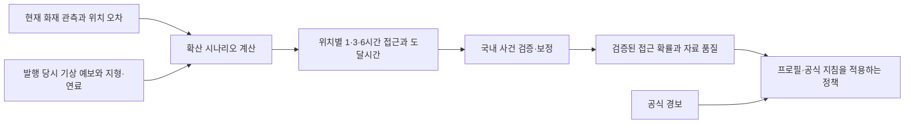

# 국내 산불 1·3·6시간 모델 개선 기록

2026-11-01 KST 갱신. Loom: `task-20261031-111807-task-9a960503`.

**국내 사용자 대응 판단에 사용할 수준은 아직 검증되지 않았다.** v4는 21개 지역 창의 수집·구축과 GPU/CPU 비교를 완료했다. 같은 검증 행에서 사건·기간별 평균 AP는 기존 v3의 0.356335에서 v4 기간그룹 선택 모델의 0.432810으로 높아졌다. 그러나 최근 화재 거리 기준 0.471403에 못 미치고, 상위10% 검토 탐지율도 기존보다 낮아 운영 모델로 승격하지 않았다. 모든 산출물의 `operational_use`는 `false`다.

후속으로 GOFER 접근 시간 AFT 2개, ELMFIRE 공식 예제와 9개 합성 풍향·풍속 시나리오, 국내 위치의 공개 GFS 예보 수신을 실제 완료했다. 이력 AFT의 사건×기간 평균 AP 0.2595는 단순 거리 0.2622보다 낮아 운영 후보로 승격하지 않았다. 이 절차와 결과는 아래 「접근 시간 모델·확산 시뮬레이터 첫 실행」에 기록했다.

추가 보강에서는 GOFER 입력을7→35개로 늘린 분류기의101회 적합을 완료했다. 기간제외 nested AP는거리0.1792→모델0.2569,동일2021개발검증의사건균등AP는기존AFT0.2595→새모델0.3311로올랐다. 그러나2021전체행합산AP는기존AFT보다떨어졌고,6h후보정밀도8.9%·KNP사건재현율38.1%에그쳐포괄적인우월성이나개인대응적합성을입증하지못했다. [전체비교·실행위치·재현명령](../../../training/reports/gofer-history-20261101/README.md)을보존한다. 실제수관자료를넣은Walker6조건도기존대비악화돼성공으로채택하지않았다.

최신 단계에서는 국내 후보466,710행을 재구축하고, 과거60분 명확 비화재 집단의57회 비교 학습을 완료했다. 미래 관측 불명확 후보도 평가 예산에 포함했다. 새 이력·바람 선택 절차의 사건×기간 AP0.22588과 상위10% 재현율35.45%는 현재 거리의0.23178·38.07%보다 낮았다. 최종 선택도 기존34개 입력으로 돌아와 이번 보강을 개선으로 채택하지 않았다. 알려진 정답만의 선택 정밀도는 약1.4%이고6시간 정답 불명확 비중46.13%가 남는다. 이는 이전v4와 다른 후보 집단의 결과다. [자료·모델 결과와506개 테스트](../../../training/reports/korea-first-observation-20261101/README.md), [실제 과거 GFS 접근 검증](../../../training/reports/korea-source-alignment-20261101/weather/README.md), [시간별 국내 화선 원자료 조사](../../../training/reports/korea-source-alignment-20261101/public-label-sources.md)를 기록했다.

이어 실제 NOAA GFS2022 예보284필드를 취득하고10개 train 창·7기간 그룹의 같은238,836행에서45회 비교 학습을 완료했다. 기상 입력을 GFS로 바꾼 고정 모델은 기존 입력보다 AP0.09136→0.08411, 상위10% 관측 양성 재현율23.36%→19.91%로 낮아졌다. 현재 거리 기준의 재현율27.70%에도 못 미쳐 교체하지 않았고 최종 선택은 A34였다. 이전57회와 모집단이 달라 위 숫자는 이번 두 후보 사이에서만 비교한다. [전체 결과·독립 감사·542개 테스트·저장 위치](../../../training/reports/korea-gfs-2022-20261101/README.md)를 보존한다. 이번57+45회 학습은 모두 종료됐으며 개인 대응 판단 목표가 달성됐다는 뜻은 아니다.

## 목표와 역할

- 사용자 확정 목표: 국내 사용자의 앞으로 1~6시간 산불 영향·접근 위험.
- 현재 학습 가능한 좁은 정답: 현재 비화재로 관측되는 육지 격자에서 향후 1·3·6시간 내 위성의 확실한 화재 관측이 생기는지.
- 위성 관측 확률은 실제 화선 도달, 개인 피해, 연기 노출, 대피 필요성의 확률과 다르다. 관측 불가를 안전으로 해석하지 않는다.
- 프로필·이동 제약·보호 대상·기본 대응 지침은 검토된 개인 정책 조합의 입력이다. 화재 관측 정답 대신 XGBoost에 넣지 않는다. Qwen의 설명 생성도 부족한 정답·검증을 대체하지 못한다.
- 공식 경보는 이 모델을 기다리지 않는 우선 경로다. 대응 단계와 알림 방식은 별도 [정책 계약](response-policy.md)을 따르며 이 연구에서 정하지 않는다.

## 기존 모델의 원인 진단

기준 모델: `ndws-20261031T104838Z-528483`, SHA256 `14a988b3b8e2755c54bc89f82a00d4babee2c3c24970df57df10973112809cb5`.

검증 양성 비율은 1.1335%, AP는 0.144925였다. 임계값 0.5에서 precision은 39.07%지만 recall은 **0.463%**라 대부분의 양성을 놓친다. AP는 분류 정확도가 아니다.

| 검증 임계값 | Precision | Recall | 비화재 표본의 오경보율(FPR) |
| --- | ---: | ---: | ---: |
| 0.01 | 7.17% | 59.55% | 8.85% |
| 0.05 | 16.43% | 40.95% | 2.39% |
| 0.10 | 20.56% | 31.81% | 1.41% |
| 0.50 | 39.07% | 0.46% | 0.0083% |

[검증 표본만의 임계값 진단](../../../training/reports/threshold-diagnosis.json). 임계값을 낮추면 누락과 함께 오경보가 증가한다. 64회 실행 중 검증 최적은 34개 트리였고 이후 학습 점수만 좋아졌다. 학습 시간을 늘리는 것만으로 해결되지 않는다. 미국·일별 관측·첫 shard 일부라는 자료 범위도 국내 1~6시간 목표와 다르다. 기존 test00은 이미 평가했으므로 새로운 개선의 미사용 최종 평가로 재활용하지 않았다.

## 실제 확보한 자료와 저장 위치

GPU 프로젝트 루트는 `/home1/ncloud/bonghwajigi`다. 원본·Parquet는 Git에서 제외하며 각 파일의 SHA, 출처, 관측 시각, 제작/수신 정보와 누락을 별도로 남긴다.

| 자료 | GPU 경로 | 확보/용도 |
| --- | --- | --- |
| 국내 MODIS FireMask/QA/MaxFRP | `data/raw/korea-wildfire/fire/` | 2018~2024와 2025 일부. 2025는 원본 확보·메타데이터 확인만 수행 |
| 국내 VIIRS 국가별 연간 CSV | `data/raw/korea-wildfire/firms/` | 2018~2024, 14개, 9,581,988 bytes. 관측점의 부재를 음성으로 쓰지 않음 |
| 국내 ISD-Lite 시간 기상 | `data/raw/korea-wildfire/weather/` | 2018~2025, 연도별 누락 목록 포함. 사후 QC 자료 |
| 토지피복·지형·국가 경계 | `data/raw/korea-wildfire/static/`, `boundary.geojson` | CCI 2015 한국 창, Copernicus DSM90 44타일, 공개 경계 |
| 국내 일별 자료 감사 | `data/processed/korea-hindcast-v2/` | 2018~2024 실제 Parquet. 1~6시간 모델의 대체 자료가 아님 |
| 공개 GOES 5분 원본 | `data/raw/goes-hourly/` | 6개 사건, 2,135개, 903,057,983 bytes |
| GOES 학습/튜닝/보정 | `data/processed/goes-hourly-v3/` | 학습 3개 사건, 튜닝 1개, 보정 1개 |
| GOES 최종 평가 | `data/processed/goes-hourly-final-v1/` | 고정 후 수집·열람한 Smith River 2023 사건 1개 |
| 국내 GK2A FF | `data/raw/korea-wildfire/gk2a-ff/` | v4 21개 비시험 창, 중복을 제외한 1,949개·1,349,810,523 bytes. 누락 시각은 manifest에 보존 |
| 국내 시간별 v3 | `data/processed/korea-gk2a-hourly-v3/`, `korea-gk2a-context-v3/` | 과거 60분 화재 이력과 지형·기상을 결합한 실제 Parquet |
| 국내 시간별 v4 | `data/processed/korea-gk2a-hourly-v4/`, `korea-gk2a-context-v4/` | 학습14창315,490행·검증6창217,604행. 입력/정답은 v3와 같고 사건 수를 확대 |

[확보 목록의 해시와 크기](../../../training/reports/improvement-audit-20261031/inventory.json), [국내 일별 품질 보고서](../../../training/reports/improvement-audit-20261031/korea-daily/report.json).

국내 일별 자료는 현재 화재 근처의 산림 격자만 대상으로 한 제한 표본이다. 2018~2024의 양성 수는 각각 59/80/114/7/591/22/6개다. 2024년의 6개 양성으로 안정적인 확률 보정을 주장할 수 없다. 일별 자료에 시간별 정답을 만들어 붙이지 않았으며 별도의 일별 모델 학습도 실행하지 않았다.

국내 MODIS의 STAC 항목 시각과 내부 제작 정보가 다른 사례가 있어 내부 `Dates`, 실제 `PRODUCTIONDATETIME`을 기준으로 정합화했다. 원본 격자는 명목 1km와 달리 약 926.625m sinusoidal 격자다. 한국 위치에서의 전단 때문에 격자 수×픽셀 폭으로 지상 거리를 계산하지 않고 국내 미터 좌표계에서 거리·경사를 계산한다. 기상 누락은 0으로 채우지 않으며, 관측된 강수량 합은 하루 총강수량이 아니다.

일별 설정의 초기 `frozen_before_label_inspection` 표기는 자료 구조 설계의 초기 의도이며, 이후 파일 가용성·양성 수를 보고 VIIRS 병합과 분할 계획을 수정한 탐색 과정 전체가 사전 등록됐다는 뜻으로 해석하면 안 된다. 사용한 당시 설정과 해시는 보고서 사본에 보존한다. 이 자료의 성능을 최종 사전 등록 평가로 제시하지 않는다.

## GOES 시간별 실제 비교 결과

모든 시점·격자·기간을 사건 단위로 분리했다. 현재 비화재 육지이며 관측 화재에서 30km 이내인 후보만 평가한다. 미래 고신뢰 화재가 있으면 양성, 미래 5분 관측이 전부 존재하고 모두 명백한 비화재일 때만 음성이다. 나머지는 검열한다. 입력에는 발행 proxy 이전에 공개된 관측만 사용한다. proxy는 실제 시스템 수신 이력과는 다르다.

| 분할 | 사건 | 행 수 | 양성 수 |
| --- | --- | ---: | ---: |
| 학습 | Dixie/Bootleg/Caldor | 255,478 | 3,976 |
| 튜닝 | Mosquito | 147,367 | 1,221 |
| 보정 | Oak | 119,578 | 500 |
| 최종 평가 | Smith River | 105,758 | 1,114 |

| 튜닝 AP | 1시간 | 3시간 | 6시간 |
| --- | ---: | ---: | ---: |
| 현재 공간 정보, depth 3 | 0.1625 | 0.3101 | 0.4086 |
| 과거 30·60분 정보 추가, depth 3 | 0.3396 | 0.4142 | 0.5111 |
| 과거 정보 추가, depth 5 — 선택 | 0.3374 | 0.4517 | 0.5079 |
| 양성 가중, depth 4 | 0.2764 | 0.4203 | 0.5103 |

튜닝 사건의 기간별 AP 평균으로 선택했다. 공통 기간 입력에 단조 제약을 걸어 동일 상황에서 1시간보다 6시간 누적 관측 확률이 낮아지지 않게 했다. 선택 모델은 49개 트리, SHA256 `d21c26f5ddbaaffcb9581016e2481b421f650a4f3380caecd8687adbc323cd72`다. 4개 비교는 실제 CUDA에서 4.49초 소요했다. 데이터 수집·품질 검사가 학습보다 오래 걸린다. 저장 모델의 CPU 재로딩 일치도와 기간 단조성을 검사했다.

모델·보정·튜닝 임계값·설정을 먼저 [고정](../../../training/reports/improvement-audit-20261031/hourly/frozen-release.json)하고, 그 뒤에 최종 사건 원본을 수집했다.

| 미사용 사건 AP | 1시간 | 3시간 | 6시간 |
| --- | ---: | ---: | ---: |
| 거리 기준선 | 0.0381 | 0.0945 | 0.1895 |
| 선택 모델 | 0.1426 | 0.1969 | 0.3390 |

튜닝에서 FPR 약 1%가 되도록 정했던 임계값을 그대로 적용한 최종 사건의 recall은 31.51%/21.63%/22.22%, precision은 17.69%/26.10%/53.13%다. 여전히 누락이 크다. FPR과 '경보 중 오경보 비율'은 다른 지표다. 같은 픽셀의 반복 예측을 독립 사용자 경보 수로 해석하지 않는다.

Oak 1개 사건의 sigmoid 보정은 최종 사건에서 logloss를 전 기간 악화시켰다. 보정이 성공했다고 판단하지 않는다. 미사용 사건 결과를 본 뒤 이 사건에 맞춰 다시 튜닝하지 않았다. 국내 결과와의 직접적인 성능 비교도 하지 않는다.

원본 [학습 보고서](../../../training/reports/improvement-audit-20261031/hourly/report.json), [독립 평가](../../../training/reports/improvement-audit-20261031/hourly/final-evaluation.json), 4개 모델과 이력은 같은 보고서 디렉터리에 있다. GPU 실행 원본은 `data/artifacts/xgboost/hourly-20261031T125336Z-542399/`다. Qwen 생성·임베딩 모델은 학습 후 모두 `ready` 확인했다.

## 국내 FF 연결과 검증 경계

사용자 제공 인증키는 GPU의 `~/.config/bonghwajigi/training.env`에 권한 600으로 저장했다. 키를 저장소·다운로드 URL 기록·로그에 넣지 않는다. 실제 허용된 API는 다음 경로다.

```text
GET https://apihub.kma.go.kr/api/typ05/api/GK2A/LE2/FF/KO/data
date=YYYYMMDDHHMM  (UTC), authKey는 요청할 때만 메모리에서 추가
```

사용자가 전달한 `CI/ELA`는 대류운 발생 탐지 예시다. 실제 수집은 `FF/KO`로 바꿨다. `typ01` FF 경로는 이 키에서 403, `typ05` FF/KO는 200과 실제 NetCDF가 확인됐다. 404 시각은 누락으로 기록한다.

실제 2022-03-04 00:00 UTC 응답은 900×900, 2km LCC 격자, `FF`, `DQF_FF`를 담는다. 원본 내부에는 `file_creation_time=2022-11-03`, `processing_environment=reprocess`가 있어 당시 입력 가용 시각의 증거로 쓸 수 없다. 원본 파일명의 `ela020ge`와도 달리 실제 투영 변수는 Lambert다. WGS84 LCC 계산을 공식 모서리와 확인한 뒤 **공식 900×900 위경도 조견표 전체와 대조**했다. 최대 차이는 위도 0.00000691°, 경도 0.00001261°였다. [투영 대조 기록](../../../training/reports/kma-audit-20261031/projection-audit.json)에 출처와 SHA를 보존한다. 참고 PDF의 구면 반경 표기는 이 좌표와 불일치해 채택하지 않았다.

현재 제품도 메타데이터만 확인했다. **2026-10-31 22:40 KST 관측을 22:46:16에 수신**했고 HTTP 200, `processing_environment=operation`, 제작 시각 22:43:14였다. [수신 기록](../../../training/reports/kma-audit-20261031/live-metadata/probe-20261031T1340.json)의 알고리즘은 `GK2A_FF_v1.2024.01.3`으로, 과거 재처리본의 `GK2A_FF_v1.2022.02.3`과 다르다. 이 한 번의 확인은 해당 시점의 다운로드 가능성을 보여주며 최초 공개 지연이나 모든 시점의 수신 성능을 보장하지 않는다. 현재 제품의 픽셀 정답은 이 확인에 사용하지 않았다.

공식 ATBD 표 2.9 기준 `FF=1,DQF=8/9`만 양성, `FF=0,DQF=2`만 관측 비화재 육지로 읽는다. 구름·물·도심/배제·저신뢰·산업열·fill을 비화재로 바꾸지 않는다. 원본 파일의 `FF=0`만 보고 안전으로 판정하지 않는다.

국내 v1은 안동 2020/2021, 합천 2022, 울진 2022를 학습, 강릉 2023을 튜닝, 홍성 2023을 보정으로 정했다. 실제 구축 뒤 강릉의 6시간 구획은 양성 4개·음성 0개여서 검사가 학습을 중지했다. 이 자료 품질을 본 뒤 **v2는 홍성을 튜닝, 강릉을 보정 부족 진단으로 바꾼 탐색 재설계**다. 모델 성능을 본 뒤 사건을 바꾼 것은 아니지만, 정답을 전혀 보기 전 고정한 정식 최종 평가라고 주장하지 않는다. 강릉 보정은 총 양성12/390행으로 부족하다. 2025년 최종 관측은 계속 잠근다.

원본 제작/수신 시간이 늦으므로 **관측 시각+15분이라는 명시적인 실험 가정**으로 과거 관측을 재현한다. Parquet 각 행의 `input_time_basis=assumed_delay_not_actual_release`로 실제 공개 시각과 구분한다. 이 실험의 좋은 점수도 실시간 성능을 입증하지 않는다.

환경 결합 단계는 기확보 DSM/CCI의 고도·경사·산림 비율, 과거 기온·습도·풍속·풍향 성분·관측 강수, 관측소 거리·관측 나이, 화재에서 대상 위치로 향하는 바람 성분을 추가했다. ISD-Lite의 반올림 시각을 고려해 입력보다 최소 1시간 이전 자료만 조회하고 3시간보다 오래된 관측은 제외한다. 100km 내 가까운 관측소 중 사용 가능한 과거 바람을 선택한다. 강수 누락은 0mm로 채우지 않는다. 바람 방향은 진북 기준의 측지 방위각과 결합한다. 이 기상도 사후 QC 자료이므로 실제 당시 가용성을 입증하지 않는다. 약 1km 정적 감사 격자의 최근접 값은 정확한 2km 연료/지형 평균과 다르다.

원본 수집 도중 HTTP 429로 한 번 중단됐다. 429를 자료 누락으로 기록하지 않고 요청 간격을 3초로 늘렸으며 `Retry-After`와 제한된 지수 대기를 적용했다. 계속 제한되거나 긴 중지가 요구되면 자동 수집을 종료한다. SHA로 확인된 캐시부터 재개한다.

## 국내 v2·v3 결과와 v4 진행

두 실험의 학습은 4개 지역 창 135,495행·양성 1,001개, 튜닝은 홍성 65,386행·양성 463개다. v3는 최근 60분의 확정 화재 위치·마지막 관측 후 경과 시간 등 7개 입력을 추가했다. [동일 표본 검사](../../../training/reports/kma-recent-audit-20261031/base/cohort-verification.json)로 v2·v3의 행·정답·기존 입력이 같음을 확인했다. 과거에 탐지된 화재가 현재도 연소 중이라고 가정하지 않는다.

| 홍성 튜닝 AP | 1시간 | 3시간 | 6시간 |
| --- | ---: | ---: | ---: |
| 거리 기준선 | 0.0194 | 0.0248 | 0.0320 |
| v2 선택 `context_depth5` | 0.0304 | 0.0317 | 0.0462 |
| v3 선택 `history_weighted` | 0.0336 | 0.0334 | 0.0488 |

**AP는 양성 관측을 앞에 놓는 순위 지표이며 분류 정확도나 개인 피해 확률이 아니다.** v3는 소폭 나아졌지만 양성 가중 학습의 원점수를 확률로 해석할 수 없다. 낮을수록 좋은 Brier 점수는 v2의 0.00398/0.00878/0.01051에서 v3의 **0.01562/0.03095/0.04246**으로 악화됐다. 학습 양성 비율만 내는 상수 기준선은 0.00397/0.00785/0.00929다. 두 모델 모두 독립 보정 검증이 없고, 강릉의 보정 양성 12개로는 보정을 적합하지 않았다. 2025년 최종 관측은 미열람 상태다.

[v2 보고서](../../../training/reports/kma-audit-20261031/run/report.json)는 GPU `data/artifacts/xgboost/hourly-20261031T134134Z-547531/`, [v3 보고서](../../../training/reports/kma-recent-audit-20261031/run/report.json)는 `data/artifacts/xgboost/hourly-20261031T135808Z-549349/`에 대응한다. 실제 CUDA 비교 시간은 각각 5개 후보 13.896초, 7개 후보 23초다. v3 선택 모델 SHA는 `c385777857e34a6b8692772bb4efe3713313041037e35531e496fa6472937d33`이다. CPU 재로딩·기간 단조성을 확인했고, 학습 종료 후 Qwen 생성·임베딩 모델이 모두 준비됐음을 확인했다.

[거리별 진단](../../../training/reports/kma-audit-20261031/distance-strata.json)에서 홍성 양성의 현재 탐지점까지 거리 중앙값은 기간별 약 16~17km였다. 새 발화, 가려졌던 화재의 재관측, 다른 화재 등의 가능성을 아직 구분하지 못했다. 이 정답을 순수한 화선 이동으로 해석할 수 없는 원인이다.

**v4 수집·구축·학습은 완료했다.** [설정](../../../training/configs/korea-gk2a-hourly-v4.json)은 학습14·튜닝6·보정1의 총21개 비시험 지역 창이다. 기존6개에15개 창을 추가했다. 같은 시기 산불은 기상을 공유하므로21개 독립 사건이라고 세지 않는다. 관측 불가 창/기간은0행으로 남기며, 양성 없는 사건도 그대로 보고한다. v2·v3를 본 뒤 확장한 탐색 실험이며 새로운 사전 등록 최종 검증은 아니다.

```bash
journalctl --user -u bonghwajigi-kma-profile-acquire-v4 -f
journalctl --user -u bonghwajigi-kma-research-v4 -f
```

## 모델 자체의 성능 개선 실험

사용자가 예측 자료의 활용에 앞서 모델 자체의 정확도를 높일 방법을 요청했다. [학습 이력 진단](../../../training/reports/kma-generalization-20261031/diagnosis.json)에서 v3 선택 모델의 저장 회차 평균 AP는 학습 0.596642, 홍성 검증 0.038626이었다. 같은 실험을 마지막 64회까지 진행한 이력은 학습 0.699136/검증 0.034640이다. 별도 depth5 후보는 학습 0.850247/검증 0.033382였다. 과적합과 사건 간 차이가 크며 두 원인의 기여는 아직 분리하지 못했다. 학습을 더 오래 돌리는 것만으로 개선되지 않았다.

학습 행의 67.82%는 안동2021, 양성의 65.43%는 울진2022에서 나온다. 강수 피처는 모든 학습 사건과 홍성에서 100% 결측이다. 입력 이름에 강수가 있다는 사실은 실제로 강수 정보를 학습했다는 뜻이 아니다.

원본 헤더도 추가 비교했다. 안동2020/2021은 `GK2A_FF_v1.6.2.3/operation`, 합천·울진2022는 `GK2A_FF_v1.2022.02.3/reprocess`, 홍성·강릉2023은 `GK2A_FF_v1.2023.01.3/operation`이다. [제품 버전 대조](../../../training/reports/kma-generalization-20261031/source-product-versions.json). 처리 버전 차이는 확인됐지만 이것만으로 성능 하락의 원인을 확정하지 않는다. 모든 과거 자료가 재처리본이라는 뜻도 아니다.

학습 4개 사건에서 하나씩 제외하는 교차검증으로 다음 4개 후보를 비교했다. 각 학습은 seed47·100회 고정, CPU2스레드이며 홍성은 후보 선택 기록을 저장한 다음 읽었다. 총 17회 적합을 14.04초에 실행했다. calibration/test와 2025년 자료는 열지 않았다.

| 후보 | 변화 | 학습 사건 교차검증 평균 AP |
| --- | --- | ---: |
| `reference_depth4` — 선택 | 깊이4, 양성 가중1, 규제 lambda20 | 0.400074 |
| `shallow_depth2` | 깊이2, min_child_weight25, lambda100, gamma1, max_delta_step1 | 0.370277 |
| `shallow_equal_events` | 위 설정에 사건별 총 학습 가중치 균등 | 0.364062 |
| `shallow_no_clock_station` | 위 설정에서 시간대·관측소 거리/나이 제거 | 0.331099 |

교차검증 점수는 후보를 고르는 데 사용했으며 독립 최종 성능이 아니다. 이미 이전 실험에서 홍성을 본 사실도 변하지 않는다. 실패 후보를 숨기거나 선택 후 다른 후보를 홍성에 맞춰 재선정하지 않았다. [실험 계획](../../../training/reports/kma-generalization-20261031/plan.json), [선택 기록](../../../training/reports/kma-generalization-20261031/selection.json), [전체 보고서](../../../training/reports/kma-generalization-20261031/report.json).

| 홍성 지표 | 기존 v3 | 교차검증 선택 모델 |
| --- | ---: | ---: |
| 1시간 AP | 0.033642 | 0.028347 |
| 3시간 AP | 0.033436 | 0.026474 |
| 6시간 AP | 0.048799 | 0.047750 |
| 기간 평균 Brier, 낮을수록 좋음 | 0.029680 | 0.011363 |

가중치·복잡도·학습 회차가 함께 다른 최종 모델 비교이므로 Brier 변화 전체를 가중치 하나의 효과라고 주장하지 않는다. **확률 오차는 줄었지만 구분 성능 AP는 개선되지 않았다.** 새 모델을 기존 모델보다 우수하다고 채택하지 않는다. v2의 비가중 모델과 상수 기준선보다 좋은 확률 모델이라는 증거도 없다. 모든 모델은 미보정 연구용이다.

이 결과는 “튜닝 여지가 없다”는 결론이 아니라 이번 고정된 소규모 후보가 문제를 해결하지 못했다는 증거다. 다음 우선순위는 v4의 사건별 결과 확인, 처리 버전·계절·지역을 고려한 국내 학습 사례 확장, 실제 기상/예보와 화재 귀속 정답 보강이다. 이후 충분한 사건 수로 사건별 검증과 제한된 설정 탐색을 다시 수행한다. 모델 종류 변경·앙상블도 같은 정답·구획에서 비교해야 하며 성능 향상을 미리 보장하지 않는다.

복잡도/규제로 과적합을 통제하는 근거는 [XGBoost 공식 지침](https://xgboost.readthedocs.io/en/stable/tutorials/param_tuning.html), 같은 사건의 표본을 학습/검증에 섞지 않는 근거는 [scikit-learn 그룹 교차검증](https://scikit-learn.org/stable/modules/cross_validation.html#cross-validation-iterators-for-grouped-data)을 참고했다. 확률 보정은 [별도 보정 자료와 검증](https://scikit-learn.org/stable/modules/calibration.html)이 필요하다.

GPU 원본은 `data/artifacts/xgboost/generalization-v1-20261031/`에 있다. 재현 시 새 output 경로를 사용한다.

```bash
training/.venv/bin/python -m bonghwa_training.generalization_experiment \
  --dataset data/processed/korea-gk2a-context-v3 \
  --config training/configs/korea-gk2a-context-v3.json \
  --reference-run data/artifacts/xgboost/hourly-20261031T135808Z-549349 \
  --output data/artifacts/xgboost/generalization-replay
```

## v4 확장과 기간그룹 교차검증

11월 1일 00:04 KST의 v4 수집 실패 원인은 v1 원본 manifest에 남은 홍성·강릉 분할과 v2부터 고정한 모델 분할이 다른 것이었다. 관측 시각·bbox·기간은 동일했다. 원본 manifest의 바이트·수정 시각을 보존하며 비시험 분할만 다른 경우 재사용하도록 복구했다. 모든 사건 계약을 수집 전에 검사하고, config SHA와 각 manifest SHA를 묶은 완료 영수증을 원자적으로 기록한다. 완료 unit이 사라져도 이 영수증 없이 학습을 시작하지 않는다. 00:15 KST 수집과 후속 연구 작업을 재개했다.

[기간그룹 실험](../../../training/src/bonghwa_training/expanded_generalization_experiment.py)은 학습 자료만으로 다음 5개 후보를 비교한다. 각 적합은 CPU 2스레드, seed47, 100회로 고정했다. 같은 날짜의 지역 창과 동해안 2022-03-04~05 창을 함께 제외한다. 같은 적격 사건×기간 셀의 AP를 평균해 후보를 선택하며, 빈 사건·단일 클래스는 비교 불가로 남긴다. 선택 기록을 저장한 뒤에만 이 실행의 2023 검증 파일을 연다. 이전 탐색에서 2023년을 이미 본 사실은 유지하며 독립 최종 시험이라고 부르지 않는다.

| 후보 | 비교 목적 | 학습 기간그룹 CV 평균 AP |
| --- | --- | ---: |
| 깊이4·단위 가중 | 고정 기준 모델 | 0.385502 |
| 깊이4·양성 가중3 | 희소 양성 가중의 효과 | 0.388145 |
| 깊이4·학습 fold의 √(음성/양성) 가중, 최대100 — 선택 | 학습 분포에 따른 양성 가중 | 0.394303 |
| 깊이4·사건별 총 표본 가중 균등 | 특정 사건의 행 수 편중 완화 | 0.373264 |
| 깊이2·강한 규제·사건별 가중 균등 | 모델 복잡도 완화 | 0.330991 |

기간별 학습 양성 비율을 상수 기준으로 사전 고정하고, 같은 검증 행에서 AP·Brier·logloss·시점별 상위10% 검토의 precision/recall을 계산한다. 최근/현재 화재 거리 기준과도 대조한다. 별도 [세대 비교 도구](../../../training/tools/compare_kma_generations.py)는 기존 v3와 v4 탐색 선택 모델, 기간그룹 선택 모델을 동일한 v4 검증 행에 적용한다. 기존 5개 학습/검증 사건의 Parquet SHA가 v3와 동일한지, 모델·선택·자료 해시가 맞는지 검사한다. 보정/시험 사건은 비교 도구가 읽지 않는다.

실제 학습 14개 창은 315,490행·양성 1,767개이며 11기간그룹으로 묶었다. 5후보×11fold+기준/선택 모델 2회=57회 적합에 140.394초가 걸렸다. GPU 7후보 탐색은 42.28초였다. 안동 2021의 학습 행 비중은 67.82%에서 29.13%로, 울진 2022의 양성 비중은 65.43%에서 37.07%로 줄었다.

검증 6개 창은 217,604행·양성 1,079개이지만 **3개 날짜 그룹**에 속한다. 순천은 양성 0, 함평 6시간은 16행 전부 양성, 순천 6시간은 0행이므로 AP 비교는 양성·음성이 모두 있는 **14개 사건×기간 셀**만 동일하게 사용한다. 행 수가 적은 셀도 같은 가중치인 탐색 지표이며 불확실성이 크다.

| 동일 검증 행의 모델/기준 | 사건·기간 평균 AP | 시점별 상위10% 검토 recall |
| --- | ---: | ---: |
| 기존 v3 | 0.356335 | 66.17% |
| v4 GPU 탐색 선택 | 0.423153 | 66.36% |
| v4 학습 기간그룹 선택 | 0.432810 | 64.69% |
| 현재 화재 거리 | 0.458042 | 61.54% |
| 최근60분 화재 거리 | 0.471403 | 67.10% |

[같은 표본의 전체 대조](../../../training/reports/kma-expanded-audit-20261101/kma-v4-groupcv-20261031T153141Z/matched-comparison.json), [집계 공식과 수치](../../../training/reports/kma-expanded-audit-20261101/summary.json). AP는 기존 대비 약 21.46% 높지만 최근 거리 기준보다 낮다. 같은 검토량의 탐지율도 개선되지 않아 전체적인 실용성 개선이나 경보 정확도 향상이라고 결론내리지 않는다. top10%는 비어 있지 않은 17개 사건×기간 셀에서 시점·기간별로 올림한 21,951개 반복 격자 관측을 검사하는 연구 진단이다. 양성 1,079건 중 기존 714건·새 모델 698건·최근 거리 724건을 찾았다는 뜻이며, 실제 검토 비율은 약 10.09%다. 사람 수나 사용자 경보 수가 아니다.

홍성의 동일 표본 AP는 1·3·6시간에서 기존0.033642/0.033436/0.048799 → 새CV모델0.038780/0.058142/0.083718이다. 홍성 상위10% recall은36.78/27.33/32.35% →33.33/25.00/31.86%로 낮아졌다. 지표 선택에 따라 상반된 효과가 있음을 보존한다.

자동 실행은 `bonghwajigi-kma-groupcv-v4.service`가 담당했다. v4 학습 및 Qwen 복구 완료 영수증을 확인한 뒤 실행했고, 결과는 `data/artifacts/xgboost/kma-v4-groupcv-20261031T153141Z/`다. 선택 모델은 `depth4_positive_sqrt.ubj`, SHA256 `6f980145a65af3ac445691b82fc638e860bddf79aa21ab379e543e7d1c0006cc`다. 2025년 시험 자료는 계속 잠근다.

```bash
journalctl --user -u bonghwajigi-kma-groupcv-v4 -f
```

### 학습 OOF 점수의 보정 실험

위 결과를 읽기 전에 단일 전역 sigmoid 방법을 Loom에 고정했다. 선택 후보의 11기간그룹 OOF 예측을 같은 코드·자료·가중치로 재현하고 315,490개 학습 행 각각에 한 번의 예측을 만들었다. `logit(raw)` 한 입력에 `LogisticRegression(C=1, class_weight=None, solver=lbfgs)`을 한 번 적합했다. 기울기 0.763743, 절편 −2.581772이며 검증 파일을 열기 전에 계수를 저장했다. 실행 29.988초, 기존 fold AP/Brier/logloss 재현, 저장 자료 SHA, 기간 단조성을 확인했다.

| 같은217,604개 검증 행의 오차 | 원점수 | OOF sigmoid | 학습기간별 상수 prior |
| --- | ---: | ---: | ---: |
| 행 수로 가중한 Brier | 0.015086 | 0.004248 | 0.004931 |
| 행 수로 가중한 logloss | 0.070801 | 0.023141 | 0.030784 |
| 비어 있지 않은17사건×기간을 균등 가중한 Brier | 0.012697 | 0.030589 | 0.062932 |

AP 변화는 모든 정의 가능한 셀에서0이다. 행 가중 오차는 줄었지만 **함평3/6시간에서 악화되고 사건·기간 균등 Brier도 나빠졌다.** 함평6시간은16개 양성만 남은 검열 표본이므로 이 손실을 숨기거나 반대로 국내 전체 성능으로 일반화하지 않는다. 보정기 적합 완료와 보정 신뢰성 확보는 다르며 운영에 채택하지 않았다.

[보정 보고서](../../../training/reports/kma-expanded-audit-20261101/oof-calibration/report.json), [검증 전에 저장한 계수](../../../training/reports/kma-expanded-audit-20261101/oof-calibration/calibrator.json). OOF는 보정 학습에 썼고 후보 선택에도 같은 학습 사건을 사용했으므로 독립 보정 평가가 아니다. fold 모델의 점수 변환을 전체 학습 모델에 적용하는 가정도 남는다. 2023년은 이전 탐색에 노출돼 있으며 `probability_calibrated=false`, `operational_use=false`를 유지한다.

### 거리 제약 추가 실험 — 교체하지 않음

마지막으로 현재·30분 전·60분 전·최근 60분 화재 거리가 늘수록 점수가 증가하지 않게 제한한 후보를 비교했다. 기간이 길어질수록 점수가 감소하지 않는 기존 제약도 유지했다. 이는 나머지 입력을 고정한 모델의 가정이며, 실제 산불의 이동 법칙을 입증하는 제약은 아니다. 3개 신규 후보와 이전 선택 후보를 같은 11기간그룹 CV로 비교하고, 선택 기록을 저장한 뒤 선택 후보만 검증했다. 이전 CV 기준 결과는 SHA 확인 후 재사용했으며 신규 학습은 3×11+최종 1회, 총 34회·64.618초였다.

| 후보 | 학습 기간그룹 CV 평균 AP |
| --- | ---: |
| 이전 선택 `depth4_positive_sqrt` | 0.394303 |
| 전체 34개 피처 + 거리 단조 제약 — 이번 실험 선택 | 0.397664 |
| 환경·시각 피처를 제외한 19개 피처 + 거리 단조 제약 | 0.375914 |
| 현재·최근 거리와 예측 기간의 3개 피처 | 0.330408 |

학습 CV에서는 소폭 상승했지만 같은 검증 표본의 평균 AP는 **0.405077로 이전 선택 모델의 0.432810보다 낮았다.** 상위 10% 검토 탐지율은 708/1,079=65.62%로 이전 선택 모델보다 높지만, 기존 v3의 66.17%와 최근 거리 기준의 67.10%에 못 미쳤다. 이번 후보로 교체하지 않으며 실패 결과도 보존한다. 재로딩 점수 차이 0, 87,756행의 기간 단조성 및 유효 거리 피처별 단조성 검사를 통과했다. 이 검사는 구현 일관성 검사이며 예측 성능 검증과 구분한다.

[거리 제약 보고서](../../../training/reports/kma-expanded-audit-20261101/kma-v4-distance-prior-20261031-final-v1/report.json), [검증 전 선택 기록](../../../training/reports/kma-expanded-audit-20261101/kma-v4-distance-prior-20261031-final-v1/selection.json). GPU 서버 결과 경로는 `data/artifacts/xgboost/kma-v4-distance-prior-20261031-final-v1/`, 모델 SHA256은 `b4dc8b43fab7c18a828ed0059ba7b7ba2fb8fe5235e9f6dde559166e22f50a2f`다. 2025년 시험 자료는 읽지 않았다.

이번 연구 실행은 모두 종료됐다. 훈련 전용 테스트 146개, 변경 Python의 Ruff, 실행 스크립트 구문 검사, 보고서 해시·모델 재로딩 검사를 통과했다. GPU 학습 뒤 Qwen 생성·임베딩 서비스를 복구했고 두 모델의 ready 상태를 확인했다. 새 모델을 운영에 배포하지 않았다.

### 별도로 확인한 시간 이력 한계

[작은 합성 입력의 산술 재현](../../../training/reports/kma-expanded-audit-20261101/history-interval-diagnosis.json)에서 현재 관측12:00·발행가정12:15일 때 30분/60분 이력으로 선택되는 관측은11:40/11:10이었다. 실제 간격은20/50분인데 기존 거리 변화 피처는30/60분으로 나눈다. 4→2km와6→2km의 거리 변화에서 저장값은 각각4/4, 실제 관측 간격당 변화는6/4.8km/h다. 이는 위성 탐지점 거리의 변화이며 물리적 화선 속도가 아니다.

이번 v4 비교에서는 기존 피처와 정답을 유지한다. 다음 입력 실험은 별도 profile에서 실제 관측 간격과 이력 가용 프레임 수를 보존하고 같은 표본의 학습 기간그룹 CV로 검토해야 한다. 고정 배율만 바꾸는 수정이 트리 모델의 순위 성능을 높인다고 가정하지 않는다. 현재 탐지가 없으면 최근 이력이 있어도 후보를 만들지 않는 조건과 12시간 창의 관측 범위도 별도 개선 대상이다. 후보 영역을 바꾸면 공통 표본과 새 표본을 나눠 평가한다.

## 예측 자료를 활용할 경계

우선 **과거 사건 재생, 같은 시점·기간의 격자 우선순위 비교, 추가 자료 확인 대상 선정**에 활용한다. 점수와 함께 관측 화재 거리, 과거 거리 변화, 마지막 관측 시각, 구름·누락, 기상 관측소 거리·나이, 모델·자료 해시를 전달한다. 거리 변화는 화선 속도나 도달 예정 시각으로 이름 붙이지 않는다. 서로 다른 모델·지역·시점의 점수를 공통 위험 등급으로 비교하지 않는다.

별도 연구용 [출력 도구](../../../training/src/bonghwa_training/prediction_evidence.py)를 구현하고 GPU 서버에서 CPU 추론으로 검증했다. JSON에 1·3·6시간의 `raw_model_score`, `calibrated_probability=null`, `operational_use=false`, 적용 범위와 자료 부족 사유를 보존한다. 같은 시점·기간 안의 순위와 확인된 관측을 설명하는 고정 문장을 함께 제공한다. Qwen용 근거 자료로 인계할 수 있지만 현재 Qwen·정책 큐에 자동 투입하지는 않는다.

학습 Parquet는 미래 관측으로 정답을 확인할 수 있는 행만 담는다. 재생 도구는 **미래 정답 유무와 무관하게 그 시점까지의 원본 입력으로 모든 후보를 만든다.** 미래 관측 파일은 픽셀을 열기 전에 제외하며, 같은 격자의 1·3·6시간 점수는 같은 과거 입력에서 기간만 바꿔 계산한다. 관측 불가·범위 밖은 0점이나 안전 대신 예측 불가로 남긴다. 학습 정답의 관측 선택 편향은 여전히 남으므로 전체 후보에 대한 성능이 입증됐다는 뜻은 아니다.

홍성 2023-04-02 06:15 UTC 재생은 영역 내 1,322개 격자 중 739개에 연구 점수를 산출했다. 관측 불가 283개, 현재 화재 관측 7개, 후보 거리 범위 밖 293개는 이 미래 비화재→화재 모델의 점수를 부여하지 않았다. 현재 화재를 관측한 위치는 `CURRENT_FIRE_OBSERVED`로 보존한다. [출력 예시](../../../training/reports/kma-recent-audit-20261031/replay/summary.json), [검증 증거](../../../training/reports/kma-recent-audit-20261031/replay/verification.json)에서 기존 학습 자료의 해당 시각 2,186행과 모든 선택 피처가 정확히 일치함을 확인했다. 이 대조는 출력 생성 후 별도 검사에서만 Parquet를 읽었으며 재생 생성기는 읽지 않는다.

GPU의 `data/artifacts/xgboost/evidence-hongseong-v3-20230402T0615Z-v2/`에 다음 파일이 있다.

| 파일 | 용도 |
| --- | --- |
| `evidence.json` | 모든 격자의 관측 상태·기간별 점수·피처 누락·출처 |
| `cells.geojson` | 2D 지도용 격자 중심점과 예측 불가 상태. 개인 위치나 실제 피해 범위 아님 |
| `summary.json` | 기간별 상위 후보 5개씩과 모델·관측·출처 정보 |
| `verification.json` | 기존 입력과 일치 검사 및 출력 SHA |

실행 명령은 다음과 같다. 기존 산출물은 덮어쓰지 않으므로 새 출력 경로를 지정한다.

```bash
ssh inno-gpu-011
cd ~/bonghwajigi
training/.venv/bin/python -m bonghwa_training.prediction_evidence \
  --run data/artifacts/xgboost/hourly-20261031T135808Z-549349 \
  --dataset data/processed/korea-gk2a-context-v3 \
  --raw data/raw/korea-wildfire --static data/processed/korea-hindcast-v2 \
  --event hongseong_2023 --issue 2023-04-02T06:15:00Z \
  --output data/artifacts/xgboost/my-hongseong-replay
```

검토량을 줄이는 효과도 [별도로 측정](../../../training/reports/kma-recent-audit-20261031/ranking-audit.json)했다. 각 시점에서 정답이 알려진 후보의 상위 약 10%씩을 살펴볼 때 다음 비율의 양성을 찾았다. 시점별 올림 때문에 정확히 10%는 아니다.

| 홍성 검증 recall | 1시간 | 3시간 | 6시간 |
| --- | ---: | ---: | ---: |
| 현재 화재와 가까운 순서 | 29.9% | 23.3% | 24.0% |
| 최근 60분 화재와 가까운 순서 | 36.8% | 27.3% | 33.8% |
| 선택 모델 순서 | 36.8% | 27.3% | 32.4% |

모델 순서는 같은 검토량의 무작위 선택 기대값보다 약 2.7~3.6배의 양성을 찾았지만, 최근 화재 거리 기준보다 확실히 우수하지 않다. 모델 순서로 살펴본 표본의 precision은 1.45%/2.14%/3.01%다. 이 결과를 경보 정확도나 사용자의 위험 확률로 제시하지 않는다. 이미 모델 선택에 사용한 홍성 검증 표본이며 미래 구름으로 검열된 행이 제외돼 있다. 사건별로 모델·현재 거리·최근 거리 기준을 계속 비교한다.

v4 수집→구축→학습 뒤 `bonghwajigi-kma-utility-v4.service`가 사건별 순위 진단과 6개 검증 창의 재생 자료 생성을 완료했다. 재생 시각은 각 검증 창 시작+4시간+가정 지연으로 고정했다. 홍성 739개·합천 705개·대전 602개·함평 0개·순천 565개·영주 611개 격자에 연구 점수를 생성했다. 함평은 해당 시각 957개 격자 중 933개가 관측 불가여서 점수를 억지로 채우지 않았다. 결과 경로는 `data/artifacts/xgboost/kma-utility-v4/`이며 [완료 영수증](../../../training/reports/kma-expanded-audit-20261101/utility/completion.json)과 [순위 진단](../../../training/reports/kma-expanded-audit-20261101/utility/ranking-audit.json)을 보존했다. 학습 성공·Qwen 복구 후 남긴 완료 영수증과 모델/설정 SHA를 확인한 뒤 실행했으며, transient unit 소멸만으로 성공 처리하지 않는다. 이 재생은 v4 GPU 탐색 선택 모델의 출력이며 후속 기간그룹 모델로 자동 교체하지 않았다.

```bash
journalctl --user -u bonghwajigi-kma-utility-v4 -f
```

현재 [내부 예측 계약](../../../src/bonghwajigi/contracts/policy.py)은 단일 `simulation/unavailable`·`probability`만 받으며, 기간별 연구 점수·품질 정보를 받지 못한다. [앱 API](../../../src/bonghwajigi/api/mobile.py)는 예측을 `MODEL_CONNECTION_EXCLUDED`로 표시하고, [정책 실행기](../../../src/bonghwajigi/policy/three_stage.py)는 예측 점수를 대응 단계에 쓰지 않는다. 연구 JSON의 인계와 제품 연결은 별개이며, 기존 모의 확률 필드나 환경 H1~H3로 연구 점수를 자동 변환하지 않는다.

## 재현 명령과 남은 작업

명령은 저장소 루트에서 실행한다. 서빙 환경과 학습 환경은 분리돼 있다.

```bash
uv sync --project training --frozen --extra train --extra geo
training/.venv/bin/python -m bonghwa_training.kma_profile \
  --config training/configs/korea-gk2a-hourly-v2.json
training/.venv/bin/python -m bonghwa_training.goes_build \
  --root data/raw/korea-wildfire/gk2a-ff \
  --output data/processed/korea-gk2a-hourly-v2 \
  --config training/configs/korea-gk2a-hourly-v2.json
training/.venv/bin/python -m bonghwa_training.hourly_context \
  --dataset data/processed/korea-gk2a-hourly-v2 --raw data/raw/korea-wildfire \
  --static data/processed/korea-hindcast-v2 --output data/processed/korea-gk2a-context-v2 \
  --config-output training/configs/korea-gk2a-context-v2.json
BONGHWA_HOURLY_DATASET=data/processed/korea-gk2a-context-v2 \
BONGHWA_HOURLY_CONFIG=training/configs/korea-gk2a-context-v2.json \
  bash training/tools/train_hourly_gpu.sh
```

GPU 학습 스크립트는 자료 계약과 SHA를 먼저 검사하고, Qwen이 실행 중이면 잠시 중지한다. 공용 GPU 잠금을 얻은 뒤 학습하고 종료/실패 시 서빙을 복구한다. `training/.venv/bin/python -m bonghwa_training.goes_train --device cpu ...`는 CUDA 없이 재현할 수 있다.

국내 적용 전에는 다음 증거가 더 필요하다.

1. 실제 입력 발행·수신 이력과 재처리/실시간 알고리즘 버전의 동등성, 지연·장애·구름 범위 검증.
2. 다양한 국내 독립 산불 사건과 시기의 검증. 격자/시점 수를 늘리는 것으로 사건 수를 대신하지 않음.
3. 현재 사후 기상/정적 자료의 결합에 더해, 발행 시각이 보존된 실시간 관측 및 1~6시간 기상 예보, 연료/식생 건조도, 진화 조치 입력 결합. 미래 실황을 과거 예보인 것처럼 쓰지 않음.
4. 실제 화선·현장 피해·연기 노출처럼 사용자 영향과 연결할 별도 정답. 위성 탐지 모델을 곧바로 개인 피해 모델로 명명하지 않음.
5. 검토자가 정한 누락/오경보 허용 조건과 사건별 평가, 확률 보정의 독립 평가. 별도 정책 계약의 대응 단계 결정을 모델 연구자가 대신하지 않음.

## 모델 교체를 포함한 개인 위치 영향 예측 검토 — 2026-11-01

사용자의 요청은 현재 모델에 한정하지 않고 개인에게 영향을 미칠 확률을 예측할 방법을 넓게 검토하는 것이다. 아래는 공식 문서·논문을 확인한 **후보 설계와 도입 판단**이며, 후보를 설치하거나 국내에서 새 성능을 측정한 결과는 아니다. 현재 모델의 운영 사용 불가 판단은 유지한다.

### 우선 예측할 사건

첫 연구 목표는 **현재 진행 중인 특정 산불이 앞으로 1·3·6시간 안에 사용자 위치 주변의 정해진 영역에 처음 접근할 확률**로 제안한다. `P(T_approach ≤ h | issue_time까지 이용 가능했던 정보)`를 예측한다. `T_approach`는 발행 시각 이후의 시간이며 아직 대상 영역에 진입하지 않은 위치를 대상으로 한다. 이미 진입한 위치는 미래 접근 확률 대신 현재 접근/노출 관측 상태로 분리한다. 반경·위치 오차·관측 해상도·현재 위치에 머무르는 가정을 함께 명시한다. 반경은 데이터와 사용 목적에 맞춰 사전에 정하며 다른 연구의 5km를 안전 기준으로 가져오지 않는다. 이동 중인 사용자는 시각별 위치/경로를 별도로 평가해야 한다.

| 영향 | 예측 사건 | 별도로 필요한 정답/조건 |
| --- | --- | --- |
| 화재 접근 | 특정 산불 화선이 위치 주변 영역에 기간 내 처음 진입 | 시간별 화재 경계·현장 관측과 오차, 산불 식별·연결 |
| 연기 노출 | 지정 위치의 지상 PM2.5가 명시한 평균 시간·농도 기준을 초과 | 지상 농도, 배출량·상승고도·배경 오염, 기상 예보 |
| 이동 경로 노출 | 사용자가 해당 도로에 도착할 때 화재/연기가 경로와 겹침 | 시간별 경로·통제·교통·대피소 가용성; 노출과 실제 도로 폐쇄를 구분 |
| 개인 신체 피해 | 노출 조건에서 특정 피해가 발생 | 개인 노출량·실내외/건물 보호·건강·대응 행동과 실제 결과; 현재 미확보 |

나이·거동·보호자 필요 같은 프로필은 같은 위치에서의 화재 전파 자체를 바꾸지 않는다. 위치·이동 경로는 노출 평가에, 프로필은 대응에 필요한 시간과 검토된 행동 지침 적용에 사용한다. 공식 경보 대상 여부는 사실 확인 경로로 따로 유지한다. 여러 영향 확률을 독립으로 가정해 하나의 피해 확률로 합치지 않는다. 위험을 발생 가능성과 노출·취약성으로 구분하는 근거는 [USFS 위험 설명](https://www.fs.usda.gov/rm/pubs_journals/rmrs/sycu/2024/sycu101_2024_wildfire_risk.pdf)이며, 해당 자료의 연간 위험 정의를 우리 1~6시간 수치에 그대로 적용하지 않는다.

### 방법 비교와 우선순위

| 방법 | 얻을 수 있는 것 | 현 시스템에서의 판단 |
| --- | --- | --- |
| 준경험 확산 모델 + 앙상블 | 초기 화선·연료·지형·기상으로 도달시간/확산 경계의 여러 시나리오 생성 | **주요 연구 후보.** ELMFIRE가 Linux 실행·도달시간 출력에 적합. 국내 입력과 확률 보정이 전제 |
| 위치별 최초 접근 시간 모델 | 이산시간 hazard, AFT 등으로 기간별 누적 접근 확률 추정 | **작은 비교 모델로 우선 구현할 가치.** XGBoost도 목적함수를 바꿔 사용할 수 있음. 정답 재구축 필요 |
| 작은 U-Net + ConvLSTM/UTAE | 화선 모양·방향과 최근 관측 시퀀스의 공간·시간 변화 학습 | **다음 비교 후보.** 현재 평탄화 피처가 잃은 정보를 보존할 가능성. 국내 개선은 아직 미측정 |
| 물리 시뮬레이션의 AI 대리모델 | 시뮬레이터를 빠르게 근사해 많은 경로를 계산 | 중기 후보. 합성 데이터 예측력과 실제 한국 사건 예측력을 별도로 검증 |
| 대형 Transformer/GNN/생성모델 | 넓은 공간 상호작용·미래 경로 분포 학습 | 현재 실질 11개 학습 기간그룹에서 처음부터 학습하는 우선순위는 낮음 |
| WRF-Fire/WRF-SFIRE | 대기-화재 상호작용을 결합한 계산 | 중장기 연구 후보. 기상 전처리·CPU/MPI 자원과 운영 전문성 필요 |
| 기관/상용 확산 예측 연계 | 외부 예측 경계를 받아 사용자 위치와 대조 | 접근 권한·한국 지원이 확보되면 빠른 경로. 공개 제품 존재와 우리 이용 가능성을 구분 |

**기술적 권고는 물리 확산 앙상블과 접근 시간 모델을 같은 국내 정답으로 비교하고, 필요하면 국내 자료로 보정·결합하는 것이다.** 모델을 하나 바꾸는 것보다 예측 사건과 입력·검증을 함께 바꾸는 작업이다. 현재 서버의 L4는 작은 시공간 신경망 실험 후보에 사용할 수 있으나, 실제 메모리·실행 시간은 입력 크기로 측정해야 한다. ELMFIRE/WRF 계열은 CPU/MPI 성능이 중요하므로 GPU 사양만으로 실시간 가능하다고 판단하지 않는다.

### 확산 시뮬레이션에서 위치별 확률까지

[ELMFIRE 공식 문서](https://elmfire.io/)는 연료·지형·기상·수분 격자를 받아 도달시간, 강도, 확산속도 등을 내보내며 Linux와 MPI를 지원한다고 설명한다. 화재 주변의 제한된 영역에서 다음 흐름을 시험하는 것이 합리적이다.



초기 화선·바람·연료 수분·비화 등의 불확실성을 변화시키고, 새 관측이 들어오면 상태와 시나리오 가중치를 갱신한다. GK2A 핫스폿을 정밀한 화선으로 간주하지 않는다. **임의로 만든 100개 경로 중 30개가 접근했다는 것은 우선 시나리오 접근 비율이다.** 입력의 확률분포와 모델 오차가 현실을 대표하는지 별도 검증해야 실제 접근 확률로 해석할 수 있다. 인명 피해 확률은 추가 노출·취약성 정답이 필요하다.

ELMFIRE의 연간 연소 확률 기능을 1~6시간 사건 예측에 그대로 쓰지 않고 현재 산불 상태에서 시작하는 조건부 실행으로 설계한다. [FARSITE/FlamMap](https://research.fs.usda.gov/firelab/products/dataandtools/flammap)은 비교 시뮬레이터 후보지만 공식 배포는 Windows 전용이며 지형·연료·수관 자료가 필요하다. [WRF-SFIRE](https://github.com/openwfm/WRF-SFIRE)는 더 복잡한 대기 결합 연구 경로로 둔다.

### 접근 시간 모델과 공개 AI 후보

[XGBoost AFT](https://xgboost.readthedocs.io/en/stable/tutorials/aft_survival_analysis.html)는 우측·좌측·구간 검열을 지원한다. 국내 사건×위치×발행시각별로 마지막 비접근 관측과 최초 접근 관측 사이의 시간 구간을 정답으로 만들 수 있다. 출력 시점 추정치 하나가 바로 확률은 아니므로 분포 가정·생존함수 또는 별도 이산시간 hazard와 보정을 검증한다. 구름으로 안 보이는 것을 비접근으로 취급하지 않으며, 구름/화세에 연관된 관측 누락을 독립 검열로 가정해도 되는지 확인해야 한다. 같은 관측 시퀀스의 격자·발행시각을 무작위로 학습/검증에 나누지 않는다.

[WiDS 2026 공식 과제](https://www.kaggle.com/competitions/WiDSWorldWide_GlobalDathon26/data)는 화재의 대피구역 주변 접근 시간을 생존분석으로 다룬 실제 선례다. 다만 시간 범위와 지역이 다르고, [규칙](https://www.kaggle.com/competitions/WiDSWorldWide_GlobalDathon26/rules)은 데이터 사용을 대회용으로 제한한다. 방법 참고 대상으로만 분류하며 우리 서비스 학습 자료로 가져오지 않는다.

| 자료/모델 | 확인한 내용 | 적용 경계 |
| --- | --- | --- |
| [WildfireSpreadTS](https://zenodo.org/records/8006177) | 미국 607개 산불의 375m 일별 시퀀스; 데이터 CC BY 4.0 | 공간 표현 사전학습 후보. 1~6시간 도달 정답을 제공하지 않음 |
| [WSTS+](https://zenodo.org/records/17584629), [공개 모델](https://huggingface.co/saadlahrichi/WSTSPlus) | 확장 데이터 및 U-Net/UTAE 가중치 공개 | 일별 관측용; 확장 자료·가중치의 별도 이용조건은 추가 확인 필요 |
| [GOFER](https://essd.copernicus.org/articles/16/1395/2024/), [자료](https://zenodo.org/records/14642378) | 캘리포니아 대형 산불의 시간별 재구성 경계·화선 | 시간 목표가 더 가까운 국외 비교 후보. 위성 기반 재구성 오차와 자료 이용조건 확인 필요 |
| [Google Research ConvLSTM](https://github.com/google-research/google-research/blob/master/wildfire_conv_lstm/README.md) | FARSITE 합성 시뮬레이션, 자료·가중치 경로 공개; 15분·30m 연구 | 비화와 시간변화 기상 표현의 한계. 합성 자료 성능을 실제 위험 성능으로 해석하지 않음 |
| [확산 생성모델, GMD 2026](https://gmd.copernicus.org/articles/19/1027/2026/) | 확률적 cellular automata 합성 자료로 학습한 diffusion 시나리오 | 합성 분포 근사 연구; 한국 검증·즉시 사용 모델의 증거가 아님 |
| [Conditional Flow Matching, 2026 사전논문](https://arxiv.org/abs/2603.26975) | WRF-SFIRE 기반 3시간 도달시간 분포의 대리모델 | 목표는 가깝지만 시뮬레이션 평가이며 국내 운영 준비가 입증된 것은 아님 |

GOFER의 사후 화선, 최종 소실면적, 최종 사건 크기를 예측 당시 입력으로 쓰지 않는다. WSTS+의 [저자 비교](https://arxiv.org/abs/2502.12003)도 Transformer가 CNN보다 자동으로 우월하다는 근거가 아니므로 작은 시공간 모델부터 비교한다. D-Fire 같은 사진의 불/연기 탐지 자료와 NDWS의 다음 날 관측 정답은 최초 위치 접근 시간의 대체 정답이 아니다.

### 국내 입력과 외부 예측 연결의 현실성

1. **미래 기상:** [기상청 수치모델 API](https://apihub.kma.go.kr/apiList.do?seqApi=9)에 KIML/KIMR 격자·지점 예보와 발행 기준시각, 예측 선행시간이 있다. 현재 문서는 UM 국지/지역 경로를 2026-03-31까지로 표시한다. 과거 사건의 UM 예보와 현행 KIM 예보의 차이도 검증해야 한다. 보유한 typ05 FF 권한이 수치모델에도 유효한지는 미확인이다. 미래 실황을 당시 예보 대신 학습에 넣지 않는다.
2. **연료:** [국내 임상도 메타데이터](https://www.data.go.kr/catalog/15093362/fileData.json)의 수종·영급·경급·수관 정보는 후보 입력이다. 임상도나 산림 비율은 연료량·낙엽층·연료 수분을 포함한 확산용 연료 등급과 같지 않다. 국내 변환·검증 및 가공/배포 이용조건 확인이 필요하다.
3. **정답:** 국내 시간별 상황도·드론 열영상·현장 기록이 가장 중요한 보강 대상이다. 최종 피해 면적이나 며칠 뒤 촬영 영상만으로 시간별 도달을 확정할 수 없다. 현재 확보한 GK2A 자료는 관측 기반 연구에 재사용하되 정밀 화선과 구분한다.
4. **기관 예측:** [산림청 2026 공식 설명](https://m.korea.kr/news/policyNewsView.do?newsId=156744521)은 산불 확산·대피 지원 체계를 다룬다. 협력으로 시간대별 확산 결과와 실제 경계를 받을 수 있다면 우선 검토할 경로다. 이번 조사에서 공개 무인 확산 API/시간별 경계 아카이브의 이용 명세는 확인하지 못했다. 발생 위험지수는 활동 중인 화재의 위치별 접근 확률이 아니다.
5. **상용 API:** [OroraTech Fire Spread](https://app.ororatech.com/docs/guides/fire-spread/)는 화재 경계·기상 입력에 대한 시간별 예측 경계를 GeoJSON으로 제공하며, [Technosylva FireCast](https://helpcenter.technosylva.com/wfa-firecast/active-fires)도 후보이다. 한국 연료·기상 지원, 접근 권한, 비용, 확률 검증 여부는 별도 확인 사항이다. 제품의 예측 경계가 존재한다는 사실만으로 사용자 피해 확률이 제공된다고 표현하지 않는다.

### 연기·경로 위험의 별도 확장

[NOAA HYSPLIT](https://www.arl.noaa.gov/hysplit/)은 연기 이동·확산 및 앙상블 농도 계산 후보이며, [공식 출력 문서](https://ready.arl.noaa.gov/hysplitusersguide/S334.htm)는 농도 초과 가능성 출력을 설명한다. 한국의 3차원 기상, 시간별 배출량과 상승고도, 배경 오염을 구성하고 [에어코리아](https://www.data.go.kr/data/15073861/openapi.do)의 지상 관측으로 검증하는 경로가 가능하다. 앙상블 농도 초과 비율도 국내 관측 검증·보정 전에는 시나리오 비율이며 개인 건강 피해 확률이 아니다. 총 PM2.5를 모두 산불 기원이라고 가정하지 않는다. [HRRR/RRFS 연기 예보](https://gsl.noaa.gov/rrfs/smoke/)를 한국용 완성 예보처럼 사용할 수는 없다.

화재와 연기를 따로 예측하면 이동 경로의 시각별 노출도 계산할 수 있다. 그러나 도로 통제·정체·사면·대피소 가용성 없이 안전한 경로나 대피 성공 확률을 보장할 수 없다. 신체 피해 정답이 없는 현재는 개인 피해 확률 대신 정의된 환경 노출 사건과 자료 품질을 출력하는 설계가 타당하다.

### 이용조건 확인 결과 — 이번 검토 후보이며 아직 미도입

| 후보 | 확인 사항 |
| --- | --- |
| ELMFIRE | 공식 문서에 AGPLv3 + Commons Clause, 상업사용 별도 계약 명시. 단순 Apache/MIT 오픈소스로 기록하지 않음 |
| FARSITE/FlamMap | 공식 배포 이용조건과 번들별 권리 확인 필요. 공개 다운로드만으로 허용형 라이선스를 추정하지 않음 |
| WRF-SFIRE | 개발자 저장소의 WRF public-domain 고지와 구성 요소별 조건 확인 대상 |
| [Spark Research](https://sparkresearch.sparkweb.io/) | 평가용 이용조건; 운영·상업·위험평가 사용 경로는 Research와 별도이므로 현재 서비스 도입 후보에서 제외 |
| XGBoost AFT | 기존 XGBoost의 Apache-2.0 코드 범위. 국내 정답 자료의 이용 권리는 별도 |
| WildfireSpreadTS | 자료 CC BY 4.0, 제작자 코드 MIT. 가공·출처 표기 유지 |
| WSTS+/GOFER/Google ConvLSTM | 코드 공개와 데이터·가중치의 개별 권리를 구분. 미확인 항목을 확인 완료로 적지 않음 |
| WiDS 2026 자료 | 대회용 사용 제한. 우리 서비스 학습용으로 미채택 |
| HYSPLIT | NOAA 배포·등록 조건 확인 필요. 공식 안내상 미등록 버전의 예보 기상을 이용한 농도 계산에 제한이 있음 |
| 상용 확산 API | 제공자 계약·한국 적용 범위·출력 재사용 권한 확인 전 미도입 |

### 다음 실행 순서와 채택 기준

1. 산불 식별·대상 위치 영역·1/3/6시간 최초 접근 사건·구름/누락/검열 규칙을 고정한다. 사용할 수 있는 국내 시간별 정답을 먼저 확인한다.
2. 실제 발행 당시의 기상 예보와 초기 화재 상태·국내 연료를 결합한다. 자료가 모자라면 계산 불가/시나리오 상태로 남긴다.
3. 같은 사건 분할에서 최근 거리/바람 방향 기준, 접근 시간 모델, 소규모 물리 앙상블을 비교한다. 기존 v4 자료와 결과는 덮어쓰지 않는다.
4. 정답과 입력이 확보된 뒤 작은 시공간 CNN 및 물리 모델의 보정/결합을 비교한다. 큰 모델 학습부터 시작하지 않는다.
5. 채택은 독립 국내 사건에서 기간별 Brier/logloss·보정도, 오경보 부담을 맞춘 탐지율, 경고 선행시간·도달시간 오차, 자료 부족 시 보류율로 판단한다. 동일 사건의 반복 격자를 독립 표본으로 세지 않고 사건 단위 불확실성을 보고한다. 수치 허용 기준은 목표 사용과 누락/오경보 비용을 정한 뒤 사전에 고정한다.
6. 기존 2025 위성 관측 시험 구획은 그대로 잠근다. 새 화선 접근 목표에는 별도의 실제 접근 정답과 독립 사건 시험 구획을 마련하며, 모델·보정·판정 기준을 고정하기 전에는 시험 평가에 사용하지 않는다. 기존 위성 시험 통과를 실제 접근 검증 통과로 간주하지 않는다. 검증을 통과한 노출 예측만 공식 경보·사용자 상태·검토된 매뉴얼을 조합하는 정책의 보조 입력 후보로 삼는다. Qwen은 근거를 정리하며 확률을 만들어 내거나 품질 부족을 감추지 않는다.

판단: **특정 위치에 대한 화재 접근·연기 노출 예측은 개발 가능한 방향이다. 현재 바로 쓸 수 있는 국내 개인 피해 확률 모델을 확인한 것은 아니다.** 우선순위는 접근 시간 정답과 미래 기상을 확보한 뒤, 물리 앙상블 및 작은 시간 모델을 같은 기준으로 비교하는 것이다.

## 접근 시간 모델·확산 시뮬레이터 첫 실행 — 2026-11-01

사용자의 즉시 실행 승인에 따라 세 경로를 실제 준비·실행했다. **새 모델과 확산 도구가 실행 가능해졌으나 국내 개인 위험 확률의 운영 성능을 입증한 것은 아니다.** 모든 산출물은 연구용이며 기존 국내 모델·2025 시험 자료·사용자 정책 경로를 변경하지 않았다.

### GOFER 접근 시간 학습

[GOFER v0.2 공식 자료](https://zenodo.org/records/14642378)의 CC BY 4.0 조건을 확인하고 원본 75,711,678 bytes를 확보했다. 원본 SHA256은 `96eca2e18529eb274ca94af9a730bcf1c9c6da597fb04a9b5cf9167aada451c2`다. 로컬·GPU 프로젝트의 `data/raw/gofer/zenodo-14642378/`에 원본·metadata·취득 영수증·제작 코드 감사를 보관한다.

목표는 **현재 미접근 위치의 반경 2km 안으로 재구성 화재 경계가 처음 접근하는 시간**이다. 2km는 연구 정의이며 안전 거리가 아니다. 매 시점의 현재 경계로부터 20km 이내 후보 격자를 만들고, 사건 첫 72시간 동안 6시간마다 다음 6시간을 관측한다. 현재 이미 접근한 위치는 분리하며, 관측 구간과 우측 검열을 보존한다. 미래 최종 경계로 후보 위치를 선정하지 않는다.

| 분할 | 사건 수 | 행 수 | 관측된 접근 구간 |
| --- | ---: | ---: | ---: |
| 2019·2020 학습 | 17 | 106,739 | 1,816 |
| 2021 검증 | 11 | 46,586 | 294 |

가공본은 `data/processed/gofer-approach-v1/`다. [자료 설정](../../../training/reports/approach-pilot-20261101/gofer/dataset-config.json), [구축 보고서](../../../training/reports/approach-pilot-20261101/gofer/dataset-report.json)를 보존했다. GOFER 발행 연도는 2025이지만 이 실험의 관측 사건은 2019~2021이며 잠긴 국내 2025 자료와 무관하다.

학습 전에 100라운드·깊이 3·lognormal AFT scale 1·seed 47을 고정했다. 거리 하나만 사용하는 모델과 거리·과거 거리·실제 시간차 기반 접근 속도·시간차·사건 경과시간·현재 면적·면적 증가율 7개를 사용하는 모델 두 개를 CPU로 학습했다. 학습 영수증 저장 후 trainer가 검증 parquet를 읽었다. builder 단계의 라벨 집계는 이미 알려져 있었으므로 완전 미노출 최종 시험이라고 표현하지 않는다. 검증으로 후보를 튜닝하지 않았다.

| 검증 기준 | 거리 AFT | 이력 AFT | 단순 현재 거리 순위 |
| --- | ---: | ---: | ---: |
| 1시간 pooled AP | 0.0721 | 0.2224 | 0.0891 |
| 3시간 pooled AP | 0.1039 | 0.2704 | 0.1218 |
| 6시간 pooled AP | 0.1381 | 0.2910 | 0.1537 |
| 적격 사건×기간 평균 AP | 0.1598 | 0.2595 | **0.2622** |
| 사건×기간 평균 Brier | 0.003599 | 0.003106 | 순위 점수라 계산하지 않음 |

상수 학습 빈도 기준의 평균 Brier는 0.003669, 등속 접근 기준은 0.005478이다. 등속 기준은 화선 자체가 아닌 연구 반경까지의 남은 거리 `(distance − 2km) / speed`를 사용한다. 실제 두 모델 학습·검증은 6.124초였고 모델 저장/재로딩 차이는 0이다. [고정 계획](../../../training/reports/approach-pilot-20261101/gofer/plan.json), [학습 영수증](../../../training/reports/approach-pilot-20261101/gofer/fit-receipt.json), [전체 성능](../../../training/reports/approach-pilot-20261101/gofer/report.json)에 사건별·기간별 결과를 남겼다.

해석: 이력 정보는 거리 AFT보다 유용했지만, 사건을 균등하게 평가한 평균 AP에서는 단순 거리보다 낮았다. AP는 정확도 백분율이 아니다. 6시간 검증 양성률은 약 0.63%이므로 작은 Brier만으로 확률 품질을 판단하지 않는다. 기존 GK2A 모델과 데이터·정답이 달라 이 수치를 직접 성능 향상으로 비교하지 않는다.

원 제작 코드 감사에서 **최종 FRAP 경계에 의한 과거 다각형 필터링, 2020 최종 MTBS 경계로 정한 파라미터, 마지막 성장 이후 시계열 절단**을 확인했다. 과거 타임스탬프만 사용해도 실제 당시 입력이라고 입증되지 않는다. `retrospective_proxy_only=true`, `source_asof_verified=false`, `probability_calibrated=false`를 유지한다. lognormal AFT는 영원히 미접근하는 경우를 별도로 표현하지 않으므로 연구한 1~6시간 밖으로 외삽하지 않는다.

### ELMFIRE 설치와 9개 합성 시나리오

GPU 서버의 `data/artifacts/research-tools/elmfire/`에 ELMFIRE 1.1, 소스 commit `f4927b7ce68cb74eb0eb117085cc920782c8644e`를 격리 설치했다. 공식 12km×12km·30m 격자·5.5시간 일정풍 예제를 실제 빌드/실행했다. 160,000셀 중 44,169셀에 도달시간이 생성됐고 최대 19,774.28초로 시뮬레이션 범위 안이었다. 이는 설치와 출력 정합성 검사이며 국내 물리 검증은 아니다. [설치 보고서](../../../training/reports/approach-pilot-20261101/elmfire/synthetic-report.json), [환경 잠금 목록](../../../training/reports/approach-pilot-20261101/elmfire/environment.explicit.txt)을 보관한다.

그다음 공식 합성 입력의 사본으로 풍속 10/15/20 mph × 풍향 340/0/20도, 6시간의 9개 시나리오를 사전에 고정해 실행했다. 모두 성공했고 총 22.944초가 걸렸다. 입력·실행파일 SHA를 전후 검증했고 CPU 1개만 사용했다.

| 합성 대상 위치 | 1시간 내 도달 조합 | 3시간 내 도달 조합 | 6시간 내 도달 조합 |
| --- | ---: | ---: | ---: |
| 점화점 남쪽 1.5km | 4/9 | 9/9 | 9/9 |
| 남서쪽 사선 위치 | 0/9 | 5/9 | 9/9 |
| 남동쪽 사선 위치 | 0/9 | 3/9 | 9/9 |
| 북쪽 1.5km | 0/9 | 0/9 | 0/9 |

이는 **정해 놓은 합성 조건에서 도달한 조합 수**이며 실제 불확실성 분포에서 표본을 뽑은 확률이 아니다. 산출물은 `scenario_fraction`과 `probability=null`을 구분한다. 실제 사용자 위치·국내 지형·국내 연료는 넣지 않았다. [시나리오 계획](../../../training/reports/approach-pilot-20261101/elmfire/plan.json), [계산 결과](../../../training/reports/approach-pilot-20261101/elmfire/report.json)를 보존한다. ELMFIRE는 AGPLv3 + Commons Clause, 상업 사용 별도 조건이므로 현재 격리된 비공개 연구 평가 범위로만 사용한다.

원 입력의 점화 좌표가 셀 경계에 있어 엔진의 CEILING 계산은 중심 `(-15,2985)`를, Rasterio의 같은 좌표 표본은 `(15,2985)`를 선택한다. 기존 출력만 별도 읽어 실제 점화 셀의 도달시간이 9개 모두 0초임을 [진단](../../../training/reports/approach-pilot-20261101/elmfire/ignition-cell-audit.json)했다. `ignition_neighborhood`의 90~211초는 동쪽 인접 셀의 시간이다. 남서/남동 지점도 점화 셀에 정확히 대칭이 아니므로 5/9 대 3/9를 물리적 비대칭의 증거로 해석하지 않는다.

### 미래 기상 입력 연결

기존 서버 키로 `nwp_nc_pnt_down.php`, `group=KIML`, `vars=U10`을 소량 요청했으나 HTTP 403으로 거부되어 즉시 중단했다. 권한 부족이 유력한 가설이지만 응답 코드만으로 정확한 원인을 단정하지 않는다. [요청 결과](../../../training/reports/approach-pilot-20261101/weather/kma-probe-report.json)에 키·인증 URL·오류 본문을 저장하지 않았다.

지금 필요한 신청 항목은 [수치모델 공식 화면](https://apihub.kma.go.kr/apiList.do?seqApi=9)의 **1.5.2 「(임의 위경도 지점자료) 국지 단일면 · 서울 부근CSV 다운로드」 → API 활용신청**이다. 서울은 샘플 좌표이며 실제 lon/lat를 지정한다. U10·V10·T2·RH2는 같은 API의 요청 변수다. 로그인 후 신청 권한의 묶음 단위는 공개 화면만으로 확인하지 못했다. 승인 후 기존 키로 재확인하며 과거 UM 조회는 이후 별도로 확인한다.

후속으로 사용자가 해당 API 주소를 전달한 뒤 **2026-11-01 01:34:47 KST에 같은 서버 키로 HTTP 200**을 확인했다. 제공된 샘플 그대로 `KIML/T2`, `tmfc=2026091912`, `hf=0`, `lon=127.5`, `lat=37.5`를 요청해 108bytes CSV 1행을 받았다. [성공 보고서](../../../training/reports/kiml-forecast-access-20261101/sample-report.json)와 [인증정보 없는 원 응답](../../../training/reports/kiml-forecast-access-20261101/sample-response.csv)을 보존했다. 실제 열은 `req_lon,req_lat,lvl,ix,iy,lon,lat,value`이며 값은 `293.03`, 층 marker는 `-1`이다. 이 응답은 과거 분석시각의 샘플이며 최신 미래 예보를 확보한 증거와 구분한다. CSV 자체에 변수명·단위·모델 발행시각이 없으므로 요청 metadata와 공식 변수 정의에 따른 해석임을 명시한다. 기존403 기록은 덮어쓰지 않았다.

그다음 **01:41 KST에 최근 KIML의 6개 미래 시각 × 4개 변수, 총24개를 실제 수신·검증했다.** 요청 cycle은 2026-10-31 12 UTC, 대상은 129.3E·37N, 요청 유효시각은 2026-11-01 **02~07시 KST**다. 수집 기준시각 이후 약 **0.31~5.31시간**에 해당하며 정확히 수집 후1~6시간이라고 부르지 않는다. 24개 모두 HTTP200·동일 격자(ix873/iy664, 129.293854E/36.991207N)·유효한8열CSV를 확인했고, 실제 수신 시점에도 모두 미래였다. [수집 계획](../../../training/reports/kiml-forecast-access-20261101/current-forecast/plan.json), [24개 원본과 검증 결과](../../../training/reports/kiml-forecast-access-20261101/current-forecast/report.json)를 보존했다.

| 요청 변수 | 공식 정의에 따른 해석 | 이번6시각 값 범위 |
| --- | --- | --- |
| T2 | 2m 기온 K, 섭씨는273.15 차감 | 7.16~9.59°C |
| RH2 | 2m 상대습도 % | 17.34~22.54% |
| U10·V10 | 10m 바람 성분 m/s | 벡터 크기0.40~1.63m/s |

높이·단위는 [공식 변수 문서](https://apihub.kma.go.kr/getAttachFile.do?fileName=%ED%95%9C%EA%B5%AD%ED%98%95%20%EC%88%98%EC%B9%98%EB%AA%A8%EB%8D%B8%28KIM%29%20%EB%B3%80%EC%88%98%EC%A0%95%EB%B3%B4.pdf)에 따른 요청 변수의 해석이며, CSV 자체가 시각·변수명·단위·실제 고도를 확인해 주는 구조는 아니다. `source_reference_time_utc=null`, `source_reference_confirmed=false`와 요청 시각을 분리했다. 풍향은 U/V 좌표축 회전 처리를 확인하지 못해 `wind_direction_from_degrees=null`, `basis_unverified`로 유지한다. 원 성분과 회전에 불변인 벡터 크기는 보존한다. 이 값을 실제 관측·과거 당시 가용성·개인 위험 확률로 취급하지 않는다.

첫 최신자료 요청은129.3이 응답에서129.300003으로 표시돼 좌표 검사에서 중단됐다. [최초 응답](../../../training/reports/kiml-forecast-access-20261101/coordinate-precision-first-attempt/report.json)을 보존하고, 요청 원값 또는 정확한IEEE-754 float32 표현 각각에0.00000051도 이내인 경우만 허용하도록 수정했다. 두 값 사이의 임의 좌표나 큰 오차는 계속 거부한다. 실제 응답 회귀검사를 포함해 신규42개·전체273개 테스트, Ruff/format 검사를 통과했다.

수집기는 `training/src/bonghwa_training/kiml_point_forecast.py`이며 서버 원본은 `data/raw/korea-wildfire/kiml-point-forecast-20261031T164111Z/`다. 매 실행 전에24개 계획을 저장하고1초 간격으로 요청한다. 403·429·파싱/좌표/결측 오류가 발생하면 즉시 중단하며 성공하지 않은 값을0으로 만들지 않는다. 이 경로는 연구 입력 수집기이며 기존 과거 모델을 재학습하거나 서비스 정책에 자동 연결하지 않았다.

동시에 [Open-Meteo GFS](https://open-meteo.com/en/docs/gfs-api)를 실제 한 번 호출해 국내 샘플 위치 129.3E·37N의 미래 정시 6개에 대한 온도·습도·풍속·풍향·강수를 확보했다. 수신은 2026-10-31 16:23:13 UTC, 예보 유효시각은 17~22 UTC이며 실제 리드는 0.61~5.61시간이다. 응답에 모델 발행시각이 없어 `forecast_reference_time_utc=null`로 남겼다. 정확히 수신 후 1~6시간이거나 과거 당시 가용 예보라고 표현하지 않는다. [기상 수신 보고서](../../../training/reports/approach-pilot-20261101/weather/gfs-probe-report.json)를 보존했다. 이 현재 예보는 위 GOFER 과거 학습이나 합성 시뮬레이션에 넣지 않았다. 무료 API의 비상업 조건과 데이터 CC BY 4.0을 구분한다.

### 재현과 다음 단계

GPU 프로젝트 `/home1/ncloud/bonghwajigi`에서 실행한다. 각 실행은 기존 출력 덮어쓰기를 거부하므로 새로운 출력 폴더명을 사용한다.

```bash
training/.venv/bin/python -m bonghwa_training.approach_train \
  --dataset data/processed/gofer-approach-v1 \
  --output data/artifacts/xgboost/gofer-approach-new-run

data/artifacts/research-tools/elmfire/env/bin/python training/tools/elmfire_ensemble.py \
  --probe-report data/artifacts/elmfire/synthetic-20261101-first/report.json \
  --output data/artifacts/elmfire/ensemble-new-run

training/.venv/bin/python -m bonghwa_training.public_forecast_probe \
  --output data/raw/korea-wildfire/public-gfs-new-probe
```

실제 첫 AFT 모델·검증 예측은 `data/artifacts/xgboost/gofer-approach-v1-20261101-first/`, 확산 raster는 `data/artifacts/elmfire/ensemble-20261101-first/`에 있다. 전체 학습 도구 테스트 **231개 통과**, 변경 Python Ruff·shell 구문 검사 통과. GOFER 변환은 pyshp 2.4.2를 사용하며 `training/uv.lock`에 고정했다.

KIML 지점 예보 접근과 현재24개 값의 수집 검증은 완료했다. 다음 실질 과제는 바람 성분의 좌표축 기준 확인, 국내 실제 초기 화선과 연료·지형 격자의 확보·변환, 과거 예보의 발행시각 검증, 국내 접근 정답이 있는 사건에서 동일 조건 비교다. 현 AFT 검증 점수를 보고 후보를 반복 튜닝하거나 합성 시나리오 비율을 개인 대응 정책의 확률로 전달하지 않는다.

## 국내 지형·미래 예보 확산 시나리오 실행 — 2026-11-01

**국내 10×10km 지형에 미래 기상과 가정 발화를 넣어 6시간 도달시간을 계산하는 연구 경로를 실제 실행했다.** 기존 XGBoost의 정확도가 개선됐거나 개인 위험 확률이 검증된 결과는 아니다. 세 연료 조건 모두 전체21,600초를 계산했으며 실행·입출력 정합성만 확인했다. 이번 조건을 실제 산불 재현으로 표시하지 않는다.

### 국내 지형과 입력의 의미

129.3E·37N 중심의 UTM52(EPSG:32652),100×100셀,100m 격자를 만들었다. 기존 Copernicus GLO-90 DSM 두 타일을 경계가 끊기지 않게 합친 뒤 재투영해 고도·경사·격자북 기준 사면향을 계산했다. 고도는16.94~797.25m, 경사는0.193~36.876도다. 원 파일명의 `COG_30`과 달리 실제 자료는 약90m DSM이며 맨땅 DTM이 아니다. ESA CCI2015의300m 토지피복을 최근접으로 옮겼고100m 재격자화로 새로운 상세정보가 생기지 않는다. 유효 고도100%, 토지피복 미상0셀, 명시적 산림8,083셀이다. [가공 보고서](../../../training/reports/korea-scenario-20261101/terrain/report.json), [원본·가공 해시](../../../training/reports/korea-scenario-20261101/terrain/manifest.json)를 보존했다.

가정 점화는 중심500m 이내에서 가장 가까운 산림 셀의 중심으로 사전에 정했다. 실제 선택은 row49/col49,129.299439826E/37.000452134N이다. 실제 관측 발화나 사용자 위치가 아니다. 각 실험에서 모든 산림에 연료181(TL1),183(TL3),185(TL5) 중 하나를 가정했다. 한국 연료 분류에 보정한 코드가 아니며 세 코드를 낮음·중간·높음 위험등급으로 해석하지 않는다. 죽은 연료 수분6/7/8%, 살아 있는 초본/목질 수분60/90%, 수관0, 지표화만, 비화·진압 없음은 고정 가정이다. 비산림·수역은 연구 범위에서 제외하며 안전한 위치라고 판단하지 않는다.

### 기상청 접근 상태와 독립 공개 예보 입력

KIML 기존24값에 hf11/12×4변수8값을 추가해 총32값을 보존했다. [추가 수집 계획·결과](../../../training/reports/korea-scenario-20261101/weather/kiml-scenario-extension-20261101-v1/report.json)는 성공했다. 그러나 바람 좌표축을 확인할 `nwp_nc_vars_down.php`의 작은 NC 요청은403이었다. 사용자의1.1.3 신청 완료 답변 후 다시 확인하고 같은 endpoint의T2/TEXT도 진단했으나, 응답은 계속 활용신청이 필요하다고 명시했다. 사용자는 같은 계정의 활용현황에 아직 등록되지 않았다고 확인했다. [첫 확인](../../../training/reports/korea-scenario-20261101/weather/kma-wind-metadata-20261101-v1/report.json), [신청 후 확인](../../../training/reports/korea-scenario-20261101/weather/kma-wind-metadata-20261101-v2/report.json), [NC/TEXT 제한 진단](../../../training/reports/korea-scenario-20261101/weather/kma-113-diagnostic/report.json)을 남기고 추가 호출을 중단했다. UM 과거 지점 요청도 두 번403이며 자료를 확보하지 못했다.

이번 확산에는 별도로 받은 **Open-Meteo GFS 7개 정시 예보만** 사용했다. 02:03:28 KST 수신, 대상03~09시 KST(t0~t6), 실제 수신 대비0.942~6.942시간이다. 첫 시각을 가정 발화 시각으로 잡아6시간 구간을 계산했다. 풍속2.42~3.42m/s, FROM 풍향257~277도이며 반환 지점은129.25781E/36.960625N이다. [원본·수신 기록](../../../training/reports/korea-scenario-20261101/weather/public-gfs-scenario-20261101-v1/receipt.json), [정규화 입력](../../../training/reports/korea-scenario-20261101/weather/public-gfs-scenario-20261101-v1/weather.json)을 보존했다. 기상청 성분을 섞거나 GFS로 기상청 축을 확인했다고 표현하지 않는다.

발행 cycle은 응답에 없어 `forecast_issue_time_utc=null`이다. 수신 시각을 발행 시각으로 바꾸지 않는다. 공식 Open-Meteo 코드·변수·풍향 기준 예제로 진북 기준 시계방향 FROM 의미를 확인한 [근거](../../../training/reports/korea-scenario-20261101/weather/open-meteo-axis/axis-evidence.json)를 보존했으며, 이는 공개 소스에 근거한 해석으로 실제 배포 버전이나 원 NOAA GRIB 대조를 증명하지 않는다. 10m 풍속m/s를km/h로 바꾸고, ELMFIRE의10m 입력 옵션과 진북→UTM 격자북 회전을 적용했다. 점 기상을 영역 전체에 동일하게 적용하므로 국지 지형풍을 해결한 것은 아니다. 기온·습도·강수는 보조 기록으로 보존하고 상대습도를 연료 수분으로 사용하지 않았다. 기상 출처는 [Weather data by Open-Meteo.com](https://open-meteo.com/), NOAA GFS이며 가공 사실·CC BY4.0·무료 API 비상업 조건은 [자원 문서](external-resources-and-licenses.md)에 기록했다.

### 실제 계산 결과와 수정한 오류

첫 실행에서 TIFF의 결측값 metadata가 비어 있어 엔진이 미도달을0으로 출력했다. 초기 점화0초와 충돌해 검증이 실패했다. [실패 기록](../../../training/reports/korea-scenario-20261101/elmfire/first-failed/report.json)은 보존하고 입력 TIFF에 `nodata=-9999`를 명시했다. 기존 실패 raster의0을 임의로 재해석하지 않았다. 추가로 엔진이 조기에 멈춘 경우 최종 파일명의6시간을 믿지 않고 실제 로그·CSV 종료 시각을 검사해 이후 구간을 `null/censored`로 처리하도록 보강했다. 이번 재실행은 세 경우 모두 조기 종료 없이6시간 전체를 완료했다. 연료·수분·바람·점화 조건은 수정하지 않았다.

| 고정 연료 가정 | 초기 점화 셀 | 1시간 추가 도달 | 3시간 추가 도달 | 6시간 추가 도달 |
| --- | ---: | ---: | ---: | ---: |
| 181 / TL1 | 1 | 0셀 | 0셀 | 0셀 |
| 183 / TL3 | 1 | 0셀 | 0셀 | 0셀 |
| 185 / TL5 | 1 | 0셀 | 1셀 | 3셀 |

셀 하나는1ha다. 이는 그리드 중심 도달의 면적 환산이며 실제 정밀 화재 피해 면적이 아니다.185의 인접 셀 도달시간은8,425/19,225/20,425초였다.181/183에서 다른 셀 중심에 도달하지 않았다고 해서 셀 내부의 확산까지0이라고 결론내리지 않는다. 동쪽1km 표본은 비산림이라 평가에서 제외했고, 북·남·서1km 표본은 이 세 가정 모두6시간 내 도달하지 않았다. 이를 실제1km 안전거리나 영향확률0%로 전달하지 않는다.

총 실행2.873초, CPU1개로 세 조건을 순차 실행했다. [고정 계획](../../../training/reports/korea-scenario-20261101/elmfire/validated/plan.json), [결과](../../../training/reports/korea-scenario-20261101/elmfire/validated/report.json), [표본 위치 GeoJSON](../../../training/reports/korea-scenario-20261101/elmfire/validated/probes.geojson), 각 조건의 도달시간GeoTIFF·실행 로그·종료 통계를 보관했다. `probability=null`, `simulation_only=true`, `operational_use=false`를 유지한다. 3개 연료 조건의 `scenario_fraction`은 통계적으로 보정된 접근확률이 아니다.

GPU 서버 원본 출력은 `/home1/ncloud/bonghwajigi/data/artifacts/elmfire/korea-100m-20261101-nodata-fix/`, 지형은 `data/processed/korea-terrain-100m-v1/`, 예보는 `data/raw/korea-wildfire/public-gfs-scenario-20261101-v1/`다. 보존된 동일 조건 재실행은 프로젝트 디렉터리에서 다음과 같이 한다. 새 출력 이름을 쓰며 기존 폴더를 덮어쓰지 않는다.

```bash
data/artifacts/research-tools/elmfire/env/bin/python training/tools/elmfire_korea_scenario.py \
  --probe-report data/artifacts/elmfire/synthetic-20261101-first/report.json \
  --terrain-manifest data/processed/korea-terrain-100m-v1/manifest.json \
  --weather data/raw/korea-wildfire/public-gfs-scenario-20261101-v1/weather.json \
  --output data/artifacts/elmfire/korea-100m-replay-new
```

이 명령은 보존한 예보의 재생이다. 수집기는 이번 미래시각을 고정한 연구 도구이므로 지난 시각을 새 실시간 예보처럼 다시 수집하지 않는다. 새로운 현재예보 실험은 별도 시각·계획을 고정해 진행해야 한다.

현재 판단은 **국내 지형→미래 기상→조건별 도달시간의 실행 경로 확보**다. 실제 화선·국내 연료/수분·독립 사건 정답과 대조하지 않았으므로 예측 정확도 상승이나 개인 대응 정책의 입력 자격은 입증되지 않았다. 다음 평가는 과거 실제 초기 화선과 당시 발행 예보를 맞춘 독립 사건에서 거리 기준·AFT·확산 계산의 경고 선행시간과 접근 오차를 비교하는 것이다. 국내2025 시험 자료와 정책·알림 경로는 열거나 변경하지 않았다.

최종 훈련 도구 테스트 **365개 통과, 실패·오류·건너뛰기0**. 변경10개 Python 파일의 Ruff/format, 문서 로컬 링크, diff 검사와 서버·로컬 코드 해시 대조를 통과했다. 출력 raster·로그·종료 통계·입력 예보의 SHA도 다시 확인했다. [검증 기록](../../../training/reports/korea-scenario-20261101/verification.json), [JUnit 결과](../../../training/reports/korea-scenario-20261101/tests.xml)를 보관했다. Affine 연산의 향후 사용 중단 예고 경고는 남아 있으며 실패는 아니다. 연구 실행 후 Qwen 생성·임베딩 서비스는 모두ready였다. 테스트 통과는 물리 정확도나 개인 안전성 검증을 대체하지 않는다.

## 공식 출처

- [기상청 API허브 — 천리안2A 자료](https://apihub.kma.go.kr/apiList.do?seqApi=6&seqApiSub=271), [국가기상위성센터 FF 정의](https://api.nmsc.kma.go.kr/homepage/html/base/cmm/selectPage.do?page=static.convergence.utilizationProducts).
- [GK2A FF 알고리즘 이론기반기술서](https://api.nmsc.kma.go.kr/resources/common/pdf/%EC%99%B8GK2A_L2_ATBD_%EA%B5%AD%EB%AC%B8_%EC%82%B0%EB%B6%88%ED%83%90%EC%A7%80_FF.pdf), [API 격자 참고](https://apihub.kma.go.kr/getAttachFile.do?fileName=map_info.pdf). 실제 승인 원본의 접근 조건을 따른다.
- [NOAA GOES 화재 산출물](https://vlab.noaa.gov/web/towr-s/goes-fhs), [NOAA 제품 ReadMe](https://www.star.nesdis.noaa.gov/atmospheric-composition-training/documents/G16_ABI_FDC_ReadMe.pdf). 공개 NODD 자료는 NOAA 출처를 표시하고 가공본을 원본으로 표현하지 않는다.
- [NASA FIRMS 국가별 연간 자료](https://firms.modaps.eosdis.nasa.gov/data/country/yearly_summary_files.txt), [속성 설명](https://firms.modaps.eosdis.nasa.gov/data/country/AttributesReadme.txt). 표준 처리 관측점이며 완전한 화선/음성 자료가 아니다.
- [MODIS STAC 컬렉션](https://planetarycomputer.microsoft.com/api/stac/v1/collections/modis-14A1-061), [ESA CCI 토지피복](https://planetarycomputer.microsoft.com/api/stac/v1/collections/esa-cci-lc), [Copernicus DSM](https://planetarycomputer.microsoft.com/api/stac/v1/collections/cop-dem-glo-90). 각 원 제공자의 이용조건과 attribution을 유지하며 원본 대량 재배포를 하지 않는다.
- [NOAA ISD 관측소 등록부](https://noaa-isd-pds.s3.amazonaws.com/isd-history.csv), [ISD-Lite 형식](https://noaa-isd-pds.s3.amazonaws.com/isd-lite/isd-lite-format.txt), [공개 국가 경계 출처](https://www.geoboundaries.org/api/current/gbOpen/KOR/ADM0/).
- [키 없는 NOAA JPSS](https://registry.opendata.aws/noaa-jpss/)의 EFIRE 실제 샘플도 확보했다. 화재 없는 위치의 판별에는 전체 geolocation과 유효 관측 마스크가 추가로 필요하다. 극궤도 통과 간격으로 6시간 연속 음성을 만들지 않는다.
- [키 없는 GK2A 공개 영상](https://registry.opendata.aws/noaa-gk2a-pds/)의 목록을 확인했다. 공개 L1B 영상 자체를 화재 정답이라고 부르지 않는다. [JAXA P-Tree](https://www.eorc.jaxa.jp/ptree/registration_top.html)는 별도 등록·자료 이용조건이 있어 인증 없는 대안으로 사용하지 않았다.


## Walker 2019 실제 사건·당시 예보 기반 재현 — 2026-11-01

가정 점화 실행에 이어 **실제 초기 경계·실제 연료 지도·당시 발행 HRRR 예보를 결합한 1·3·6시간 확산 비교**를 실행했다. 이번 사건은 기존 학습용 2019/2020 사건 중 GOES 발화 metadata가 가장 이른 Walker2019로 결과 확인 전에 고정했다. 검증 사건에서 좋은 결과를 골라 보고한 것이 아니며, 국내 2025 잠금 정답을 사용하지 않았다.

### 입력과 재현 범위

GOFER의 `GOESIg_UTC=2019-09-04T07Z`는 공개 경계가 없는 시각이다. 실제 공개된 첫 Combined 경계인 **2019-09-04 22UTC**를 초기 시각으로 사용했다. 초기 경계의 bounding box에 20km를 더해 100m·UTM10(EPSG:32610),419×411 격자를 고정하고, 초기 polygon에서20km 이내인135,009셀을 평가 영역으로 정했다. 미래 경계로 격자나 후보 위치를 좁히지 않았다. 초기140셀을 모두 보존했으며 LANDFIRE 비가연 분류와 겹치는1셀도 삭제하지 않았다.

[지형 manifest](../../../training/reports/gofer-hindcast-20261101/terrain/manifest.json)의 입력은 Copernicus GLO90 DSM N39/W121·N40/W121, 실제 LF2016 FBFM40 코드다. DEM 유효100%, 연료 미상0셀. 수관0, 지표화만, 비화·진압 없음은 가정이고 실제 측정이 아니다. 사전에 고정한 죽은 연료 수분 M1/M10/M100은3/4/5%,6/7/8%,9/10/11%의 세 조건이며 살아 있는 초본/목질/엽 수분은60/90/90%다. 지표화만으로 실제 비화·수관화까지 설명했다고 해석하지 않는다.

[기상 수집 기록](../../../training/reports/gofer-hindcast-20261101/weather/acquisition/report.json)은 NOAA HRRR **2019-09-04 20UTC cycle**, h2~h8의10m U/V 14개 원본 필드를 포함한다. 시각22UTC~다음날04UTC의7개 knot로6시간을 계산한다. 이력 예보 cycle은 원시 GRIB2와 GDAL 양쪽에서 확인했으나, 당시 실제 공개 지연은 확인되지 않았다. 자료를2026년에 내려받았다고2019년 당시 이용 가능했음을 증명하는 것은 아니다. HRRR 원본은3km이며100m 보간을 국지100m 기상 관측으로 표시하지 않는다.

원본 Lambert 격자 기준 바람을 진북 기준 east/north로 회전한 뒤 성분을 보간하고 풍속·FROM 풍향을 계산했다. 이후 지도용 UTM 격자 기준으로 한 번 더 회전해 사면향과 맞췄다. [원본 축 검증](../../../training/reports/gofer-hindcast-20261101/weather/axis-verification.json), [독립 h2 수치 검토](../../../training/reports/gofer-hindcast-20261101/weather/independent-h2-review.json)를 보존했다. 별도 PROJ 회전각 차이는0.000001763도,25개 직접 보간점과의 최대 풍속차0.001212m/s·풍향차0.054563도였다. 이 독립 수치 검토는 h2 대상이며, 전체 h3~h8 원본 metadata 검사는 본 수집·정규화 경로에서 수행했다.

초기 누적 경계의 모든 셀을 PHI=-1/도달0초로 넣고 외부는 PHI=+1로 넣었다. 추가 점화는 없으며 경계 전체가 활성 화선이라는 가정이다. 세 실행을 마치고 입력·계획·출력 SHA를 고정한 `fit-receipt.json`을 쓴 다음 미래 정답 raster를 읽었다. 초기 manifest/GOFER archive와 정답의 SHA 연결, 입력 불변, 음수 도달시간 오류, 격자·종료시각·연구 영역 경계 도달을 검사했다.

### 첫 결과와 해석

최초 원본 바이너리 실행은 CPU1개·세 조건 순차로6.160초가 걸렸다. [실행 기록](../../../training/reports/gofer-hindcast-20261101/elmfire-first/report.json), [고정 계획](../../../training/reports/gofer-hindcast-20261101/elmfire-first/plan.json), [평가](../../../training/reports/gofer-hindcast-20261101/elmfire-first/evaluation.json)를 남겼다. 초기140ha를 제외한 신규 확장만 비교한 결과는 다음과 같다.

| 수분 M1/M10/M100 | 1h 예측 신규 면적 / GOFER | 1h 신규 재현율 | 3h 예측 신규 면적 / GOFER | 3h 신규 재현율 |
| --- | ---: | ---: | ---: | ---: |
| 3/4/5% | 12 / 366ha | 3.28% | 80 / 1,072ha | 7.46% |
| 6/7/8% | 10 / 366ha | 2.73% | 59 / 1,072ha | 5.50% |
| 9/10/11% | 8 / 366ha | 2.19% | 51 / 1,072ha | 4.76% |

세 조건에서 예측한 작은 확장 영역은 GOFER 안에 들어 있어 신규 정밀도는1.0이지만, 관측 재구성 확장의92.5% 이상을3시간에서 놓쳤다. 따라서 정밀도1.0을 정확도100%로 표시하면 안 된다. 초기 경계 유지(persistence)의 신규 재현율은0이며, 이것을 조금 넘은 사실만으로 쓸 만한 모델로 승격하지 않는다. 이번 검사는 단순 거리·AFT와 동일 표본의 충분한 사건별 비교를 대신하지 않는다.

[독립 경계 검토](../../../training/reports/gofer-hindcast-20261101/independent-geometry-review.json)에서 CRS·격자·초기 경계·ha 환산은 모두 일치했다.3h 예측 확장은 초기 경계에서 최대179~300m, GOFER 신규 영역은 중앙값780m·최대2,132m였다. 다만 초기1.4km²와1h 증가3.66km²는 원 GOES 약2km 센서의 공간 규모와 겹친다. 사후 탐지·평활·재구성의 변화가 큰 겉보기 확장을 만들었을 가능성을 실제 화선 확산과 구분해야 한다. 이 결과만으로 과소예측 원인을 연료 수분·바람·수관 생략 중 하나로 확정하지 않는다.

6시간 지표는 최초 실행에서 보류했다. 엔진 로그가21,595초에서 stall을 표시하고 종료 통계는6.00시간으로 반올림해 기록했다. 마지막 출력 파일 이름은25,195초지만 이를 실제 적분 시간으로 믿지 않는다. 이 차이를 확인하기 위해 원본을 보존하고 시간 진단 출력만 추가한 별도 빌드로 같은 입력을 대조했다. 마지막 RK2 적분은 세 조건 모두 `T=21595, DT=5, T+DT=21600`이었다. 적분 후의 PHI 최대 변화량0.00058556~0.00065106이 엔진 임계값0.001보다 작아 stall 메시지가 나온 것이다. 원본과 진단 출력의 도달시간·mask·metadata는 전부 같았고 BIL 파일 SHA도 동일했다. 최초 보수적 판정의 오분류임을 확인했지만, 다른 조기 종료 사례까지 허용하도록 일반 검사를 완화하지 않았다. 이 세 사례만 증거를 연결해 별도 평가하며 최초 보고서를 덮어쓰지 않는다.

### 진단 증거를 반영한 6시간 확정 평가

[출력 전용 진단](../../../training/reports/gofer-hindcast-20261101/endpoint-diagnostic/report.json)은61.047초, [검증·평가 재계산](../../../training/reports/gofer-hindcast-20261101/endpoint-reconciled/report.json)은0.621초였다. 별도 재계산은 원본·진단 소스/바이너리/patch/로그/전체 입력/출력 SHA와 실제 endpoint를 다시 검증한다. 모델 수식·파라미터·도달시간 값은 변경하지 않았으며 기존1h/3h 지표와 persistence 지표가 정확히 일치함을 검사했다.

| 수분 M1/M10/M100 | 6h 예측 신규 면적 | GOFER 신규 면적 | 신규 재현율 / IoU | 신규 정밀도 |
| --- | ---: | ---: | ---: | ---: |
| 3/4/5% | 138ha | 1,294ha | 10.66% | 100% |
| 6/7/8% | 107ha | 1,294ha | 8.27% | 100% |
| 9/10/11% | 95ha | 1,294ha | 7.34% | 100% |

[확정 평가 JSON](../../../training/reports/gofer-hindcast-20261101/endpoint-reconciled/evaluation.json)의 SHA256은 `11d2aff42fec774c4906b9af7577bd5ea7732c64b73ca8c204effd66576276b3`이다. 이는 동일 출력의 평가 가능 시점을 확인한 것이며 모델 정확도를 개선한 결과가 아니다. **6시간에도 재구성 신규 영역의89.3~92.7%를 놓쳐 국내 개인 대응 판단용 근거로 사용할 수준을 입증하지 못했다.** 낮은 민감도와 정답 자체의 해상도·회고성 한계를 함께 남긴다.

서버 경로는 `/home1/ncloud/bonghwajigi/` 아래 다음과 같다.

- 원본 기상·지형: `data/raw/gofer-hindcast/walker-2019/`
- 가공 지형/정답: `data/processed/gofer-hindcast-walker-v1/`
- 바람 입력: `data/processed/gofer-hindcast-walker-weather-v1/weather.json`
- 최초 실행: `data/artifacts/elmfire/walker2019-hindcast-v1/`
- 출력 전용 진단: `data/artifacts/elmfire/walker2019-endpoint-diagnostic-v1/`
- 근거 연결 후 확정 평가: `data/artifacts/elmfire/walker2019-endpoint-reconciled-v1/`

원본·진단을 그대로 보존한 상태에서 별도 평가를 재검산하는 명령은 아래와 같다. 기존 출력 폴더를 덮어쓰지 않는다.

```bash
data/artifacts/research-tools/elmfire/env/bin/python training/tools/reconcile_elmfire_endpoint.py \
  --original data/artifacts/elmfire/walker2019-hindcast-v1 \
  --diagnostic data/artifacts/elmfire/walker2019-endpoint-diagnostic-v1 \
  --diagnostic-report-sha256 cf59a5ddd4d0d32e0c3e7bf6106b6bc4729304f8c931553f2e374a4730b51d6b \
  --output data/artifacts/elmfire/walker2019-endpoint-recheck-new
```

### 국내 정답 자료의 다음 확보 경로

[국내 정답 출처 조사](../../../training/reports/gofer-hindcast-20261101/domestic-label-sources.md)에서2019 공식 PDF2개와2023 산림청 백서1개를 실제 확보했다. 홍성2023 상황도에는2~5시간 간격 지도10개가 있지만, 원본 GIS·CRS·관측 정확도·명시 개방 조건이 없어 정밀 정답으로 바로 사용하지 않았다. NIFOS의2023 사건4개 연구에는 비영 면적 경계31개가 표에 있고 원자료는 저자 요청 방식이다. 아직 기관·저자에게 연락하지 않았다.

다음 개선은 실제 화선 시계열과 지형·연료·수관·수분·돌풍의 부족을 분리해 확인하고, 사전에 고정한 여러 사건에서 단순 거리·과거 경계 이동·학습 모델·확산 모델을 비교하는 것이다. 이번 단일 학습 사건의 사후 비교로 한국 사용자 접근확률이나 개인 대응 메뉴얼의 근거 자격이 생기지 않는다. `probability=null`, `simulation_only=true`, `operational_use=false`를 유지한다.


이번 단계 최종 확인은 **훈련 도구418개 테스트 통과, 실패·오류·건너뛰기0**, 변경8개 Python 파일 Ruff/format 통과다. 기존 Affine 사용 중단 예고54건은 남아 있다. 서버·로컬 코드/입력/진단/평가9개 SHA 일치, 보관 근거44개 해시, 로컬 문서 링크와 인증값 비노출 검사를 완료했다. [검증 기록](../../../training/reports/gofer-hindcast-20261101/verification.json), [테스트 결과](../../../training/reports/gofer-hindcast-20261101/tests.xml)를 보관한다. CPU 연구 실행 후 Qwen 생성·임베딩은 모두ready, GPU9,080MiB/사용률0%였다. 이번 고정 연구 실행은 종료됐고 백그라운드 학습을 뜻하지 않는다. 앱·운영 정책·알림 경로를 수정하거나 commit/push하지 않았다.

## 추가 보강의 결과와 채택 판단 — 2026-11-01

사용자 추가 승인으로 **GOFER101회 + 국내53회 =154회 적합**, 실제 수관을 넣은 **확산6조건**을 실행했다. 이번 고정 실험은 모두 종료됐으며 국내 대응 판단이라는 장기 목표는 아직 달성하지 못했다. [종합 보고서](../../../training/reports/model-strengthening-20261101/README.md), [GOFER 상세 비교](../../../training/reports/gofer-history-20261101/README.md), [독립 재계산](../../../training/reports/gofer-history-20261101/independent-review.md)을 참조한다.

### 국내 최근 화재 기준 바람·건조도

기존 v4의14개 학습 창,315,490개 후보×시점×기간 행만 사용했다. 원래34개 입력은 유지하고 최근60분 화재에서 대상 위치를 향하는 바람·가로 바람·방향 정렬·현재/최근 화재 간격4개를 추가했다. 별도 후보에는 과거 기온·상대습도에서 계산한 공기 건조도VPD와 바람 상호작용2개를 더했다. 원래 GK2A 미래 관측 정답과 행을 바꾸지 않았다. 실제 화선 접근·같은 화재의 확산·개인 피해라는 새로운 정답이 생긴 것은 아니다.

11기간그룹의 outer4/inner3 중첩검증으로 3후보를 비교했다. 미래/검증/보정/2025시험 파일을 열지 않았으며, 후보의 양성 가중치는 매번 해당 훈련 fold에서만 정했다. [동결 계획](../../../training/reports/korea-recent-wind-20261101/plan.json), [전체 결과](../../../training/reports/korea-recent-wind-20261101/report.json).

| 국내 학습기간 제외 평가 | 새 선택 절차 | 최근 화재 거리 기준 |
| --- | ---: | ---: |
| 사건×기간 평균 AP | 0.359895 | 0.369650 |
| 각 시점 상위10% 검토 시 포착률 | 54.33% | 49.86% |
| 같은 검토량의 정밀도 | 3.01% | 2.76% |
| 검토 후보 수 | 31,932 | 31,932 |
| 그중 양성 정답 수 | 960 | 881 |

총 양성1,767개는 기간별 중복을 포함하는 후보 관측 수이며 독립 산불이나 사용자 수가 아니다. AP 대상35개 사건×기간은 동일하다. 각 시점의 ceil(10%)와 row/col 동점 규칙을 동일하게 적용했다. 행별 점수와 [독립 재계산](../../../training/reports/korea-recent-wind-20261101/independent-review.md)을 보존한다.

최종 전체train 내부CV에서는 기존34개0.365054,바람38개0.363008,바람+VPD40개0.372036으로40개 후보가 선택됐다. 그러나 outer에서는 기존후보1회·바람후보3회가 선택됐고40개 후보는0회다. 위 표는 중첩 선택 절차의 평가이며 최종40개 모델의 독립 성능 개선을 입증한 값이 아니다. 동일 검토량에서 포착이 좋아진 신호는 있지만 주 지표에서 거리 기준을 넘지 못했고 정밀도도3% 수준이라 개인 대응 판단용 확률로 연결하지 않는다.

53회 적합은100.767초였다. 저장/재로딩 차이0,315,490행의 기간 단조성 위반0,원자료·보고서·설정·코드37개 SHA 재대조가 통과했다. 서버 `/home1/ncloud/bonghwajigi/data/artifacts/xgboost/korea-recent-wind-nested-20261101/`에 `model.ubj`, `outer-predictions.parquet`, 모든fold평가를 보존했다. 모델 SHA256은 `e094808a6f5ce111eda37e10c929cfdb086ce87fa872a1a0971f265da0f80a5e`다.

### 실제 수관을 넣은 확산 결과

USGS의 LF2016 CC/CH/CBH/CBD를 실제 수집하고 ELMFIRE encoding과 공식 단위를 맞췄다. 4개 제품별 metadata·TIFF·단위 문서, 총12요청이었다. 기존 Walker의 지형·연료·기상·초기경계는 유지했고 crown model0/1 × 기존수분3조건을 평가 전에 고정했다. 원자료에서 CC/CH/CBH가0인데CBD>0인7,331셀(초기1셀)은 임의 수정하지 않고 QC 경고로 기록했다.

| 6h 신규 영역 재현율/IoU | 건조3/4/5% | 중간6/7/8% | 습윤9/10/11% |
| --- | ---: | ---: | ---: |
| 기존 수관없음 | 10.66% | 8.27% | 7.34% |
| 실제수관·지표화만 | 6.26% | 5.41% | 4.71% |
| 실제수관·수관화 사용 | 8.73% | 6.57% | 5.95% |

수관화는 같은 수관의 지표화만 사용한 경우보다 확산을 늘렸으나, 수관의 바람 차폐 효과를 상쇄하지 못해 기존 결과보다 낮았다. 입력을 현실화했다고 성능도 올라간다고 주장하지 않는다. 작은 예측영역이 GOFER 안에 있어 정밀도가1이어도 대부분의 신규영역을 놓친다. 이 사건은 이미 본 미국 학습사건 하나이고 사후 재구성 정답이므로 국내 확률 검증이 아니다. [모든1/3/6h 평가](../../../training/reports/gofer-hindcast-20261101/canopy-ablation/evaluation.json), [계획·실행기록](../../../training/reports/gofer-hindcast-20261101/canopy-ablation/report.json), [입력·단위·QC](../../../training/reports/gofer-hindcast-20261101/canopy-inputs/manifest.json).

실제 RK2 종료21,600초를 6조건 모두 확인했고 실행시간은11.242초였다. dry crown1의 마지막 적분은21,583.59005+16.40995초여서 기존 고정5초 가정을 사용하지 않는다. 출력 전용 진단 바이너리를 재사용했으며 계산식과 기존 조기종료 검사는 바꾸지 않았다. 결과를 보고 ROS 배율이나 수분을 더 조정하지 않았다.
