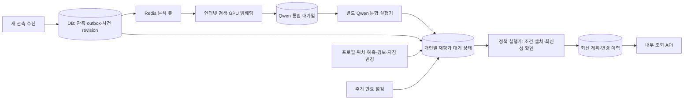

# 개인별 대응 계획의 자동 갱신 루프

후속 구현: 사용자 확정 3단계 **경고·대피·위급**, 공식 경보 및 알림 경로는 [현재 정책](response-policy.md)을 따른다. 아래의 단계 unknown·미발송 설명은 최초 루프 검증 당시의 이력이다.

기준: 2026-10-31 KST. Loom Task `task-20261031-112704-task-7e315021`.

새 관측이 수신되면 기존 분석 큐·인터넷 검색·GPU 임베딩·Qwen3 통합에서 사용자별 대응 계획 저장까지 자동으로 이어진다. 프로필·위치·예측·경보·지침·규칙 버전이 바뀌어도 재평가하며, 새 입력이 없어도 주기적으로 만료를 확인한다. 결과가 바뀌면 새 버전을 저장하고 변경 이력으로 조회한다.

**현재는 simulation 전용 내부 기능이다.** 회의 중인 대응 단계·확률 임계값·푸시 방식은 확정하지 않았다. 단계는 `unknown`, 규칙과 지침은 `draft` 또는 `simulation_only`, `operational_use=false`, 알림은 미발송으로 유지한다. 실제 승인된 개인별 대응 지침이나 국내 영향 예측의 운영 완료를 뜻하지 않는다.

## 실제 확인한 결과

최종 시연: **2026-10-31 20:40~20:41 KST**. [검증 결과 JSON](personal-policy-loop-evidence.json)에 실제 Qwen 응답·두 번의 관측 처리·사용자별 단계별 결과·새 입력 없는 만료 검사를 보관했다.

| 시나리오 | 확인한 결과 |
| --- | --- |
| 첫 관측 → 검색 → Qwen → 세 사용자 계획 | 공통 참고 항목 1개 / 이동 지원 항목 포함 2개 / 동반자 항목 포함 2개 |
| 예측 입력 | 합성 확률 0.73의 입력·버전 반영. 개인 대응 단계에는 사용하지 않음 |
| 첫 사용자의 프로필 변경 | 해당 사용자 행동이 1개에서 2개로 갱신. 나머지 두 사용자의 계획 버전은 그대로 |
| 두 번째 사용자의 위치 변경 | 지정 사각 구역 밖이면 `outside_scope`, 해당 사건의 행동 항목 제거. 안전 판정은 하지 않음 |
| 두 번째 관측 → 검색 → Qwen | 기존 사건의 revision 2로 다시 통합하고 사용자별 계획을 자동 갱신 |
| 규칙 버전 변경 | 같은 행동 내용이어도 적용한 정책 버전을 기록하고 계획 갱신 |
| 예측 불가 입력 | 확률을 `null`로 갱신하고 공식 경보 기록은 그대로 보존 |
| 위치 유효 기간 종료 | `needs_refresh`, 만료된 위치에 근거한 행동 제거 |
| 새 입력 없는 벽시계 검사 | 약 8초 후 계획 revision 1 → 2, `simulation_preview` → `needs_refresh` |

Qwen3-4B-Instruct-2507의 고정 revision `cdbee75f17c01a7cc42f958dc650907174af0554`를 실제 두 번 호출했다. 각각 입력 1,068 / 출력 378토큰, 모델 처리 약 15.14초였다. 이 시간은 전체 처리 지연이 아니다.

사건·공식 경보는 이전 영덕 과거 재생 자료다. **사용자, 위치, 사각 구역, 규칙과 확률은 모두 합성 시연**이다. 사각 구역은 실제 산불 경계가 아니며 0.73은 학습 중인 XGBoost의 실제 출력이 아니다. 현재 발효 중인 경보나 개인 피해 확률로 표시하지 않는다.

## 실행 구조



정책 실행기와 Qwen 실행기는 **다른 프로세스**다. Qwen이 지연되거나 실패해도 기본 지침 적용과 프로필·위치 갱신은 계속할 수 있다. Qwen의 자유 문장은 사건 설명으로만 보관하고 정책 행동·대응 단계·확률로 사용하지 않는다. 프로필과 개인 위치는 인터넷 검색어 또는 자동 Qwen 요약 입력에 넣지 않는다.

학습 실행기나 실제 수치 추론을 이 루프가 자동 실행하지는 않는다. 모델 추론 결과를 별도 예측 입력 API로 받으며, 아직 결과가 없으면 `unavailable`을 유지해도 정책 평가가 진행된다. 학습·국내 입력 정렬·확률 보정·운영 검증과 개인 정책 회의 결과는 별도다.

## DB와 갱신 규약

- `policy_scopes`: 시나리오 격리와 평가 시계. `evaluation_at=null`이면 벽시계, 날짜를 지정하면 고정된 재생 시각이다.
- `policy_entities`: 사용자 프로필·위치·사건·예측·경보·지침·규칙의 최신 버전. 입력마다 revision과 정규화된 본문 해시를 기록한다.
- `policy_integrations`: 관측 job과 사건 revision별 Qwen 처리 상태·재시도·임대·요청·원본 응답·검증된 인용. 완료된 옛 revision이 새 관측을 덮어쓰지 않는다.
- `policy_projections`: 사용자·사건별 최신 계획과 내구성 있는 재평가 요청/적용 번호. 입력과 재평가 요청을 같은 트랜잭션에 저장한다.
- `policy_snapshots`: 실제 내용·근거·적용 버전·상태가 바뀐 계획의 이력. 주기 점검만 반복되고 내용이 같으면 새 버전을 만들지 않는다.

새 revision만 적용한다. 같은 revision·본문은 중복으로 반환하고, 같은 revision의 다른 본문이나 낮은 revision은 409다. 같은 사건 revision을 서로 다른 관측 job에 연결하려면 새 사건 revision이 필요하다. 관측 수신과 정책 등록이 충돌하면 관측·outbox도 함께 롤백된다.

프로필·위치 변경은 해당 사용자, 사건·예측·경보 변경은 같은 시나리오의 해당 사건 후보 사용자, 지침·규칙 변경은 같은 시나리오의 계획을 재평가한다. 현재는 MVP 규모로 후보 쌍을 만들고 사각 구역 관련성을 계산한다. 전국 사용자 수를 대상으로 하는 공간 인덱스 기반 fan-out은 구현하지 않았다.

위치 시각·유효 기간·GPS 정확도를 검사한다. 오차 범위가 사각 경계와 겹치면 `uncertain`, 자료가 없거나 만료되면 `unknown`이다. 경도 경계를 넘는 구역은 지원하지 않고 경계 부근 불확실성을 보류한다. 이 사각 구역 비교는 대피 경로의 통행 가능성이나 안전성을 계산하지 않는다.

주기 점검 기본값은 30초, 실행기의 대기 간격은 2초다. 최종 시연은 점검도 2초로 설정했다. 재평가가 아직 끝나지 않았거나 기존 결과가 만료·실패 상태이면 조회 API는 옛 행동과 확률을 가려 오래된 계획이 최신처럼 제공되지 않게 한다. 공식 원문은 이력으로 보존한다.

## 기본 지침·규칙·공식 경보

[시연 규칙](../../../data/scenarios/policy-loop-rules.json)은 DB에 저장한 공통 참고 문구에 이동 지원·아이 동반 조건을 적용하는 예제다. 출처, 적용 기간, 지침 revision, 규칙 revision과 검토 상태를 보존한다. `draft` 지침·규칙이나 만료된 지침은 행동으로 선택하지 않는다. `simulation_only` 행동은 운영 미승인 상태로 명시한다. 운영 승인이나 대응 레벨 매핑을 API 입력으로 임의 추가하면 거부한다.

공식 경보의 기관 등급·대상 구역·원문·발령 시각은 별도 입력이다. 낮은 예측값이나 Qwen 요약으로 변경하지 않는다. `validity_confirmed=false`인 과거 발령 기록은 현재 유효한 경보로 취급하지 않으며, 캐시 만료를 공식 해제로 해석하지 않는다. 취소 상태는 별도 새 revision으로 받는다.

원문 조회 경로는 GPU나 정책 평가를 호출하지 않는다. 실제 urgent 수신·외부 긴급 알림·푸시 발송 경로는 이번에 구현하지 않았다. 개인 대응 단계와 알림 방식은 기존 D1 회의 결과를 기다린다.

## 내부 API

모든 경로는 `BONGHWA_SERVICE_TOKEN`의 Bearer 인증이 필요하다. 일반 앱 사용자용 JWT API와 별개이며 앱에 서비스 토큰을 넣으면 안 된다. 앱 저장소나 기존 `/v1/me` 초안을 구현한 것은 아니다.

공통 접두사: `/internal/v1/policy/scenarios/{scenario_id}`.

| 메서드·경로 | 역할 |
| --- | --- |
| `PUT /clock` | revision과 평가 시각 설정. 재생 시각 역행 금지 |
| `PUT /users/{user_id}/profile` | 이동 지원·아이 동반 플래그의 전체 스냅샷 |
| `PUT /users/{user_id}/location` | 좌표·정확도·관측/유효 시각 |
| `PUT /incidents/{incident_id}` | 구조화 사건 자료 직접 수신 |
| `PUT /incidents/{incident_id}/prediction` | 모의 예측 또는 예측 불가 수신 |
| `PUT /incidents/{incident_id}/alerts/{alert_id}` | 경보 발령/취소 기록 수신 |
| `GET /incidents/{incident_id}/alerts` | 정책·Qwen과 독립적인 원문 기록 조회 |
| `PUT /guidance/{guidance_id}` | 기본 참고 지침·출처·검토 상태·유효 기간 |
| `PUT /rules` | 적용 조건과 지침 ID·우선순위·규칙 버전 |
| `GET /users/{user_id}/plans/{incident_id}` | 최신 계획·revision·평가 시각·갱신 대기 여부 |
| `GET /users/{user_id}/plans/{incident_id}/history?after_revision=0` | revision 이후 이력 최대 100개 |
| `GET /integrations/{job_id}` | Qwen 작업·검증 결과·실제 생성 응답 |
| `POST /integrations/{job_id}/retry` | 실패한 Qwen 작업을 명시적으로 재시도 |

202는 DB 저장·재평가 요청 완료를 뜻하며 계획 생성 완료를 뜻하지 않는다. 계획 조회의 `pending_update=false`와 `revision`으로 최신 적용 여부를 확인한다. 실패한 작업은 최대 3회 자동 시도하며, 프로세스가 중단된 통합 작업은 임대 만료 후 다시 처리할 수 있다. 사용자별 평가 하나가 실패해도 다른 사용자의 처리를 계속한다.

기존 `POST /internal/v1/scenario-events`의 analysis payload에 다음 선택 필드를 추가하면 자동 루프에 연결된다. 아래는 **기존 payload에 추가하는 부분**이다.

```json
{
  "policy_context": {
    "incident_id": "fire",
    "incident_revision": 1,
    "expires_at": "2025-03-27T01:00:00+09:00",
    "area": {"west": 129.0, "east": 129.8, "south": 36.0, "north": 37.0}
  }
}
```

고정 예시는 과거 재생용이다. 관측 `as_of` 이후의 유효 기간과 같은 시나리오 평가 시계를 맞춰야 한다. 구역을 모르면 `area=null`로 넣고 위치 관련성을 보류한다. 같은 사건의 새 관측에는 새로운 event ID와 더 큰 incident revision을 쓴다. 이 필드가 없는 기존 분석 요청은 종전처럼 검색까지만 처리된다.

## 실행 방법

먼저 [분석 환경](analysis-retrieval-flow.md)의 DB/Redis·인증·임베딩 설정을 준비하고 migration을 적용한다.

```sh
docker compose -f deploy/compose/analysis-dev.yaml up -d --wait
BONGHWA_ENV_FILE=.env.analysis uv run --no-sync alembic upgrade head
```

GPU 터널은 별도 터미널에서 유지한다.

```sh
ssh -N -L 127.0.0.1:18001:127.0.0.1:8001 inno-gpu-011
```

아래 실행기는 localhost API, Redis 분석 워커, 분석 outbox, 정책 실행기, Qwen 통합 실행기를 함께 시작한다. 인증정보는 기존 비공개 환경 파일에서 읽는다.

```sh
BONGHWA_ENV_FILE=.env.analysis \
BONGHWA_POLICY_ENABLED=true \
BONGHWA_POLICY_QWEN_ENABLED=true \
BONGHWA_QWEN_REVISION=cdbee75f17c01a7cc42f958dc650907174af0554 \
uv run --no-sync python tools/serve_analysis.py
```

다른 터미널에서 실행한다.

```sh
BONGHWA_ENV_FILE=.env.analysis uv run --no-sync python tools/run_policy_loop_demo.py
```

전체 로컬 결과는 `data/artifacts/policy-loop-demo.json`에 저장한다. 마지막 검증 원본은 `data/artifacts/policy-loop-final.json`이다. 둘 다 Git 제외다. `--report`로 다른 경로를 지정할 수 있다. Ctrl+C는 실행기와 자식 프로세스를 종료한다. 이번 검증 후 로컬 실행기와 터널·DB/Redis를 정리하며 자료 볼륨은 유지한다.

개별 실행은 `python -m bonghwajigi.workers.policy_loop --mode plans` 또는 `--mode integrations`를 사용하고 `--once`를 붙이면 한 배치만 처리한다. 일반 Compose에는 `policy`, `policy-qwen` 프로필을 추가했으며 해당 환경 플래그를 함께 설정해야 한다. 기본값은 비활성화다. 실제 일반 서버 배포·상시 프로세스 설치는 수행하지 않았다.

## 검증과 남은 연결

실제 PostgreSQL 검사를 포함한 **57개 테스트**, Ruff 검사·포맷, Alembic 코드/DB 일치, Compose 설정과 기존 앱 API 계약 검사를 통과했다. 현재 Starlette TestClient의 기존 httpx deprecation 경고 1개가 남는다.

검증 범위는 세 사용자 개인화, 입력 멱등성·역순 거부, 같은 레벨의 행동 변경, 규칙/지침 수정·만료, 위치 오차·만료, 공식 원문 보존·취소, 예측 불가, Qwen 장애 시 기본 문구 유지, 재시도/임대 복구, 늦은 Qwen 완료의 덮어쓰기 방지, 사용자별 실패 격리, 주기 갱신과 변경 없는 이력 억제다.

학습 결과를 국내 사용자 위치에 맞는 검증된 예측으로 만드는 연결, 회의에서 확정할 운영 정책·레벨·알림 규칙, 앱 사용자 인증과 조회 어댑터는 아직 남아 있다. Qwen의 인용 일치 검사는 요약의 의미·사실성이나 정책 승인을 보장하지 않는다. 부하·프로세스 강제 종료·장기 운영·원격 CI는 검증하지 않았다.
